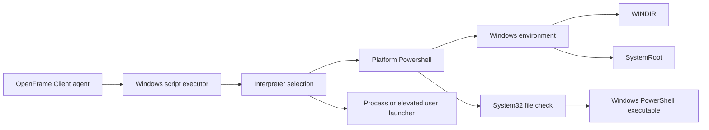
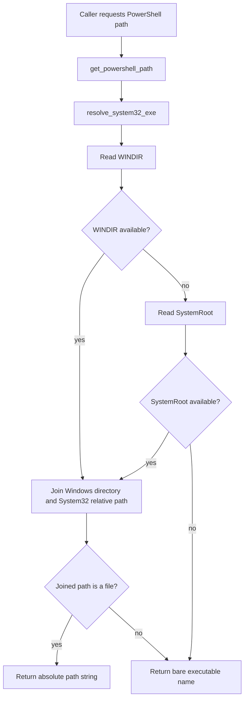
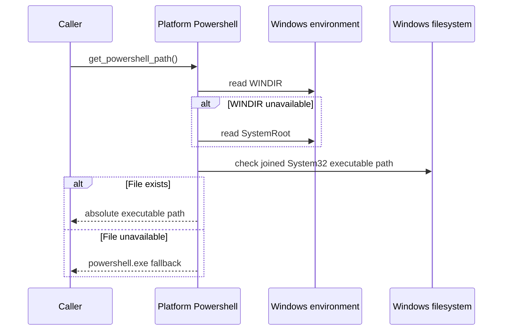
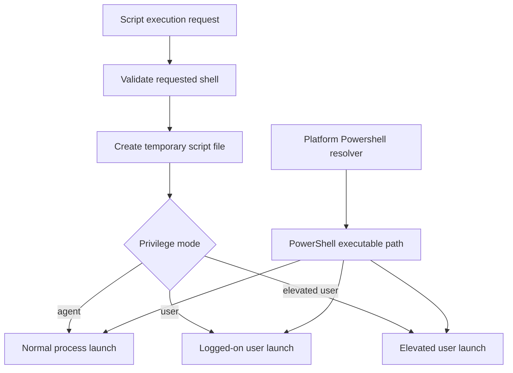

# Platform Powershell

Platform Powershell is the Windows-specific executable-resolution utility used by the OpenFrame Client agent. It selects the Windows PowerShell executable from the operating system's System32 directory when that binary exists, rather than accepting whichever executable is found first through `PATH`. If the operating-system path cannot be established or the expected executable is absent, it returns the supplied bare executable name so normal process resolution remains available.

This module is implemented by the `openframe_agent_lib` Cargo dependency from **OpenFrame OSS Library**. Its two functions are conditionally compiled only for Windows, so it has no exported implementation in non-Windows agent builds. The authoritative source is [powershell.rs](https://github.com/flamingo-stack/openframe-oss-lib/blob/16e7c1cbd9664e7d10ec5ebca7d53c9bd314decf/clients/openframe-client/src/platform/powershell.rs).

## Responsibilities

- Resolve the conventional Windows PowerShell executable at `System32\WindowsPowerShell\v1.0\powershell.exe` beneath the Windows directory.
- Prefer `WINDIR` and use `SystemRoot` when `WINDIR` is unavailable.
- Confirm that the joined path identifies a file before returning it.
- Provide a caller-defined fallback name when no verified absolute executable path is available.
- Keep executable selection separate from process spawning, argument construction, elevation, and script lifecycle management.

The module does not launch PowerShell, validate its version, alter execution policy, or report a structured error. Both public functions return a `String`; callers receive either the verified absolute path or the fallback value.

## Architecture and Placement

The module belongs to the OpenFrame Client's platform layer. It is a narrow resolver that converts Windows environment state plus a relative System32 location into a launchable executable string. Windows script execution is a neighboring concern: the executor creates a temporary script, chooses an interpreter, then runs it normally or through an interactive-user elevation path. Platform Powershell supplies a trusted path-selection primitive rather than coordinating that execution flow.

### Component Inventory

| Component | Role | Result |
|---|---|---|
| `get_powershell_path` | Resolves the standard Windows PowerShell executable for agent use. | An absolute System32 path when verified; otherwise `powershell.exe`. |
| `resolve_system32_exe` | Generic resolver for an executable located beneath the Windows directory. | A verified absolute path for `system32_rel`, or the supplied `bare` fallback. |

## Resolution Contract

`get_powershell_path` is a specialization of `resolve_system32_exe`. It passes the relative PowerShell location and the `powershell.exe` fallback name. The generic function makes the same behavior reusable for a different System32 executable without duplicating environment-variable and existence-check logic.

### Detailed Behavior

1. `resolve_system32_exe` reads `WINDIR` using an OS-native environment value, preserving non-Unicode path data until conversion is required.
2. If `WINDIR` is not set, it attempts `SystemRoot`.
3. If either variable produces a base directory, it appends the caller's relative System32 path with `PathBuf::join`.
4. It tests the resulting path with `is_file`. A directory, missing path, or inaccessible path that does not satisfy this test does not qualify.
5. For a qualifying file, it converts the path with lossy string conversion and returns it.
6. In every other case, it returns the caller's bare executable name unchanged.

The fallback is intentional availability behavior, not validation. A subsequent launcher may resolve the bare name through the operating system's normal executable lookup. Consequently, callers that require strict path pinning must verify or reject the fallback themselves.

## Component Interaction

The OpenFrame Client's Windows executor handles script materialization, shell support checks, privilege selection, and one of two launch paths. Platform Powershell is orthogonal to those mechanics: it supplies an executable identifier that an interpreter-selection or launching component can consume. The supplied core components establish the boundaries below; they do not establish a direct call from `execute_script` to `get_powershell_path`.

## Security and Operational Rationale

Using the System32 binary when present produces a deterministic executable location and reduces exposure to a conflicting `PATH` entry. It also supports environments where security controls permit PowerShell based on its executable path. The existence check avoids returning a constructed but nonexistent path when environment variables are stale, customized, or incomplete.

The behavior has important limits:

- It targets **Windows PowerShell** at the conventional version 1.0 directory path, not PowerShell 7 or another shell host.
- It does not establish that the returned executable is signed, trusted, allowed by policy, or successfully runnable.
- The bare fallback restores compatibility but reintroduces ordinary executable-search semantics.
- The `cfg(windows)` gate means cross-platform callers must select platform-appropriate behavior at compile time rather than expecting this utility on macOS or Linux.

## Relationship to Script Execution

The Windows script executor accepts a script shell, rejects unsupported values, creates a temporary script file, and selects one of three privilege behaviors: agent, logged-on user, or elevated user. It then starts the script using the selected interpreter. Platform Powershell is best understood as an executable-discovery dependency that can feed this type of workflow, while the executor retains ownership of execution and cleanup.

## Maintenance Guidance

When changing Platform Powershell, preserve these invariants:

- Keep the System32 relative path and fallback name paired in `get_powershell_path`.
- Preserve the `WINDIR` then `SystemRoot` precedence unless there is an explicit compatibility reason to change it.
- Use path operations rather than manual string concatenation so Windows path construction remains correct.
- Retain the `is_file` guard before returning an absolute path.
- Treat a fallback return as distinct from confirmation that PowerShell can launch.

A focused test matrix should cover: a valid `WINDIR` location; `WINDIR` absent with a valid `SystemRoot`; both variables absent; a base directory with a missing target file; and a target that is a directory rather than an executable file. Tests should assert the returned string in each case and should isolate environment-variable changes to avoid cross-test interference.

## Source Boundaries

Platform Powershell is library code supplied by **OpenFrame OSS Library**, artifact `openframe_agent_lib` version `v0.0.5`, which this repository consumes. The repository assembles the OpenFrame Client service around that library; it does not define the module's implementation here.