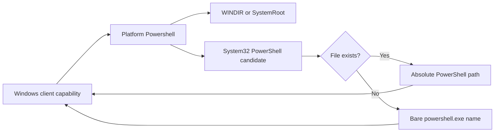
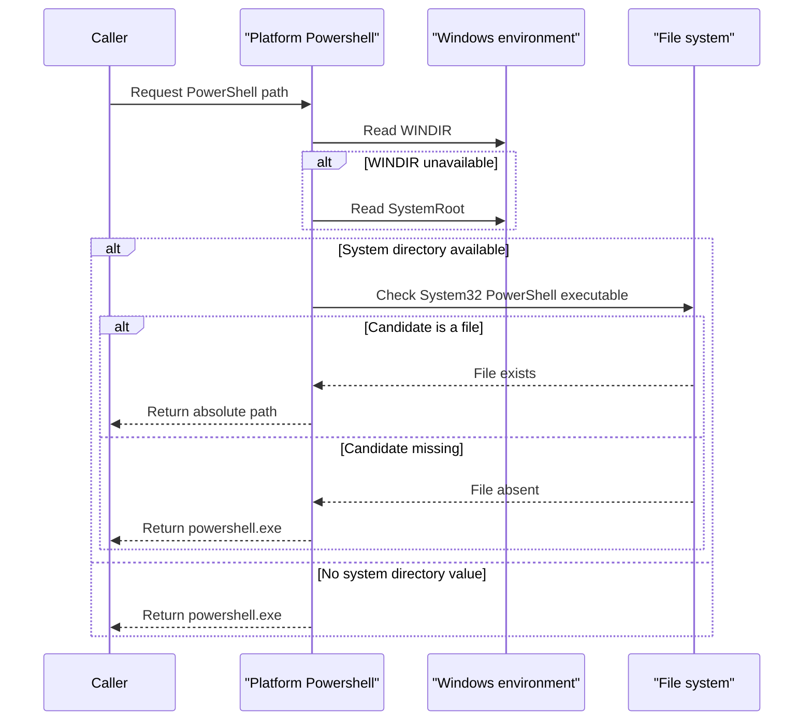
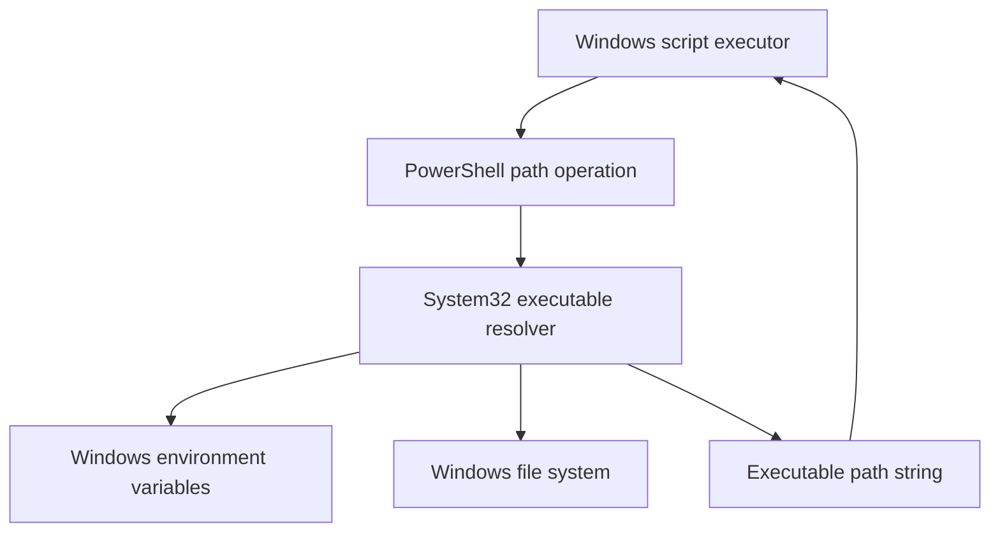

# Platform Powershell

Platform Powershell is the Windows-specific executable resolver used by the OpenFrame client agent. It selects the operating system's PowerShell executable by its System32 location when that file exists, with a bare executable name as a compatibility fallback. This prevents an entry earlier in `PATH` from changing which PowerShell process an agent starts, while retaining a usable result on incomplete or unusual Windows installations.

The implementation is supplied by the `openframe_agent_lib` Cargo artifact from the OpenFrame OSS Library and is run by this repository's OpenFrame client. Its two public operations are compiled only for Windows.

## Responsibilities

- Resolve the Windows PowerShell executable from the Windows system directory.
- Prefer the `WINDIR` environment value and use `SystemRoot` when `WINDIR` is unavailable.
- Verify that the candidate is an existing regular file before selecting it.
- Return `powershell.exe` when no usable absolute path can be established.

The module does not launch PowerShell, construct command-line arguments, elevate a process, or validate a script. Those responsibilities remain with the client execution and permissions facilities.

## Architecture

The public PowerShell-path operation delegates to a general System32 resolver. The general resolver accepts a System32-relative executable location and a fallback name; the PowerShell-specific operation supplies the Windows PowerShell version 1.0 location and the `powershell.exe` fallback.

## Resolution Flow

### Decision Details

1. The resolver reads `WINDIR` first, then attempts `SystemRoot` only if the first variable is absent.
2. It appends the configured System32-relative executable path to the selected Windows directory.
3. It accepts the constructed candidate only when the filesystem reports a regular file.
4. It converts the accepted path to a string without rejecting non-Unicode path data.
5. It returns the supplied bare name whenever the environment does not yield a valid candidate.

This is deliberately a resolution policy rather than a discovery search. It does not inspect `PATH`, search alternate PowerShell installations, or probe PowerShell versions. As a result, a valid System32 executable is deterministic and cannot be shadowed by a `PATH` entry. The fallback delegates normal executable lookup to the eventual process launcher.

## Component Interaction

Within the client, Windows script execution is the primary consumer-facing context for this resolved value: the module provides an executable-path string that an executor can use when preparing a PowerShell process. The surrounding client platform layer also contains related responsibilities for permissions, service management, binary updates, and process handling, but Platform Powershell has no direct side effects on those areas.

## Platform and Failure Behavior

| Condition | Returned value | Rationale |
|---|---|---|
| `WINDIR` identifies a directory containing the expected System32 executable | Absolute executable path | Uses the trusted operating system location. |
| `WINDIR` is unavailable and `SystemRoot` identifies a valid executable | Absolute executable path | Preserves the same policy using the alternative Windows variable. |
| Both directory variables are unavailable | Bare executable name | Allows the caller's normal process resolution to proceed. |
| A directory variable is present but the expected file is absent | Bare executable name | Avoids returning a nonexistent absolute path. |
| The build target is not Windows | No operation is compiled from this module | The APIs are guarded by a Windows compilation condition. |

## Security Considerations

Using an absolute System32 path is a security and operational compatibility measure. It avoids selecting a same-named executable from `PATH` and gives security tooling a stable executable location to match. The fallback is less constrained because it relies on later process lookup; maintainers should preserve the System32 preference and the file-existence check when modifying this behavior.

The resolver uses only local environment data and a filesystem metadata check. It does not access the network, execute a command, modify files, or perform privilege escalation.

## Maintenance Notes

- Keep the general resolver parameterized so other Windows System32 executables can use the same environment and existence policy.
- Treat a non-file candidate as invalid; returning an absolute directory or missing path would shift failure later and obscure the cause.
- Preserve the `WINDIR` then `SystemRoot` precedence unless Windows environment compatibility requirements change.
- Test the valid primary variable, alternative-variable fallback, absent-variable fallback, and missing-file fallback on a Windows target.

## Source

The implementation is maintained in the OpenFrame OSS Library: [Platform Powershell source](https://github.com/flamingo-stack/openframe-oss-lib/blob/7a766f00e4f58b5d89db007b878ac8d6e0c344f4/clients/openframe-client/src/platform/powershell.rs). The consuming repository publishes a Cargo client package and uses OpenFrame OSS Library version `7.0.11` for the corresponding library dependency.
