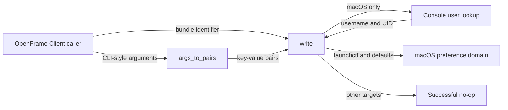
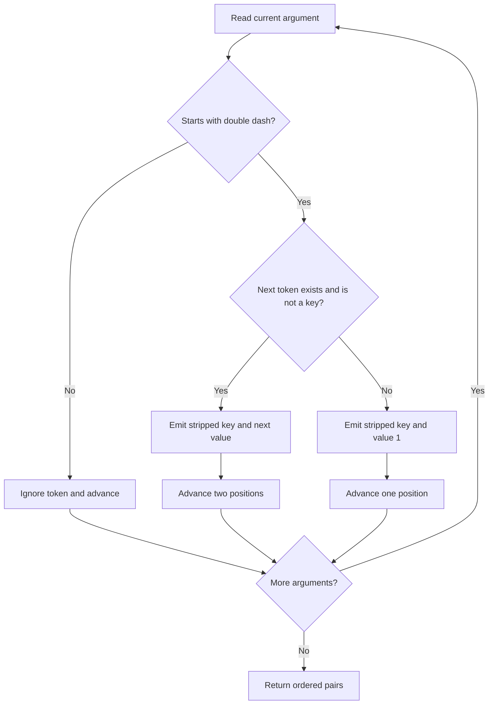
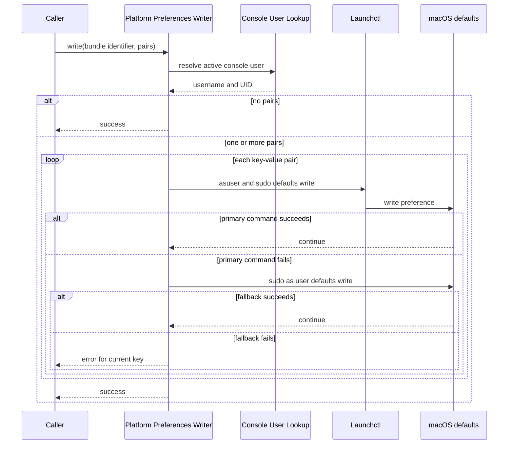
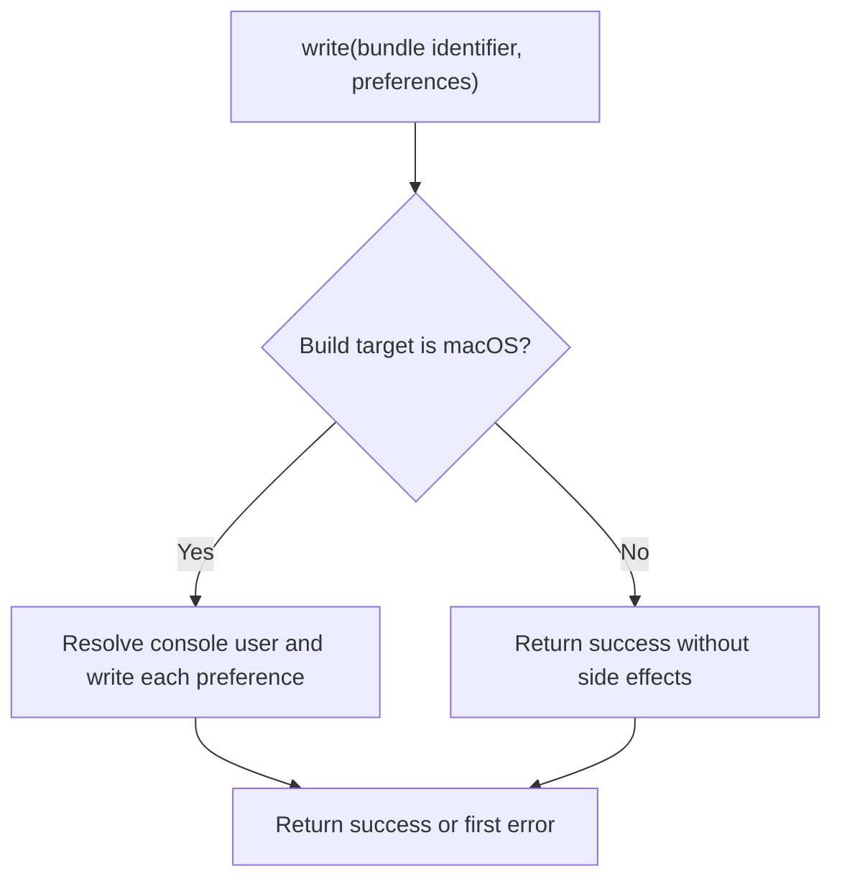

# Platform Preferences Writer

Platform Preferences Writer is a small OpenFrame Client platform utility that turns command-line-style preference arguments into key-value pairs and, on macOS, writes them to a bundle preference domain for the actively logged-in console user. It is implemented by the `openframe_client` code supplied by the OpenFrame OSS Library; this tenant repository assembles that library into its client runtime.

The implementation is source-controlled in the [OpenFrame OSS Library preferences writer](https://github.com/flamingo-stack/openframe-oss-lib/blob/7a766f00e4f58b5d89db007b878ac8d6e0c344f4/clients/openframe-client/src/platform/preferences_writer.rs).

## Purpose and Scope

The module exposes two functions:

| Function | Responsibility | Platform behavior |
|---|---|---|
| `args_to_pairs` | Parses a slice of CLI-style strings into borrowed preference key-value pairs. | All targets |
| `write` | Persists pairs through the macOS `defaults write` utility under a specified bundle identifier. | Functional on macOS, successful no-op on other targets |

The module does not validate bundle identifiers, preference keys, preference value types, or duplicate keys. It also does not read preferences or provide transaction semantics across multiple writes. Those concerns belong to the caller or the operating system preference tooling.

## Architecture and Placement

Platform Preferences Writer belongs to the OpenFrame Client's platform layer. It has a deliberately narrow boundary: callers provide already-selected arguments and a target bundle identifier; the module obtains the interactive macOS user and invokes operating-system commands only on macOS.



### Runtime Dependencies

| Dependency | Role in the write path |
|---|---|
| `get_console_user` | Finds a regular console user's username and numeric UID. It reads the `/dev/console` owner through `stat`, then resolves the UID with `id`. If no eligible console user is found, the write operation fails with context. |
| `launchctl` | Runs the primary command in the interactive user's launch context through `launchctl asuser`. |
| `sudo` | Switches the command to the console user's account. It is used inside the primary command and as the outer fallback command. |
| `defaults` | Performs the per-key write to the supplied bundle preference domain. |
| `anyhow` | Supplies errors and contextual failure messages in the macOS implementation. |

The console-user dependency is also part of the OpenFrame OSS Library. Its documented source behavior is visible in the [macOS user-session implementation](https://github.com/flamingo-stack/openframe-oss-lib/blob/7a766f00e4f58b5d89db007b878ac8d6e0c344f4/clients/openframe-client/src/platform/user_session/macos.rs).

## Argument Parsing

`args_to_pairs` scans left to right and considers only tokens beginning with `--` to be keys. For each key it examines the immediately following token:

1. When the next token exists and does not begin with `--`, it becomes the value and both tokens are consumed.
2. When there is no next token, or the next token also begins with `--`, the key is treated as a flag with value `"1"`; only the key token is consumed.
3. Tokens without the `--` prefix are ignored.



For example, the following input produces three ordered pairs. The positional token is ignored, and `--devMode` is a flag because it is immediately followed by another key.

```rust
let args = vec![
    "--serverUrl".to_owned(),
    "https://example.invalid".to_owned(),
    "positional".to_owned(),
    "--devMode".to_owned(),
    "--region".to_owned(),
    "us-east".to_owned(),
];

let preferences = args_to_pairs(&args);
// [("serverUrl", "https://example.invalid"), ("devMode", "1"), ("region", "us-east")]
```

The returned pairs borrow from the input strings. Therefore, the original argument vector must remain alive while a caller uses the returned values, including when passing them to `write`.

## macOS Preference Write Flow

On macOS, `write` first resolves the console user and collects the caller's iterable into a vector. Console-user resolution occurs before the empty-preferences shortcut, so an empty write still requires an eligible console user. Once a user is available, an empty vector returns success without launching any commands.

For each pair, the module attempts the primary command first:

```bash
launchctl asuser USER_UID sudo -u USERNAME defaults write BUNDLE_ID KEY VALUE
```

If that command returns a non-success status, it retries the same `defaults write` operation without `launchctl`:

```bash
sudo -u USERNAME defaults write BUNDLE_ID KEY VALUE
```

The identifiers in these commands represent values selected at runtime, not shell interpolation performed by the module. The Rust process API passes them as individual command arguments.



### Failure and Completion Semantics

- Failure to identify a console user is returned as an error with the context `No console user found`.
- Failure to start either command is returned with context naming the affected preference key.
- A non-zero primary command is not immediately fatal; it triggers the fallback command.
- A non-zero fallback command stops processing and returns an error containing the key and fallback status.
- Keys are written sequentially. If a later pair fails, earlier writes remain applied; the module does not roll them back.
- Repeated keys are processed in input order. The final system value is determined by the last successful `defaults write` for that key.

## Non-macOS Behavior

The non-macOS `write` implementation accepts the same API but immediately returns success. It neither resolves a user nor iterates the supplied preferences. This makes preference application portable for callers while intentionally avoiding unsupported OS-level behavior outside macOS.



## Integration Guidance

Callers typically compose the two functions by converting command-line arguments and passing the resulting pairs to the writer. Keep parsing and writing close together so the borrowed values remain valid.

```rust
let pairs = args_to_pairs(&arguments);
write("com.example.desktop-tool", pairs)?;
```

When integrating the module:

- Supply only arguments intended for preference persistence. Non-option values are silently discarded by the parser.
- Use an argument value after a key when a literal preference value is required; a missing value becomes `"1"`.
- Treat a successful non-macOS call as compatibility behavior, not confirmation that a preference was stored.
- Surface errors from `write` to installation or launch orchestration, because the module stops at the first key whose primary and fallback commands both fail.
- Avoid assuming all supplied preferences are committed together. Design retries to be safe if earlier keys have already been written.

## Maintenance Notes

Changes to parsing rules are externally observable by every caller that constructs macOS preference settings from command-line-style tokens. In particular, preserve the distinction between a following value and a following `--` key, and retain the ordered output unless callers are deliberately migrated.

Changes to the macOS command sequence should preserve execution as the actual console user. The primary `launchctl asuser` route addresses the user's launch context, while the fallback maintains a best-effort path when that route returns a failing status. Any new behavior should be tested on macOS as well as on a non-macOS target, where `write` must remain side-effect free.
