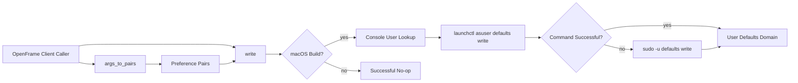
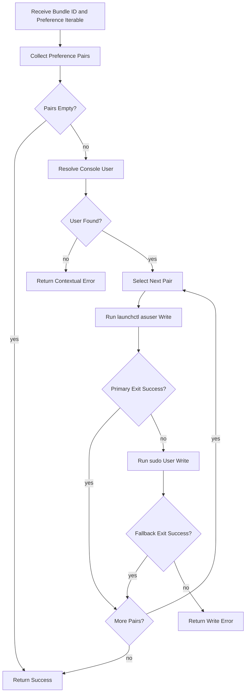
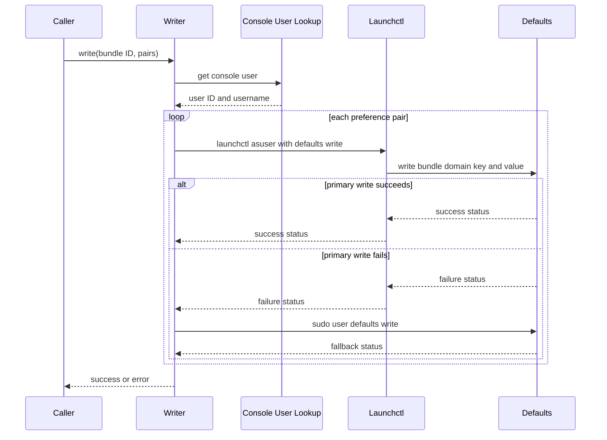

# Platform Preferences Writer

Platform Preferences Writer is a small, macOS-aware utility in the OpenFrame client agent. It converts command-line-style configuration arguments into preference pairs and, on macOS, writes those pairs into an application's `defaults` domain as the active console user. On Linux and Windows, the write operation deliberately succeeds without changing host preferences, allowing cross-platform callers to use one interface.

The implementation is supplied by the OpenFrame OSS Library as part of the `openframe_agent_lib` Cargo artifact, version `v0.0.5`, which this repository consumes for the OpenFrame client runtime. Its source is maintained in the [OpenFrame OSS Library preferences writer](https://github.com/flamingo-stack/openframe-oss-lib/blob/16e7c1cbd9664e7d10ec5ebca7d53c9bd314decf/clients/openframe-client/src/platform/preferences_writer.rs).

## Responsibilities

- Parse options prefixed with `--` into borrowed key-value pairs.
- Represent a standalone option as an enabled flag with the value `"1"`.
- On macOS, determine the logged-in console user before writing preferences.
- Prefer a `launchctl asuser` execution context and fall back to `sudo -u` when that command exits unsuccessfully.
- Fail with context when no console user can be identified, a command cannot be started, or both write attempts fail.
- Preserve portable behavior by making preference writes no-ops outside macOS.

## Architecture and Scope

The module has two public functions: `args_to_pairs` performs in-memory parsing, while `write` applies an iterable of preference pairs. The macOS implementation depends on the client platform user-session capability to identify the target user. It then invokes system utilities rather than directly editing preference files.



### Runtime Dependencies

| Dependency | Role | Platform |
|---|---|---|
| `get_console_user` | Obtains the active console user's numeric identifier and username. | macOS only |
| `launchctl` | Runs `defaults write` in the console user's launch context. | macOS only |
| `sudo` | Executes the fallback `defaults write` as the console user. | macOS only |
| `defaults` | Updates the supplied application bundle identifier's preference domain. | macOS only |
| `anyhow` | Adds contextual errors and creates terminal failures. | macOS error paths; return type on other platforms |

The module does not persist data itself, expose network endpoints, or contact OpenFrame backend services. The operating system owns the final preference storage.

## Component Reference

### `args_to_pairs`

`args_to_pairs(args: &[String]) -> Vec<(&str, &str)>` scans the argument slice from left to right and returns references into the original strings. The caller must therefore keep the input slice alive for as long as the returned pairs are used.

Parsing rules are intentionally simple:

| Input token pattern | Output | Scanner movement |
|---|---|---|
| `--key value` where `value` does not begin with `--` | `("key", "value")` | Consumes both tokens |
| `--flag` at the end of input | `("flag", "1")` | Consumes one token |
| `--flag --next` | `("flag", "1")`, then parses `--next` | Consumes one token for each flag |
| A token without a `--` prefix | No pair | Consumes one token |

For example:

```text
Input:  ["--serverUrl", "https://example.invalid", "--devMode", "positional"]
Output: [("serverUrl", "https://example.invalid"), ("devMode", "positional")]
```

A token after an option is treated as that option's value whenever it does not start with `--`; the parser does not distinguish positional values from explicit option values. Likewise, a value that begins with `--` cannot be represented as a value through this format because it is interpreted as the next option.

### `write`

`write(bundle_id, prefs)` accepts a bundle identifier and any iterable yielding key-value string pairs.

On macOS, it first resolves the console user and materializes the iterable into a vector. Materialization makes it possible to test whether there is work before issuing commands. An empty collection returns successfully and does not need to run `defaults`.

For every pair, the primary command is equivalent in structure to:

```text
launchctl asuser USER_ID sudo -u USERNAME defaults write BUNDLE_ID KEY VALUE
```

If the primary process completes with a non-zero status, the module retries that individual pair with:

```text
sudo -u USERNAME defaults write BUNDLE_ID KEY VALUE
```

The fallback is not attempted when the primary process could not be spawned; that condition returns an error annotated with the preference key. If the fallback exits unsuccessfully, the function returns an error and later pairs are not processed. Earlier successful writes remain applied; the operation is sequential and is not transactional.

On non-macOS targets, the function ignores both parameters and returns `Ok(())`. This is a compile-time platform split rather than a runtime emulation of macOS preferences.

## Preference Write Flow



## Command Interaction

The following sequence shows the successful primary path and the fallback path. Each preference is handled independently, so a fallback for one key does not affect the choice of primary command for the next key.



## Error Handling and Operational Consequences

| Condition | Result |
|---|---|
| No console user is available | The macOS write fails before any preference is applied. |
| Primary command cannot be started | The write fails with the key in the error context; no fallback is attempted for that key. |
| Primary command exits unsuccessfully | The fallback command is attempted for the same key. |
| Fallback cannot start or exits unsuccessfully | The write fails and no later preference pairs are processed. |
| Input has no recognized options | Parsing returns an empty vector; a subsequent macOS write returns successfully without command execution. |
| Target is not macOS | `write` returns successfully without resolving a user or changing preferences. |

Callers should treat the macOS function as a best-effort sequence only when partial application is acceptable. If multiple preferences must change atomically, the caller needs its own compensating strategy because Platform Preferences Writer does not roll back successfully written keys.

## Maintenance Notes

- Keep `args_to_pairs` deliberately conservative unless its command-line contract changes. Its borrowed output avoids allocation for keys and values but ties result lifetimes to the input list.
- Do not pass untrusted keys, values, or bundle identifiers without applying the caller's own validation policy. The module forwards each value as a separate process argument, which avoids shell interpolation, but it intentionally permits any string accepted by `defaults`.
- Changes to the macOS execution path must preserve the console-user context. Running `defaults` as the agent service account could update the wrong preference domain.
- Test both primary and fallback outcomes when changing process execution. In particular, distinguish a non-zero exit status from a process-spawn failure because only the former triggers the fallback.
- Maintain the non-macOS no-op behavior unless all callers are updated to use platform-specific handling.

## Relationship to the OpenFrame Client

Platform Preferences Writer belongs to the Rust OpenFrame client platform layer. It is narrowly focused on user-scoped macOS preferences and complements platform services that handle user sessions, directories, permissions, service lifecycle, tool installation, and application updates. It does not implement agent registration, authentication, command delivery, or tool management; those concerns are handled elsewhere in the client runtime and backend services.
