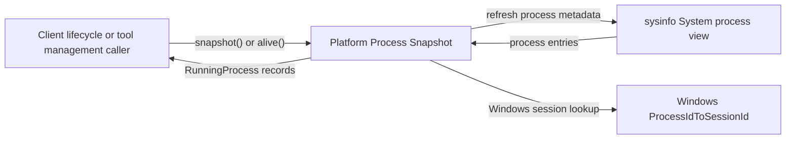
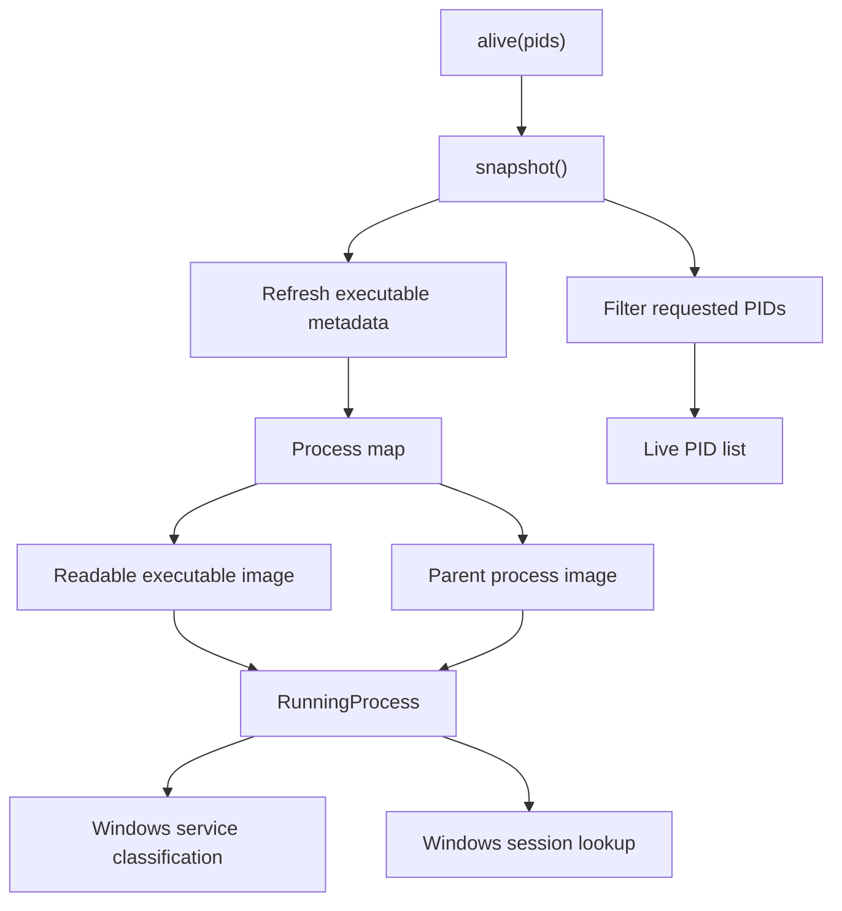
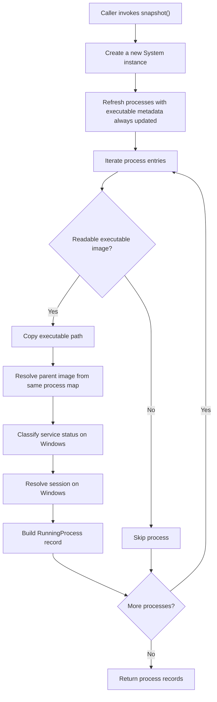
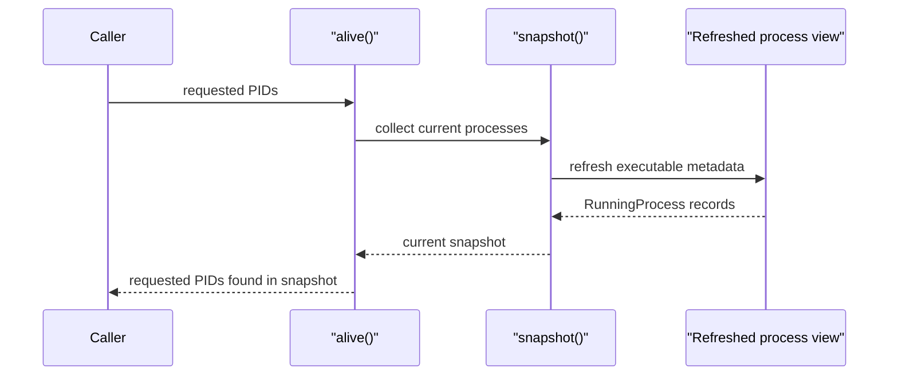

# Platform Process Snapshot

Platform Process Snapshot is a small, read-only process-inspection utility used by the OpenFrame client agent. It is implemented in the `openframe_agent_lib` crate supplied by the OpenFrame OSS Library and is run on managed endpoints by this repository's OpenFrame Client deployment. Its source is maintained in the [OpenFrame OSS Library process snapshot implementation](https://github.com/flamingo-stack/openframe-oss-lib/blob/7a766f00e4f58b5d89db007b878ac8d6e0c344f4/clients/openframe-client/src/platform/process_snapshot.rs).

The module converts the operating system process table into a compact `RunningProcess` record. It exposes two operations:

- `snapshot()` collects every discoverable process that has a readable executable image.
- `alive(pids)` reports which requested process identifiers still occur in a freshly collected snapshot.

This boundary centralizes platform-specific details needed by higher-level client lifecycle, update, and tool-management code without creating or stopping processes itself.

## Responsibilities and Boundaries

| Responsibility | Implementation | Result |
|---|---|---|
| Enumerate processes | `snapshot()` creates and refreshes a `sysinfo::System` process view. | One `RunningProcess` record per process with a readable executable path. |
| Identify executable images | The process executable path is copied into `image`. | Callers can compare executable locations rather than relying only on a process name. |
| Capture parent context | The parent process is resolved from the same in-memory process map. | `parent_image` identifies the parent executable when it remains available. |
| Recognize Windows services | The parent executable name is compared with `services.exe` on Windows. | `is_service` is true only for processes detected as service-control-manager children. |
| Associate Windows sessions | Windows calls `ProcessIdToSessionId`. | `session` carries a session identifier when the operating system provides one. |
| Check liveness | `alive()` filters a new snapshot against requested identifiers. | A list of requested identifiers still visible in the refreshed process view. |

The module deliberately does not retain a system handle or cache snapshots. Each public operation observes the process table at its own point in time. It also does not infer process identity from a PID alone across time: callers that need stronger identity guarantees must combine the returned PID with their own lifecycle controls.

## Architecture



### Component Relationships



The source module belongs to the OpenFrame client platform layer. Its immediate dependency is the Rust `sysinfo` process API. The session lookup uses the Windows API only in Windows builds; non-Windows builds compile a replacement that returns no session. Higher-level callers decide how to react to the resulting process facts, keeping process enumeration separate from update, installation, and termination policy.

## Data Model

`RunningProcess` is the snapshot contract:

```rust
pub struct RunningProcess {
    pub pid: u32,
    pub image: PathBuf,
    pub parent_image: Option<PathBuf>,
    pub is_service: bool,
    pub session: Option<u32>,
}
```

| Field | Meaning | Availability and semantics |
|---|---|---|
| `pid` | Operating-system process identifier. | Present for every returned record. |
| `image` | Filesystem path of the process executable. | A record is emitted only when this path can be read. |
| `parent_image` | Filesystem path of the parent executable. | Absent when there is no parent, the parent has exited, or its executable path is unavailable. |
| `is_service` | Whether the process was started by the Windows Service Control Manager. | True only on Windows when the resolved parent file name equals `services.exe`, ignoring ASCII case. Always false on non-Windows builds. |
| `session` | Windows session identifier. | Present only on Windows when `ProcessIdToSessionId` succeeds. Always absent on non-Windows builds. |

`RunningProcess` derives `Debug`, `Clone`, `PartialEq`, and `Eq`, which makes records straightforward to log, duplicate, and compare in client code and tests.

## Snapshot Collection Flow



### Refresh Scope

The refresh is intentionally specific: the `sysinfo` process view is refreshed with executable metadata configured to update on every snapshot. This is significant because `image`, parent-derived service detection, and any caller comparison by executable location depend on current executable path information. Other process attributes are not part of this module's output contract.

### Parent Resolution

Parent data is best effort. The module first retrieves the process's parent PID, then looks up that PID in the very same snapshot map, then reads that parent executable path. Any failure in this chain produces `None` for `parent_image`; it does not discard the child process record. This preserves useful process information while accurately representing an incomplete parent relationship.

## Liveness Query Flow



`alive()` is a convenience query rather than a separate operating-system probe. It calls `snapshot()` and returns only requested PID values for which a snapshot record exists. Consequently, a process without a readable executable image is excluded from both `snapshot()` and `alive()`, even if the operating system still has that PID. The output preserves the order and duplicates of the input PID slice because it filters the original input iterator.

## Platform Behavior

| Platform | Session behavior | Service behavior | Process image and parent behavior |
|---|---|---|---|
| Windows | Calls `ProcessIdToSessionId`; failures become `None`. | Checks whether the parent executable is named `services.exe`, using case-insensitive ASCII comparison. | Uses `sysinfo` executable and parent data; unreadable child images are omitted. |
| Non-Windows | Always returns `None`. | Always returns `false`. | Uses the same `sysinfo` collection and parent-image best-effort logic. |

The compile-time conditional implementations avoid invoking Windows APIs outside Windows builds. The public data model stays consistent across platforms, allowing callers to consume optional fields rather than maintaining separate interfaces.

## Operational Considerations

- **Point-in-time observation:** Processes can start or exit before, during, or after collection. The returned vector is a best-effort view rather than a transactional operating-system inventory.
- **Permission and visibility limits:** Only processes with readable executable paths are represented. A missing process in `alive()` means it was not represented in the new snapshot, not necessarily that a PID can never exist.
- **Parent races:** A parent may exit between the child's enumeration and parent lookup, yielding no parent image while retaining the child record.
- **Windows service heuristic:** Service status is intentionally derived from the parent image name. It describes the observed launch relationship and is not a universal service-management query.
- **PID reuse:** PID values may be reused by an operating system. A long-lived workflow should not treat a later positive PID match as proof that it is the original executable without also validating `image` or applying its own lifecycle guard.
- **Cost:** Every `snapshot()` and `alive()` call builds a fresh `sysinfo::System` and refreshes process executable metadata. Callers that need multiple related decisions should reuse one returned snapshot where their own consistency requirements permit it.

## Maintenance Guide

When changing Platform Process Snapshot, preserve the following contract points unless coordinated changes are made with its client-layer callers:

1. Keep unreadable child executable paths out of the returned snapshot. This is the current inclusion rule used by `alive()`.
2. Keep parent lookup optional and non-fatal; parent image unavailability must not remove an otherwise valid child record.
3. Preserve platform-neutral fields and their documented fallback values: non-Windows session is absent and non-Windows service status is false.
4. Treat the Windows `services.exe` check as a heuristic coupled to parent executable discovery. If changing it, review consumers that distinguish service-hosted and user-session processes.
5. Retain the fresh-snapshot behavior of `alive()` unless callers are explicitly migrated to a cached or injected process view.
6. Add or update the co-located `process_snapshot_tests.rs` test module when changing filtering, parent resolution, platform fallback, or liveness semantics.

## System Context

OpenFrame OSS Tenant publishes and deploys the OpenFrame Client alongside platform services. The client agent functionality documented here is supplied by the OpenFrame OSS Library's `openframe_agent_lib` dependency, pinned for this repository at version `v0.0.5`. Platform Process Snapshot is local endpoint plumbing: it supplies process facts that client update and integrated-tool workflows may use, while application services, messaging, policy, and delivery remain outside this module's responsibility.
