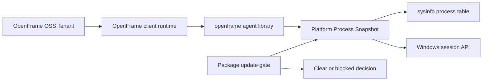
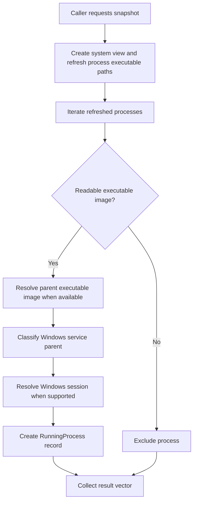
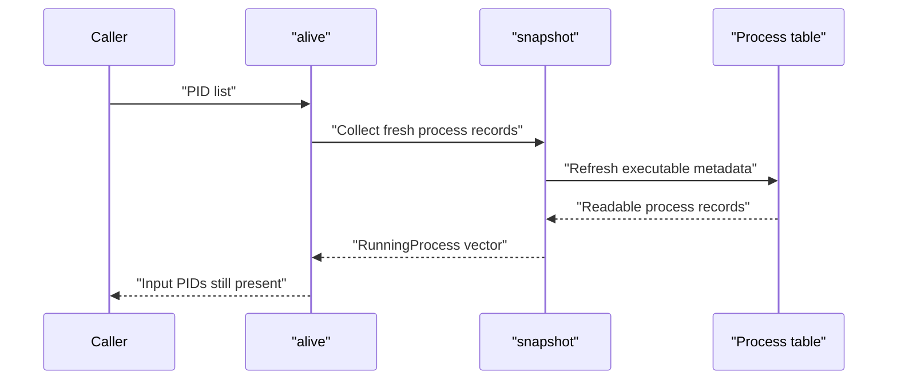
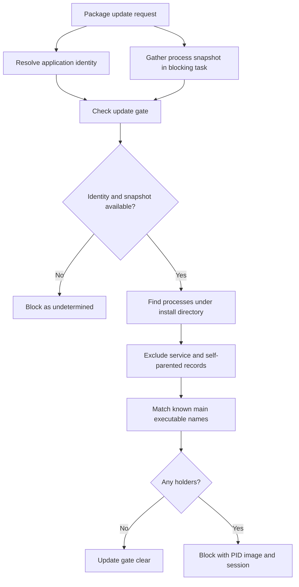

# Platform Process Snapshot

Platform Process Snapshot provides a synchronous, cross-platform view of locally running processes for the OpenFrame client agent. It is implemented by the `openframe_agent_lib` dependency rather than in this repository: [`process_snapshot.rs`](https://github.com/flamingo-stack/openframe-oss-lib/blob/16e7c1cbd9664e7d10ec5ebca7d53c9bd314decf/clients/openframe-client/src/platform/process_snapshot.rs). The tenant repository assembles that library into the OpenFrame client runtime.

The module deliberately returns only processes whose executable image is readable. Each retained entry identifies the process, its executable path, the parent executable when it can be resolved, whether it was launched by the Windows Service Control Manager, and, on Windows, its session identifier. This is sufficient for update-safety checks without exposing a platform-specific process API to higher-level services.

## Responsibilities

- Enumerate the current process table using `sysinfo` with executable-path refresh explicitly enabled.
- Normalize process metadata into the `RunningProcess` value.
- Enrich an entry with its parent image when the parent remains in the same refreshed table and its image is readable.
- Detect Windows service children from a parent executable named `services.exe`.
- Resolve the Windows session for each process when the operating system API permits it.
- Provide `alive` as a simple filter over a newly collected snapshot.

The module does not terminate processes, parse command lines, determine file-lock ownership, or retain process state between calls. Process termination and file-lock diagnostics belong to other platform facilities.

## Position in the Client Runtime

The principal verified integration is the package update gate. Its asynchronous wrapper runs `snapshot` on a blocking task, combines the returned processes with a resolved application identity, and blocks the update if a relevant non-service application process remains active. If obtaining the snapshot fails at the task boundary, the gate represents the result as an undetermined condition and blocks rather than assuming the update is safe.

## Core Data Model

`RunningProcess` is a cloneable, equality-comparable record with the following fields:

| Field | Meaning | Availability |
|---|---|---|
| `pid` | Operating-system process identifier, represented as an unsigned 32-bit value. | Every emitted record. |
| `image` | Readable executable image path. | Every emitted record; entries without an image are excluded. |
| `parent_image` | Executable image path of the parent process. | Optional when no parent exists, the parent is absent from the refreshed table, or its image is unreadable. |
| `is_service` | Whether the process was launched by Windows Service Control Manager. | `true` only on Windows when the parent filename equals `services.exe` without case sensitivity; otherwise `false`. |
| `session` | Windows session identifier. | Optional; unavailable on non-Windows systems and when the Windows lookup fails. |

The absence of a parent image is not a process failure signal. It preserves uncertainty caused by parent exit or inaccessible metadata.

## Snapshot Collection Flow

`snapshot` creates a fresh `sysinfo::System` instance and refreshes process information with executable updates set to always refresh. It then iterates the resulting map. A process becomes a result only if `process.exe()` supplies a path. Parent resolution is performed against that same map, so it neither launches another system query nor follows a parent outside the collected view.

On Windows, the service classifier checks the resolved parent filename. The check is intentionally narrow: only a case-insensitive match on `services.exe` produces `is_service: true`. On every other target, compile-time platform selection yields `false`. Similarly, session lookup invokes `ProcessIdToSessionId` only in Windows builds; other builds return no session.

## Liveness Query

`alive` accepts a slice of process identifiers, takes one fresh snapshot, and returns the input identifiers that occur in that snapshot. It preserves input order and preserves duplicate identifiers because it filters the supplied slice rather than producing identifiers from the process table. A PID is considered alive solely by its presence in the fresh snapshot; it is not matched against a captured executable path or process start time. Consequently, callers that require protection from operating-system PID reuse need an additional identity check outside this module.

Because `alive` is built on `snapshot`, a running process whose executable path is unavailable is not reported as alive by this API. This follows the module's readable-image contract and is important for consumers treating the result as an eligibility signal.

## Package Update Gate Interaction

The package update gate uses Platform Process Snapshot to avoid updating an application that is actively running:

The verified decision logic uses these properties from `RunningProcess`:

1. It selects processes whose image is under the resolved install directory.
2. It excludes entries marked as service processes.
3. It excludes a record when its parent image equals its own image without case sensitivity, preventing that parent-child pattern from being treated as an interactive application holder.
4. It either matches the executable filename against derived main-image names or accepts all candidates if the main images are unknown.
5. It returns a blocking decision containing each holder's PID, executable path, and optional session when candidates remain.

This makes the process snapshot an observation boundary: it gathers platform metadata, while update policy decides which observed processes prevent package installation.

## Platform Behavior and Operational Considerations

| Concern | Behavior |
|---|---|
| Process visibility | The result is based on the process information visible to the agent process and excludes records without readable executable paths. |
| Windows service detection | Relies on the immediate parent image filename being `services.exe`; it does not inspect service registration. |
| Windows session metadata | Uses the operating-system process-to-session lookup and returns no value if it fails. |
| Non-Windows behavior | No session is reported and no process is labeled a service by this module. |
| Snapshot freshness | Each `snapshot` and `alive` call independently refreshes the process table; there is no cache. |
| Threading | The module itself is synchronous. The package update gate moves snapshot collection to a blocking task so it can be used from asynchronous coordination. |

## Maintenance Guidance

- Preserve the exclusion of unreadable executable images unless every consumer is updated to handle incomplete process identity safely.
- Treat `is_service` as a narrow heuristic for update gating, not a general service-management truth source.
- Keep session lookup behind platform-specific compilation. The optional field is the cross-platform contract.
- Avoid adding state or caching here unless callers can explicitly reason about snapshot age; update-safety decisions depend on fresh observation.
- When extending process identity, consider how `alive` should behave for PID reuse and whether callers need a start-time or executable-path comparison.

## Source and Ownership

Platform Process Snapshot is supplied by the OpenFrame OSS Library as cargo artifact `openframe_agent_lib` at version `v0.0.5`, which this repository consumes for the client agent. Its implementation source is [`clients/openframe-client/src/platform/process_snapshot.rs`](https://github.com/flamingo-stack/openframe-oss-lib/blob/16e7c1cbd9664e7d10ec5ebca7d53c9bd314decf/clients/openframe-client/src/platform/process_snapshot.rs). The OpenFrame OSS Tenant repository publishes and deploys the surrounding OpenFrame client service and its container image; it does not define this process-snapshot implementation.
