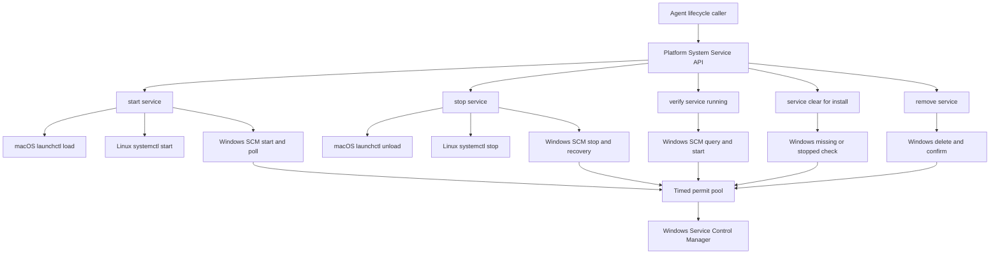
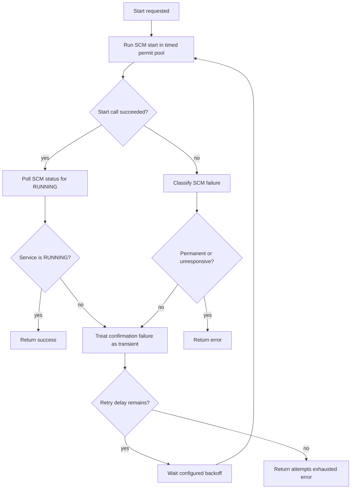
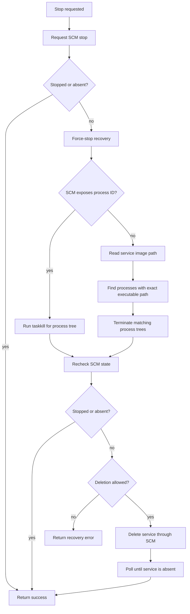
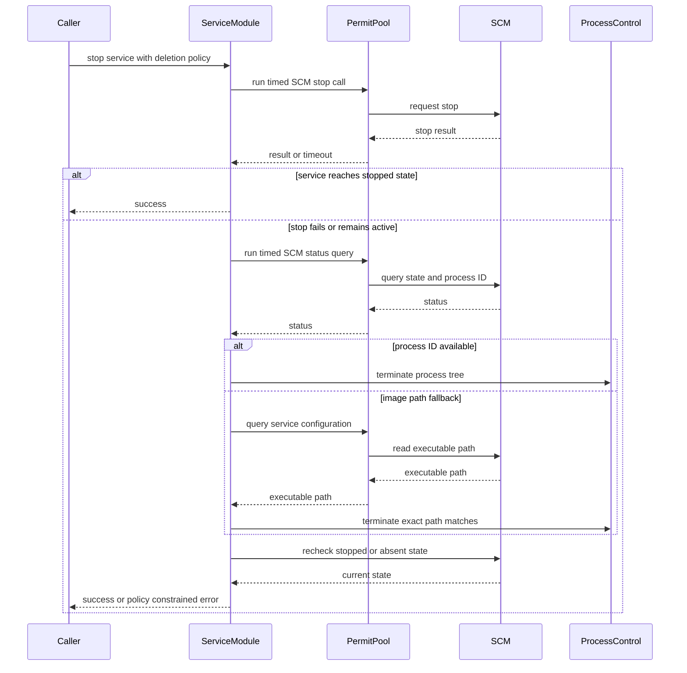

# Platform System Service

Platform System Service is the operating-system service lifecycle layer used by the OpenFrame Client agent. It abstracts how the agent starts, stops, verifies, and, when appropriate, removes its background service on macOS, Linux, and Windows. The implementation is supplied by the OpenFrame OSS Library's Rust client package and is assembled into this repository's OpenFrame Client runtime.

Its central responsibility is safety during installation, upgrade, recovery, and removal. In particular, the Windows implementation prevents Service Control Manager (SCM) calls from indefinitely blocking asynchronous work, distinguishes retryable failures from permanent ones, and avoids deleting a service during update paths that cannot recreate it.

**Implementation source:** [system service module](https://github.com/flamingo-stack/openframe-oss-lib/blob/16e7c1cbd9664e7d10ec5ebca7d53c9bd314decf/clients/openframe-client/src/platform/system_service.rs)

## Scope and Public Operations

The module exposes the following lifecycle operations:

| Operation | Purpose | Platform behavior |
|---|---|---|
| `start_service` | Starts a registered agent service. | Runs `launchctl load` on macOS, `systemctl start` on Linux, and SCM start plus running-state confirmation on Windows. |
| `stop_service` | Requests service shutdown. The `allow_delete` argument controls whether a wedged Windows service can be deleted as a recovery measure. | Uses `launchctl unload`, `systemctl stop`, or the SCM stop path. |
| `verify_service_running` | Confirms that a newly installed Windows service reaches `RUNNING`; starts it when needed. | A deliberate no-op on macOS and Linux. |
| `service_clear_for_install` | Determines whether installation or reinstall may safely proceed. | Windows requires the service to be missing or stopped; other platforms return safe-to-install. |
| `remove_service` | Removes an existing service registration. | Implements SCM deletion on Windows; no-op elsewhere. |
| `service_exists` | Checks whether a Windows service can be queried. | Windows-only synchronous SCM query. |
| `service_not_stopped` | Tests whether a Windows service is in a non-stopped state. | Windows-only synchronous SCM query. |
| `service_running_state` | Obtains a bounded asynchronous Windows state check. | Returns `Some` for a successful query and `None` if SCM is unavailable or the query fails. |

The synchronous state helpers are documented in the code as off the restart path. The operations that may run as part of restart, stop, install, or deletion flows use the timed SCM wrapper instead.

## Architecture

The operating-system-neutral API selects a platform-specific implementation at compile time. `cfg` gates ensure that only the relevant service manager integration is included in the target binary.

### Runtime Context and Dependencies

Platform System Service belongs to the Rust OpenFrame Client implementation from the OpenFrame OSS Library. The tenant repository consumes the `openframe_agent_lib` Cargo artifact at version `v0.0.5`; the client runtime provides the higher-level installation, service-management, upgrade, and uninstallation workflows that invoke this module.

At the module boundary, its direct responsibilities are intentionally narrow:

- It uses service stop configuration for retry schedules, call timeouts, poll intervals, retry limits, and Windows SCM capacity limits.
- It uses Tokio process execution for macOS, Linux, and Windows utility commands, plus Tokio timers for Windows polling and backoff.
- It uses the timed permit pool to bound blocking SCM work that must be moved off the asynchronous runtime.
- On Windows it uses `windows_service` for SCM access, `taskkill` for process-tree termination, and `sysinfo` for fallback process discovery by executable path.
- It emits operational tracing at information, warning, and error levels so lifecycle failures include service names, attempts, platform command output, and SCM details.

The module does not install service definitions itself. Instead, it coordinates the registered service lifecycle after higher-level service management has created or selected the service.

## Platform Lifecycle Behavior

### macOS and Linux

macOS derives a LaunchDaemon plist path under `/Library/LaunchDaemons` and runs `sudo launchctl load` to start or `sudo launchctl unload` to stop. Stop treats an absent plist and an already-unloaded service as non-fatal conditions, which supports idempotent cleanup.

Linux invokes `sudo systemctl start` and `sudo systemctl stop` for the supplied service name. Stop similarly treats manager messages indicating a unit is not loaded or not found as a successful cleanup result. Command-launch failures and unsuccessful commands with other error output are returned with context.

Verification after installation and service-clear checks are intentionally relaxed outside Windows. The code avoids issuing an additional start against launchd or systemd because doing so might fail for an already-loaded unit, while the Windows-specific stop-pending recovery problem does not apply in the same way.

### Windows

Windows provides the full recovery logic. Blocking SCM work is run through a shared `TimedPermitPool`. A call has a deadline and a bounded number of parked SCM threads. Consequently, a wedged SCM cannot consume unbounded async runtime capacity or cause each retry to create another permanently blocked worker.

The module classifies failed starts as follows:

| Failure class | Response |
|---|---|
| Transient SCM or confirmation failure | Retry according to the configured start-delay schedule. |
| Permanent SCM error | Fail immediately. The code identifies missing image paths, disabled services, non-existent services, and services already marked for deletion as permanent. |
| Unresponsive SCM after a timed call | Fail immediately to avoid adding more blocked SCM calls. |

A successful SCM start request is not considered sufficient. The module polls status and requires the service to reach `RUNNING`. It treats an already-running response as successful, preserving idempotent start behavior.

## Start Flow

The Windows start sequence uses a bounded number of attempts. Each successful start request is followed by status polling; failure to reach `RUNNING` is retryable only while the SCM remains responsive.

The permanent-error fast path matters during reinstall work: retries cannot restore a missing executable, enable a disabled service, recreate an absent registration, or clear a service that SCM has marked for deletion.

## Stop, Force Stop, and Delete Safety

`stop_service` accepts `allow_delete` because its callers have different guarantees:

- Install, reinstall, and uninstall paths may pass `true`. They can recreate or intentionally remove the service registration, so deleting a permanently wedged Windows service is an allowed final recovery action.
- Update and restore paths must pass `false`. Those paths do not re-register the service. Deleting it there would leave the installed agent unable to start as a service.

The Windows stop path first sends an SCM stop control through the timed pool. Missing services and inactive services are already-safe outcomes. If stop fails, cannot accept control, times out, or does not reach `STOPPED` after the configured poll count, the module escalates to force-stop handling.

The image-path fallback addresses transitional SCM states, such as stop pending, where SCM may hide the process identifier. It parses the registered executable path and only targets processes whose full executable path exactly matches it. Matching full paths, rather than only an executable filename, prevents collateral termination of another tool with the same filename.

Deletion is also confirmed by polling until SCM reports that the service is absent. This prevents an immediate reinstall from racing a still-open SCM handle and receiving a service-marked-for-deletion error.

## Installation and Removal Contracts

The installation path should call `service_clear_for_install` before registering over an existing Windows service. A `true` result means the service is absent or stopped. A failed or unresponsive status query returns `false`, deliberately stopping an unsafe overwrite of a live, wedged, or unqueryable service.

After registration, `verify_service_running` checks whether the service is already running and otherwise delegates to the robust start flow. This validates the post-install state rather than trusting installer success alone.

`remove_service` is a Windows-specific cleanup routine. It skips removal when the service is already missing, attempts a stop without allowing the stop path itself to delete the service, then sends the SCM delete operation and waits for disappearance. Failure to stop is logged before deletion is attempted, allowing deletion to recover registrations that cannot be gracefully stopped.

## Component Interaction Sequence

This sequence summarizes the relationship among a lifecycle caller, the service module, its bounded blocking-call facility, the SCM, and the process fallback.

## Operational Notes for Maintainers

- Preserve the distinction between an SCM call that cannot acquire capacity and a call that has timed out while still parked in SCM. The latter must not be retried blindly because it continues to hold a permit.
- Preserve post-start confirmation. A successful request to start does not prove the service reached `RUNNING`.
- Keep the `allow_delete` policy at call sites explicit. Passing `true` from an update or restore flow risks deleting a service that the flow cannot recreate.
- Treat missing and already-stopped services as idempotent stop outcomes. This makes cleanup and uninstall resilient to partial prior state.
- Preserve exact executable-path matching in the no-process-ID force-stop branch. A filename-only match can terminate unrelated installed tools.
- The non-Windows no-op behavior for selected verification and install-clear functions is deliberate platform policy, not an omission of service manager support.

## Failure Visibility

The module wraps process execution and SCM errors with operation-specific context. Logging records start attempt counts, retry delays, SCM status-query failures, stop escalation, process identifiers, executable-path fallback actions, and deletion confirmation problems. These records should be the primary diagnostic evidence when an install, upgrade, or uninstall reports a service lifecycle failure.
