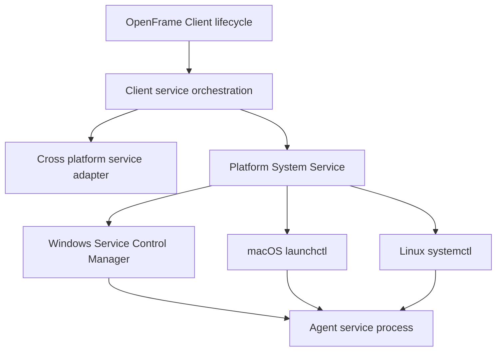
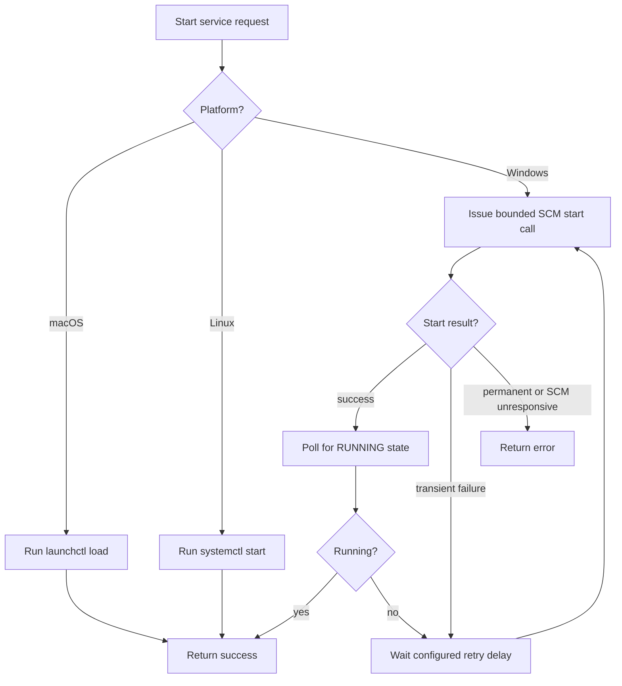
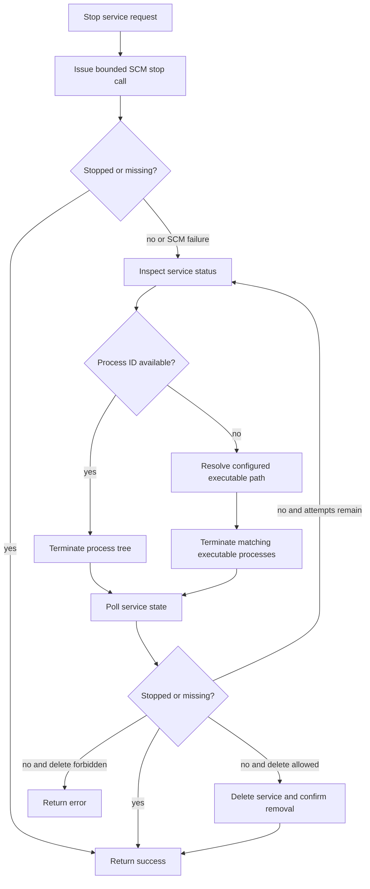
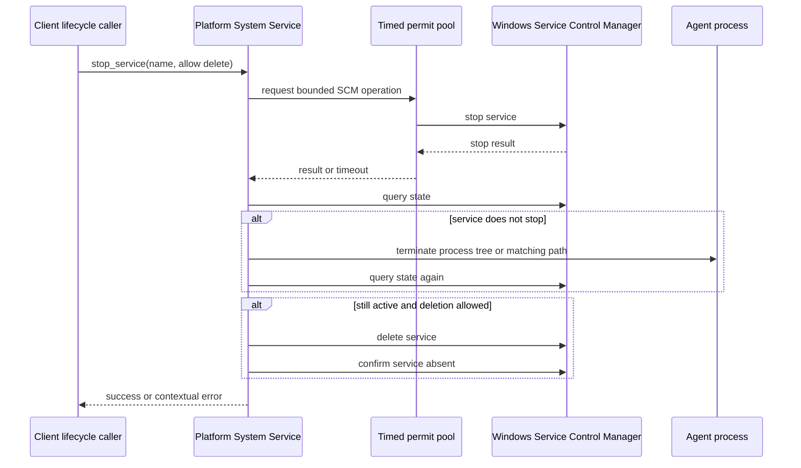

# Platform System Service

Platform System Service is the operating-system boundary for the OpenFrame Client agent. It starts, stops, verifies, and, on Windows, removes the agent's registered service while isolating platform-specific service-manager behavior from the rest of the client runtime.

The implementation is supplied by the `openframe_agent_lib` dependency from OpenFrame OSS Library and is run by this repository's OpenFrame Client. Its source is [`system_service.rs`](https://github.com/flamingo-stack/openframe-oss-lib/blob/7a766f00e4f58b5d89db007b878ac8d6e0c344f4/clients/openframe-client/src/platform/system_service.rs).

## Responsibilities

The module exposes a small asynchronous lifecycle interface:

| Operation | Purpose | Platform behavior |
|---|---|---|
| `start_service` | Starts a named agent service and reports failure with command or Service Control Manager context. | Runs `launchctl load` through `sudo` on macOS, `systemctl start` through `sudo` on Linux, or uses the Windows Service Control Manager. |
| `stop_service` | Stops a service before update, restore, reinstall, or removal. | Uses `launchctl unload`, `systemctl stop`, or a guarded Windows stop and recovery procedure. |
| `verify_service_running` | Confirms a newly installed Windows service reaches the running state. | Starts the service when Windows cannot confirm it is running; intentionally a no-op elsewhere. |
| `service_clear_for_install` | Determines whether a service is absent or stopped and therefore safe to install over. | Performs a time-bounded Windows status query; returns true on non-Windows platforms. |
| `remove_service` | Removes a prior service registration. | Performs Windows deletion and confirmation; it is a no-op on macOS and Linux. |
| `service_exists`, `service_not_stopped`, and `service_running_state` | Provide existence and state probes for lifecycle callers. | Windows state comes from the Service Control Manager; the asynchronous running probe is bounded by the shared permit pool. |

The module does not register a service definition itself. Registration configuration and lifecycle orchestration belong to the client service and service-adapter layers. Platform System Service provides the low-level controls those layers use once they know the service name.

## Position in the Client Architecture

The OpenFrame Client uses this layer during service installation, update, restart, recovery, and uninstall paths. The `allow_delete` argument to `stop_service` is significant: callers that will recreate or permanently remove the registration may allow a final Windows deletion, while update and restore callers must prohibit deletion because they do not re-register the service.

## Platform Implementations

### macOS and Linux

macOS maps a service name to `/Library/LaunchDaemons/<service name>.plist` and invokes `sudo launchctl load` or `sudo launchctl unload`. A missing plist and an already unloaded service are treated as an acceptable stop outcome.

Linux invokes `sudo systemctl start <service name>` and `sudo systemctl stop <service name>`. A stop result indicating that the unit is not loaded or cannot be found is treated as already stopped. Other non-successful commands include command output in the returned error.

These implementations use asynchronous child-process execution. They do not attempt a second start during `verify_service_running`, avoiding potentially unsafe redundant operations against launchd or systemd.

### Windows

Windows uses the Service Control Manager rather than shelling out for ordinary lifecycle commands. Service Control Manager calls can block, so the module runs them outside the asynchronous runtime through a shared, bounded `TimedPermitPool`. Each call has a configured timeout. This prevents an unresponsive manager from indefinitely stalling an agent task or allowing an unlimited number of blocked worker threads.

Start failures are classified before retrying:

- **Transient:** retry according to `SERVICE_START_RETRY_DELAYS_SECS`.
- **Permanent:** stop immediately for missing image paths, disabled or absent services, and services marked for deletion.
- **Unresponsive manager:** stop immediately after a timed-out call that may still occupy a permit.

An already-running service is treated as a successful start. After a successful start request, the module polls status until it observes `RUNNING`; failure to reach that state is retried under the configured schedule.

## Start Flow

## Windows Stop and Recovery Flow

Stopping is deliberately more defensive than starting because a service can remain in a transitional state, including `StopPending`. The first attempt issues an SCM stop request, then polls for a stopped or missing registration. Missing and inactive services are successful no-op outcomes.

If stopping fails, times out, cannot accept a control request, or does not settle, Platform System Service escalates as follows:

1. Query the service state and process identifier.
2. If the manager exposes a process identifier, terminate that process tree with `taskkill`.
3. If it does not expose an identifier, resolve the executable from the configured service image path and terminate only processes whose full executable path matches. Matching the path rather than a process name avoids killing a sibling tool with the same executable name.
4. Poll and repeat up to the configured force-kill limit.
5. If the service is still not clear, delete the service only when `allow_delete` is true. Otherwise, return an error so an update or restore cannot silently leave the agent unregistered.

## Installation Safety and Deletion

`service_clear_for_install` is an installation guard. On Windows, it returns true only when the Service Control Manager reports that the registration is absent or stopped. An unresponsive manager or an indeterminate status returns false, causing the caller to avoid overwriting a still-active or wedged agent.

`remove_service` first checks whether a registration is already absent. Otherwise it attempts to stop it without permitting forced deletion during the stop step, then issues a Service Control Manager delete operation. Deletion is followed by bounded polling until the service is actually absent. This protects a subsequent reinstall from the Windows `ERROR_SERVICE_MARKED_FOR_DELETE` condition, in which the name cannot yet be reused because a service handle remains open.

## Component Interaction

## Operational Characteristics

- **Idempotent outcomes where safe:** Starting an already running Windows service and stopping a missing or inactive service succeed.
- **Bounded failure behavior:** Windows Service Control Manager calls and state polls are time-bounded; repeated query failures are treated as manager unavailability rather than an infinite wait.
- **Contextual diagnostics:** The module uses structured tracing for attempts, state transitions, retries, command failures, force-kill actions, and deletion outcomes. Windows error formatting preserves the underlying operating-system error where possible.
- **Scoped destructive action:** Process termination by image path requires an exact path match, and registration deletion is permitted only for flows that recreate or remove the service.
- **Platform-specific compilation:** Conditional compilation keeps Service Control Manager code and Windows-only dependencies out of macOS and Linux builds.

## Maintenance Guidance

Changes to retry delays, timeout values, poll counts, or maximum concurrent Service Control Manager calls affect recovery behavior under a wedged Windows service manager. Preserve the distinction between a pool that is temporarily busy and a call that timed out while still parked in the manager: the latter consumes a permit and must not trigger unbounded retries.

When adding lifecycle callers, choose `allow_delete` conservatively. It should be true only for reinstall or uninstall paths that are guaranteed to register a replacement or intentionally remove the agent. For an in-place update, rollback, or restore, deletion can leave the tool unable to start until an external repair occurs.
