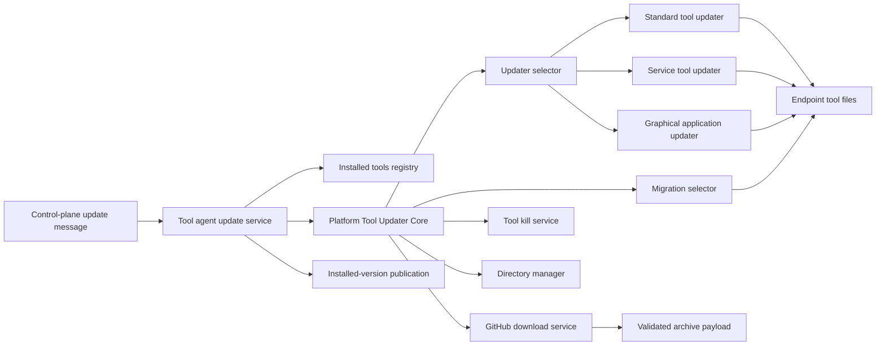
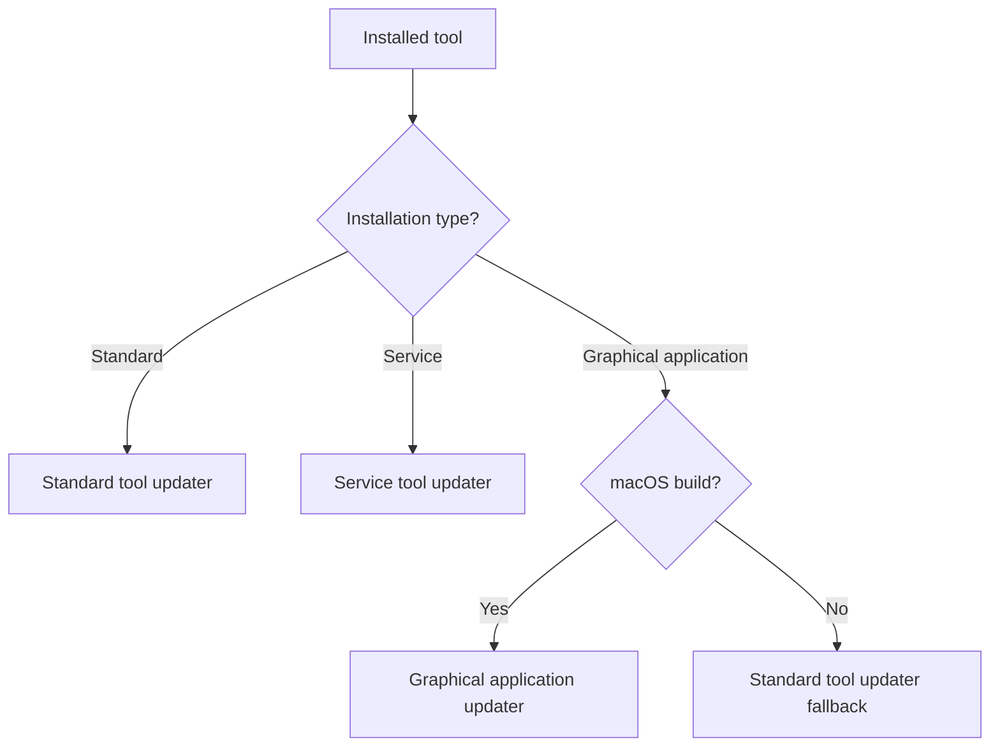
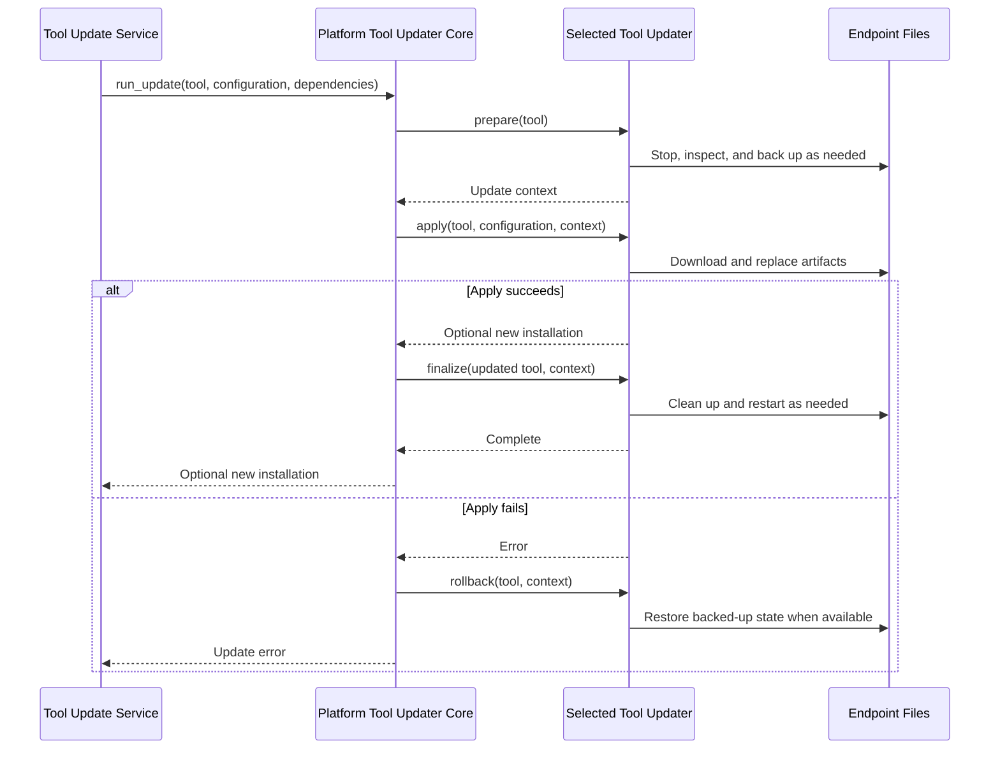
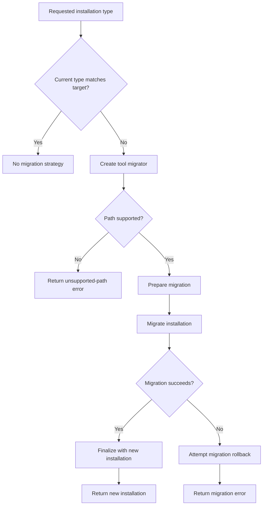

# Platform Tool Updater Core

Platform Tool Updater Core is the orchestration layer for updating an installed OpenFrame client tool on an endpoint. It is implemented by the `openframe_agent_lib` Rust dependency from [OpenFrame OSS Library](https://github.com/flamingo-stack/openframe-oss-lib/blob/16e7c1cbd9664e7d10ec5ebca7d53c9bd314decf/clients/openframe-client/src/platform/tool_updater/mod.rs), which this repository assembles into its client runtime. The tenant repository consumes `openframe_agent_lib` version `v0.0.5`.

The module selects an updater based on the installed tool's installation form, drives a prepare–apply–finalize transaction, and attempts rollback when application fails. It also coordinates supported installation-form migrations. The core deliberately defines the lifecycle and shared safety helpers; implementation-specific behavior belongs to the standard, service, graphical application, and migration modules.

## Responsibilities

- Select an updater for `Standard`, `Service`, or `GuiApp` installations.
- Define the asynchronous `ToolUpdater` lifecycle contract.
- Carry common collaborators in `ToolUpdaterDeps`.
- Coordinate update phases and preserve contextual errors by tool identifier.
- Back up, restore, download, and safely write executable files.
- Detect conditions that can leave a prior tool binary active after an update.
- Route a requested installation-type change to a supported `ToolMigrator`.

The module does not decide whether an incoming update should run. That policy, including version comparison, repair of missing artifacts, installed-tool state transitions, and publication of resulting versions, is handled by the client update service before it invokes this core.

## Position in the Endpoint Client

An update message is first resolved against the installed-tool registry. The surrounding service skips an orphaned tool, detects an interrupted installation or missing artifact as a repair case, and normally rejects a downgrade when the installed semantic version is newer. If work is required, it supplies the core with the installed tool, the selected download configuration, and the shared dependencies.

## Core Types and Contracts

| Component | Role |
|---|---|
| `ToolUpdater` | Asynchronous strategy contract with `prepare`, `apply`, `finalize`, and `rollback` stages. Implementations must be thread-safe and usable behind a shared trait object. |
| `ToolUpdaterDeps` | Dependency bundle containing the download service, process-stop service, directory manager, and command-parameter resolver. It keeps concrete updaters consistent and makes construction explicit. |
| `UpdateContext` | Per-update state shared between lifecycle stages. It currently records an optional backup path and whether restart behavior is required. Its default enables restart and has no backup. |
| `UnsupportedToolUpdater` | Non-macOS guard implementation that fails `prepare` and `apply` with a supplied message, while allowing `finalize` and `rollback` to complete harmlessly. |
| `create_updater` | Factory that maps the persisted installation variant to the appropriate updater implementation. |
| `run_update` | Transaction coordinator for an in-place update. |
| `run_migration` | Transaction coordinator for an installation-form migration. |

The persisted `Installation` model distinguishes three forms:

- **Standard**: an executable, optionally with a configured executable path.
- **Service**: a service name plus an optional executable path.
- **Graphical application**: an executable path and optional application bundle identifier.

The selected `DownloadConfiguration` identifies the target operating system, archive file name, archive member name, source link, intended installation type, and optional bundle or service metadata.

## Updater Selection

`create_updater` uses the installation persisted with the tool, rather than the download configuration, to determine how to update the currently deployed form. Graphical application updates use `GuiAppToolUpdater` on macOS. On other platforms the current behavior uses `StandardToolUpdater` as a fallback; the source marks a dedicated Windows graphical application updater as future work. Service installations select `ServiceToolUpdater`, and standard installations select `StandardToolUpdater`.

## Update Lifecycle

`run_update` is the common transaction boundary. It constructs one updater, logs each phase with the tool agent identifier, and attaches that identifier to errors returned from each stage.

### Phase behavior

1. **Prepare** returns an `UpdateContext`. Implementations use it to retain state needed for recovery, such as a backup path.
2. **Apply** receives the current tool, download configuration, and context. It returns either no installation change or a replacement `Installation` value.
3. **Finalize** is called with a tool whose installation has been replaced when `apply` returned one. This ensures that cleanup and restart decisions use the resulting installation metadata.
4. **Rollback** is attempted only when `apply` fails. A rollback failure is logged but does not replace the original application error.

A failure in `prepare` stops the operation before application begins. A failure in `finalize` is returned as a finalize error; the coordinator does not automatically roll back after a successful apply. This makes finalization implementations responsible for keeping their post-apply work safe to retry or for reporting a recoverable condition.

## Shared File and Process Safety Helpers

The core exposes internal helpers to make updater strategies follow the same recovery behavior.

| Helper | Behavior |
|---|---|
| `clear_aside_binary` | Removes a stale rename-aside file with the `.old` path derived by the binary writer. A lock or other removal failure returns `false`, signalling that an earlier binary may still be executing. |
| `log_update_survivors` | Checks whether the installed tool remains running after a stop request. The update may continue, but the running process keeps the prior version until it exits. |
| `backup_binary` | Copies an existing executable to a sibling path using the `backup` extension. A missing original is valid and produces no backup path. |
| `download_and_write_binary` | Downloads and extracts the configured artifact, then delegates writing to the platform binary writer. |
| `cleanup_backup` | Deletes a backup after successful completion and logs cleanup failures without failing the completed update. |
| `restore_from_backup` | Copies a present backup back to the target, then removes the backup. Missing backup state produces a warning rather than a hard error. |

The download service retries the archive download, rejects undersized downloads and extracted binaries, and supports ZIP plus tar-gzip archive formats. It extracts the named target file from the archive. The binary writer creates missing parent directories, writes and flushes the file, attempts a bounded disk synchronization, closes the handle before execution, and applies executable permissions. Its Windows recovery path can move a locked target aside before retrying file creation.

## Migration Lifecycle

An update changes the contents of an installation form. A migration changes the form itself, for example from a standard executable to a graphical application. `needs_migration` compares the current installation form with the requested `InstallationType`; `run_migration` asks the migration factory for a compatible strategy.

The migration factory returns no strategy when the source and target types already match. The supported path shown by the source is Standard to Graphical Application, compiled for macOS and Windows. Other type pairs return an unsupported-path error. `ToolMigrator` mirrors the update lifecycle with `prepare`, `migrate`, `finalize`, and `rollback`, while adding `from_type` and `to_type` for diagnostics. Its default rollback implementation logs that rollback is not implemented for the path and returns success, so concrete migrations should provide rollback whenever partial migration can leave meaningful state behind.

## Dependencies and Integration Boundaries

Platform Tool Updater Core receives its collaborators rather than opening network connections or resolving endpoint locations itself:

- **GitHub download service** obtains and validates the configured archive payload.
- **Tool kill service** stops a tool and provides the post-stop running-process check used for visibility warnings.
- **Directory manager** provides platform-aware endpoint directory and executable-path behavior to updater implementations.
- **Tool command parameters resolver** is supplied to strategies that need resolved invocation parameters during installation or restart work.

The update service surrounding this core serializes tool operations through its tool-operation guard, obtains the persisted tool entry, and publishes installed versions after update processing. It also restores the registry state from `Installing` to `Installed` following a successful repair. These responsibilities remain outside the core so the lifecycle coordinator stays focused on endpoint mutation and recovery.

## Operational Notes

- Treat a tool agent identifier as the primary correlation value for update logs. The coordinator includes it in phase logs and contextual errors.
- A successful executable replacement does not guarantee that every active process immediately uses the new bytes. Investigate survivor warnings and stale aside binaries when diagnosing apparent version mismatches.
- Preserve the `UpdateContext` across all stages. It is the link between preparation, rollback, cleanup, and restart decisions.
- Test each updater implementation against apply failure, rollback failure, absent original binaries, locked executables, and finalization failure. The coordinator intentionally preserves the first application error even when rollback also fails.
- Add a migration path in the migration factory only with an implementation that explicitly handles source cleanup, target creation, finalization, and partial-state recovery.

## Source Scope

This document describes the shared orchestration code in the OpenFrame OSS Library source file named above. Concrete standard, service, graphical application, and migration strategies are separate modules in that library, and the tenant repository provides the runtime services and deployment artifacts that execute the client.