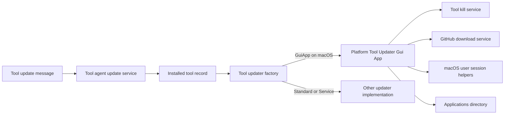
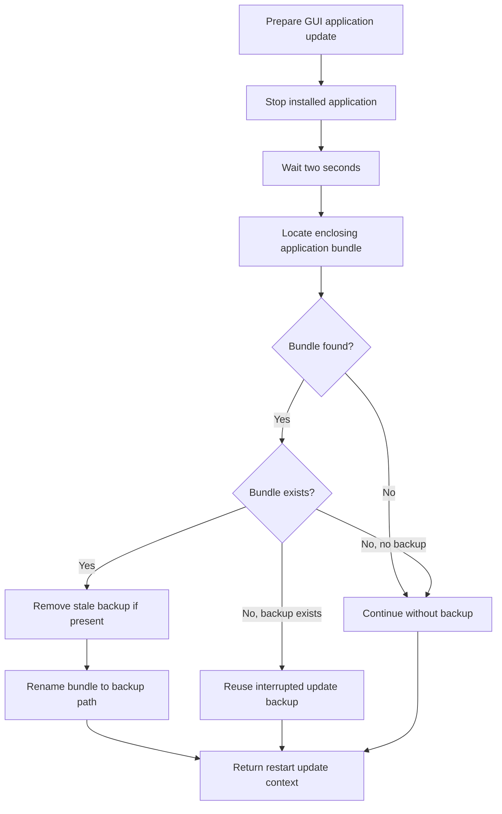
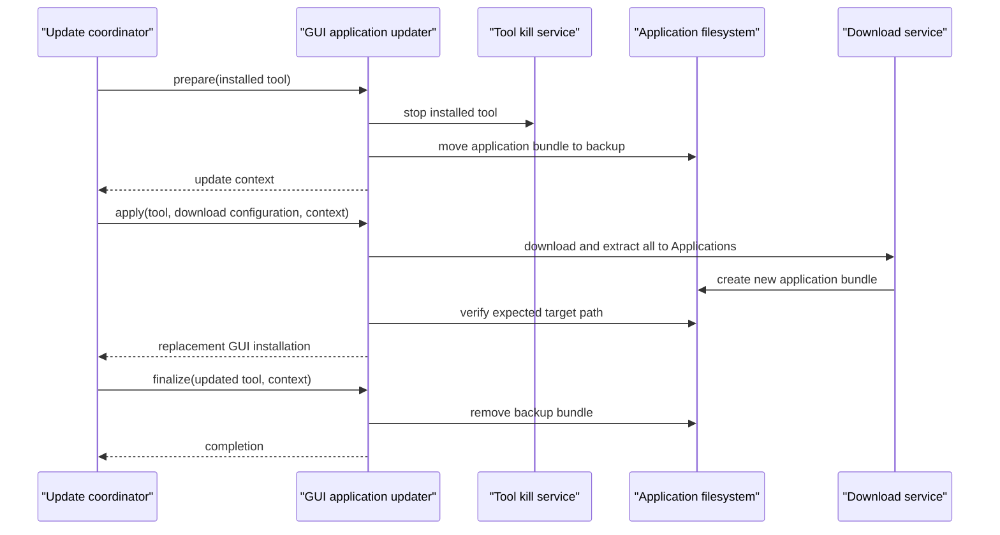
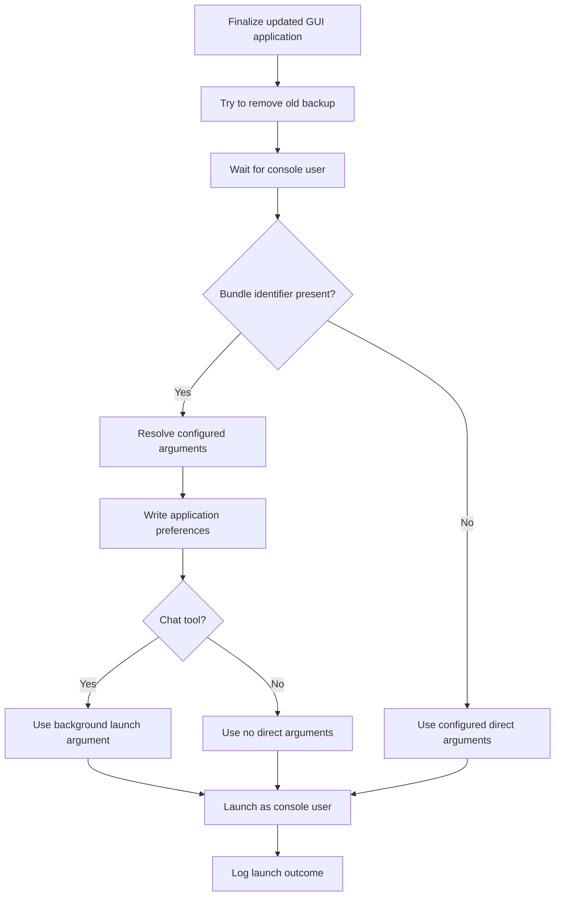

# Platform Tool Updater Gui App

Platform Tool Updater Gui App is the macOS-specific implementation that updates an installed graphical application represented by the OpenFrame client as `Installation::GuiApp`. It protects the prior `.app` bundle during replacement, installs a downloaded archive into `/Applications`, records the new executable location, removes the backup after success, and launches the application in the active console user's session.

The implementation is supplied at runtime by the `openframe_agent_lib` Cargo artifact from OpenFrame OSS Library. The tenant repository consumes that artifact at version `v0.0.5`; the implementation documented here is the verified [GuiApp tool updater source](https://github.com/flamingo-stack/openframe-oss-lib/blob/7a766f00e4f58b5d89db007b878ac8d6e0c344f4/clients/openframe-client/src/platform/tool_updater/gui_app.rs).

## Scope and Responsibilities

The module exposes `GuiAppToolUpdater` and its `new` constructor. `GuiAppToolUpdater` fulfills the shared `ToolUpdater` lifecycle:

1. **Prepare** stops the currently installed application and, where possible, moves its enclosing `.app` bundle to a sibling hidden backup directory.
2. **Apply** downloads and extracts the incoming macOS archive into `/Applications`, then returns replacement `Installation::GuiApp` metadata.
3. **Finalize** deletes the preserved bundle, resolves and writes launch preferences when a bundle identifier exists, and starts the new executable as the console user.
4. **Rollback** removes an unsuccessfully installed replacement bundle and restores the backup.

This is an application-bundle updater, not a general tool updater. Standard executables and system services are handled by separate implementations selected by the parent updater factory. On non-macOS builds, the factory selects the standard updater for GUI application installations rather than this implementation.

## Position in the Update Architecture

The OpenFrame client receives a tool update through its tool-update service. That service identifies the locally registered tool, prevents concurrent work through its tool-operation guard, rejects stale downgrades unless a repair is needed, and delegates replacement to the common updater pipeline. The pipeline chooses an updater from the recorded `Installation` variant.

### Selection and Lifecycle Contract

The shared `ToolUpdater` interface requires `prepare`, `apply`, `finalize`, and `rollback`. Its `run_update` coordinator calls them in that order. If `apply` fails, the coordinator invokes `rollback`; if rollback also fails, the original apply failure remains the update result. Before finalization, the coordinator clones the tool record and substitutes the returned installation metadata, which lets this module launch the newly installed executable rather than the old path.

`GuiAppToolUpdater::new` accepts a `ToolUpdaterDeps` bundle:

| Dependency | Use in this module |
| --- | --- |
| GitHub download service | Downloads the configured archive and extracts all contents to `/Applications`. |
| Tool kill service | Stops the installed GUI application before its bundle is moved or replaced. |
| Directory manager | Finds the enclosing `.app` ancestor for an executable path. |
| Tool command parameters resolver | Resolves placeholders in configured launch arguments before they are persisted as preferences. |

The `InstalledTool` input supplies the tool-agent identifier, current version, launch arguments, and `Installation::GuiApp` fields: an executable path and an optional bundle identifier. The selected `DownloadConfiguration` supplies the archive link and the expected extracted bundle name through `target_file_name`.

## Bundle Replacement Design

A GUI executable can be located inside an application bundle. During preparation, the updater searches each ancestor of the executable path for a path with the `.app` extension. If it finds one, it chooses a sibling backup path named with the pattern `.<bundle name>.update-backup`.

This handling makes an interrupted replacement recoverable when the original bundle was already moved aside: a later attempt can adopt the existing backup. The updater deliberately continues without a backup when it cannot derive an application bundle from the stored executable path. That condition is logged as a warning, and rollback later advises reinstallation if no backup was available.

## Update Data Flow

The apply stage accepts only `Installation::GuiApp`; another installation variant is an error. It requests full archive extraction from the download service into `/Applications`. The download service supports `.tar.gz`, `.tgz`, and `.dmg` archive inputs for this path, rejects unsupported formats, and checks that the downloaded file meets its minimum size requirement. After extraction, the updater requires the expected path `/Applications/<target file name>` to exist before it creates the replacement installation record.

### Rollback Semantics

When extraction or validation fails after preparation, the common coordinator calls `rollback` with the original tool and update context:

- If no backup was taken, rollback logs a warning and returns successfully; an operator must reinstall the tool from the server.
- If a backup exists, the updater resolves the original application bundle path from the stored executable path.
- It removes a replacement bundle at that location when present, then renames the backup back into place.
- A failure to restore the backup is reported to the common coordinator, which logs it in addition to the original update failure.

The backup is removed in finalization before the app is restarted. Failure to delete it is non-fatal and is logged as a warning.

## Relaunch and Preference Handling

The updater treats restart as required by returning `UpdateContext` with `needs_restart` set. During finalization, it waits until macOS reports a regular console user. This avoids starting a graphical application in the service account or before a user session exists.

When the installation has a bundle identifier, configured command arguments are handled as application preferences rather than direct process arguments:

1. The command-parameter resolver expands any supported placeholders for the tool.
2. Argument pairs are interpreted as `--key value`; a standalone `--key` becomes the preference value `1`.
3. Preferences are written with macOS `defaults` under the bundle identifier, first through `launchctl asuser` and then through a `sudo -u` fallback if necessary.
4. The program is launched with no direct arguments, except the chat tool receives `--background`.

When no bundle identifier is available, the configured `run_command_args` are passed directly to the executable. Preference-resolution and preference-write failures are warnings: they do not prevent the relaunch attempt. Likewise, a failed launch is logged but does not make finalization fail.

The macOS launcher verifies that the executable exists, attempts `launchctl asuser` for the console user's UID, and falls back to `sudo -u` if that mechanism fails. This preserves a graphical application's user-session context even when the OpenFrame client itself runs with service privileges.

## Interaction with Related Client Behaviors

- **Tool update service:** serializes updates through a tool-operation guard, detects missing artifacts and interrupted installs as repair cases, and publishes installed versions after handling updates. A tool with no registry record is skipped rather than reconstructed from an update message.
- **Tool run manager:** recognizes that an updater relaunches a GUI application while the tool is busy, avoiding a competing launch. Its normal GUI supervision path starts eligible installed GUI applications outside an update.
- **Migration support:** the parent migration framework can move a standard installation to a GUI application installation on macOS and Windows. That is distinct from this module's in-place GUI update lifecycle.
- **Download configuration:** archive type and target bundle naming must agree with the extraction result. A missing target bundle is treated as an apply failure and activates rollback when a backup exists.

## Operational Considerations

### Preconditions

- The installed tool must be recorded as `Installation::GuiApp` with a usable executable path.
- The archive must extract into `/Applications` and create the bundle named by `target_file_name`.
- The client needs permission to stop the application, rename or remove bundle directories, and write under `/Applications`.
- A logged-in regular macOS console user is required for relaunch. Finalization waits in five-second intervals until one is detected.

### Diagnostics

The implementation emits structured logs keyed by `tool_id`. Follow the phase-oriented messages from the common coordinator and the GUI-specific messages for bundle backup, archive installation, preference handling, deletion warnings, restoration, and launch PID or failure.

A failed update should be investigated in this order:

1. Confirm that the incoming download configuration targets the expected macOS archive and bundle name.
2. Check whether the running application could be stopped and whether a backup bundle was created.
3. Confirm the archive extracted to the expected `/Applications` path.
4. Check console-user availability and application-launch logs.
5. If rollback had no backup, reinstall the affected tool from the server-side workflow.

## Maintenance Boundaries

Changes to this module must preserve the lifecycle guarantees expected by the shared updater coordinator: prepare must construct sufficient rollback context, apply must return current installation metadata, finalize must operate on that updated metadata, and rollback must be safe after a partial apply. In particular, do not remove the backup strategy without providing an equivalent recovery path for archive extraction failures.

No module-specific test code was supplied with the source excerpt, although the source declares a companion `gui_app_tests.rs` test module. Tests for future changes should cover bundle discovery, stale-backup adoption, successful replacement, missing extracted bundle, restoration after apply failure, bundle-identifier preference behavior, the chat background argument, and console-user relaunch failure handling.
