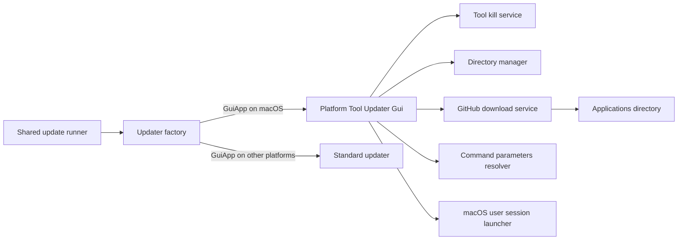
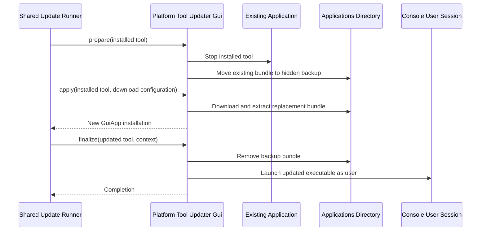
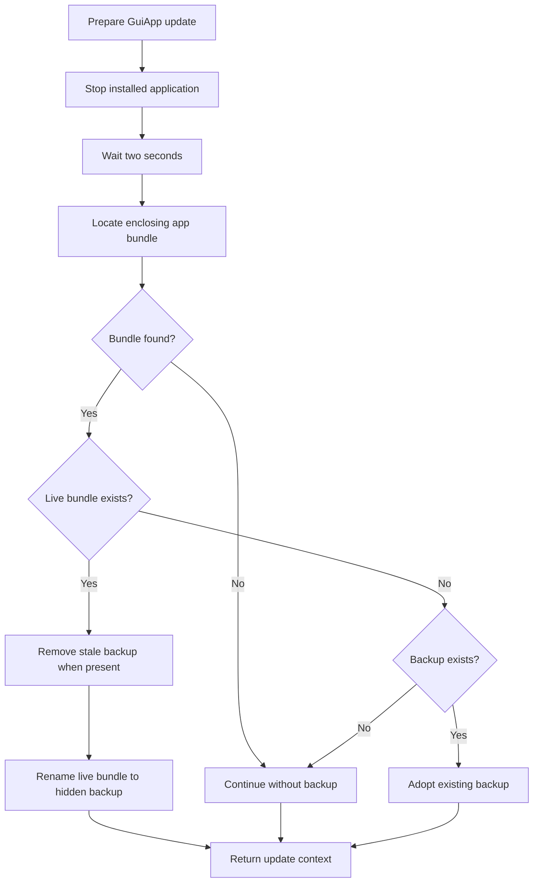
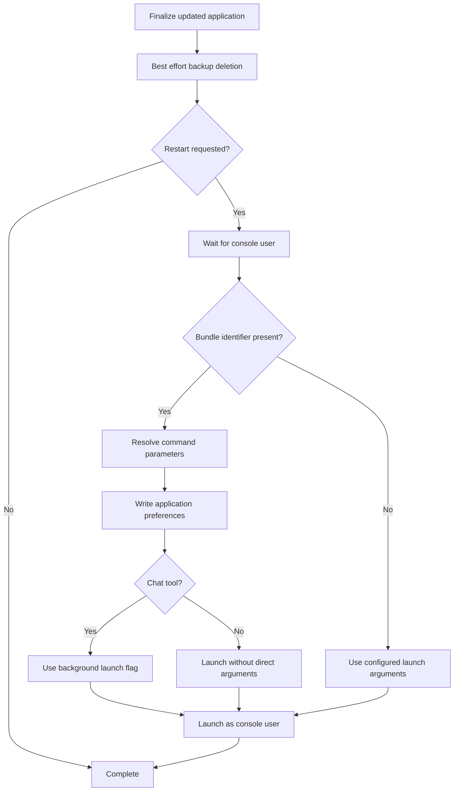
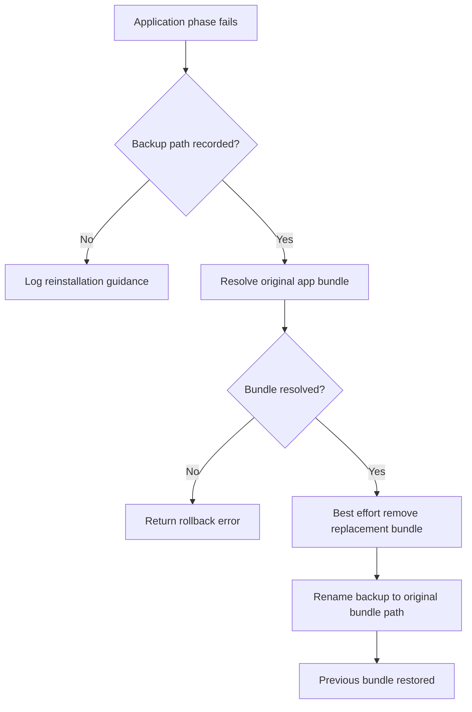

# Platform Tool Updater Gui

Platform Tool Updater Gui is the macOS-specific update strategy for installed desktop application bundles. It implements the shared tool-update contract from the OpenFrame client library, replacing an existing `.app` bundle with an archive-provided version in `/Applications`, preserving the prior bundle until installation succeeds, and relaunching the replacement in the active console user's session.

The implementation is supplied by the `openframe_agent_lib` dependency from OpenFrame OSS Library and is run by this repository's OpenFrame client. The source of record is [gui_app.rs](https://github.com/flamingo-stack/openframe-oss-lib/blob/16e7c1cbd9664e7d10ec5ebca7d53c9bd314decf/clients/openframe-client/src/platform/tool_updater/gui_app.rs).

## Scope and Selection

An installed tool is represented as `Standard`, `GuiApp`, or `Service`. The shared updater factory selects Platform Tool Updater Gui for `GuiApp` installations only when the client is compiled for macOS. On non-macOS builds, a `GuiApp` installation currently uses the standard updater instead. Platform Tool Updater Gui therefore assumes macOS bundle conventions and must not be treated as a cross-platform desktop-application updater.

A `GuiApp` installation retains two values:

- `executable_path`: the current executable path, used to locate its enclosing `.app` bundle and to launch the updated application.
- `bundle_id`: optional application identifier used to write application preferences before launch.

The updater receives shared dependencies through `ToolUpdaterDeps`:

| Dependency | Responsibility in Platform Tool Updater Gui |
| --- | --- |
| GitHub download service | Downloads an archive and extracts all contents into `/Applications`. On macOS, supported archive types are `.tar.gz`, `.tgz`, and `.dmg`. |
| Tool kill service | Stops the installed application before bundle replacement. |
| Directory manager | Finds the nearest enclosing `.app` directory from the recorded executable path. |
| Tool command parameters resolver | Resolves command-argument placeholders before optional preference persistence. |

## Update Contract and Lifecycle

Platform Tool Updater Gui implements four asynchronous phases defined by the shared `ToolUpdater` contract: `prepare`, `apply`, `finalize`, and `rollback`. The shared runner coordinates those phases as follows:

1. It calls `prepare` and stops immediately if preparation fails.
2. It calls `apply`; only an apply failure triggers `rollback`.
3. When apply returns a replacement installation, the runner creates an updated copy of the tool record before calling `finalize`. Thus, finalization launches the new executable path rather than the previous path.
4. The runner returns the replacement installation so the caller can persist it.

An error during finalization is returned to the caller, but the shared runner does not invoke rollback after finalization has started. Operational recovery for a launch or cleanup failure therefore depends on the error being observed and on later reconciliation, rather than an automatic bundle restoration.

## Preparation: Quiesce and Preserve

`prepare` begins by stopping the installed tool with deletion disabled. This makes the updater responsible for the bundle transition and avoids removing the application before a replacement is available. It then waits two seconds before manipulating the filesystem, allowing the application process to exit and release files.

For a `GuiApp` installation, the updater derives the application bundle by walking ancestors of `executable_path` until it finds a path ending in `.app`. The hidden backup location is a sibling whose file name has the form `.<bundle-name>.update-backup`.

The preparation behavior is deliberately tolerant of incomplete prior updates:

- If the executable path is not inside an application bundle, no backup is made. The update can still continue, but rollback cannot restore an old bundle.
- If the bundle no longer exists but a backup does, the updater adopts that backup as the recovery source.
- If both the live bundle and an older backup exist, it removes the older backup on a best-effort basis before renaming the live bundle.
- If the rename fails, preparation fails and the shared runner does not enter apply.

The resulting `UpdateContext` records the optional backup path and always sets `needs_restart` to `true` for this updater.

## Application: Download and Replace

`apply` verifies that the source installation is `GuiApp`; any other variant is an error. It asks the download service to download and extract the configured artifact into `/Applications`. The download service checks the minimum downloaded size and chooses tarball or disk-image extraction from the configured source filename.

After extraction, the updater requires an application bundle at `/Applications/<target file name>`. It does not infer a different bundle location or filename. If that expected path is missing, application fails and the shared runner attempts rollback.

On success, `apply` returns a new `GuiApp` installation containing:

- the new bundle path as `executable_path`; and
- the original optional `bundle_id`.

This returned installation is important: the shared runner uses it in finalization and should persist it after a completed update.

## Finalization: Clean Up, Configure, and Relaunch

Finalization first tries to remove the backup bundle. Failure to delete a backup is logged as a warning and does not stop the remaining steps. Because the context always requests a restart, it then waits until `get_console_user` identifies an active console user, polling every five seconds. This wait has no timeout in this module.

When a bundle identifier is present, the updater resolves the tool's configured command arguments before converting them to preference pairs and writing the preferences for that bundle. This supports arguments containing client configuration placeholders, including server URL, token-path, machine ID, and tool asset references. Parameter-resolution or preference-write errors are warnings; the updater continues by using the original command arguments if resolution fails.

Launch handling depends on `bundle_id`:

| Condition | Argument behavior |
| --- | --- |
| Bundle identifier is present | Arguments are supplied through preferences. The chat tool is the exception and receives `--background` at launch. |
| Bundle identifier is absent | The configured command arguments are passed directly to the executable. |

The application is launched in the console user's session through `launchctl asuser`, with a `sudo -u` fallback. A launch failure is logged but is not returned as a finalization error, so the update can be considered complete even if the new application does not start.

## Failure Handling and Recovery

Rollback is only intended to recover an apply failure after a backup was recorded. It uses the original installation's executable path to rediscover the target bundle directory, removes any bundle currently at that location on a best-effort basis, and renames the backup into place.

If no backup exists, rollback logs that reinstallation from the server is required and succeeds without changing the filesystem. If the updater cannot find an enclosing `.app` bundle from the original executable path, it returns an error because there is no deterministic restore destination. A failed restore rename also propagates as an error to the shared runner.

## Operational Considerations

- The configured artifact's target filename must match the extracted application bundle name expected under `/Applications`.
- Stopping the application, moving its bundle, extraction, cleanup, and restoration all require filesystem permissions appropriate for `/Applications`.
- A signed-in console user is necessary for relaunch. In unattended situations without one, finalization remains pending while it polls.
- Backup cleanup is non-fatal. Operators can investigate a hidden sibling backup directory if disk cleanup repeatedly fails.
- The backup protects only the bundle replacement portion of an update. It is not created when the configured executable is outside a discoverable `.app` bundle.
- Launch failure is recorded in logs rather than propagated. Verify the updated application's process state and logs when an update reports success but the desktop application is absent.

## Relationship to the Wider Client

Platform Tool Updater Gui is one implementation inside the client-side tool update pipeline. The shared updater core selects it by installation type and coordinates transactional phase ordering. The tool update service supplies update messages and persists installed-tool state; the tool run manager is responsible for the broader lifecycle of managed tools. Migration logic separately determines when a tool's installation type must change, including standard-to-application-bundle migrations.

The module itself does not fetch command messages, publish update results, or own persistent tool records. Its responsibility starts once the surrounding client has selected a GUI application update and ends after it has attempted cleanup, configuration, and relaunch of the replacement bundle.
