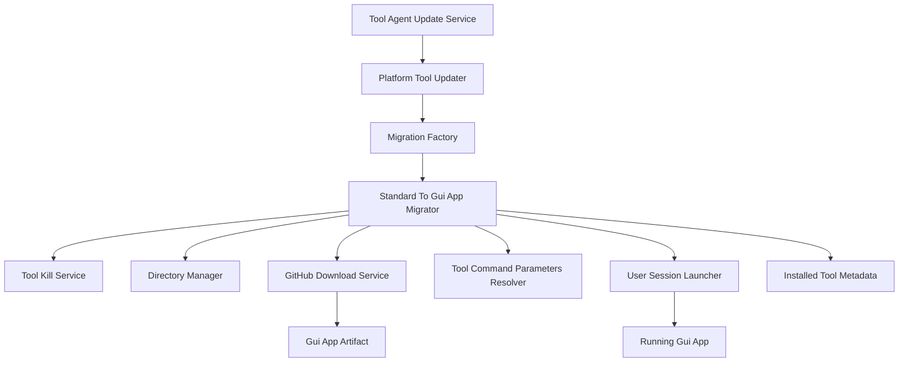
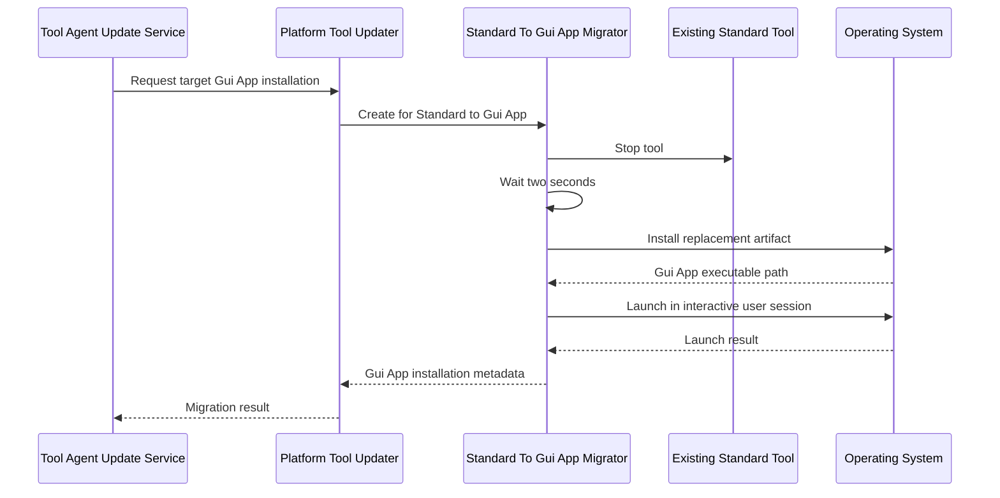
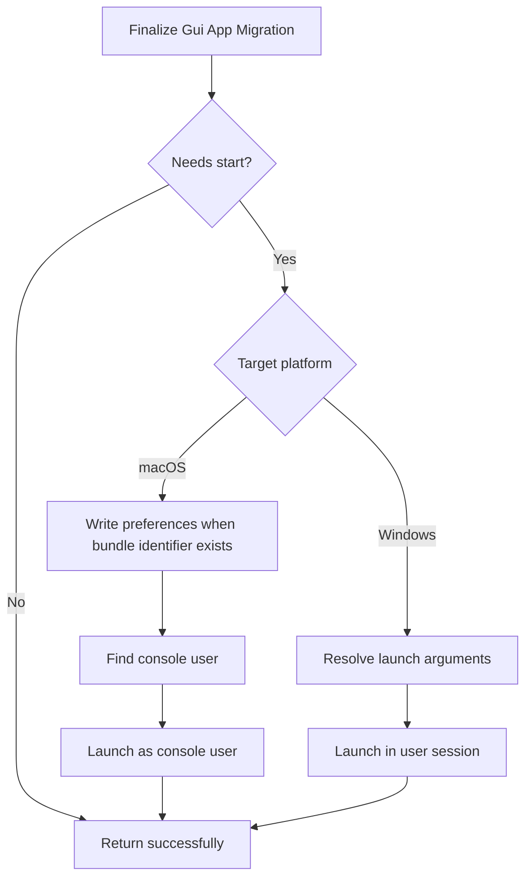
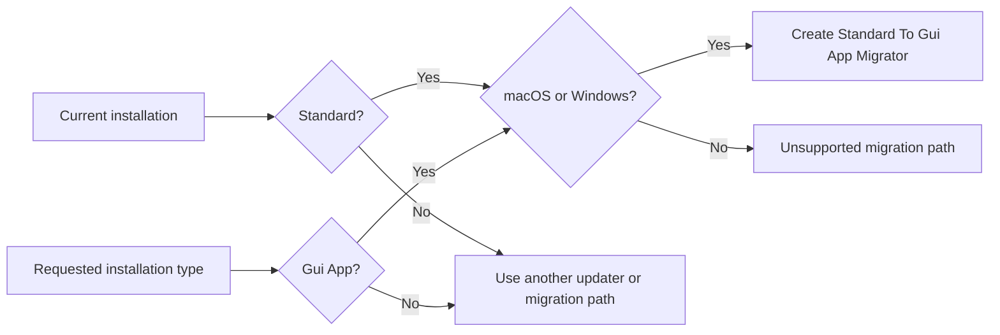

# Platform Tool Updater Migration Standard To Gui App

Platform Tool Updater Migration Standard To Gui App is the platform-specific migration implementation that converts an installed OpenFrame client tool from a **Standard** installation to a **Gui App** installation. It belongs to the Rust `openframe_client` library supplied by OpenFrame OSS Library version `0.0.5`, which this repository consumes to run the endpoint client.

The module is selected only for the Standard-to-Gui App transition on macOS and Windows. It stops the existing tool before replacing its installation artifact, records the resulting Gui App installation metadata, and attempts to start the replacement in the interactive user session. It does not provide a restoration path after a failed artifact migration; operators must reinstall a tool if its binary was lost.

## Scope and Source

The implementation is `StandardToGuiAppMigrator`, constructed by the module's `new` function. Its source is maintained in OpenFrame OSS Library: [standard to GUI application migrator](https://github.com/flamingo-stack/openframe-oss-lib/blob/7a766f00e4f58b5d89db007b878ac8d6e0c344f4/clients/openframe-client/src/platform/tool_updater/migration/standard_to_gui_app.rs).

This is a migration, not an ordinary in-place update. The enclosing tool updater chooses migration when the persisted installation type differs from the requested `DownloadConfiguration` installation type. The migration factory supports this particular transition only; same-type updates and other installation forms are handled elsewhere in the client updater architecture.

## Responsibilities

- Declare `Standard` as the source installation type and `GuiApp` as the destination type.
- Stop the old tool and wait two seconds before manipulating its executable.
- Install or write the Gui App artifact using an operating-system-specific workflow.
- Return an `Installation::GuiApp` record containing the executable path and optional bundle identifier.
- Resolve configured command parameters where possible before launch.
- Start the application in a user-visible session, with special background behavior for the chat tool.
- Log preparation, migration, finalization, launch, and rollback conditions using the tool agent identifier.

## Architecture and Placement

The migrator receives `ToolUpdaterDeps`, a dependency bundle owned by the platform tool updater. The dependencies used directly by this migration are the tool termination service, directory manager, download service, and command-parameter resolver. User-session and preference helpers are called through platform modules on the relevant operating system.

The migration contract separates the workflow into `prepare`, `migrate`, `finalize`, and `rollback` phases. The surrounding `run_migration` coordinator creates the migrator from the current persisted installation and requested target type, invokes these phases in order, and returns the new installation record only after finalization succeeds.

## Installation Data Contract

The source record is a Standard installation. The target record is a Gui App installation:

| Item | Meaning during migration |
| --- | --- |
| `InstalledTool` | Supplies the tool agent identifier, existing installation data, and configured launch arguments. |
| `DownloadConfiguration` | Supplies the target artifact name, download location, requested installation type, and optional bundle identifier. |
| `Installation::GuiApp` | Stores the resolved executable path and the optional bundle identifier after the artifact is installed. |
| `MigrationContext` | Carries `old_cleaned: false` and `needs_start: true` from preparation to finalization. |

`old_cleaned` remains false even though the macOS flow removes the previous binary; this implementation does not use that field to coordinate additional cleanup. `needs_start` causes finalization to attempt application startup.

## End-to-End Process

### Phase 1: Preparation

`prepare` logs the transition, invokes `stop_tool` using the tool agent identifier, waits for two seconds, and creates the migration context. A stop failure aborts the migration before any new artifact is installed.

### Phase 2: Artifact Migration

The operating system determines the installation mechanism:

- **macOS:** The migrator removes the old standard executable when it exists, downloads and extracts all artifact contents into `/Applications`, and resolves the new executable path. It first recognizes an application-bundle path through `DirectoryManager`; otherwise it derives the executable below `Contents/MacOS` using the tool agent identifier.
- **Windows:** The migrator delegates download and binary writing to the platform updater helper at the managed agent path supplied by `DirectoryManager`. That path becomes the Gui App executable path.

Both paths return `Installation::GuiApp`, preserving `bundle_id` from the download configuration when supplied.

### Phase 3: Finalization and Launch

Finalization is skipped when `needs_start` is false or the migration did not produce a Gui App record. Otherwise, it starts the new application using platform-specific session behavior.

On macOS, the migrator converts resolved command arguments to application preferences only when a bundle identifier is available. A preference-write failure is logged but does not fail finalization. It then identifies the console user. If no console user exists, it logs a warning and returns successfully without launching. With a user available, it launches as that user. Tools with a bundle identifier normally receive no direct command arguments; the chat tool receives `--background`. Tools without a bundle identifier use their configured launch arguments.

On Windows, command arguments are resolved through the parameter resolver, falling back to the original arguments if resolution fails. The chat tool is additionally passed `--background` so it starts in the system tray. The executable is launched in the user session to make the Gui App visible. Launch failures are warnings rather than migration failures, so the installed Gui App record is still returned.

## Selection Rules and Supported Platforms

The migration factory returns no migrator when source and target types are equal. It creates this migrator only for Standard-to-Gui App on macOS or Windows. Unsupported type transitions cause an error rather than silently applying an incompatible updater.

## Failure Semantics and Operational Considerations

The coordinator calls `rollback` only when the artifact migration phase fails. This module's rollback intentionally does not recover the prior executable. It logs that the binary may have been lost and that reinstall is required, then returns successfully. Finalization errors are propagated by the coordinator, but individual application-launch failures are handled locally as warnings and do not fail finalization.

Maintain these invariants when modifying the module:

1. Stop the existing tool before replacing or deleting its executable.
2. Treat the returned Gui App installation path as the persisted identity of the new installation.
3. Preserve the optional bundle identifier because macOS preference writing and launch behavior depend on it.
4. Keep launches scoped to the active user session; a background service session is not sufficient for a tray or interactive Gui App.
5. Do not claim rollback restores the old Standard binary unless a real backup and restore mechanism is added.
6. Test both platform branches independently, including no-console-user behavior on macOS and chat-tool background launch behavior on both supported platforms.

## Observability

Structured logs include `tool_id` for preparation, migration, finalization, successful launches, launch failures, and rollback warnings. These records are the primary evidence for determining whether failure occurred before artifact replacement, while launching the Gui App, or during an unsupported migration request. The module does not emit a dedicated result message itself; its returned installation or propagated error is handled by the enclosing tool update flow.
