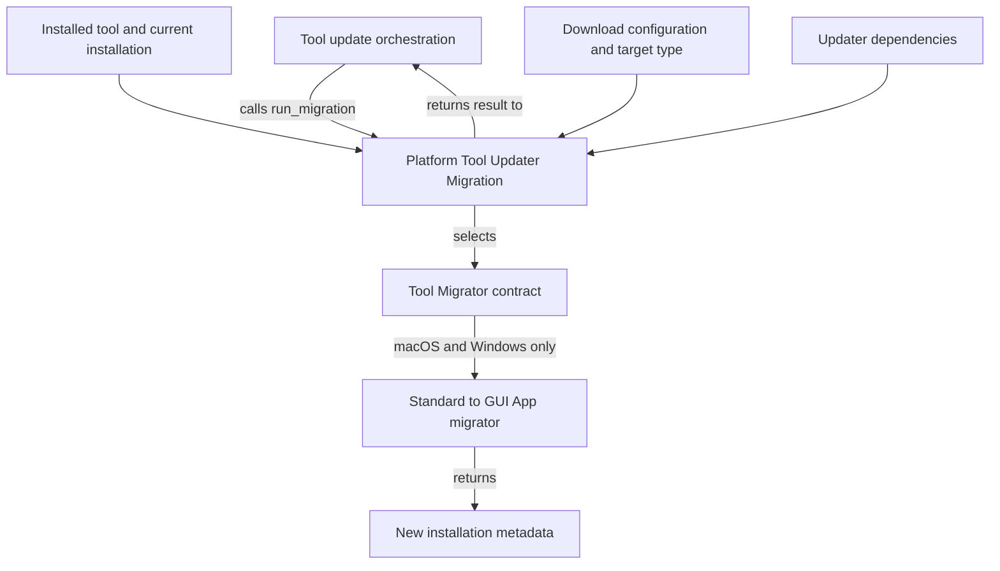
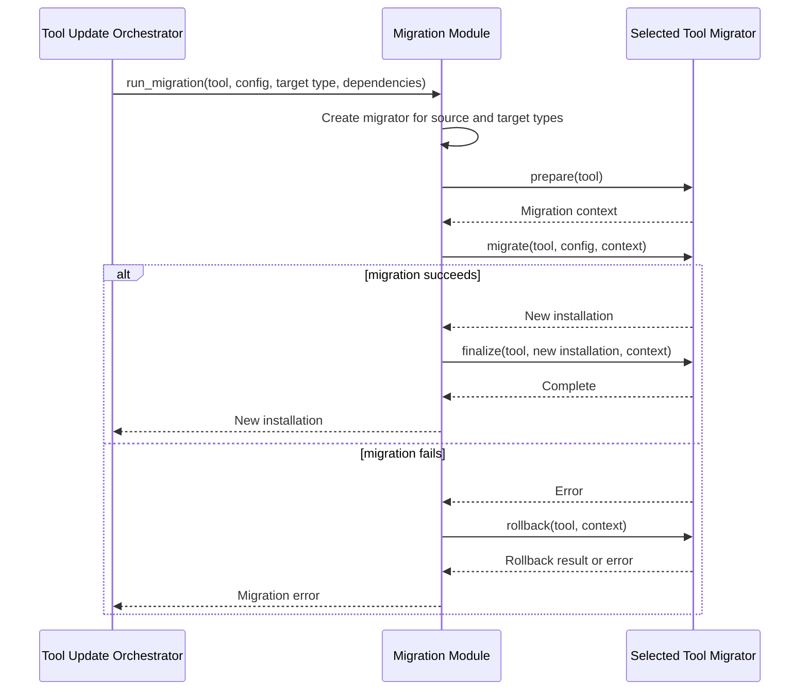
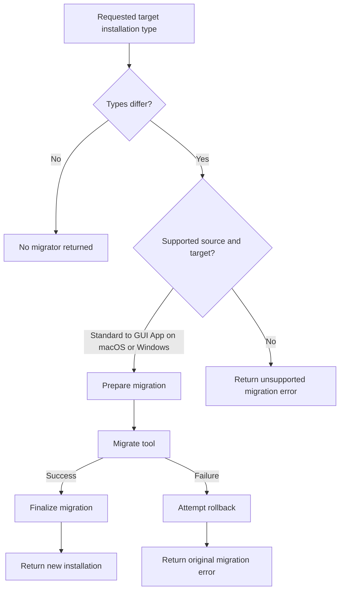

# Platform Tool Updater Migration

Platform Tool Updater Migration is the OpenFrame client subsystem that changes an installed tool from one installation representation to another. It is part of the `openframe_agent_lib` Cargo artifact supplied by the OpenFrame OSS Library and run by the OpenFrame client. Its current supported migration is **Standard to GUI App**, and it is compiled only on macOS and Windows.

The module deliberately separates migration from a normal in-place update. A migration is selected when the recorded installation type differs from the desired `InstallationType`; it creates a platform-specific migrator, executes a three-phase lifecycle, and returns the resulting `Installation` record for the caller to persist and use.

Source implementation: [migration module](https://github.com/flamingo-stack/openframe-oss-lib/blob/7a766f00e4f58b5d89db007b878ac8d6e0c344f4/clients/openframe-client/src/platform/tool_updater/migration/mod.rs).

## Scope and Responsibilities

The module owns the following decisions and contracts:

- Maps an existing `Installation` value to its type: Standard, GUI App, or Service.
- Detects whether the existing and requested installation types differ.
- Selects a compatible `ToolMigrator` implementation or rejects the requested transition.
- Defines a consistent asynchronous lifecycle: prepare, migrate, finalize, and rollback.
- Carries limited cross-phase state in `MigrationContext`.
- Logs selection and lifecycle progress, including rollback warnings and failures.

It does not decide when a tool should be updated, download a tool asset itself, or persist the returned installation metadata. Those responsibilities remain with the enclosing tool update orchestration and its injected dependencies.

## Installation Model

An installed tool has exactly one of these representations:

| Installation variant | Stored identity | Migration relevance |
| --- | --- | --- |
| Standard | Optional executable path | The only supported source representation for migration. |
| GUI App | Required executable path and optional bundle identifier | The supported target representation. |
| Service | Service name and optional executable path | Recognized for comparison, but no migration path is registered. |

`needs_migration` compares the type inferred from the stored `Installation` with the requested `InstallationType`. It does not inspect versions, files, or platform state. Therefore, type equality means no migration is needed even if a separate ordinary update may still be necessary.

## Architecture

The public factory, `create_migrator`, is the policy boundary. It derives the source type from the stored installation, returns no migrator when source and target types match, and otherwise selects a concrete implementation. At present, only Standard to GUI App is accepted on macOS and Windows. Any other differing pair fails explicitly as an unsupported migration path.

## Core Components

### Migration Context

`MigrationContext` is a cloneable, defaultable value that lets a migrator communicate cleanup and startup requirements across lifecycle phases:

| Field | Meaning |
| --- | --- |
| `old_cleaned` | Records whether the old installation has been cleaned up. |
| `needs_start` | Records whether the resulting tool needs to be started. |

The migration framework transports this context unchanged. Concrete migrators determine how the flags are set and interpreted.

### Tool Migrator Contract

`ToolMigrator` is an asynchronous, thread-safe trait. Every implementation identifies its source and destination installation types and implements the following operations:

1. `prepare` validates or stages the existing tool and produces a `MigrationContext`.
2. `migrate` receives the installed tool, download configuration, and context, then creates a new `Installation`.
3. `finalize` completes work after a successful migration using the original tool, new installation, and context.
4. `rollback` is invoked when `migrate` fails after preparation.

The trait supplies a default rollback that logs a warning and succeeds without compensating changes. A new migrator should override this method whenever preparation or migration can leave externally visible state that must be restored.

### Standard to GUI App Migrator

The Standard to GUI App implementation is conditionally available on macOS and Windows. The factory constructs it with `ToolUpdaterDeps`. The provided module surface establishes that it owns the concrete implementation of the migration contract; its constructor stores those dependencies for its lifecycle operations.

### Dependency Bundle

`ToolUpdaterDeps` provides the facilities used by concrete migrations:

| Dependency | Role supplied to a migrator |
| --- | --- |
| GitHub download service | Obtains tool content described by the download configuration. |
| Tool kill service | Stops a running tool when migration requires it. |
| Directory manager | Resolves and manages tool, asset, and staging locations. |
| Tool command parameters resolver | Resolves command parameters needed by tool operations. |

## Migration Lifecycle

`run_migration` enforces the lifecycle in order:

1. It calls `create_migrator`. If the types are identical, the factory returns no migrator and `run_migration` reports that migration was not needed.
2. It calls `prepare` and wraps failures with the tool identifier and preparation context.
3. It calls `migrate`. On success, the new installation is passed to `finalize`.
4. If `migrate` fails, it attempts rollback. A rollback failure is logged but does not replace the original migration error.
5. It returns the new installation only after finalization succeeds.

A finalization failure is returned directly after a successful migration. The orchestration does not automatically invoke rollback in that case, so concrete implementations must make finalization safe to retry or otherwise account for partially finalized state.

## Decision and Failure Flow

The platform gate is compile-time conditional. On platforms other than macOS and Windows, Standard to GUI App is not registered, so a differing migration request is unsupported. Similarly, Service transitions and GUI App transitions are not implemented by this module regardless of whether their types can be recognized.

## Relationship to the Tool Update System

The enclosing tool updater has two distinct flows:

- A normal update selects an updater based on the existing installation representation and performs its own prepare, apply, finalize, and rollback lifecycle.
- A migration receives a desired target installation type, selects a `ToolMigrator`, and returns a replacement `Installation` representation.

This distinction prevents an updater for the old representation from silently changing the tool into a different installation model. The caller should use migration only when the target installation type differs and should treat the returned installation as the authoritative result of the transition.

## Operational Guidance

### Logging and Diagnosis

The module emits informational events when a migration is required and at each lifecycle phase. It emits warnings when the default rollback is used and errors when migration or rollback fails. Include the tool agent identifier, source type, target type, phase, and original error when diagnosing failures.

### Adding a Migration Path

To support another transition:

1. Implement `ToolMigrator` with precise `from_type` and `to_type` values.
2. Make `prepare`, `migrate`, and `finalize` idempotent or safely recoverable where possible.
3. Implement rollback if any operation can alter the existing installation before migration completes.
4. Add the type pair to `create_migrator`, applying platform guards if the implementation is platform-specific.
5. Test equal-type detection, unsupported paths, preparation failure, migration failure with rollback, successful finalization, and finalization failure.

Avoid treating `InstallationType` recognition as support for a transition. The explicit factory match is the source of truth for supported migrations.

## Source and Runtime Ownership

This repository consumes `openframe_agent_lib` version `v0.0.5` from the OpenFrame OSS Library. The code documented here resides in that library, while the OpenFrame OSS Tenant repository runs the client as part of its deployed platform. The library source is pinned in the link at the start of this document.