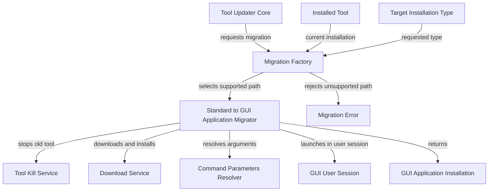
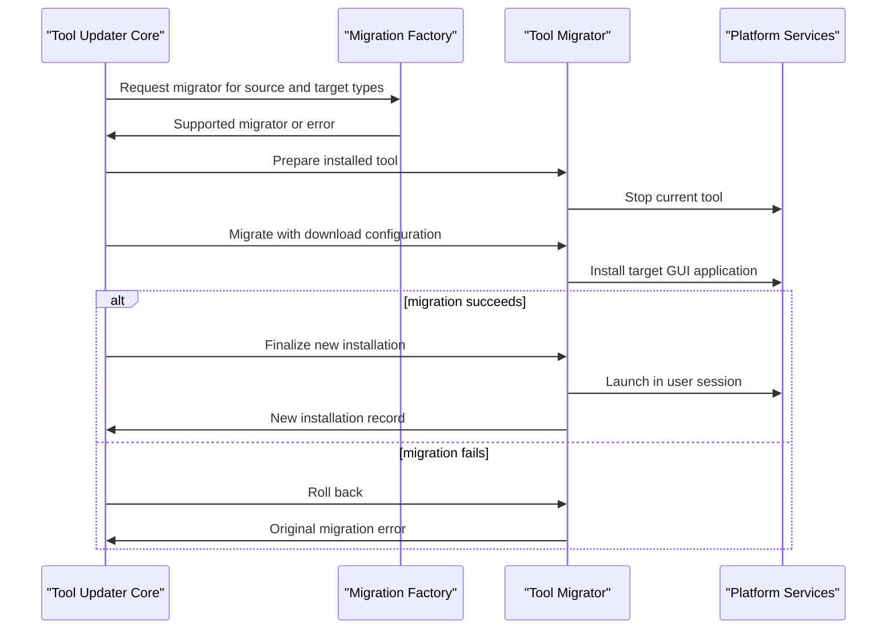

# Platform Tool Updater Migration

## Purpose

Platform Tool Updater Migration is the OpenFrame Client capability that changes an installed integrated tool from one installation form to another. It is implemented by the `openframe_agent_lib` artifact from the OpenFrame OSS Library and runs in this repository's OpenFrame Client. The current supported path is **Standard** to **GUI application** on macOS and Windows.

This is a migration rather than an ordinary binary update: the target installation representation changes, platform-specific files may be replaced or extracted, and the migrated GUI application is started in the logged-in user's session when possible.

The implementation sources are maintained in the OpenFrame OSS Library:

- [Migration orchestration source](https://github.com/flamingo-stack/openframe-oss-lib/blob/16e7c1cbd9664e7d10ec5ebca7d53c9bd314decf/clients/openframe-client/src/platform/tool_updater/migration/mod.rs)
- [Standard to GUI application source](https://github.com/flamingo-stack/openframe-oss-lib/blob/16e7c1cbd9664e7d10ec5ebca7d53c9bd314decf/clients/openframe-client/src/platform/tool_updater/migration/standard_to_gui_app.rs)

## Scope and Supported Transitions

An installation is classified as Standard, GUI application, or Service. `needs_migration` compares the persisted installation form with the requested target form. If they match, no migration is needed. `create_migrator` selects an implementation only when the forms differ.

At present, the factory accepts Standard to GUI application only, and only in macOS and Windows builds. Any other differing source and target combination is rejected as unsupported. This deliberate factory boundary prevents a generic update request from silently applying an unimplemented installation conversion.

## Architecture

The migration module depends on the parent tool updater's dependency bundle. Its concrete implementation uses the tool-kill, download, directory, command-parameter, and platform user-session capabilities supplied through that bundle. The parent tool updater owns phase orchestration and invokes `prepare`, `migrate`, and `finalize` in sequence.

## Migration Lifecycle

`run_migration` in the parent tool updater establishes the execution contract:

1. It obtains a migrator for the current and target installation types. A request that needs no migration is treated as an error at this layer because callers should not invoke the lifecycle unnecessarily.
2. It calls `prepare` and attaches the tool identifier to failures.
3. It calls `migrate`. On success, the returned `Installation` represents the new persisted form.
4. It calls `finalize` with that new installation, which performs post-install launch behavior.
5. If the migration step fails, it attempts rollback and returns the original migration error. A rollback failure is logged but does not replace the original failure.

## Core Components

| Component | Responsibility |
| --- | --- |
| `MigrationContext` | Carries migration state between lifecycle phases. The current implementation marks whether old content was cleaned and whether the target application should be started. |
| `ToolMigrator` | Asynchronous extension point defining source and target types plus prepare, migrate, finalize, and rollback phases. Implementations must be thread-safe. |
| `create_migrator` | Derives the source type from the persisted installation and returns the supported platform-specific migration implementation, no implementation for an unchanged type, or an error for an unsupported transition. |
| `needs_migration` | Predicate that compares the current derived installation type with the requested target type. |
| `StandardToGuiAppMigrator` | macOS and Windows implementation of Standard to GUI application conversion. |

## Detailed Submodule

- [Standard to GUI Application Migration](platform_tool_updater_migration/standard_to_gui_application_migration/standard_to_gui_application_migration.md) details the only currently supported installation-form conversion, including its macOS and Windows behavior, user-session launch rules, and recovery boundaries.

## Platform Behavior

### Shared Preparation and Finalization

Preparation stops the running tool by tool agent identifier and waits two seconds before changing its installed form. The context requests a subsequent application start. Finalization exits without launching when that flag is unset or when the resulting installation is not a GUI application.

The implementation treats launch and preferences failures as warnings after a successful install. Therefore, a successful migration can return a GUI application installation even if the immediate post-migration launch could not be completed. Operators should use the client logs to distinguish installation success from launch success.

### macOS

On macOS, migration removes the legacy standard binary when it exists, downloads and extracts the configured artifact into `/Applications`, and derives the executable or application-bundle path. The returned installation retains the configured bundle identifier.

During finalization, the migrator resolves configured command arguments where possible. When a bundle identifier is available, it converts those arguments into application preferences and attempts to write them. It then finds the console user and launches the application as that user. A chat tool with a bundle identifier starts with the `--background` argument; a bundle-based non-chat application starts without command-line arguments, while a non-bundle application uses its configured arguments.

### Windows

On Windows, migration downloads and writes the target binary to the tool's agent path and returns that path as the GUI application executable. Finalization resolves run arguments, falling back to the stored arguments if resolution fails. It adds `--background` for the chat tool and launches the executable in the interactive user session so that a tray application can be visible.

## Failure Semantics and Operational Considerations

- Unsupported conversions fail before preparation. No fallback installer is selected.
- The default trait rollback is a no-op that logs a warning. The Standard to GUI application implementation also logs that the binary may be lost and that reinstallation is required; it does not reconstruct the removed Standard installation.
- macOS removal of the old binary intentionally ignores an individual removal error before attempting target installation. A failure later in the process can therefore require a fresh installation.
- The migration API returns an `Installation` only after the platform migration step succeeds. The caller is responsible for persisting the returned installation representation through the wider tool update workflow.
- Because user-session availability is required for immediate GUI startup, a device without an active console user can complete the file migration but not launch the GUI application immediately.

## Relationship to the OpenFrame Client

This module is one narrow part of the Rust OpenFrame Client's platform tool updater. The client consumes `openframe_agent_lib` version `v0.0.5` from the OpenFrame OSS Library. The broader platform deploys the client as part of the tenant services and uses tool update commands to manage integrated tooling on endpoint devices.

The migration module does not receive commands, persist tool records, or publish update outcomes itself. Those responsibilities belong to adjacent client services and the parent tool updater. Its responsibility is to safely select and execute the installation-form conversion requested by that workflow.
