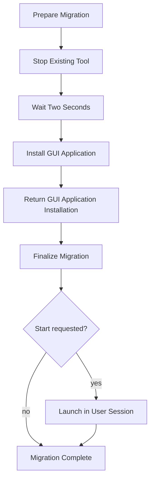

# Standard to GUI Application Migration

## Purpose

Standard to GUI Application Migration is the currently implemented Platform Tool Updater Migration path. It converts a managed tool from the Standard installation form to the GUI application form on macOS and Windows. The code belongs to the OpenFrame OSS Library `openframe_agent_lib` artifact, which is run by this repository's OpenFrame Client.

The implementation source is [standard to GUI application migration source](https://github.com/flamingo-stack/openframe-oss-lib/blob/16e7c1cbd9664e7d10ec5ebca7d53c9bd314decf/clients/openframe-client/src/platform/tool_updater/migration/standard_to_gui_app.rs).

## Responsibilities

- Stop the running Standard tool before changing its installed form.
- Download, extract, or write the GUI application artifact according to the operating system.
- Return a GUI application installation record with an executable path and configured bundle identifier.
- Attempt to launch the migrated application in an interactive user context.
- Log recovery guidance when migration failure requires reinstallation rather than restoration.

## Lifecycle

`prepare` invokes the tool-kill service with the tool agent identifier and waits two seconds. It returns a `MigrationContext` with `needs_start` set to true. `migrate` selects the compile-time operating-system implementation and returns an `Installation::GuiApp` value. `finalize` only starts an application when that context flag is true and the returned installation is a GUI application.

The surrounding updater calls rollback only when the migration step itself fails. This implementation's rollback is non-restorative: it warns that the old binary may be lost and that reinstallation is required.

## macOS Conversion

The macOS path attempts to remove the legacy binary at the directory manager's agent path. It downloads and extracts the configured artifact under `/Applications`, then records either the detected application-bundle path or an executable path beneath `Contents/MacOS`.

When finalizing a bundle-based application, it resolves the configured command arguments, converts them into preferences, and attempts to write those preferences. It locates the console user and launches the executable as that user. Preference failures, a missing console user, and launch failures are warnings rather than fatal migration errors. A chat tool with a bundle identifier receives `--background`; other bundle-based tools receive no arguments, while non-bundle tools receive their configured arguments.

## Windows Conversion

The Windows path downloads and writes the GUI executable at the directory manager's managed agent path. The returned GUI application record uses that path and preserves the configured bundle identifier.

Finalization resolves command arguments and falls back to stored arguments if resolution fails. It appends `--background` for the chat tool, then launches the executable in the user session so the GUI can appear in the system tray. Launch failures are logged as warnings.

## Failure Boundaries

| Event | Result |
| --- | --- |
| Tool shutdown fails | Preparation fails and migration does not continue. |
| Download, extraction, or binary write fails | Migration fails and the parent updater attempts rollback. |
| Legacy macOS binary removal fails | The error is ignored and artifact installation continues. |
| Preference or argument resolution fails | The operation logs or falls back to stored arguments where applicable. |
| No interactive user or GUI launch failure | The installation remains successful, but immediate startup may not occur. |
| Rollback requested | The module reports a recovery condition; it does not recreate the Standard installation. |

## Collaborators

The migrator receives `ToolUpdaterDeps` from the parent updater. It uses the tool-kill service for shutdown, the directory manager for managed locations, the download service or Windows binary helper for artifact placement, the command-parameter resolver for launch configuration, and operating-system user-session helpers for visible GUI startup.

The migration framework source is [migration framework source](https://github.com/flamingo-stack/openframe-oss-lib/blob/16e7c1cbd9664e7d10ec5ebca7d53c9bd314decf/clients/openframe-client/src/platform/tool_updater/migration/mod.rs). See the parent [Platform Tool Updater Migration](../../platform-tool-updater-migration.md) documentation for migration selection and integration with the parent updater.
