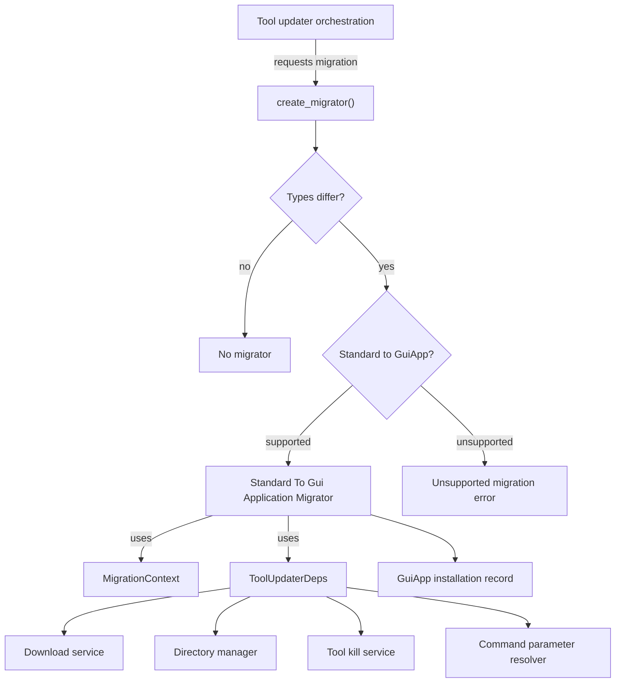
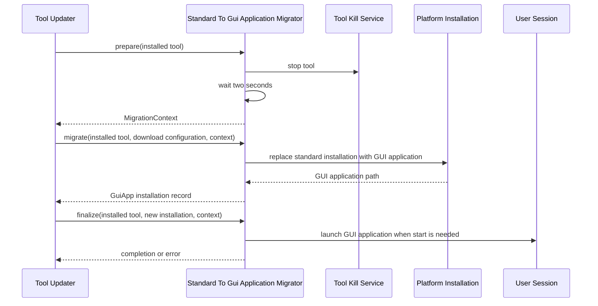
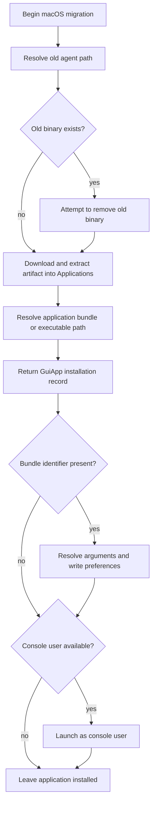

# Standard To Gui Application Migration

Standard To Gui Application Migration is the platform-specific migration path that converts an installed OpenFrame client tool from the `Standard` installation representation to the `GuiApp` representation. It is implemented by the `openframe_agent_lib` Rust artifact from OpenFrame OSS Library and is run on managed endpoints by this repository’s OpenFrame client.

The module is available only on macOS and Windows. It stops the existing tool before replacing its installation, records the new GUI application installation, and then attempts to launch it in the interactive user context. The migration framework deliberately identifies unsupported installation-type conversions rather than silently applying an inappropriate updater.

## Scope and Responsibilities

| Area | Responsibility |
|---|---|
| Migration selection | Compares the persisted installation variant with the requested installation type and constructs a migrator only for the supported `Standard` to `GuiApp` path. |
| Lifecycle contract | Defines the asynchronous prepare, migrate, finalize, and rollback operations that every tool migrator must implement. |
| macOS conversion | Removes the legacy standard binary, downloads and extracts the GUI application into `/Applications`, records its executable or application-bundle path, writes preferences when applicable, and launches it as the console user. |
| Windows conversion | Writes the downloaded GUI binary at the managed tool path, records it as a GUI application, and launches it in the user session. |
| Operational behavior | Emits structured informational and warning logs; failed preference writing or GUI launch is logged without turning finalization into a migration error. |

The module does not decide when an update is delivered, resolve download metadata, persist the installed-tool record, or coordinate broader tool lifecycle operations. Those responsibilities belong to the surrounding tool updater and its injected dependencies.

## Architecture

`ToolMigrator` separates the generic migration lifecycle from the operating-system-specific conversion. `create_migrator` derives the source type from the current `Installation`, compares it with the requested `InstallationType`, and returns either no migrator, the Standard To Gui Application Migration implementation, or an unsupported-path error.

### Core Types

- **`MigrationContext`** carries lifecycle state between phases. The Standard To Gui Application Migration prepares a context with `old_cleaned` set to `false` and `needs_start` set to `true`. The current migrator uses the latter field to decide whether finalization should launch the application.
- **`ToolMigrator`** is an asynchronous, thread-safe interface. It supplies the source and target types and defines `prepare`, `migrate`, `finalize`, and `rollback` phases.
- **`StandardToGuiAppMigrator`** owns `ToolUpdaterDeps`, which provides endpoint services for stopping tools, locating installation paths, downloading artifacts, and resolving run parameters.
- **`Installation`** represents the persisted form of an installed tool. The migrator returns `Installation::GuiApp` with an executable path and an optional bundle identifier copied from the download configuration.
- **`DownloadConfiguration`** supplies the artifact information, including the target file name and optional bundle identifier used during the migration.

## Migration Selection and Compatibility

The factory determines the current type from the concrete `Installation` variant:

| Current installation | Requested type | Result |
|---|---|---|
| Same type | Same type | No migration is created. |
| Standard | GuiApp | Creates the Standard To Gui Application Migrator on macOS and Windows. |
| Any other differing pair | Different type | Returns an unsupported migration-path error. |

`needs_migration` performs only the type comparison. It does not verify artifact availability, validate a target path, or determine whether an already-installed application is healthy. The orchestration layer must handle those concerns before and around the lifecycle execution.

## Lifecycle and Data Flow

The generic updater invokes the migrator in phase order. The prepare phase is destructive in the sense that it stops the current process before the new artifact is installed. A failed later phase therefore relies on operational recovery rather than an automatic restoration of the standard binary.

### Prepare

`prepare` logs the tool identifier, asks the tool-kill service to stop the existing tool, and waits for two seconds. It then returns the initial context. Failure to stop the tool aborts this phase because the error is propagated.

### Migrate

`migrate` dispatches at compile time to the macOS or Windows implementation and returns a `GuiApp` installation record. The passed migration context is not inspected by this implementation during the artifact replacement phase.

### Finalize

`finalize` is a guarded start phase:

1. It returns immediately when `needs_start` is false.
2. It returns immediately if the returned installation is not a GUI application.
3. Otherwise, it runs the platform-specific launch procedure.

The launch attempt is best effort. A launch error is emitted as a warning and finalization returns successfully. This preserves the installed GUI application record even where no interactive user session is currently available.

### Rollback

The Standard To Gui Application Migration rollback implementation logs a warning that the binary may be lost and that reinstallation is required. It does not recreate or restart the prior standard installation. Maintainers should treat migration failures after old-binary removal as a recovery scenario requiring a subsequent installation action.

## macOS Behavior

On macOS, the migrator performs the following conversion:

- The old standard executable path comes from the directory manager. If a file is present, removal is attempted; a removal failure is intentionally ignored.
- The new artifact is downloaded and fully extracted into `/Applications` through the download service.
- The resulting path is derived from the configured target file name. If the target resolves as an application bundle, the record retains that application path. Otherwise, it points to `Contents/MacOS` with the tool agent identifier as the executable name.
- When a bundle identifier is configured, the module resolves run-command arguments through the command-parameter resolver and converts them to preference key-value pairs. Preference-write failures are warnings only.
- The tool launches only if a console user exists. For a tool with a bundle identifier, normal tools launch with no arguments. The chat tool uses `--background`; a tool without a bundle identifier uses its configured run-command arguments.

## Windows Behavior

On Windows, the migrator uses the managed tool path supplied by the directory manager. It downloads and writes the new binary at that path through the updater download helper, then returns a GUI application installation containing that executable path and the configured bundle identifier.

During finalization, it resolves the tool run-command arguments through the command-parameter resolver, falling back to the original arguments when resolution fails. The chat tool receives an additional `--background` argument so it starts in the system tray. The executable is then launched through the platform user-session helper rather than the service session, allowing the GUI to be visible to the signed-in user. A failed user-session launch is logged as a warning.

## Dependency Boundaries

The migration code is supplied by OpenFrame OSS Library, versioned in this repository as the `openframe_agent_lib` dependency. Its direct collaborator boundaries are:

| Collaborator | Used for | Behavior in this migration |
|---|---|---|
| Tool updater orchestration | Phase sequencing and installed-state handling | Calls the migration lifecycle and consumes the returned installation record. |
| Tool kill service | Process shutdown | Stops the legacy standard tool before replacement. |
| Directory manager | Managed filesystem locations and bundle recognition | Locates the old and Windows target paths; assists macOS application-path resolution. |
| Download service | Artifact retrieval and extraction | Extracts the macOS application bundle into `/Applications`. |
| Binary download helper | Windows artifact placement | Downloads and writes the GUI executable at the managed agent path. |
| Command parameter resolver | Runtime-argument resolution | Supplies resolved arguments for preferences and process launch, with a fallback to stored arguments. |
| User-session helpers | Interactive GUI start | Starts the application as the macOS console user or in the Windows user session. |

## Observability and Failure Semantics

The migration emits structured tracing events with the tool identifier for prepare, migration, and finalization. Important operational outcomes are intentionally non-fatal:

| Event | Outcome |
|---|---|
| Existing macOS binary cannot be removed | Removal error is ignored; migration continues. |
| Argument resolution fails | Stored run-command arguments are used. |
| macOS preference write fails | Warning is logged; launch processing continues. |
| No macOS console user exists | Warning is logged; the application remains installed but is not launched. |
| GUI launch fails | Warning is logged; finalization still succeeds. |
| Migration rollback is requested | Warning indicates that the prior binary may be lost and reinstallation is required. |
| Tool stopping, artifact download, extraction, or binary write fails | The error is propagated, causing the corresponding lifecycle phase to fail. |

## Maintenance Considerations

- Keep the supported migration matrix explicit in `create_migrator`. Adding a new installation transition requires a dedicated migrator or an intentional unsupported-path error.
- Preserve the distinction between successful installation and successful launch. Interactive launches can fail because no user is signed in even when the artifact conversion completed correctly.
- Any change to GUI argument handling must preserve the chat tool’s background-start behavior on both supported platforms.
- Rollback is not restorative. Changes that make the replacement phase more destructive should be evaluated with reinstall and recovery workflows in mind.
- The module is compile-time gated to macOS and Windows. Linux builds do not include the Standard To Gui Application Migration implementation.

## Source

The implementation is maintained in OpenFrame OSS Library: [standard to gui application migration source](https://github.com/flamingo-stack/openframe-oss-lib/blob/16e7c1cbd9664e7d10ec5ebca7d53c9bd314decf/clients/openframe-client/src/platform/tool_updater/migration/standard_to_gui_app.rs) and [migration framework source](https://github.com/flamingo-stack/openframe-oss-lib/blob/16e7c1cbd9664e7d10ec5ebca7d53c9bd314decf/clients/openframe-client/src/platform/tool_updater/migration/mod.rs).
