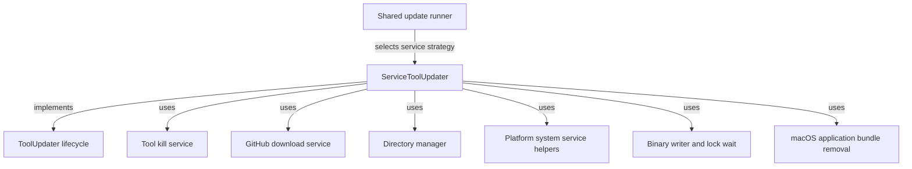
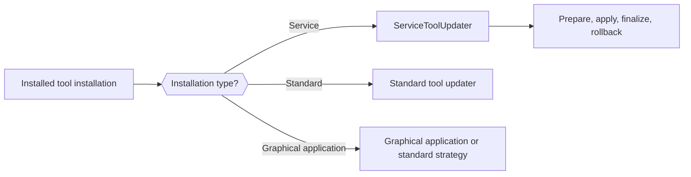
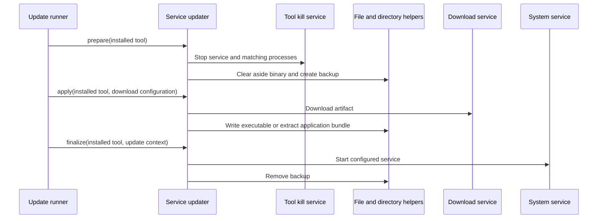
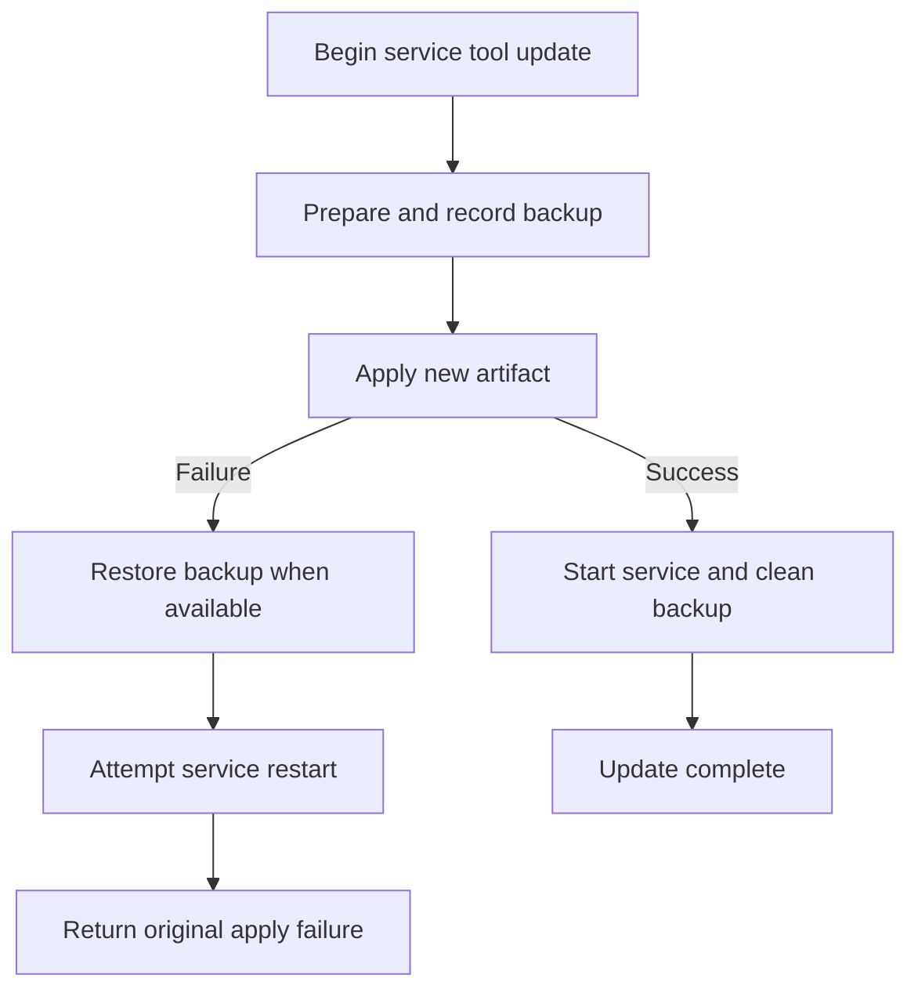

# Platform Tool Updater Service

Platform Tool Updater Service is the service-installation strategy for updating an integrated tool managed by the OpenFrame endpoint client. It is implemented by `ServiceToolUpdater` in the `openframe_agent_lib` Rust library and is selected when an `InstalledTool` has the `Installation::Service` variant. Its responsibility is deliberately narrow: stop the existing service and managed processes, preserve a rollback copy when possible, replace or extract the new artifact, start the service again, and restore the saved binary if applying the update fails.

The implementation is supplied by [OpenFrame OSS Library source](https://github.com/flamingo-stack/openframe-oss-lib/blob/7a766f00e4f58b5d89db007b878ac8d6e0c344f4/clients/openframe-client/src/platform/tool_updater/service.rs). This repository runs that library as part of the OpenFrame client.

## Scope and Contract

`ServiceToolUpdater` implements the common `ToolUpdater` lifecycle:

| Lifecycle operation | Service updater responsibility |
|---|---|
| `prepare` | Stop the declared service on a best-effort basis, terminate remaining managed processes, clear an aside binary, record surviving processes, and back up the executable unless it is an application bundle. |
| `apply` | Either download and atomically write a single executable or, on macOS for an application-bundle target, remove the old bundle and extract the complete archive into the tool directory. |
| `finalize` | Ensure that the service is running on the newly installed artifact, handling Windows-specific stale-process and locked-binary cases before start, then remove the backup. |
| `rollback` | Restore the backed-up executable after an apply failure and attempt to start the configured service again. Application-bundle updates have no local binary backup. |

The outer `run_update` orchestration selects this strategy for a service installation, invokes the three main phases in order, and invokes `rollback` only when `apply` returns an error. A `finalize` error is returned by the orchestrator; it does not cause the outer update function to call rollback.

## Architecture

The component receives `ToolUpdaterDeps` at construction time. Those dependencies provide download, process-control, directory, and command-parameter capabilities while keeping the updater focused on lifecycle coordination. The service updater directly uses the download, process-control, and directory dependencies in its implementation.

### Strategy Selection

The shared factory chooses an updater from the installation record. `Installation::Service` maps to `ServiceToolUpdater`; standard and graphical-application installations use other strategies. This distinction matters because a service update must coordinate an operating-system service in addition to replacing files.

## Executable Resolution

Before altering files, the updater resolves the executable path for the installed service:

1. It obtains the managed agent path for the tool identifier from `DirectoryManager`.
2. When the service installation declares an executable path, an absolute Unix-style path or a value containing a drive separator is used as supplied.
3. A relative declared path is resolved against the parent directory of the managed agent path.
4. If the installation has no service executable path, the managed agent path is used.

This behavior permits service definitions to name an executable outside the default agent filename while retaining a deterministic location for relative paths.

## Update Flow

### Prepare Phase

`prepare` treats shutdown as a safety action but does not immediately fail when shutdown attempts fail:

- It asks the tool-kill service to stop the installed service, logging any failure as non-fatal.
- It then stops managed processes matching the tool identifier. This covers a process that may remain from a prior standard installation.
- It waits for two seconds, clears an aside binary if possible, and logs update survivors.
- For regular executable paths, it creates a backup and stores the resulting optional path in `UpdateContext`.
- For a macOS application-bundle path, it skips backup because the bundle is described as protected and too large. The context therefore contains no rollback artifact.

The returned context also contains `needs_restart`, set to `false` by this strategy. The current service updater does not use this field to request a later restart.

### Apply Phase

The apply behavior is determined by the platform and the download configuration:

- **Normal executable update:** `download_and_write_binary` downloads the configured asset and writes it to the resolved executable path.
- **macOS application-bundle update:** when the target filename contains `.app/`, the updater removes the old bundle, asks the download service to extract the complete archive into the tool folder, and applies executable permissions if the resolved executable exists afterward.

Both paths return `None` for a replacement `Installation`, so the original installation metadata continues into finalization. Errors from apply are the rollback trigger in the shared update runner.

### Finalize Phase

For a service installation, finalization starts the service by its configured service name. If the start helper returns an error but the process scan shows the installed tool is running, the updater logs a warning and accepts the service as started. Otherwise, the start error is returned with context.

On Windows, finalization adds locked-binary protections:

1. It tries to clear the aside copy of the pre-update executable.
2. If that copy is still locked, it runs orphan remediation before attempting a normal start.
3. If the Service Control Manager already reports that the service is active, it records that state. Otherwise it waits for the executable lock to clear before starting the service.
4. It removes the backup when finalization completes, including after the orphan-remediation path.

Orphan remediation stops the installed service and matching processes again, checks whether a remaining lock corresponds to a real surviving tool process, waits for executable unlock for the configured interval, and attempts a service restart. A non-process lock holder does not by itself prevent restart. Failures during this best-effort remediation are logged rather than returned.

## Failure and Recovery Model

The recovery boundary is intentionally specific:

- A backup is created before a regular executable is overwritten.
- A failure during apply calls `restore_from_backup` and then attempts to restart the service. A failure to restart after rollback is logged as non-fatal, while a restore failure is returned.
- An application-bundle update has no backup. Its rollback logs that server-driven reinstallation is required and returns successfully from the strategy rollback method.
- Finalization removes the backup after the service-start handling succeeds. Because the shared runner only automatically rolls back apply failures, operators should treat a finalization failure as a potentially partially applied update and inspect service and process state.

## Platform Behavior

| Platform area | Behavior |
|---|---|
| All supported platforms | Resolves the executable, stops service and managed processes, downloads the replacement, and attempts to start the named service. |
| macOS | Detects application-bundle targets from `.app/` in the configured target filename, replaces the full bundle by extraction, and skips backup for those bundles. |
| Windows | Uses executable-unlock waiting and special orphan-service remediation to avoid starting a service while a pre-update process still holds the old executable. |

The Windows and macOS branches are compile-time conditional. Maintaining them requires testing the relevant target build; code for one branch is not executed on the other target.

## Operational Observability

The updater emits structured tracing events keyed by `tool_id`. Important log points include preparation, service stop attempts, process termination, backup decisions, application-bundle extraction, service start, orphan remediation, rollback, and cleanup. Warnings identify actions that are allowed to continue, such as an initial failure to stop a service. Errors identify conditions that may leave the service stopped or prevent a clean startup, including a surviving pre-update process.

For an update incident, correlate entries for the same tool identifier in this order:

1. Confirm executable-path and backup decisions during preparation.
2. Check whether the service stop or process-kill operations reported warnings.
3. Identify whether the updater used single-binary replacement or macOS bundle extraction.
4. Confirm service-start output and, on Windows, locked-binary or orphan-remediation messages.
5. If apply failed, confirm whether a backup was restored and whether the service restart was attempted.

## Maintenance Considerations

- Preserve the distinction between failures that must abort the update and shutdown or remediation failures that are explicitly best-effort. Turning non-fatal cleanup failures into hard failures can reduce the updater's ability to recover a service.
- Keep executable path resolution aligned with installation metadata. A relative service executable is interpreted relative to the managed agent path, while absolute paths bypass that resolution.
- Do not assume rollback exists for every target: macOS application bundles intentionally skip local backup.
- Changes to service startup handling must retain the process-state check after a start failure. The code recognizes that a service manager can report failure even when the process has started.
- Changes to binary replacement must continue to account for stale processes and file locks, particularly in the Windows-only finalization path.

## Related Runtime Areas

This module is one strategy inside the client-side tool update subsystem. The surrounding runtime provides strategy selection, common lifecycle orchestration, process management, download and extraction, directory layout, service control, and update state persistence. Refer to the platform documentation for those broader client behaviors; this document focuses on the service-specific update strategy.