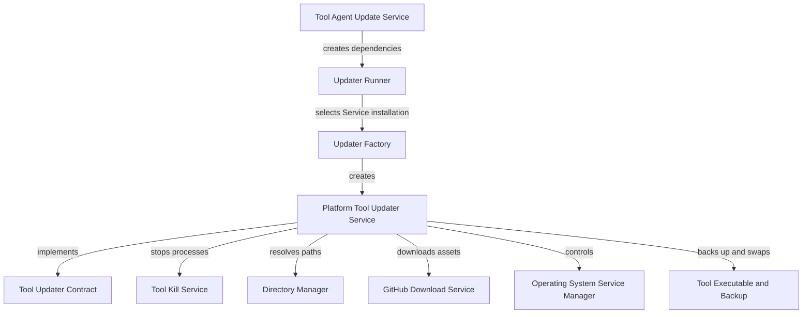
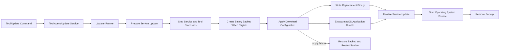
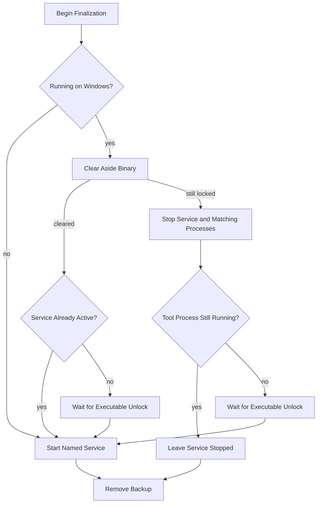

# Platform Tool Updater Service

The Platform Tool Updater Service updates tools installed as operating-system services on a managed endpoint. It is the service-installation implementation of the client library's `ToolUpdater` contract. Its source is supplied by the OpenFrame OSS Library as part of the `openframe_agent_lib` Cargo artifact; this repository runs that library in the OpenFrame client. The implementation is defined in [service.rs](https://github.com/flamingo-stack/openframe-oss-lib/blob/16e7c1cbd9664e7d10ec5ebca7d53c9bd314decf/clients/openframe-client/src/platform/tool_updater/service.rs).

Its primary responsibility is to replace a service executable safely: stop the running workload, preserve a rollback copy when possible, install the new asset, start the service, and restore the previous binary if applying the asset fails. It also contains platform-specific recovery behavior for Windows service processes and macOS application bundles.

## Scope and Role

The service operates only when an installed tool has the `Service` installation variant. That installation record supplies a service name and may supply an executable path. The broader updater factory selects this implementation for that variant; standard and graphical application installations follow separate updater implementations.

The module implements four lifecycle operations:

| Operation | Responsibility | Result |
| --- | --- | --- |
| `prepare` | Stop the service and lingering tool processes, determine the executable path, move aside a previous leftover, and create a backup when allowed. | An `UpdateContext` containing an optional backup path. |
| `apply` | Download and write the replacement executable, or extract an entire macOS application bundle. | No installation-record change is currently returned. |
| `finalize` | Verify that an old Windows image is not still active, then start the service and remove the backup. | Updated service process or an error when startup cannot be confirmed. |
| `rollback` | Restore the backup after an apply failure and attempt to restart the service. | Best-effort restoration; macOS application bundles require server-side reinstall because they have no backup. |

`ServiceToolUpdater::new` receives `ToolUpdaterDeps` and retains those dependencies for the entire lifecycle. The dependency bundle contains the download service, process and service stop support, directory management, and command-parameter resolution support. The current implementation directly uses the download, process-control, and directory dependencies.

## Architecture

The updater runner is supplied by the platform tool-updater core in the same client library. It chooses an implementation from the installation kind, invokes the lifecycle in order, and calls `rollback` only if `apply` returns an error. A failure during finalization is propagated by the runner, but the runner's automatic rollback boundary is specifically the apply phase.

## Component Relationships

### Service Tool Updater

`ServiceToolUpdater` is intentionally small: it owns `ToolUpdaterDeps` and implements the updater trait. It does not persist tool state itself. Its input is an `InstalledTool`, which includes the tool agent identifier and an `Installation::Service` record. Its download input is a `DownloadConfiguration`, which identifies the target operating system, source file, target filename, download link, installation type, and optional bundle or service metadata.

### Executable Path Resolution

The updater determines the binary to replace as follows:

1. It asks the directory manager for the tool's default agent path.
2. If the service installation declares an executable path that is absolute, it uses that path.
3. If the declared executable path is relative, it resolves it against the parent of the default agent path.
4. If no service executable path is recorded, it uses the default agent path.

This lets service metadata override the conventional tool location without interpreting a relative path as relative to the updater process.

### Service and Process Control

Before touching the executable, preparation first requests that the tool kill service stop the installed tool without deletion. It then stops remaining managed processes using the tool identifier pattern. Each stop error is logged as non-fatal, allowing the update to continue to the later lock and service recovery safeguards.

Finalization uses platform system-service support to start the named service. If a start request reports an error but process inspection proves the tool is already running, the condition is accepted as a successful start. This handles cases where the service manager reports failure despite a successful recovery start.

### Asset Delivery and Filesystem Handling

For ordinary binary updates, the service updater delegates downloading and writing to the updater core helper. The helper's responsibility is to obtain the configured asset and replace the resolved executable path. Preparation saves a backup unless the executable is inside a macOS application bundle, then finalization removes that backup after a successful service-start sequence.

On macOS, a download whose target filename contains an application-bundle path is handled as an archive deployment instead of a single-file replacement. The updater removes the old bundle, downloads and extracts the full archive into the tool folder, and applies executable permissions when the expected binary exists. The download service supports tar-gzip, TGZ, and DMG extraction for this full-archive path.

## Update Data Flow

The update command arrives through the client update orchestration path and is processed while the caller holds a tool-operation guard. That higher-level coordination prevents conflicting operations on the same tool. The Platform Tool Updater Service focuses on the platform mutation once orchestration has selected a service installation.

## Lifecycle Details

### Preparation

Preparation logs the update intent, issues non-fatal stop requests, waits two seconds to give processes time to exit, and resolves the target executable. It clears aside an existing old binary left by an earlier replacement attempt and records update survivors for diagnostics.

For a normal binary, it creates a backup and returns its path in `UpdateContext`. For a macOS application-bundle path, it deliberately skips backup because such bundles are protected and large. The context records no required restart for this updater implementation.

### Application

For non-bundle updates, the updater downloads and writes the configured asset to the resolved executable path.

For macOS application bundles, the updater:

1. Detects an application-bundle target from the configured target filename.
2. Removes the prior application-bundle path.
3. Finds the managed tool folder using the tool agent identifier.
4. Downloads and extracts the complete archive into that folder.
5. Sets executable permissions on the resolved binary when it exists.

The method returns no replacement `Installation` record, so finalization continues to use the existing service name and executable metadata.

### Finalization and Windows Recovery

Finalization starts only when the installation remains a service installation. On Windows, it first attempts to clear the aside binary. Failure to clear that previous image indicates that an older executable may still be locked.

The Windows orphan-remediation path is best effort and does not fail the update by itself. It stops the installed service, kills matching tool processes, attempts to clear the aside binary, and waits for the executable unlock interval. When no tool process remains but a non-process holder such as a scanner still locks the old file, it attempts to start the service anyway. When a tool process demonstrably remains alive, it leaves the service stopped rather than starting it against the wrong executable image.

After the platform-specific checks, the updater starts the named service. It treats a reported start failure as non-fatal only when process inspection confirms that the installed tool is actually running. In all other cases, it returns a contextual startup error. It removes an eligible backup after completion, including after the Windows orphan-remediation branch.

### Rollback

The common updater runner invokes rollback when the apply step fails. If a backup path exists, the service updater restores that file to the resolved executable location and attempts to restart the named service. A restart failure during rollback is logged but does not prevent rollback from returning successfully.

When no backup was created, which is the macOS application-bundle case, the updater logs that rollback cannot restore a binary and that reinstallation from the server is required. It does not reconstruct the removed bundle locally.

## Operational Guarantees and Boundaries

- **Service targeting:** The updater starts and stops only the service name recorded in the installation metadata.
- **Path isolation:** Relative executable paths are anchored to the managed tool location rather than the current working directory.
- **Process cleanup:** It attempts both service-aware shutdown and tool-pattern process shutdown before a replacement.
- **Rollback material:** Standard binaries receive a backup before applying the asset; macOS application bundles do not.
- **Archive safety:** Full application-bundle extraction accepts only supported macOS archive formats through the download service.
- **Lock awareness:** Windows logic distinguishes an active tool process from other file-lock holders so an incidental lock does not unnecessarily prevent a restart.
- **Observability:** Lifecycle phases, non-fatal stop failures, recovery decisions, and restart anomalies are emitted through structured tracing with the tool identifier.

## Failure Handling

| Condition | Handling |
| --- | --- |
| Service stop fails during preparation | Log a warning and continue with process cleanup and later lock checks. |
| Tool-pattern process stop fails | Log a warning and continue. |
| Backup creation fails for a normal binary | Fail preparation, so the runner does not apply the download. |
| Asset download or write fails | The runner invokes rollback; the updater restores the backup if available. |
| Full macOS bundle extraction fails | Apply fails; no local backup exists, so remediation requires reinstalling from the server. |
| Service manager start fails but the process is running | Log a warning and accept the service as started. |
| Service manager start fails and no process is running | Return an error with the service name as context. |
| Windows old image remains locked by a live process | Attempt remediation and leave the service stopped if the process cannot be terminated. |

## Maintenance Notes

When changing this module, preserve the lifecycle contract expected by the shared updater runner: preparation must create all rollback state needed before apply, and apply failures must remain safe to roll back. Any new installation layout should be reflected in executable path resolution and must be tested across the relevant operating systems.

Treat the Windows recovery logic as a compatibility boundary with service-manager recovery and executable locks. Changes should retain its two checks: service-control state alone is insufficient to prove which executable image is running, and a remaining file lock alone is insufficient to prove that the tool process is still alive.

The module is library code from OpenFrame OSS Library rather than a service endpoint in this repository. For client orchestration, command delivery, tool-operation locking, and persisted installed-tool state, consult the corresponding client-library components in the platform documentation.