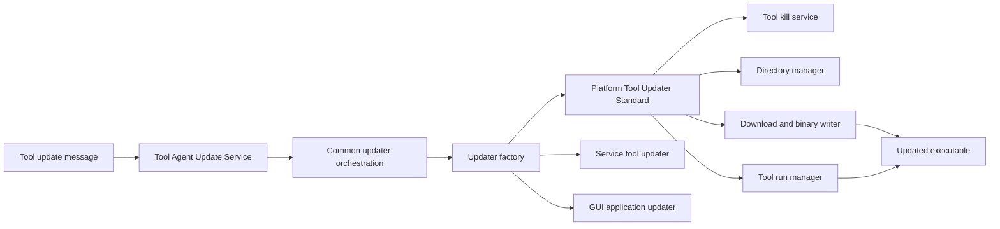
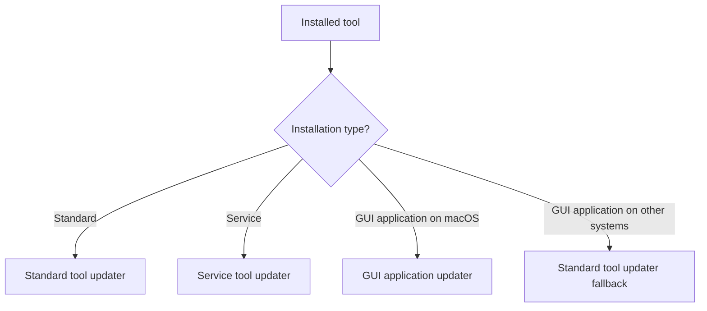
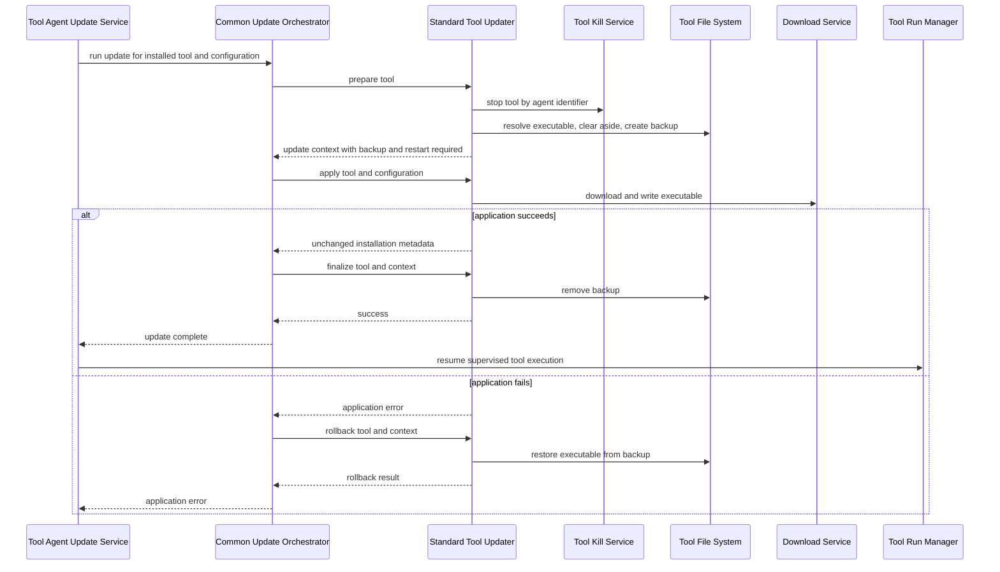
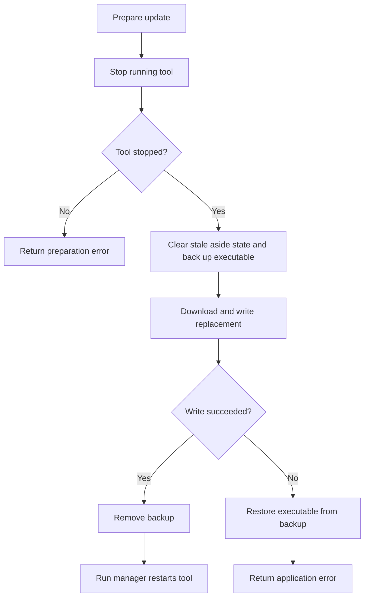

# Platform Tool Updater Standard

Platform Tool Updater Standard is the OpenFrame client agent's update strategy for a tool installed as a regular executable rather than as a managed operating-system service or a macOS GUI application. It implements the common update contract supplied by OpenFrame OSS Library, stops the running tool, protects the current executable with a backup, writes the replacement binary, and restores the backup if the write phase fails.

The implementation is supplied by the `openframe_agent_lib` Cargo dependency from OpenFrame OSS Library at version `v0.0.5`. The tenant repository runs it through the OpenFrame client; the implementation source is [standard.rs](https://github.com/flamingo-stack/openframe-oss-lib/blob/16e7c1cbd9664e7d10ec5ebca7d53c9bd314decf/clients/openframe-client/src/platform/tool_updater/standard.rs).

## Responsibilities

`StandardToolUpdater` owns the executable replacement lifecycle for an `Installation::Standard` record:

- Resolves the installed executable from the tool agent identifier and its optional configured executable path.
- Stops matching tool processes before modifying the executable.
- Removes a stale aside binary, records surviving processes for diagnostics, and creates a backup of the current executable.
- Downloads and writes the selected update artifact to the resolved executable path.
- Deletes the backup after a successful update.
- Restores the backup when the apply phase fails.
- Signals, through update context, that the tool needs restarting. The run manager performs that restart after the update workflow.

It does not choose which version to apply, persist tool records, or publish installed versions. Those activities belong to the surrounding tool update service and common updater orchestration.

## Placement in the Client Update Architecture

The standard updater is one implementation of the `ToolUpdater` lifecycle. The factory selects it for standard installations. On non-macOS platforms, the factory also temporarily uses it for GUI application installations while a platform-specific GUI updater is unavailable.

### Selection and Contract

The common updater module defines four asynchronous lifecycle operations:

| Operation | Standard updater behavior |
| --- | --- |
| `prepare` | Stops the tool, resolves its executable path, clears stale aside state, logs survivors, and backs up the executable. |
| `apply` | Downloads and writes the new executable. It returns no replacement installation metadata because the installation remains standard. |
| `finalize` | Removes the backup and leaves restart execution to the run manager. |
| `rollback` | Restores the backed-up executable after a failed apply operation. |

The updater factory dispatches by installation kind. A standard installation, represented by `Installation::Standard`, always selects `StandardToolUpdater`.

## Dependencies and Data

`StandardToolUpdater::new` receives a `ToolUpdaterDeps` value. Although the dependency bundle includes a command-parameter resolver, the standard updater directly uses the following dependencies:

| Dependency | Use in this module |
| --- | --- |
| Tool kill service | Stops processes whose command matches the tool agent identifier before the binary is changed. |
| Directory manager | Resolves the canonical executable path for the installed tool. |
| Download service | Participates in downloading and writing the replacement binary through the common helper. |

The update inputs are:

| Input | Relevant fields | Purpose |
| --- | --- | --- |
| Installed tool | Tool agent identifier, installation descriptor, executable path | Identifies the executable and determines where it is stored. |
| Download configuration | Operating system, source link, source filename, target filename, installation type | Identifies the artifact selected for the client platform. |
| Update context | Optional backup path and restart flag | Carries state between lifecycle phases. |

If an executable path is absolute, the directory manager uses it directly. If it is relative, it resolves it below the client application-support directory and the tool agent identifier. When the path is omitted, the default executable name is `agent.exe` on Windows and `agent` on other supported platforms.

## Update Process

The common orchestration invokes preparation, application, and finalization in sequence. It catches an error from application, attempts rollback, then returns the original application error. A finalization failure is reported to the caller but does not cause the common orchestration to invoke rollback.

### Preparation

Preparation is deliberately destructive only after the running process has been stopped:

1. The updater logs the tool identifier and requests that the tool kill service stop the tool.
2. A stop failure terminates the update before backup or replacement begins. The error is annotated with the tool identifier.
3. It resolves the executable path from the installed tool's standard installation metadata.
4. It clears an aside binary left by a previous update attempt and records processes that may have survived shutdown.
5. It creates a backup and returns an `UpdateContext` containing that optional path and `needs_restart: true`.

The context allows later phases to operate on the exact backup created for this update, rather than recomputing or guessing a rollback path.

### Application

Application resolves the same executable path and delegates artifact retrieval and replacement to the common binary-download helper. The helper receives the download configuration, destination path, and tool agent identifier. This separates transport and file-write behavior from installation-specific lifecycle decisions.

The standard updater returns `None` for replacement installation metadata. In other words, a standard executable update does not change the `Installation` classification or its path description.

### Finalization and Restart

On successful application, finalization removes the backup. The updater does not launch the executable itself; it logs that it will be automatically restarted by the tool run manager. The restart flag in the context documents that requirement to the surrounding workflow.

This boundary prevents the updater from competing with the client runtime's supervision and coordination responsibilities.

### Failure and Rollback

Only an apply failure initiates the rollback branch in the common orchestrator. The updater recalculates the target executable path and asks the common restore helper to replace it from the backup path recorded in the context.

If restoration also fails, common orchestration logs that secondary failure while preserving the original application failure as the returned error. Operators should therefore examine both the primary update error and rollback log entries when a device remains in an inconsistent state.

## Interaction with Tool Update Service

The tool update service is the policy and persistence boundary around this updater. Before invoking the update process, it:

- Locates the installed tool record by tool agent identifier.
- Detects interrupted installation state or a missing artifact and treats either as a repair condition.
- Compares installed and requested versions, rejects downgrades unless explicitly allowed, and avoids updates where the target version is already installed.
- Coordinates updates under a tool operation guard so concurrent tool operations do not conflict.
- Publishes installed versions when no update is required and after applicable update work completes.

The standard updater therefore assumes that it is given a valid installed-tool record and a download configuration already chosen for the host. Its concerns are local process control, executable replacement, and recovery.

## Operational Guarantees and Limits

### Guarantees

- **Stop before replace:** An inability to stop the tool prevents the update from progressing to file replacement.
- **Rollback material:** Successful preparation supplies a backup path for a subsequent failed application attempt.
- **Consistent targeting:** Preparation, application, and rollback resolve the executable with the same directory-manager rule.
- **Explicit restart intent:** The update context records that a standard tool must be restarted after replacement.
- **Traceability:** Each lifecycle phase logs the tool agent identifier, and preparation logs potential surviving processes through the shared helper.

### Limits

- The module does not verify that the relaunched tool is healthy; lifecycle supervision is external to this updater.
- The module does not roll back after a finalization error because rollback is tied to application failure in common orchestration.
- The module does not itself choose an artifact, validate update policy, or mutate installed-tool version records.
- Backup creation can yield no path, so restore behavior is necessarily dependent on the backup state recorded during preparation.

## Maintenance Guidance

When changing Platform Tool Updater Standard, keep these invariants intact:

1. Preserve the prepare, apply, finalize, and rollback contract so it remains interchangeable with service and GUI application updater implementations.
2. Stop the tool before moving or replacing its executable.
3. Use `DirectoryManager` rather than constructing installation paths directly; it centralizes absolute, relative, and default executable-path rules.
4. Keep the backup path in `UpdateContext` as the sole rollback source for the active update.
5. Do not start the executable directly from finalization. The tool run manager owns supervised restart behavior.
6. Retain the tool agent identifier in errors and structured logs so failures can be correlated with the device's installed-tool record.

For questions, implementation feedback, or coordination with maintainers, use the [OpenMSP Slack community](https://join.slack.com/t/openmsp/shared_invite/zt-36bl7mx0h-3~U2nFH6nqHqoTPXMaHEHA).