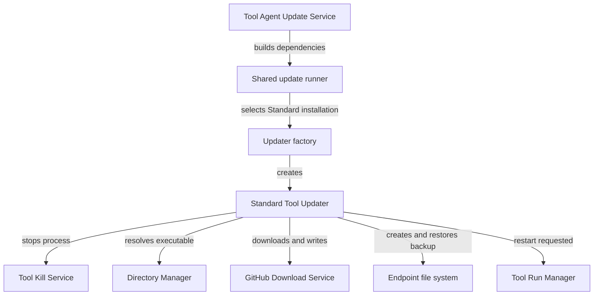
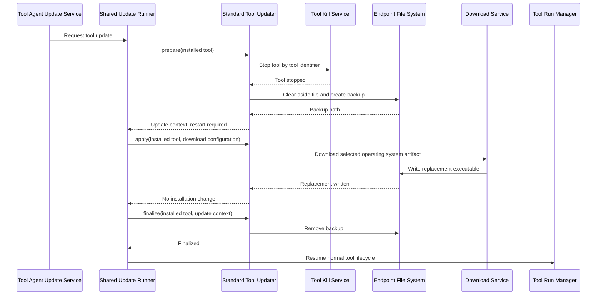
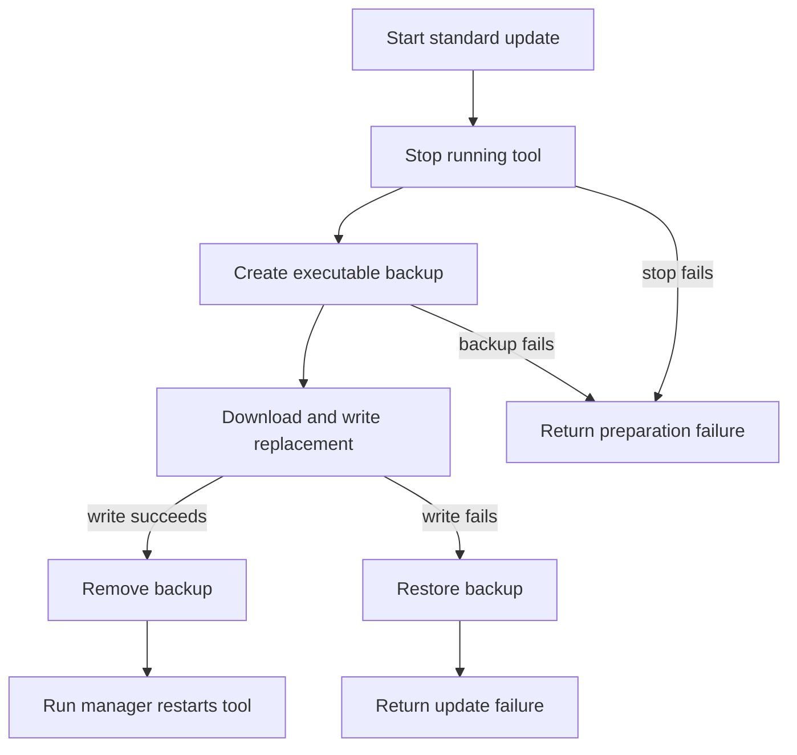
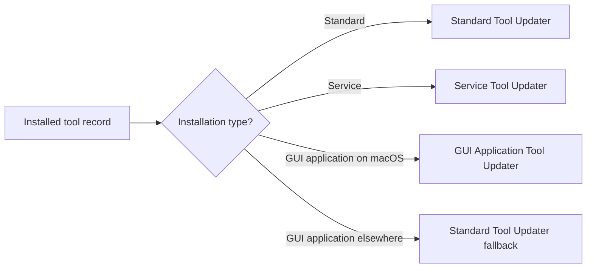

# Platform Tool Updater Standard

Platform Tool Updater Standard updates a normal, executable-based integrated tool on an endpoint running the OpenFrame client. It is the `Standard` implementation of the tool-update strategy supplied by the `openframe_agent_lib` Rust library. The implementation deliberately separates stopping the running process, preserving a rollback copy, replacing the executable, and removing the backup after a successful update.

The source implementation is maintained in the OpenFrame OSS Library: [standard.rs](https://github.com/flamingo-stack/openframe-oss-lib/blob/7a766f00e4f58b5d89db007b878ac8d6e0c344f4/clients/openframe-client/src/platform/tool_updater/standard.rs). This repository consumes that library as the Cargo artifact `openframe_agent_lib` version `v0.0.5`; the endpoint client assembled by this repository runs the updater.

## Purpose and Scope

An installed tool has an `Installation` classification. This module handles the `Standard` variant, whose executable location is either explicitly configured or resolved by the directory manager. If no executable path is configured, the directory manager resolves the default agent file name: `agent.exe` on Windows and `agent` on other supported platforms.

The module implements the common `ToolUpdater` lifecycle:

1. **Prepare** stops the tool, clears a leftover aside binary, records surviving update artifacts for diagnostics, and backs up the current executable.
2. **Apply** downloads the selected platform artifact and writes it to the resolved executable location.
3. **Finalize** removes the rollback backup and records that the run manager should restart the tool.
4. **Rollback** restores the backup if applying the replacement fails.

It does not manage service registration or application bundles. The shared updater factory selects dedicated implementations for service installations and macOS GUI applications. On non-macOS platforms, GUI application updates currently fall back to this standard binary-replacement behavior.

## Architecture

`StandardToolUpdater` owns a `ToolUpdaterDeps` value. Its relevant collaborators are:

| Dependency | Responsibility in the update |
| --- | --- |
| Tool Kill Service | Terminates the target tool before the executable is backed up or replaced. |
| Directory Manager | Computes the installed executable path from the tool identifier and optional configured path. |
| GitHub Download Service | Is used by the shared binary-download-and-write operation to retrieve the chosen artifact. |
| Tool Command Parameters Resolver | Is available through the shared dependency bundle for updater implementations, although the Standard implementation does not call it directly. |
| Tool Run Manager | Restarts normal tools after a successful standard update according to the shared update context. |

The updater returns an `UpdateContext` containing the optional backup path and `needs_restart`. For a standard update, preparation always sets `needs_restart` to `true` after it has successfully stopped the tool and attempted backup creation.

## Component Responsibilities

### Standard Tool Updater

`StandardToolUpdater` is a small strategy object constructed with `new(deps)`. It implements the asynchronous `ToolUpdater` contract and logs each lifecycle stage with the tool agent identifier.

| Lifecycle method | Behavior | Result |
| --- | --- | --- |
| `prepare` | Stops the target tool, resolves its executable path, clears an aside binary, logs any surviving update files, and backs up the current executable. | An update context with the backup path and a restart requirement. |
| `apply` | Resolves the executable path again and invokes the shared download-and-write operation using the selected download configuration. | `None`, because a standard update retains the existing installation classification. |
| `finalize` | Cleans up the backup. It does not launch the process itself; it records in logs that the run manager will perform automatic restart. | Successful completion after backup cleanup is attempted. |
| `rollback` | Resolves the destination executable path and restores the backup supplied by the update context. | The restoration result. |

### Shared Tool Update Contract

The shared update runner invokes `prepare`, then `apply`, then `finalize`. If `apply` returns an error, it invokes `rollback` and returns the original apply failure. A rollback failure is logged but does not replace the primary update error.

The `apply` result can optionally return a replacement `Installation` for updater types that change installation style. This implementation returns no replacement, so finalization continues with the original installed-tool record.

## Update Flow

The update request contains a `DownloadConfiguration` selected for the endpoint operating system. That configuration identifies the source link, input file name, target file name, installation type, and optional bundle or service metadata. Standard updates consume the download and target details but preserve the installed tool's `Standard` classification.

## Failure and Recovery Behavior

Important operational properties:

- **No replacement while the tool is running:** `prepare` stops the process before filesystem modification. A failure to stop the tool aborts preparation, so no download or replacement is attempted.
- **Rollback scope:** the shared runner attempts rollback only after `apply` fails. A preparation failure occurs before the lifecycle context is returned and therefore does not enter rollback through the shared runner.
- **Backup cleanup is post-apply:** the backup is retained through download and write, then removed during finalization. This keeps recovery material available while replacement is in progress.
- **Finalization errors:** the shared runner surfaces an error if finalization fails. Since the replacement has already been written, operators should inspect the update logs and leftover files rather than assuming that rollback occurred.
- **Diagnostics for stale artifacts:** preparation clears an aside binary and logs update survivors before backup. These steps help identify files left from previous interrupted updates.

## Invocation and Eligibility

Tool update handling first loads the installed-tool record. It declines an update for a tool with no registry record, avoids stale downgrades unless repair is needed, and calculates whether the main tool or individual assets need change. A missing executable or an installation record left in the installing state forces a repair attempt.

For an eligible main-tool update, the service constructs the updater dependencies and calls the shared runner. The updater factory dispatches based on the installation type:

This module is therefore the primary updater for normal endpoint-agent binaries and also supplies the current non-macOS GUI application fallback. It is not responsible for deciding the target version, selecting which tools receive an update, publishing installed versions, or persisting installed-tool state; those are coordinated by the surrounding tool update service.

## Path and Process Semantics

The path resolution step is central to safe replacement. For each operation, the updater asks the directory manager for the executable location using the tool agent identifier and the installed record's executable-path setting:

- An absolute configured path is used unchanged.
- A relative configured path is resolved inside the application-support directory for that tool.
- An absent path uses the platform default executable name within the tool directory.

The tool kill service stops processes by a pattern derived from the tool identifier. The updater then performs backup, write, cleanup, or restoration against the resolved executable path. Re-resolving the path in each lifecycle method keeps all file operations tied to the installed-tool record that the runner supplied.

## Maintainership Notes

When changing this updater, retain the lifecycle ordering and the separation of concerns:

1. Stop the tool before manipulating its executable.
2. Keep backup creation before replacement.
3. Return the backup through `UpdateContext` so shared rollback can recover it.
4. Do not delete the backup until finalization.
5. Preserve `needs_restart` for standard tools so the supervising run manager can restore normal operation.
6. Keep platform-specific installation semantics in their corresponding updater strategy rather than expanding the standard path to cover service or macOS bundle behavior.

Changes should be evaluated against interrupted-update cases: a failed stop, absent or unusable backup, failed download, failed write, failed restoration, and an inability to remove the backup after a successful replacement. In each case, verify the tool's executable path, process state, retained artifacts, and structured logs identified by the tool agent identifier.
