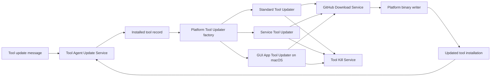
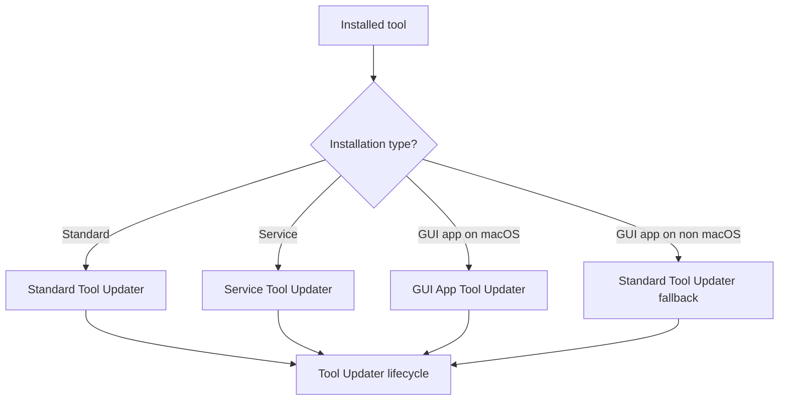
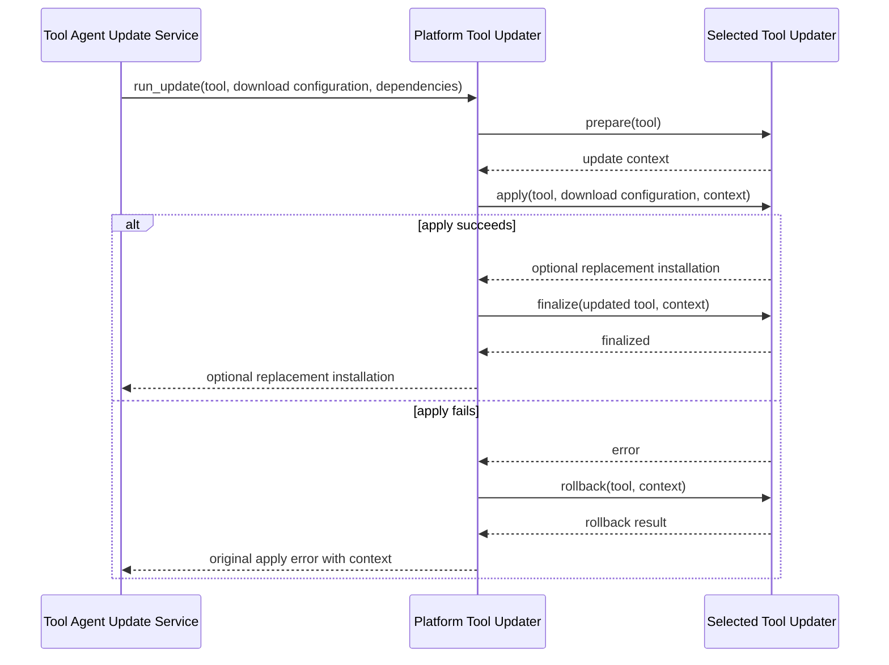
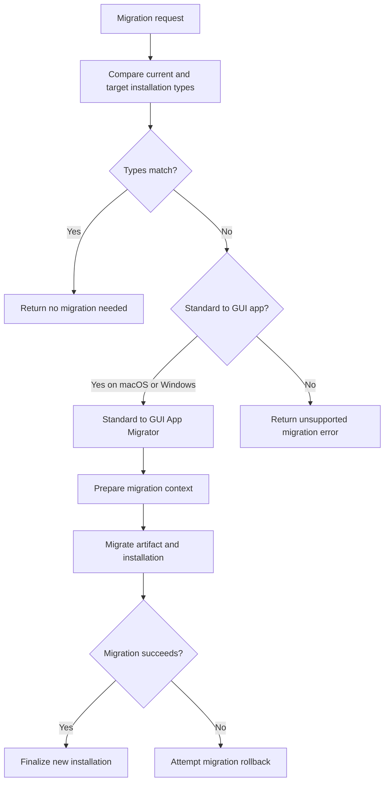

# Platform Tool Updater

Platform Tool Updater is the endpoint-side update orchestration layer for integrated tools managed by the OpenFrame client. It selects an updater that matches the tool's recorded installation form, stops and preserves the current installation when required, obtains the replacement artifact, applies it, finalizes the new installation, and attempts recovery when application fails. It also provides a distinct migration path when an update changes the installation type.

The implementation is supplied by the `openframe_agent_lib` Cargo dependency from the OpenFrame OSS Library and runs as part of this repository's OpenFrame client deployment. The implementation source is [tool updater module](https://github.com/flamingo-stack/openframe-oss-lib/blob/7a766f00e4f58b5d89db007b878ac8d6e0c344f4/clients/openframe-client/src/platform/tool_updater/mod.rs).

## Responsibilities

- Dispatch an update to an implementation appropriate for `Standard`, `Service`, or `GuiApp` installations.
- Give every update a consistent three-phase lifecycle: prepare, apply, and finalize.
- Preserve a previous executable as a backup where an updater requires it, and invoke rollback after an apply failure.
- Download the selected operating-system artifact through `GithubDownloadService` and write an executable through the platform binary writer.
- Coordinate process termination, directory resolution, and command-parameter resolution through injected dependencies.
- Detect and execute supported installation-type migrations rather than treating them as ordinary in-place updates.
- Preserve an explicit platform boundary: the native graphical-app updater is compiled only on macOS; non-macOS graphical-app updates currently use the standard updater behavior.

## Position in the Client Update Pipeline

A tool update is normally driven by a `ToolAgentUpdateMessage`. `ToolAgentUpdateService` serializes the operation through its tool-operation guard, loads the installed-tool record, rejects a stale downgrade unless repair is necessary, identifies independently versioned assets that also require updating, and delegates tool replacement to this module. The service republishes known installed versions when there is no work to perform.

The update request contains a target version and optional asset updates. An installed record supplies the current `Installation` and its executable or service metadata. `DownloadConfiguration` selects an artifact using operating-system metadata, target filename, download link, installation type, and optional bundle or service identifiers.

## Core Abstractions

| Component | Role |
|---|---|
| `ToolUpdater` | Asynchronous strategy contract. Implementations provide `prepare`, `apply`, `finalize`, and `rollback`. |
| `ToolUpdaterDeps` | Dependency bundle containing the download service, process-stop service, directory manager, and command-parameter resolver. It keeps platform-specific updater construction consistent. |
| `UpdateContext` | State carried across phases. It can retain a backup path and signals whether a restart is needed. Defaults to no backup and a required restart. |
| `create_updater` | Factory that maps an `Installation` variant to a standard, service, or graphical-app updater. |
| `run_update` | Transaction-like coordinator for a same-type tool update. It drives phases and invokes rollback only when apply fails. |
| `ToolMigrator` | Separate contract for changing installation type. It identifies source and target types and provides prepare, migrate, finalize, and optional rollback phases. |
| `run_migration` | Migration coordinator that creates a supported migrator, runs its phases, and attempts rollback after a migration error. |
| `UnsupportedToolUpdater` | Non-macOS erroring implementation available for unsupported platform-specific cases. Its prepare and apply methods fail with the configured message, while finalize and rollback are safe no-ops. |

### Installation Dispatch

The installation record determines the implementation rather than the incoming download configuration alone:

| Current installation | Selected updater | Notes |
|---|---|---|
| `Standard` | `StandardToolUpdater` | Handles conventional executable replacement. |
| `Service` | `ServiceToolUpdater` | Handles service-oriented updates, including service lifecycle concerns. |
| `GuiApp` on macOS | `GuiAppToolUpdater` | Native graphical application behavior is available only in macOS builds. |
| `GuiApp` on non-macOS | `StandardToolUpdater` | Present fallback handles binary download and replacement; a dedicated Windows graphical-app updater remains unimplemented. |

## Update Lifecycle

`run_update` gives all updater implementations the same ordering and error semantics.

1. **Prepare**: the selected updater examines the installed tool and returns an `UpdateContext`. This phase may stop processes, record a backup, or collect other state needed by later phases.
2. **Apply**: the updater installs the downloaded target. It returns `None` when the installation metadata is unchanged, or `Some(Installation)` when the installation descriptor itself changes.
3. **Finalize**: the coordinator constructs an updated in-memory tool when apply returned replacement installation metadata, then passes that tool to `finalize`.
4. **Failure recovery**: an apply error triggers `rollback`; rollback errors are logged but do not replace the original apply error. Prepare and finalize errors are propagated with tool-specific context, but do not cause the coordinator to call rollback.

### Artifact and File Handling

The shared helpers provide common behavior used by updater implementations:

- `download_and_write_binary` downloads and extracts the configured artifact, then writes it to the resolved target through the binary writer.
- `backup_binary` copies an existing executable to a sibling file with a `backup` extension. If the source does not exist, it deliberately produces no backup.
- `restore_from_backup` restores a recorded backup and deletes it after a successful restore. Missing backups are logged as warnings rather than treated as rollback failures.
- `cleanup_backup` removes a successful-update backup on a best-effort basis.
- `clear_aside_binary` removes an old rename-aside file. Failure to remove it indicates that a process from a preceding update may still be executing it, and the helper returns `false`.
- `log_update_survivors` reports when a process remains after the stop operation. The update can proceed, but that process continues on its old version until it exits.

The binary writer creates parent directories, writes and flushes the artifact, attempts disk synchronization within a bounded timeout, applies executable permissions, and closes its handle before execution. Its replacement operation writes a sibling staged file first and renames it into place; it removes the staged file if replacement fails. On Windows, the lower-level writer also attempts a rename-aside recovery for an existing locked file.

## Process and Service Coordination

The updater relies on `ToolKillService` before replacing content that may be executing. The stop strategy mirrors the installation form:

- A graphical application is stopped by executable path.
- A standard installation stops its configured executable path when available and also stops by tool agent identifier.
- A service installation first requests a stop through the system service manager, then kills remaining processes by executable path to handle detached children.

This separation matters because a successful stop request does not guarantee the process exited before file replacement. The survivor check makes that condition visible in logs, and rename-aside handling avoids silently discarding the prior binary when a locked executable prevents normal replacement.

## Migration Workflow

Migration is intentional conversion between installation forms, not a fallback for an ordinary update. `needs_migration` compares the current installation type with the target `InstallationType`. `create_migrator` returns no migrator when they are identical, returns a supported strategy for known paths, and rejects unsupported paths.

At present, the supported migration path is Standard to GUI application on macOS and Windows builds. The migration uses a dedicated `StandardToGuiAppMigrator`; all other differing source-target combinations fail explicitly. A migration returns a new `Installation` descriptor, whereas an update may preserve existing installation metadata.

Unlike `ToolUpdater`, `ToolMigrator` has a default rollback implementation that only records a warning. A migration strategy that performs irreversible or multi-resource work must override rollback to provide actual recovery.

## Persistence and Reporting Considerations

The updater returns installation metadata; it does not itself persist the installed-tool record. Its caller is responsible for recording the updated state and publishing the installed versions. `ToolAgentUpdateService` performs this broader orchestration and includes repair behavior:

- An absent installed-tool record is considered orphaned and skipped rather than self-healed from a lean update message.
- A tool in `Installing` state or with a missing artifact is forced through repair even when the reported version has not changed.
- Versions are compared before update, and downgrades are rejected by default unless repair is needed.
- Assets with their own versioned download configurations are filtered independently and updated only when their target version differs under the same downgrade policy.
- After a successful repair, the persisted record is moved to `Installed`; when no updates are required, current versions are published immediately.

## Failure Model and Operational Signals

| Situation | Behavior | Operational implication |
|---|---|---|
| Prepare fails | Error is returned with the tool identifier. | No apply or rollback is attempted by `run_update`. |
| Apply fails | Rollback is attempted; original apply failure remains the returned error. | Inspect both the primary failure and any logged rollback failure. |
| Finalize fails | Error is returned with the tool identifier. | Apply may already have changed files, so recovery is caller- or implementation-specific. |
| Backup unavailable | Rollback warns and completes without restoring a binary. | The old executable cannot be recovered by this helper. |
| Old aside file is locked | The helper reports failure and logs the likely surviving prior process. | Defer cleanup until the process releases the file. |
| Installation migration is unsupported | The migrator factory returns an error before preparation. | A new migration implementation is required. |
| GUI application update outside macOS | Standard updater fallback is selected. | Do not assume native GUI lifecycle behavior outside macOS. |

The module emits structured tracing events with the tool agent identifier at lifecycle transitions, download and write operations, recovery attempts, stale artifacts, and process-survival warnings. These logs are the primary diagnostic record for update failures and incomplete cleanup.

## Maintenance Guidance

When adding an installation form or a new migration path:

1. Extend the `Installation` and `InstallationType` model relationship first.
2. Implement the `ToolUpdater` lifecycle or `ToolMigrator` lifecycle as appropriate.
3. Register the implementation in `create_updater` or `create_migrator` with platform compilation boundaries made explicit.
4. Define backup, rollback, service-stop, and restart behavior before performing file replacement.
5. Preserve the coordinator contract: apply failure must be recoverable through rollback, and replacement installation metadata must be returned for finalization and persistence.
6. Test locked-file, missing-artifact repair, process-survival, download failure, and migration-failure paths on every supported operating system.

The Platform Tool Updater should remain focused on endpoint file and process transitions. Message validation, version policy, installed-tool persistence, asset selection, and result publication belong to the surrounding client services.