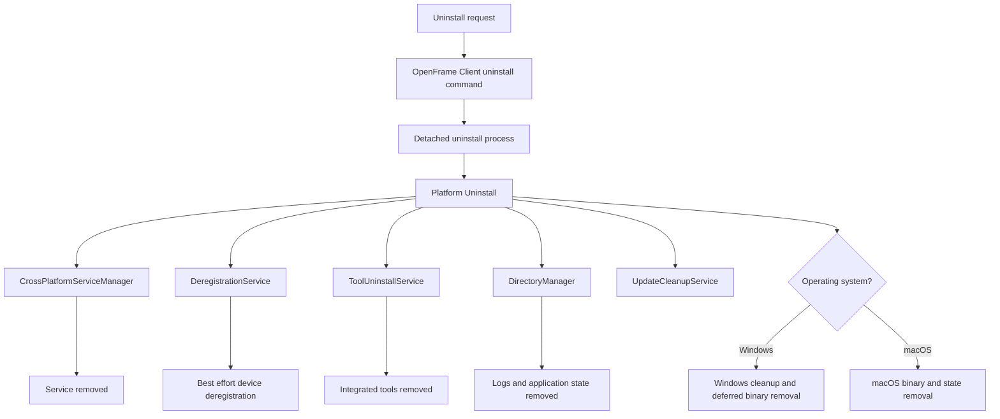
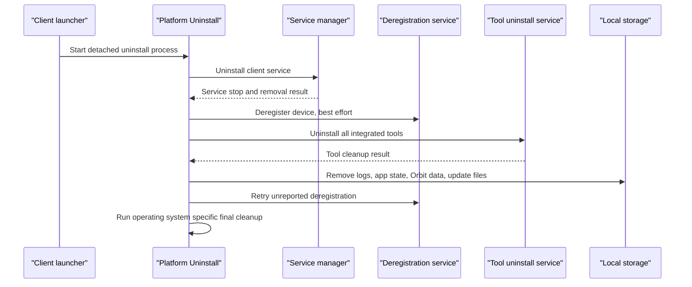
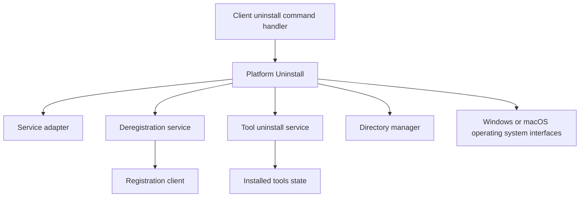

# Platform Uninstall

Platform Uninstall removes an installed OpenFrame Client from Windows or macOS. It is implemented by the `openframe_agent_lib` library from OpenFrame OSS Library and is run by this repository's OpenFrame Client. The module stops and unregisters the client service, attempts to deregister the device, removes integrated tools and persisted client state, and schedules or performs removal of the client binary.

The implementation is operating-system gated: self-uninstallation is supported on Windows and macOS. Linux does not expose a corresponding platform-specific uninstall routine in this module.

**Implementation:** [OpenFrame OSS Library uninstall source](https://github.com/flamingo-stack/openframe-oss-lib/blob/7a766f00e4f58b5d89db007b878ac8d6e0c344f4/clients/openframe-client/src/platform/uninstall.rs)

## Responsibilities

Platform Uninstall is deliberately a best-effort cleanup workflow. It continues through independent cleanup stages when a non-critical step fails, recording warnings for follow-up rather than abandoning the entire uninstall. Its responsibilities are:

- Remove the `client` service through `CrossPlatformServiceManager`, using the OpenFrame Client display name and service description.
- Deregister the device after the service is stopped, then make a final retry before the client can no longer report its removal.
- Uninstall all integrated tools through `ToolUninstallService`.
- Delete client logs, application-support data, update staging data, update-generated binary siblings, and the legacy `openframe` command alias when it is demonstrably owned by this client.
- Remove Orbit data so a later installation does not retain the prior Fleet association.
- Remove Windows registration and path integration, or remove the macOS binary directly.
- Use a detached process for self-uninstall so the cleanup can outlive the service process that initiated it.

## Architecture

### Component roles

| Component | Role in the uninstall workflow |
|---|---|
| `spawn_detached_uninstall` | Starts the installed executable with the `uninstall` subcommand in a detached process. This avoids terminating cleanup when the client service stops itself. |
| `uninstall_windows` | Coordinates service removal, device deregistration, tool removal, state cleanup, Windows integration cleanup, and deferred binary deletion. |
| `uninstall_macos` | Coordinates the same service, deregistration, tool, and state cleanup, then removes the installed binary with short retries. |
| `uninstall_integrated_tools` | Builds the services required to enumerate, stop, and uninstall integrated tools, then invokes `uninstall_all`. |
| `remove_directory_with_retry` | Resiliently removes a directory that may contain locked or protected files. |
| `remove_legacy_alias` | Removes only the older client-owned `openframe` alias or Windows command shim; it preserves an unrelated tool with the same name. |
| `orbit_dir` | Resolves Orbit's data location: `Program Files/Orbit` on Windows and `/opt/orbit` on macOS or Linux. |

## Uninstall lifecycle

Both supported operating systems follow the same high-level ordering. Stopping the service precedes deregistration to prevent a remaining heartbeat from recreating the machine record after it has been deleted.

### Stage details

1. **Service removal** — A `ServiceConfig` is created for the service named `client`, with the current executable path. `CrossPlatformServiceManager::uninstall` is attempted. A missing or already-removed service is treated as a warning, allowing the rest of the cleanup to proceed.
2. **Initial deregistration** — When a `DeregistrationService` was provided, `deregister_best_effort` is called after service removal. This sequencing protects against a still-running service re-announcing the machine.
3. **Integrated-tool uninstall** — `uninstall_integrated_tools` constructs `InstalledToolsService`, `InitialConfigurationService`, `AgentConfigurationService`, `ToolCommandParamsResolver`, and `ToolKillService`. Those dependencies are passed to `ToolUninstallService`, whose `uninstall_all` operation handles managed tools.
4. **Local data cleanup** — The module removes a dedicated logs directory when it is distinct from the application-support directory, then removes application-support state. It also removes Orbit state where applicable.
5. **Final deregistration retry** — `retry_if_unreported` provides one final opportunity to submit the deregistration result before binary cleanup removes the agent's ability to do so.
6. **Platform finalization** — Windows removes operating-system integrations and launches a cleanup script; macOS removes the active binary directly and then removes update leftovers.

## Detached self-uninstall

A service cannot reliably remove the executable that is currently hosting it, especially after it stops its own system service. `spawn_detached_uninstall` therefore launches the installed client executable with the `uninstall` CLI subcommand through the detached-process platform utility.

This entry point is intended for Windows and macOS. The module explicitly documents Linux self-uninstall as unsupported.

## Data and filesystem cleanup

### Client-managed files

Platform Uninstall targets resources owned by the client rather than indiscriminately deleting similarly named files:

- **Logs:** removed only when the logs directory is separate from application-support data, avoiding a duplicate deletion target.
- **Application-support directory:** removed with retry logic.
- **Update artifacts:** update copies adjacent to the binary are removed by prefix. This captures versions such as `.lkg`, `.prev`, `.old`, `.bad`, `.bak`, and timestamped backup suffixes without requiring every suffix to be known in advance.
- **Temporary update state:** update leftovers in the operating-system temporary directory are swept. Windows additionally removes the dedicated update staging directory.
- **Legacy command alias:** Unix removes `openframe` only when it is a symlink to the installed binary. Windows removes `openframe.cmd` only when its contents exactly match the client-generated shim for that binary.
- **Orbit directory:** removed on Windows and macOS. Orbit data includes a node key and `osquery.db`; retaining it could cause a subsequent installation to rejoin the former Fleet team.

### Resilient directory removal

`remove_directory_with_retry` first handles an absent path as a successful no-op. For an existing path, it attempts recursive deletion up to the caller-supplied limit. Retries use exponential backoff capped at eight seconds.

Near the end of the retry sequence, the helper attempts to make directory contents writable:

- Windows invokes `attrib` to clear read-only, system, and hidden attributes recursively.
- Non-Windows platforms invoke recursive `chmod 777`.

On Windows, a sharing violation triggers lock-aware recovery to identify and evict safe processes holding files in the target directory. If standard removal is still unsuccessful, the module attempts an operating-system force deletion and verifies that the directory no longer exists:

- Windows uses `cmd` with `rd /S /Q` after requesting writable access through the file-access-control helper.
- Non-Windows platforms use `rm -rf`.

Failure is reported only after the normal attempts and the force-deletion fallback have both failed. Callers generally log this error and continue with remaining uninstall work.

## Operating-system behavior

### Windows

After common cleanup, Windows-specific finalization performs the following steps:

1. Removes the Windows Apps and Features entry through the application-entry helper.
2. Removes the installation directory from the system `PATH` when the binary has a parent directory.
3. Removes binary siblings and update temporary data.
4. Starts the Windows binary-cleanup script when the installed executable still exists. The script can wait for the process to exit before removing the executable and, where appropriate, its now-empty installation directory.

The deferred script is necessary because Windows normally prevents a live process from deleting its own executable.

### macOS

After common cleanup, macOS-specific finalization tries to remove the installed executable directly. It makes up to three attempts with a one-second pause between unsuccessful attempts. A failure to delete the binary is a warning rather than a rollback condition; the module continues deleting sibling update artifacts and temporary update state. It also retries an unreported deregistration after the local wipe is complete.

## Failure handling and operational guarantees

The module uses two error classes:

- **Fatal setup or control-flow errors:** failures that prevent a required internal operation from being initialized or a caller-facing helper from completing are returned as `Result` errors. For example, failure to initialize a tool-uninstall dependency prevents `uninstall_integrated_tools` from starting.
- **Best-effort cleanup failures:** service removal, device deregistration, tool uninstall, individual directory deletion, operating-system registration removal, path cleanup, and binary-cleanup launch failures are logged as warnings while later cleanup proceeds.

This behavior maximizes removal progress on machines with partial installs, locked files, missing services, or temporarily unreachable server-side deregistration. Operators should review client logs for warning entries if remnants remain after the workflow finishes.

## Integration boundaries

Platform Uninstall belongs to the Rust OpenFrame Client supplied by the OpenFrame OSS Library artifact `openframe_agent_lib` version `v0.0.5`. It is incorporated into the OpenFrame OSS Tenant service repository through that library dependency.

Its key collaboration boundaries are:

- The command-handling layer can request removal and relies on Platform Uninstall to execute operating-system cleanup.
- `DeregistrationService` provides server coordination. The local uninstall remains resilient when that coordination cannot complete immediately.
- Tool services provide a managed teardown path for integrated tools before their client state is deleted.
- `DirectoryManager` supplies the authoritative client directories, preventing uninstall logic from hard-coding client-state locations.
- Service, application-entry, path, file-access-control, lock-recovery, and cleanup-script utilities isolate operating-system concerns from the core workflow.

## Maintenance considerations

When changing this module:

- Preserve the ordering of service removal before device deregistration.
- Keep ownership checks around the legacy alias. The alias name can belong to another CLI, so removing it solely by filename would be destructive.
- Ensure any new update artifact placed beside the client binary remains compatible with prefix-based sibling cleanup.
- Treat directory deletion as unreliable in the presence of locks, antivirus scanning, attributes, or delayed process shutdown; maintain verification and retries.
- Keep Windows binary removal deferred until after the client process exits, while retaining the macOS retry behavior for direct binary deletion.
- Maintain the distinction between cleanup warnings and unrecoverable setup errors so a partial installation can still be removed as completely as possible.
