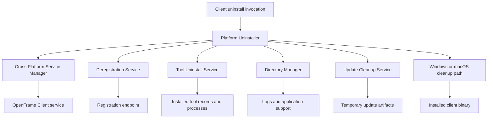
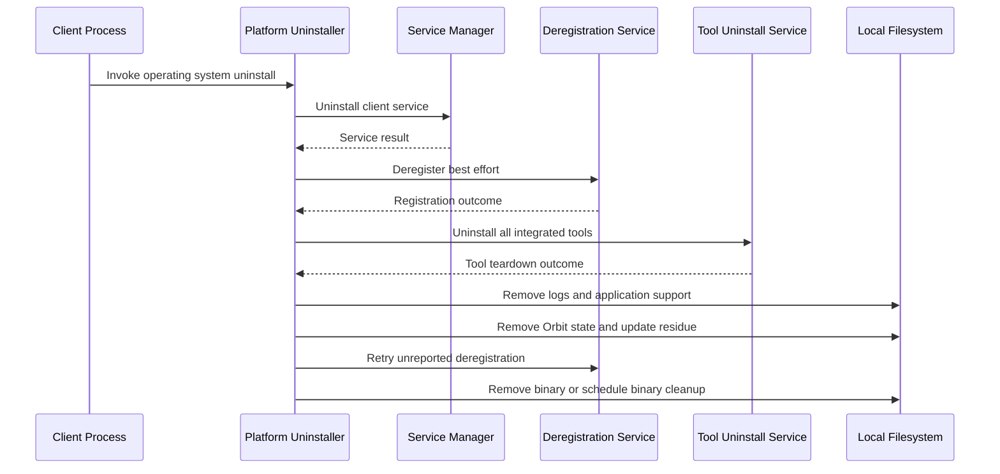
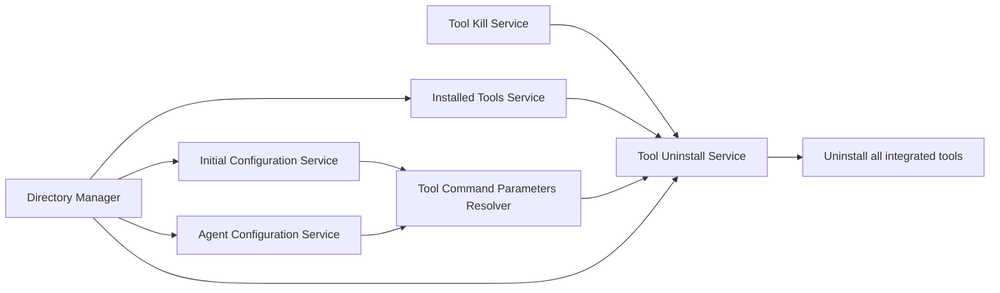
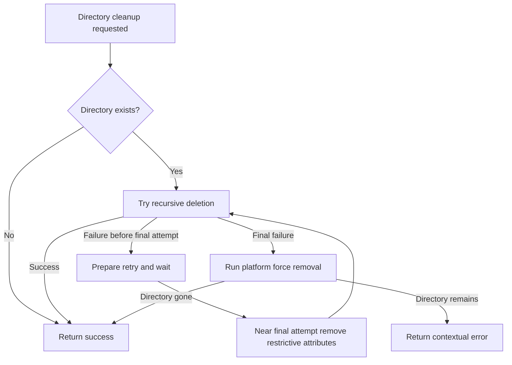

# Platform Uninstaller

Platform Uninstaller removes an OpenFrame Client installation from a managed Windows or macOS endpoint. It is implemented by the `openframe_agent_lib` library supplied by the OpenFrame OSS Library and executed by this repository's OpenFrame Client distribution. Its primary objective is a safe teardown: stop the client service before deregistering the device, gracefully remove managed tools, clear client state and update residue, then arrange removal of the running executable.

The implementation is platform-specific. Windows and macOS have complete uninstall paths; self-uninstall on Linux is explicitly unsupported. The module is intentionally best-effort for independent cleanup stages: a failure to remove a managed tool or a nonessential file is logged as a warning and does not prevent remaining cleanup.

**Implementation source:** [OpenFrame OSS Library uninstall module](https://github.com/flamingo-stack/openframe-oss-lib/blob/16e7c1cbd9664e7d10ec5ebca7d53c9bd314decf/clients/openframe-client/src/platform/uninstall.rs)

## Responsibilities

- Removes the `client` system service, configured with the display name **OpenFrame Client Service**.
- Deregisters the machine on a best-effort basis after service shutdown, preventing a subsequent heartbeat from restoring the server-side machine record.
- Delegates integrated-tool teardown to `ToolUninstallService`.
- Clears client log and application-support directories and the Orbit state directory.
- Removes update artifacts that are siblings of the installed binary and clears temporary update residue.
- Performs operating-system-specific final executable cleanup.
- Provides guarded cleanup helpers for legacy aliases and locked directories.

## Architecture and System Placement

The uninstaller runs at the boundary between the resident client agent, operating-system service management, locally installed tools, and remote registration state. It is a narrow platform module rather than the policy layer that decides to uninstall. A higher-level command handler or service-management flow invokes it with a `DirectoryManager`, the installed binary path, and, when available, a `DeregistrationService`.

### Key Collaborators

| Collaborator | Role in Platform Uninstaller |
|---|---|
| `CrossPlatformServiceManager` | Uninstalls the `client` system service using a `ServiceConfig` assembled from the current executable path. |
| `DeregistrationService` | Attempts remote deregistration after service shutdown, then retries reporting before the process removes itself. The service tracks whether a report has already succeeded. |
| `DirectoryManager` | Supplies the application-support and log directory locations used during local state removal. |
| `InstalledToolsService` | Loads the persisted set of integrated tools for the tool teardown workflow. |
| `InitialConfigurationService` and `AgentConfigurationService` | Supply configuration and persisted agent values to resolve tool uninstall command parameters. |
| `ToolCommandParamsResolver` | Resolves command parameters for tool-specific uninstall operations. |
| `ToolKillService` | Stops relevant tool processes as part of integrated-tool removal. |
| `ToolUninstallService` | Coordinates uninstalling all installed integrated tools. |
| `UpdateCleanupService` | Removes leftover update artifacts in the temporary area. |

## Uninstall Lifecycle

The order of work is significant. The service is removed before deregistration because a still-running service could emit a heartbeat that recreates the deleted remote machine record. Tool teardown is attempted before deleting the client directories because it depends on persisted tool and configuration state.

## Platform Workflows

### Windows

`uninstall_windows` proceeds through the following stages:

1. Builds a `ServiceConfig` using the current executable and asks `CrossPlatformServiceManager` to uninstall the `client` service. Failure is a warning because the service might already be absent.
2. If a deregistration service was supplied, invokes `deregister_best_effort` after the service is stopped.
3. Calls `uninstall_integrated_tools`. Failures are recorded but do not halt filesystem cleanup.
4. Removes the logs directory when it is distinct from the application-support directory, then removes the application-support directory. Both operations use retry-based deletion.
5. Removes the Orbit directory, which is in `%ProgramFiles%/Orbit` or falls back to `C:\Program Files\Orbit`. This prevents a future installation from retaining Orbit node state that could rejoin an old Fleet team.
6. Gives deregistration one final opportunity through `retry_if_unreported`, removes binary siblings and temporary update data, unregisters the Apps and Features entry, and attempts to remove the binary directory from the system `PATH`.
7. Starts a detached PowerShell cleanup script to wait for the current process to exit and then remove the binary. This is required because the running executable cannot reliably delete itself on Windows.

The cleanup-script launcher writes a uniquely named PowerShell script in the update staging directory and starts it without a console window. If a process job disallows breakaway, it retries without the breakaway creation flag.

### macOS

`uninstall_macos` follows the same ordering for service removal, best-effort deregistration, integrated-tool removal, logs, application-support data, and Orbit state. It then attempts direct binary deletion up to three times, waiting one second between failed attempts. Afterward it removes binary siblings and temporary update residue, then invokes `retry_if_unreported` to make a final deregistration report. A binary that remains locked is reported as requiring manual cleanup rather than causing the whole workflow to fail.

## Integrated Tool Teardown

`uninstall_integrated_tools` constructs the dependencies necessary to remove every registered integrated tool:

Construction failures are returned with context. Once constructed, the module calls `uninstall_all`. The platform-specific callers downgrade a returned tool-uninstall error to a warning, preserving the broader uninstall sequence even if an individual tool cannot be removed.

## Filesystem Cleanup and Retry Behavior

### Managed locations

The module cleans the following local data categories:

| Location or artifact | Cleanup behavior |
|---|---|
| Logs directory | Deleted only when it differs from the application-support directory, avoiding duplicate removal attempts. |
| Application-support directory | Deleted with retry logic. |
| Orbit directory | Deleted with retry logic on Windows and macOS. Its location is `%ProgramFiles%/Orbit` on Windows and `/opt/orbit` on macOS. |
| Binary update siblings | Removes files sharing the installed executable name plus a trailing period, covering update copies such as `.lkg`, `.prev`, `.old`, `.bad`, `.bak`, and timestamped backups. |
| Temporary update residue | Uses `UpdateCleanupService` to sweep temporary leftovers. Windows also removes its entire update staging directory. |
| Legacy alias | `remove_legacy_alias` removes only a verified legacy client alias. It will not remove an unrelated `openframe` command. |

### Deletion escalation

`remove_directory_with_retry` is asynchronous and treats an absent directory as already clean. For a present directory it tries ordinary recursive deletion up to the caller-supplied count, normally five attempts. Delays use exponential backoff capped at eight seconds.

Near the final ordinary deletion attempt, the helper tries to make contained files removable: Windows runs `attrib` to remove read-only, system, and hidden attributes recursively; non-Windows systems run recursive `chmod 777`. On Windows sharing violations also trigger lock-aware holder eviction before retrying. If all ordinary deletions fail, the helper uses `rd /S /Q` on Windows or `rm -rf` elsewhere, and verifies that the directory has actually disappeared before returning success.

## Guardrails and Ownership Checks

Platform Uninstaller includes ownership checks to avoid removing files that might belong to another tool:

- On Windows, the legacy `openframe.cmd` alias is removed only when its contents exactly match the shim pointing at the installed client executable.
- On non-Windows systems, the `openframe` alias is removed only if it is a symbolic link whose target is the installed client path.
- Update-sibling removal is restricted to entries in the installation directory whose name begins with the client executable name followed by a period.
- Failure to clean an optional target is logged, allowing later cleanup stages and the final remote deregistration retry to execute.

## Operational Notes for Maintainers

- Do not reorder service removal and deregistration without preserving the no-heartbeat-after-deregistration guarantee.
- Do not delete client state before tool teardown; tool removal needs the tool inventory and configuration services initialized from the managed directories.
- Preserve post-action existence checks in forced deletion code. A successful process exit is not sufficient evidence that a filesystem target was removed.
- Treat `spawn_detached_uninstall` as the self-uninstall handoff. It starts `openframe-client uninstall` as a detached process so it survives termination of the service process it is uninstalling.
- Linux lacks a supported self-uninstall path; any extension of support must define service stop, binary removal, and privilege behavior explicitly rather than reusing Windows or macOS assumptions.
