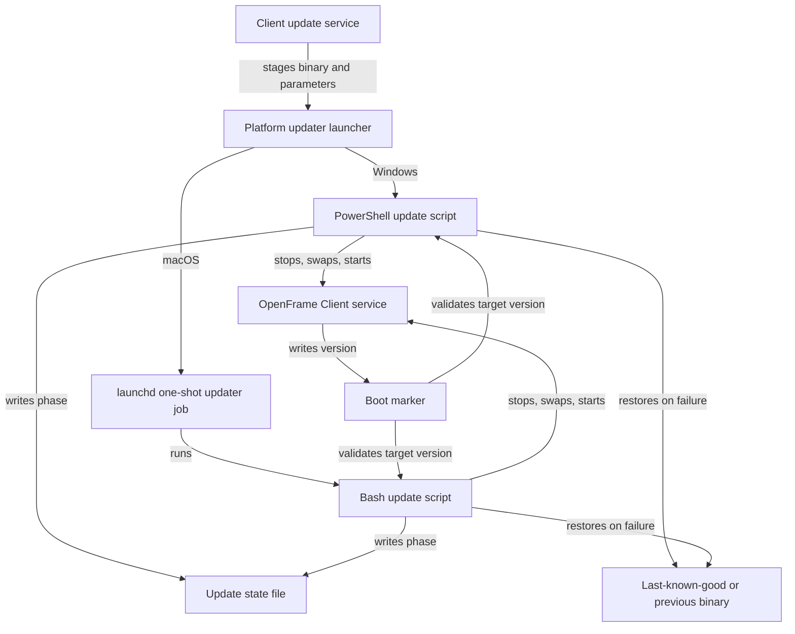
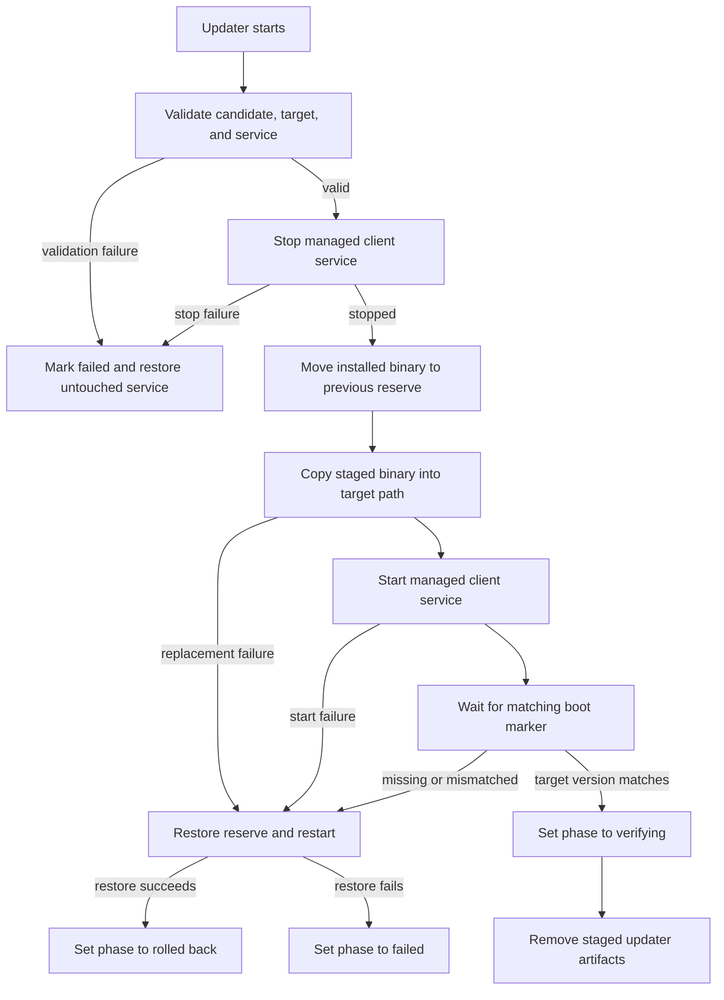

# Platform Update Scripts

Platform Update Scripts supplies the operating-system-specific, out-of-process portion of the OpenFrame Client self-update workflow. The scripts are embedded as Rust string constants in the `openframe_agent_lib` crate from OpenFrame OSS Library version `0.0.5`, which this repository consumes. At runtime, the client writes and launches the relevant script after it has staged a replacement binary.

The module has two source files rather than a shared executable abstraction:

- [macOS update script source](https://github.com/flamingo-stack/openframe-oss-lib/blob/7a766f00e4f58b5d89db007b878ac8d6e0c344f4/clients/openframe-client/src/platform/update_scripts/macos.rs) provides a Bash updater plus a `launchd` job template.
- [Windows update script source](https://github.com/flamingo-stack/openframe-oss-lib/blob/7a766f00e4f58b5d89db007b878ac8d6e0c344f4/clients/openframe-client/src/platform/update_scripts/windows.rs) provides a Windows PowerShell updater.

## Purpose and Boundary

A client cannot reliably overwrite the executable that is currently running as its managed service. Platform Update Scripts moves the critical section into a separate process or one-shot job that can stop the service, replace its binary, restart it, and confirm that the new binary actually booted.

The Rust-side update service prepares the staged binary, update-state file, boot marker, last-known-good reserve, and transcript paths. This module consumes those values as command arguments. It does not download or extract updates, decide which version to install, or publish the final client state; those responsibilities remain with the surrounding client update services.

## Architecture

### Shared Contract

Both scripts receive equivalent operational inputs:

| Input | Role |
|---|---|
| Staged binary path | The already-extracted candidate executable to install. |
| Service identifier | Windows service name or macOS `launchd` label. |
| Target executable path | The installed client executable to replace. |
| Update-state path | JSON state file whose phase is updated during verification, rollback, or failure. |
| Target version and boot-marker path | Expected version and the client-produced evidence that it booted that version. |
| Last-known-good path | Preferred rollback reserve. The pre-swap executable is a fallback reserve. |
| Boot-marker wait time | Maximum verification window, defaulting to 90 seconds. |
| Rollback-only flag | Requests restoration without installing a staged binary. |
| Transcript path | Windows captures a PowerShell transcript. On macOS, `launchd` routes standard output and error to the supplied transcript. |

The updater-launcher module writes the Windows script with a UTF-8 byte-order mark for Windows PowerShell compatibility, invokes PowerShell without a profile and with a noninteractive execution-policy bypass, and redirects early output to a companion output log. On macOS it writes an executable shell script and loads a temporary one-shot `launchd` property-list job so the updater remains alive after the managed service stops.

## Update Lifecycle

### Preconditions and Safety Checks

Before stopping the service, both implementations verify that the staged and currently installed binaries exist and reject a staged file smaller than 100 KB. The Windows script additionally resolves the named service before stopping it. The macOS script verifies the expected service property-list file.

The installed binary is moved to a sibling path with the `.prev` suffix immediately before the replacement copy. This establishes a rollback option even if the last-known-good reserve is absent. A rollback prefers the last-known-good binary and falls back to the pre-swap copy. Each implementation makes up to three restore attempts, with a delay between attempts.

A deleted update-state file is treated as evidence that the agent was uninstalled during the update. Except in explicit rollback-only mode, the scripts then remove their staged candidate and exit without modifying the service further.

## Verification and State Transitions

Starting a service is insufficient proof that the intended executable is live. After startup, each script waits for the running client to write its boot marker. The marker must contain exactly the requested target version. A missing marker, a mismatched version, or timeout triggers rollback.

The scripts record these states when the state file remains available:

| Phase | Meaning |
|---|---|
| `verifying` | The replacement booted and its marker matched the expected version. Post-update handling can continue. |
| `rolled_back` | A failed update was restored and the service was restarted from a reserve. |
| `failed` | A pre-swap error occurred, or no successful rollback could be completed. |

Windows reads, modifies, serializes, and atomically replaces the JSON state file. Failure reasons are constrained to printable ASCII and truncated before writing because the Rust-side reader expects UTF-8. macOS updates only the JSON `phase` field through a temporary-file replacement. Both approaches preserve a readable state file as the coordination record between the updater and client lifecycle code.

## Platform Implementations

### macOS

`UPDATER_PLIST_TEMPLATE` defines a temporary `launchd` job named `com.openframe.updater`. Its program arguments carry the generated script path and the shared updater inputs. `RunAtLoad` starts the job when the temporary property-list is loaded, while standard output and error both go to the update transcript.

`UPDATE_SCRIPT_MACOS` uses Bash and `launchctl` to manage the service property list under `/Library/LaunchDaemons`. It waits up to 30 seconds for service unload and, after a successful replacement, reloads the service and checks that it is loaded. The script removes the staged binary and temporary updater job during cleanup. Removing the updater job is intentionally last because `launchctl remove` may terminate the updater itself.

### Windows

`UPDATE_SCRIPT_WINDOWS` targets Windows PowerShell 3.0 and later. It intentionally avoids later-only cmdlets. The script uses `Get-Service`, `Stop-Service`, and `Start-Service` for service control, waits up to 30 seconds for stop and rollback restart operations, and uses a transcript where available.

The PowerShell error handler distinguishes failures before the binary move from those after it using a swap-reached flag. Pre-swap failures mark the update failed and attempt to start the untouched service. Post-swap failures stop the service, retry reserve restoration, stamp `rolled_back` before startup on success, and otherwise stamp `failed` while attempting to start whichever binary remains in place.

## Integration in the Client

Platform Update Scripts is invoked by the surrounding updater launcher and update services in OpenFrame OSS Library:

- `UpdaterParams` supplies the staged binary, service identifier, target path, update-state path, target version, boot marker, reserve, transcript, and rollback-only flag.
- `OpenFrameClientUpdateService` coordinates download and update application, owns the update-in-progress guard, and depends on the update-state and last-known-good services.
- `UpdateHandlerService` handles pending-update recovery, records boot attempts, publishes the running version, and coordinates cleanup and reserve management after the script returns or the client starts again.
- `LastKnownGoodService` owns the reserve path and boot-marker path used by the scripts to make rollback and post-start validation possible.

These components belong to OpenFrame OSS Library rather than this repository. This repository packages and runs the OpenFrame Client as part of the tenant platform, while the client behavior described here is supplied by its pinned library dependency.

## Operational Considerations

- Treat the staged executable, update state, reserve, and transcript locations as a single update transaction. Removing or manually modifying them while the updater runs can force a failed or rollback path.
- Preserve update transcripts when investigating an update failure. They contain the updater's progress, service-control results, marker mismatch evidence, and rollback attempts.
- A successful script exit indicates that the target-version marker was observed and the state was advanced to `verifying`; it is not the final lifecycle decision. The restarted client performs the later handling and cleanup.
- Rollback-only mode deliberately follows the rollback path without requiring a staged candidate. It still requires an available service definition and a usable reserve binary.
