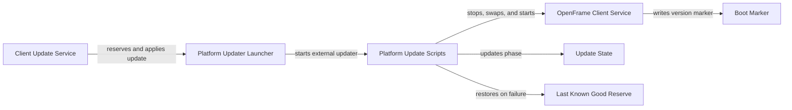
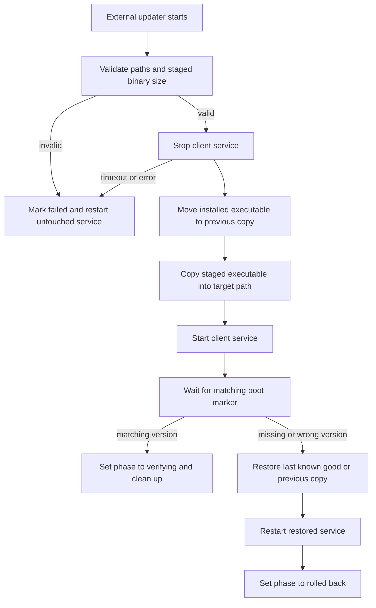

# Platform Update Scripts

Platform Update Scripts contains the operating-system-specific, external updater programs used by the OpenFrame Client self-update flow. The scripts are embedded in the `openframe_agent_lib` artifact from the OpenFrame OSS Library and are executed by the client distributed by this repository. Their narrow responsibility is to stop the installed client service, atomically replace its executable as far as the host permits, restart it, and verify that the newly started process reports the expected version.

The module deliberately performs the swap outside the process being replaced. It uses a staged binary, a pre-swap copy, and a last-known-good reserve so that a failed replacement can restore a runnable client.

## Source and System Context

The implementation is supplied by OpenFrame OSS Library version `v0.0.5` as the Cargo dependency `openframe_agent_lib`. The client-update service reserves and launches an update, the updater-launcher selects and runs the platform script, and the scripts below perform the host-level handoff. The update-state, last-known-good, client-info, and update-handler services own the higher-level lifecycle and persisted state.

## Update Contract

Both implementations receive the staged executable, service identity, installed executable path, update-state path, expected version, boot-marker path, last-known-good path, and a boot-marker wait interval. The Windows script additionally accepts a transcript path. The boot marker is the decisive post-start check: a running service alone is not sufficient evidence that the intended binary started.

| Concern | Common behavior |
| --- | --- |
| Input validation | Requires the staged and target executables, checks that the staged binary is at least 100 KiB, and confirms that the service definition exists. |
| Controlled stop | Stops the service and waits up to 30 seconds, followed by a short settling delay. |
| Replacement | Moves the installed executable to a `.prev` path, copies the staged executable into the target path, and clears any old boot marker. |
| Success verification | Starts the service, confirms its running or loaded state, then waits for the marker to contain the requested version. |
| State reporting | Sets the persisted update phase to `verifying` after a successful boot-marker match. |
| Failure before swap | Marks the update as `failed` and attempts to restart the untouched service. |
| Failure after swap | Stops the service, restores the last-known-good reserve when present or the `.prev` copy otherwise, marks `rolled_back` before restart, and retries restoration up to three times. |
| Uninstall race | If the update state disappears during a normal update, the updater stands down rather than altering service state. |

## Platform Implementations

The module has two platform-specific implementations:

- **macOS update script** — runs under `bash`, manages the client through `launchctl`, and is launched through a temporary LaunchDaemon property-list definition. Its property-list template forwards the updater arguments and sends both standard output and standard error to the supplied transcript path.
- **Windows update script** — runs under Windows PowerShell 3.0 or later, manages a Windows service, and optionally writes an execution transcript. It preserves a useful innermost Win32 error reason and records a sanitized, bounded failure reason in update state.

Detailed platform notes are available in the generated submodules:

- [macOS Update Script](platform_update_scripts/macos_update_script/macos_update_script.md) documents the LaunchDaemon wrapper, `launchctl` lifecycle, and file-mode handling.
- [Windows Update Script](platform_update_scripts/windows_update_script/windows_update_script.md) documents PowerShell service control, transcript capture, and diagnostic-state handling.

## Update Flow

## Operational Guarantees and Limits

- Rollback selects the last-known-good reserve before the immediate pre-swap copy. This lets the updater prefer a separately promoted known-good binary.
- The scripts remove the downloaded staged executable during cleanup. macOS also removes the temporary updater property-list registration.
- A rollback-only invocation deliberately enters the post-swap recovery path without attempting an update.
- The scripts do not download or unpack releases. Artifact acquisition and preparation occur before script execution.
- A successful script exit means that the updater observed the expected boot marker and moved update state to `verifying`; final lifecycle handling remains the responsibility of the client update services.

## Implementation References

- [macOS implementation](https://github.com/flamingo-stack/openframe-oss-lib/blob/16e7c1cbd9664e7d10ec5ebca7d53c9bd314decf/clients/openframe-client/src/platform/update_scripts/macos.rs)
- [Windows implementation](https://github.com/flamingo-stack/openframe-oss-lib/blob/16e7c1cbd9664e7d10ec5ebca7d53c9bd314decf/clients/openframe-client/src/platform/update_scripts/windows.rs)
