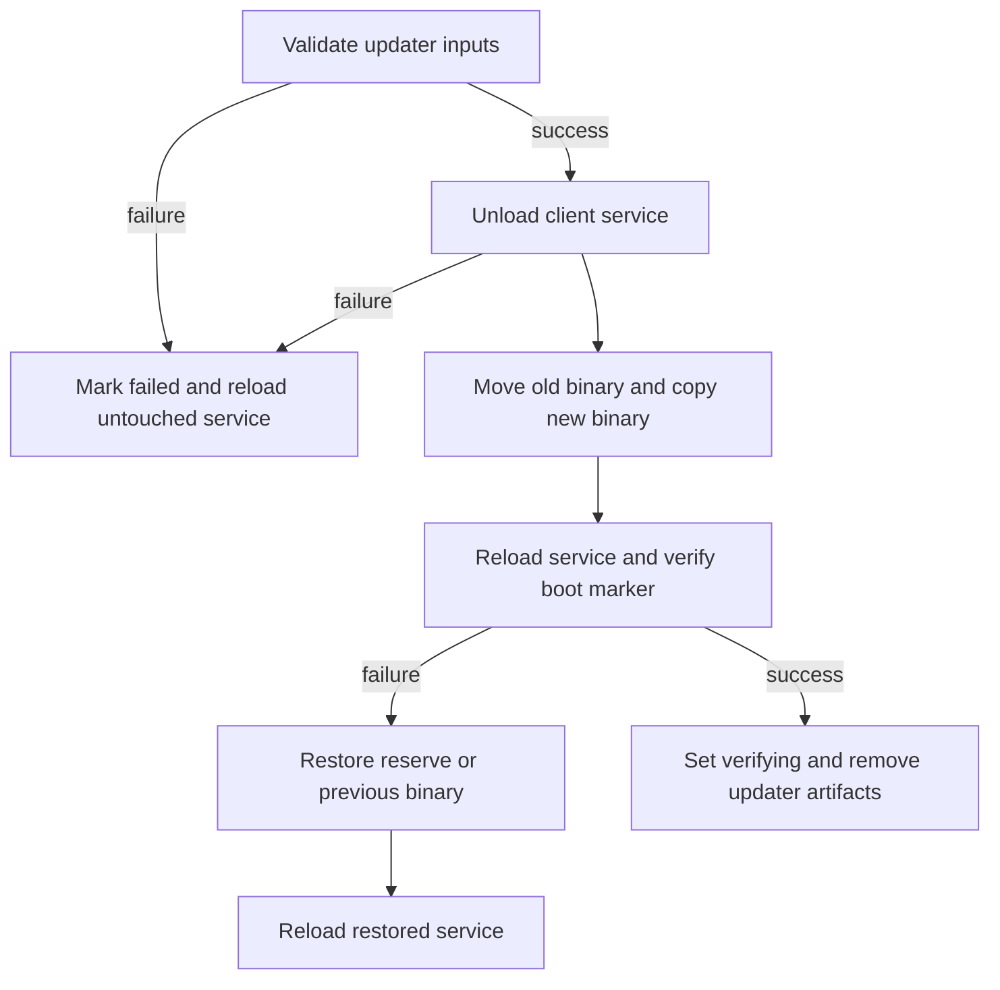

# macOS Update Script

The macOS Update Script is an embedded `bash` program that performs an OpenFrame Client binary replacement after the client process has exited. It is paired with `UPDATER_PLIST_TEMPLATE`, which creates a temporary LaunchDaemon named `com.openframe.updater` and forwards the updater arguments to the script.

## Responsibilities

- Validates the staged and installed executable paths, the staged binary size, and the LaunchDaemon service plist.
- Unloads the target service and waits for `launchctl` to report it absent, with a 30-second limit.
- Moves the current executable to a `.prev` path, copies the staged binary into place, and applies mode `755`.
- Clears the old boot marker, reloads the service, and waits for a marker containing the requested version.
- Updates the JSON update state through a temporary state file, setting `verifying`, `rolled_back`, or `failed` as applicable.
- Restores the last-known-good file first, falling back to the `.prev` copy, if failure occurs after the swap.

## LaunchDaemon Wrapper

The property-list template sets `RunAtLoad` and provides the script, staged binary, service label, target executable, update state, target version, boot-marker path, reserve path, wait interval, and rollback-only flag as program arguments. It routes standard output and standard error to the same transcript path.

The cleanup routine removes the staged binary and removes the temporary updater property-list registration last, because `launchctl remove` can terminate the updater itself.

## Failure Boundaries

If the update-state file has disappeared and rollback-only mode is not active, the script treats the agent as uninstalled. It removes temporary updater artifacts and exits without attempting to stop, restore, or reload the client service.

## Key Components

| Component | Role |
| --- | --- |
| `UPDATER_PLIST_TEMPLATE` | Defines the temporary LaunchDaemon used to invoke the detached updater and capture its transcript. |
| `UPDATE_SCRIPT_MACOS` | Implements validation, `launchctl` service control, binary replacement, version verification, cleanup, and recovery. |

Source: [macOS update script](https://github.com/flamingo-stack/openframe-oss-lib/blob/16e7c1cbd9664e7d10ec5ebca7d53c9bd314decf/clients/openframe-client/src/platform/update_scripts/macos.rs).
