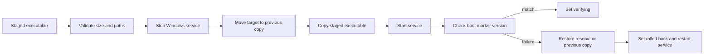

# Windows Update Script

The Windows Update Script is an embedded PowerShell program that completes an OpenFrame Client replacement after a staged executable has been prepared. It supports Windows PowerShell 3.0 or later and intentionally avoids newer-only cmdlets.

## Responsibilities

- Validates the staged executable, target executable, binary size, and Windows service identity.
- Stops the named service, waits up to 30 seconds for the `Stopped` state, then preserves the installed executable as a `.prev` file.
- Copies the staged executable into the target location, starts the service, and confirms the `Running` state.
- Waits for a boot-marker file containing the expected target version before declaring the update verified.
- Records `verifying`, `rolled_back`, or `failed` in the persisted update state.
- Captures a PowerShell transcript when a transcript path is supplied.

## Recovery Model

The script tracks whether it has reached the replacement boundary with `SwapReached`. Before that boundary, an error only marks the update as failed and tries to restart the untouched service. After that boundary, recovery stops the service, attempts restoration up to three times, and starts the restored binary.

The restore source is selected in this order:

1. The last-known-good path, when present.
2. The immediate pre-swap `.prev` copy.

On a successful rollback, the script writes `rolled_back` before starting the service so the restored client observes the final recovery state during its first boot. If restoration itself fails, it records `failed` with both the initial and rollback failure reasons, then makes a best-effort attempt to start whichever binary is currently present.

## State and Diagnostic Handling

`Set-UpdatePhase` parses and rewrites the JSON update-state file through a temporary file. Failure text is restricted to ASCII and limited to 1,000 characters because the Rust consumer expects UTF-8 state. The helper that extracts the error reason walks to the innermost exception so service errors such as a timeout or access denial are retained in diagnostics.

If the update-state file disappears during a normal update, the script assumes uninstallation is in progress. It removes the staged file and exits without changing service state. Rollback-only mode bypasses that safeguard and forces recovery behavior.

## Key Component

| Component | Role |
| --- | --- |
| `UPDATE_SCRIPT_WINDOWS` | Implements Windows service control, binary swap and rollback, boot-marker verification, state updates, transcript handling, and cleanup. |

Source: [Windows update script](https://github.com/flamingo-stack/openframe-oss-lib/blob/16e7c1cbd9664e7d10ec5ebca7d53c9bd314decf/clients/openframe-client/src/platform/update_scripts/windows.rs).
