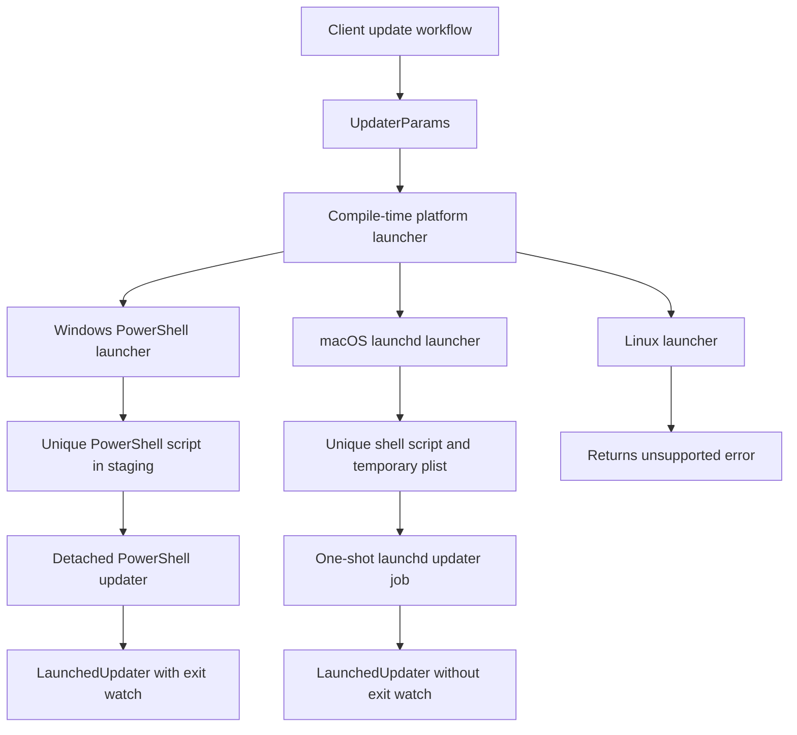
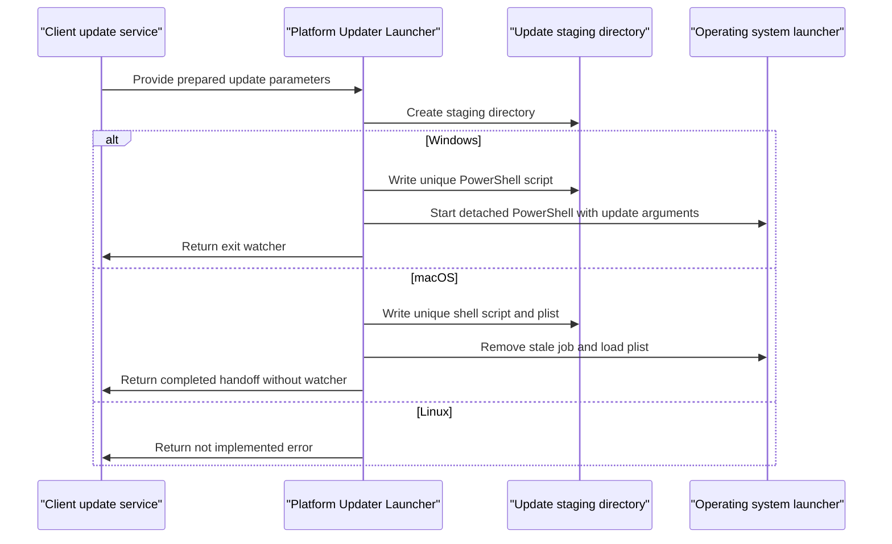

# Platform Updater Launcher

The Platform Updater Launcher is the operating-system boundary for a self-update of the OpenFrame client agent. It is supplied by the `openframe_agent_lib` Cargo dependency from the OpenFrame OSS Library and runs in this repository's OpenFrame client workload. Given a prepared update, it creates and starts a platform-specific updater that can continue after the agent service stops.

The module intentionally does **not** download or validate an update payload. Its caller supplies the staged binary, target executable, service identity, persisted update state, version metadata, boot marker, last-known-good binary location, transcript destination, and whether the launch is rollback-only. The launcher then transfers these inputs to a Windows PowerShell process or a macOS `launchd` job. Linux support is explicitly unavailable at this boundary.

## Source and Scope

The implementation is provided by the OpenFrame OSS Library at the pinned source revision used by this repository:

- [Shared launcher contract](https://github.com/flamingo-stack/openframe-oss-lib/blob/16e7c1cbd9664e7d10ec5ebca7d53c9bd314decf/clients/openframe-client/src/platform/updater_launcher/mod.rs)
- [Windows launcher](https://github.com/flamingo-stack/openframe-oss-lib/blob/16e7c1cbd9664e7d10ec5ebca7d53c9bd314decf/clients/openframe-client/src/platform/updater_launcher/windows.rs)
- [macOS launcher](https://github.com/flamingo-stack/openframe-oss-lib/blob/16e7c1cbd9664e7d10ec5ebca7d53c9bd314decf/clients/openframe-client/src/platform/updater_launcher/macos.rs)
- [Linux launcher](https://github.com/flamingo-stack/openframe-oss-lib/blob/16e7c1cbd9664e7d10ec5ebca7d53c9bd314decf/clients/openframe-client/src/platform/updater_launcher/linux.rs)

## Architecture

`UpdaterParams` is the cross-platform request contract. Compile-time platform selection exposes exactly one `launch_updater` implementation for a client build. `LaunchedUpdater` represents the handoff and may carry an asynchronous process watcher when the platform can retain a child-process handle.

### Platform selection

The shared module conditionally compiles the Windows, macOS, or Linux implementation and re-exports its `launch_updater` function. This prevents one build from selecting a launcher for another operating system at runtime.

### Handoff boundary

The updater must outlive the client process because applying an update can require the running service to stop and release its executable. The launcher therefore prepares only the durable execution mechanism. The update scripts, service control, binary replacement, restart, boot-marker waiting, and rollback behavior are downstream responsibilities of the launched updater.

## Core Components

| Component | Responsibility |
|---|---|
| `UpdaterParams` | Carries all data required by the updater: staged binary and destination paths, service name, update-state and version values, boot marker, last-known-good location, transcript path, and rollback-only mode. |
| `LaunchedUpdater` | Returns an optional Tokio join handle that resolves to an optional process exit status. An absent watcher is valid where the operating system owns the updater job. |
| Windows `launch_updater` | Writes a unique PowerShell script to the update staging directory, starts it with explicit arguments and noninteractive flags, captures early output, and returns a watcher for the spawned process. |
| macOS `launch_updater` | Writes a unique executable shell script and a temporary plist, removes a stale updater job if present, then loads a one-shot `launchd` job. |
| Linux `launch_updater` | Logs the attempted launch and returns an error indicating that the systemd-based updater has not been implemented. |

## Update Launch Flow

## Windows Behavior

The Windows launcher obtains the update staging directory and creates it before writing a uniquely named script. It writes a UTF-8 byte-order mark before the embedded PowerShell update script so Windows PowerShell 5.1 does not interpret multibyte content as ANSI.

It invokes the resolved PowerShell executable with `Bypass`, `NoProfile`, and `NonInteractive` options, passes the script by file path, and supplies every `UpdaterParams` field as named arguments. `CREATE_NO_WINDOW` detaches the updater from a visible console. Standard output and standard error share an adjacent output log derived from the transcript path.

The launch result includes an asynchronous watcher. If the updater exits while the agent process remains alive, the watcher reads up to the final 2 KiB of captured output and logs the exit status. This is diagnostic evidence of an early failure, not a confirmation that a detached update completed successfully.

## macOS Behavior

The macOS launcher writes a uniquely named shell script to the staging directory, sets executable permissions to mode `0755`, and generates `com.openframe.updater.plist`. The plist template receives the staged executable, service label, target executable, update state, target version, boot marker, last-known-good path, boot-marker wait period, rollback flag, and transcript path.

Before loading the plist, the launcher attempts to remove an updater job with the same label. The removal result is intentionally ignored so a missing prior job does not block an update. It then loads the temporary plist with `launchctl`; a nonzero result includes standard error in the returned failure.

Once `launchctl` accepts the job, `launchd` owns it. The client cannot reliably watch the job as a child process, so the returned `LaunchedUpdater` has no exit watcher. Failures after handoff are consequently detected by later boot and update-state handling rather than an immediate process status.

## Linux Status

Linux has a compiled launcher entry point but no implementation. It returns an error advising a systemd service restart instead. Callers must treat this as an unsupported self-update path, not as a successful deferred update. Any future implementation should preserve the shared parameter contract and establish a durable systemd-based execution mechanism that survives service shutdown.

## Operational Guarantees and Constraints

- The launcher creates the staging directory before it writes platform-specific launch artifacts.
- Windows and macOS use unique script names, avoiding collisions between successive attempts.
- macOS additionally removes a prior fixed-label job before creating its replacement.
- The `rollback_only` flag is forwarded unchanged. The launcher does not decide whether rollback is warranted.
- The module does not authenticate, download, extract, verify, or replace update binaries.
- A successful return means the launcher handed work to the operating-system mechanism. It does not mean that the update has completed or that the restarted service has passed its boot checks.

## Failure Handling

A caller should distinguish between two failure periods:

1. **Before handoff:** staging-directory creation, script or plist writing, permission changes, process spawning, or `launchctl` loading can fail synchronously and are returned as errors with context.
2. **After handoff:** the updater can fail after the client has stopped. On Windows, an early exit can be observed through `exit_watch` while the client is still alive. On macOS, the job is external to the process and is checked indirectly through persisted update state and subsequent startup handling.

The update state, boot marker, last-known-good path, and transcript path are therefore not incidental parameters: they are the durable coordination and diagnostic data passed across the service-stop boundary.

## Maintenance Notes

Changes to this module must keep the embedded script interfaces synchronized with `UpdaterParams`. Adding, renaming, or changing the meaning of a field requires corresponding updates to the Windows named arguments and the macOS plist substitutions. Verify the behavior on each supported operating system because only the shared contract is common; process supervision semantics differ by design.
