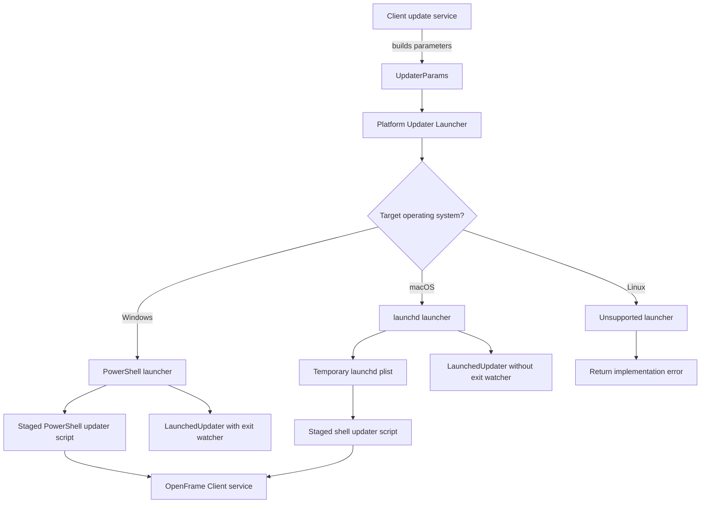
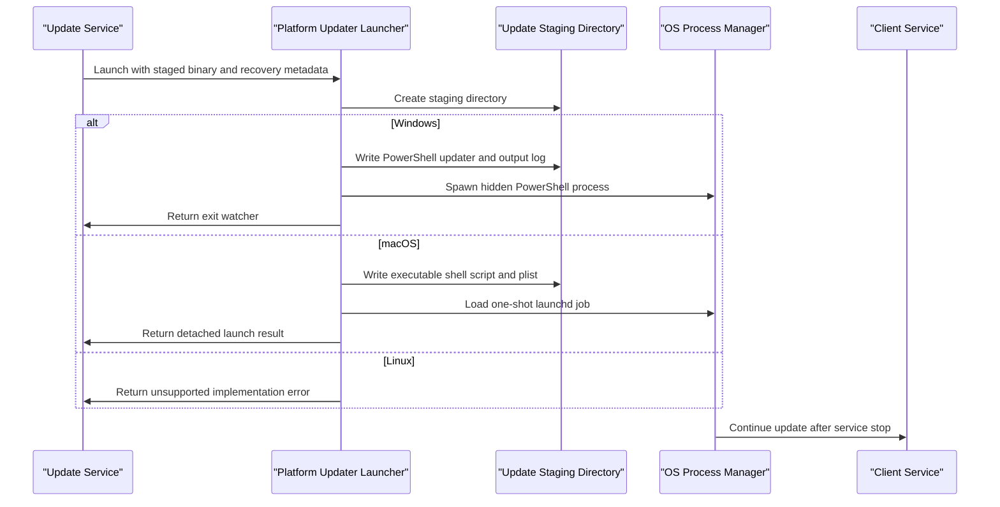

# Platform Updater Launcher

## Purpose

Platform Updater Launcher is the operating-system boundary for an OpenFrame Client self-update. It receives an already staged replacement executable and the update recovery metadata, then starts an updater process that can continue after the client service stops. The implementation is supplied by the `openframe_agent_lib` artifact from OpenFrame OSS Library and is run by this repository's OpenFrame Client deployment.

The module deliberately separates **starting** an updater from **performing** the file replacement. The launcher creates and starts an operating-system-specific updater script or job; the script is responsible for the subsequent service-stop, executable-swap, restart, rollback, and diagnostic work. This boundary prevents the active client process from trying to replace its own executable.

## Scope and Guarantees

- Provides one compile-time-selected `launch_updater` entry point for Windows, macOS, or Linux.
- Carries the binary, service, version, update-state, boot-marker, rollback, and transcript inputs through `UpdaterParams`.
- Returns `LaunchedUpdater`, optionally including an asynchronous exit watcher when the child process remains observable.
- Creates the update staging directory before writing temporary launch material.
- Does **not** implement Linux updates yet. Linux calls return an error instructing callers to use a system service restart instead.
- Does not itself download, validate, or extract an update payload, nor does it persist update state.

## Architecture

The OS implementation is chosen using Rust conditional compilation. Consumers use the same public `launch_updater` name, while only the target platform implementation is compiled and re-exported.

## Core Contract

### Updater Parameters

[`UpdaterParams`](https://github.com/flamingo-stack/openframe-oss-lib/blob/7a766f00e4f58b5d89db007b878ac8d6e0c344f4/clients/openframe-client/src/platform/updater_launcher/mod.rs) is the complete hand-off contract between the update orchestration service and the platform launcher.

| Field | Purpose |
|---|---|
| `binary_path` | Path to the replacement executable that has already been staged. |
| `target_exe` | Installed executable path to replace or restore. |
| `service_name` | Service identity the updater must coordinate with. |
| `update_state_path` | Serialized update-state location passed to the updater script. |
| `target_version` | Version expected after a successful update. |
| `boot_marker_path` | Marker path used by update recovery and boot verification. |
| `lkg_path` | Last-known-good binary path used for recovery. |
| `transcript_path` | Destination for updater diagnostics. |
| `rollback_only` | Requests recovery behavior without applying a newly staged binary. |

### Launch Result

[`LaunchedUpdater`](https://github.com/flamingo-stack/openframe-oss-lib/blob/7a766f00e4f58b5d89db007b878ac8d6e0c344f4/clients/openframe-client/src/platform/updater_launcher/mod.rs) represents a successfully initiated hand-off.

- On **Windows**, `exit_watch` contains a Tokio task that waits for the PowerShell child. It is useful only while the current process remains alive; an early child exit is logged with the tail of its captured output.
- On **macOS**, `exit_watch` is absent because `launchd` owns the detached job. A launchd job that exits later is detected during later recovery rather than watched by the client process.
- On **Linux**, no result is returned because launching is intentionally unsupported.

## Platform Implementations

### Windows

The [Windows implementation](https://github.com/flamingo-stack/openframe-oss-lib/blob/7a766f00e4f58b5d89db007b878ac8d6e0c344f4/clients/openframe-client/src/platform/updater_launcher/windows.rs) creates a uniquely named PowerShell script in the update staging directory and starts it with the staged update inputs.

Its launch sequence is:

1. Ensure the staging directory exists.
2. Write the Windows updater script with a UTF-8 byte-order mark so Windows PowerShell 5.1 does not interpret multi-byte script content as ANSI.
3. Create a companion output log adjacent to the configured transcript, capturing output produced before the script transcript begins.
4. Start PowerShell with a bypassed execution policy, no profile, non-interactive execution, and no console window.
5. Pass every update and recovery parameter as a named PowerShell argument; add the rollback switch only when requested.
6. Spawn a background exit watcher without a deadline, allowing slow cold starts while still surfacing an updater that exits before stopping the client service.

The launcher does not synchronously wait for completion. The running client can therefore proceed with the coordinated shutdown that permits the update script to replace its executable.

### macOS

The [macOS implementation](https://github.com/flamingo-stack/openframe-oss-lib/blob/7a766f00e4f58b5d89db007b878ac8d6e0c344f4/clients/openframe-client/src/platform/updater_launcher/macos.rs) persists a uniquely named shell script in the staging directory, marks it executable, and wraps it in a temporary `launchd` job.

Before loading the new job, it makes a best-effort attempt to remove `com.openframe.updater`, avoiding a stale job from a previous failed update. It then writes `com.openframe.updater.plist` by substituting the script path and all update parameters into the updater plist template. `launchctl load` starts the one-shot job. If loading fails, the launcher returns the captured standard error as a contextual failure.

Using `launchd` is essential to the design: the job remains independent when the client service stops. Once the plist is loaded successfully, the client receives a `LaunchedUpdater` without a child-process watcher.

### Linux

The [Linux implementation](https://github.com/flamingo-stack/openframe-oss-lib/blob/7a766f00e4f58b5d89db007b878ac8d6e0c344f4/clients/openframe-client/src/platform/updater_launcher/linux.rs) is a deliberate placeholder. It logs the requested launch and returns an error stating that Linux updates are not implemented and that a system service restart should be used instead. The source notes systemd as the intended future mechanism.

Callers must treat this as an unsupported capability, not as a deferred asynchronous update. In particular, they must not mark an update as launched after this error.

## Update Hand-off Flow

## Integration Boundaries

Platform Updater Launcher sits between update orchestration and platform utilities:

- **Input producer:** the client update service reserves and applies update work, determines the target version, and constructs the parameter set.
- **Platform dependencies:** Windows resolves a PowerShell executable and uses the Windows update-script template. macOS uses the macOS script and plist templates. Both use the shared update staging directory and configured boot-marker wait duration.
- **Recovery collaborators:** update-state, boot-marker, last-known-good, and transcript paths are forwarded intact to the updater. The launcher does not inspect or mutate their contents.
- **Service lifecycle:** platform scripts or jobs outlive the caller specifically so they can coordinate with the client service after the service exits.

This means changes to a parameter name, its interpretation in an updater script, or the staging-directory layout must be treated as a cross-platform compatibility change. Update orchestration and the corresponding platform script must be changed together.

## Failure Handling and Operational Notes

| Condition | Launcher behavior | Maintainer consideration |
|---|---|---|
| Staging directory cannot be created | Returns an error with context. | Preserve the underlying filesystem failure for diagnosis. |
| Temporary script, plist, output log, or permissions cannot be written | Returns an error with context. | Avoid beginning service shutdown when launch did not succeed. |
| `launchctl load` fails | Returns an error containing launchctl standard error. | Check launchd permissions, plist content, and staging accessibility. |
| PowerShell cannot spawn | Returns an error with context. | Verify executable discovery and process creation permissions. |
| Windows updater exits while still observable | Exit watcher logs status plus the final portion of pre-transcript output. | Treat this as an early launch failure signal. |
| macOS job exits after launch | Not watched by the current process. | Rely on subsequent boot/update recovery evidence. |
| Linux update request | Returns an explicit unsupported error. | Use the supported service-restart path until a systemd updater exists. |

## Maintenance Guidance

1. Keep the `UpdaterParams` contract aligned with both update-script templates. Each platform launcher forwards the same recovery-critical data, even though command-line and plist transport differ.
2. Preserve unique temporary script names. Concurrent or retried updates must not overwrite another updater script.
3. Do not remove the macOS stale-job cleanup without defining equivalent retry behavior.
4. Retain the Windows byte-order mark and pre-transcript output capture unless PowerShell compatibility and diagnostics are replaced intentionally.
5. When implementing Linux support, provide an independent process manager such as systemd that survives client-service termination, and define whether it can expose an exit watcher.
6. Exercise normal update, rollback-only update, launch failure, service-stop hand-off, and reboot recovery paths on every supported operating system.

## Source Components

| Component | Responsibility |
|---|---|
| [`UpdaterParams` and `LaunchedUpdater`](https://github.com/flamingo-stack/openframe-oss-lib/blob/7a766f00e4f58b5d89db007b878ac8d6e0c344f4/clients/openframe-client/src/platform/updater_launcher/mod.rs) | Defines the cross-platform input contract, result handle, and conditional platform export. |
| [`launch_updater` for Windows](https://github.com/flamingo-stack/openframe-oss-lib/blob/7a766f00e4f58b5d89db007b878ac8d6e0c344f4/clients/openframe-client/src/platform/updater_launcher/windows.rs) | Writes and spawns the detached PowerShell updater, then optionally watches early termination. |
| [`launch_updater` for macOS](https://github.com/flamingo-stack/openframe-oss-lib/blob/7a766f00e4f58b5d89db007b878ac8d6e0c344f4/clients/openframe-client/src/platform/updater_launcher/macos.rs) | Writes the shell updater and temporary plist, then starts a launchd-owned job. |
| [`launch_updater` for Linux](https://github.com/flamingo-stack/openframe-oss-lib/blob/7a766f00e4f58b5d89db007b878ac8d6e0c344f4/clients/openframe-client/src/platform/updater_launcher/linux.rs) | Reports that a systemd-based updater has not yet been implemented. |
