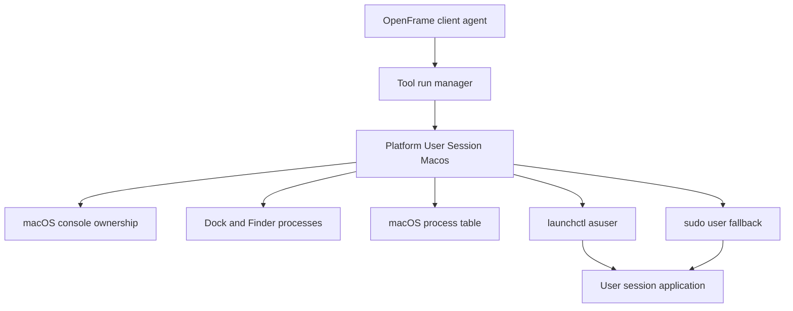
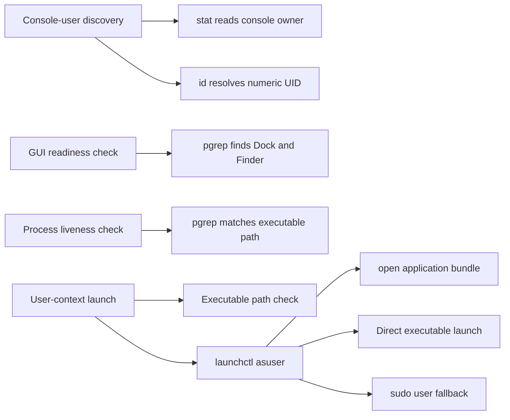
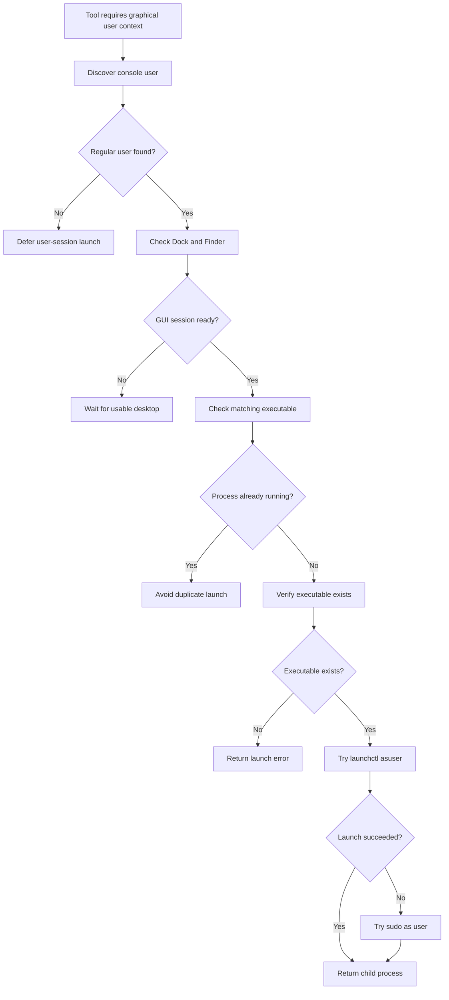

# Platform User Session Macos

Platform User Session Macos is the macOS-specific user-session bridge used by the OpenFrame client agent. It lets a privileged, machine-level agent determine whether an ordinary user owns the active console session, verify that the graphical desktop is usable, avoid duplicate launches, and start a tool in that user's session.

The implementation is supplied by the OpenFrame OSS Library through the `openframe_agent_lib` Cargo dependency. This tenant repository assembles and runs that client behavior; the implementation source is maintained in the [macOS user-session source file](https://github.com/flamingo-stack/openframe-oss-lib/blob/7a766f00e4f58b5d89db007b878ac8d6e0c344f4/clients/openframe-client/src/platform/user_session/macos.rs).

## Scope and responsibilities

The module provides five operational capabilities:

| Capability | Responsibility | Result |
|---|---|---|
| Console-user discovery | Reads the owner of `/dev/console` and resolves the account UID. | A console-user value containing the username and UID, or no user. |
| Login-window protection | Rejects an empty name, `root`, and names beginning with an underscore. | Prevents a launch into the login window or Setup Assistant system account. |
| GUI readiness check | Looks for both Dock and Finder for the target UID. | Confirms that the normal macOS desktop components are running. |
| Duplicate detection | Searches process command lines for the supplied executable path. | Indicates whether a matching process is already running. |
| User-context launch | Starts an application under the discovered user identity. | A child process handle, or a contextual error. |

The module does not authenticate users, create macOS accounts, manage service lifecycle, or decide when tools should run. Those responsibilities remain with the client orchestration and tool-run-management layers.

## Placement in the client architecture

The OpenFrame client is a machine agent that may run with elevated privileges while some integrated tools must run within the active desktop user's context. Platform User Session Macos is the OS adapter that crosses that boundary only after identifying a valid console user.

The module is part of the OpenFrame client core supplied by OpenFrame OSS Library version `7.0.11` for Maven components and by `openframe_agent_lib` version `v0.0.5` for the Rust agent library. In this repository, the OpenFrame Client service is one of the deployed tenant services; its service image is published as `ghcr.io/flamingo-stack/openframe-oss-tenant/openframe-client`.

## Core model

### Console user

The console-user model carries two fields:

- **Username**: The account returned as the `/dev/console` owner.
- **UID**: The numeric user identifier resolved by invoking `id` for that username.

The discovery operation returns no value when a system rather than a regular user owns the console, when either system command fails, or when the UID cannot be parsed. This makes the absence of a usable interactive session an expected condition rather than a launch target.

### Valid interactive user criteria

A console owner is considered a login user only when all of the following are true:

1. The username is nonempty.
2. The username is not `root`.
3. The username does not begin with an underscore.

The last two exclusions account for the macOS login window and Setup Assistant behavior described by the implementation. A service must therefore defer GUI-tool startup rather than substituting a system identity.

## Dependency and interaction model

All operating-system commands are invoked locally. The module neither sends data to an OpenFrame service nor persists state. It emits informational logs for discovered users, existing processes, and successful child-process creation, and warning logs when no regular user is available or the preferred launch mechanism fails.

## Launch behavior

The user-context launch operation accepts an executable path, an argument list, and an already discovered console user. Its behavior is ordered as follows:

1. Verify that the executable path exists. A missing path fails immediately.
2. Attempt a launch through `launchctl asuser` using the console user's UID.
3. If the executable resides beneath a directory whose name ends in `.app`, invoke macOS `open` through `launchctl`.
4. For an application bundle, use the non-activating option so a daemon-initiated launch does not steal foreground focus. Forward provided arguments after the `open` argument separator.
5. For a non-bundle executable, invoke the executable directly through `launchctl` with its arguments.
6. If the preferred launch fails, log the failure and retry through `sudo` under the console username.
7. Return the spawned child process handle from the successful mechanism or return the failure from the fallback.

The bundle path is discovered by walking upward from the executable path until an ancestor ending in `.app` is found. This supports tools whose actual executable is nested inside an application bundle while preserving a direct-executable path for other tool types.

## User-session launch flow

GUI readiness and process liveness are separate checks. Readiness requires both Dock and Finder under the target UID, whereas liveness searches for the requested executable path. Callers can use readiness to avoid launching before login initialization completes and liveness to prevent a second instance immediately before invoking the launcher.

## Operational considerations

### Execution context

This module is designed for an agent that can invoke `stat`, `id`, `pgrep`, `launchctl`, and, when needed, `sudo`. The fallback requires that the runtime environment permits switching to the discovered username. A failed fallback is surfaced to the caller with context identifying that user.

### Focus and launch coalescing

Application bundles are opened with a non-activating request. The launch path intentionally does not force a new application instance: callers are expected to perform the liveness check near launch time, while a normal macOS open request can coalesce with an instance that is still starting.

### Failure interpretation

| Condition | Module behavior | Caller implication |
|---|---|---|
| Login window or Setup Assistant owns the console | Returns no console user and records a warning. | Do not start a user-facing tool. Retry when a regular session appears. |
| Dock or Finder is absent | GUI readiness is false. | Treat the desktop as not ready; defer launch. |
| Executable does not exist | Returns an error before attempting either launch mechanism. | Validate tool installation and path construction. |
| Preferred launcher fails | Logs a warning and tries the user-switch fallback. | A successful fallback remains a valid launch. |
| Process query fails | Reports not running. | The caller may continue with its normal launch safeguards. |

## Maintenance guidance

- Keep console-user validation conservative. Launching as `root` or an underscore-prefixed system account would violate the module's interactive-session contract.
- Preserve the distinction between an application bundle and a plain executable. Bundles require macOS `open` semantics; direct binaries are launched directly.
- Do not treat a successful spawn as proof that the graphical application is fully ready. The returned child handle represents the launcher process, and application startup remains asynchronous.
- When changing command invocation, retain captured standard output and standard error for launch commands so failures remain diagnosable by the calling agent's logging.
- Test changes on a real macOS host across the login window, a newly logged-in desktop, an already-running application, a bundled application, and a non-bundle executable.

## Relationship to the wider system

Platform User Session Macos is a narrow platform implementation beneath the OpenFrame client agent. It enables the higher-level tool lifecycle to place GUI applications in the human user's desktop session without coupling that lifecycle to macOS command details. Other client subsystems continue to handle tool installation, process lifecycle decisions, configuration, and remote command delivery; this module supplies only the local session discovery, readiness signals, liveness lookup, and user-context spawn primitive needed by those flows.
