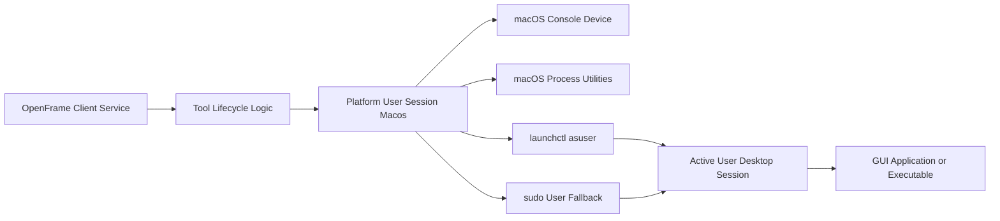
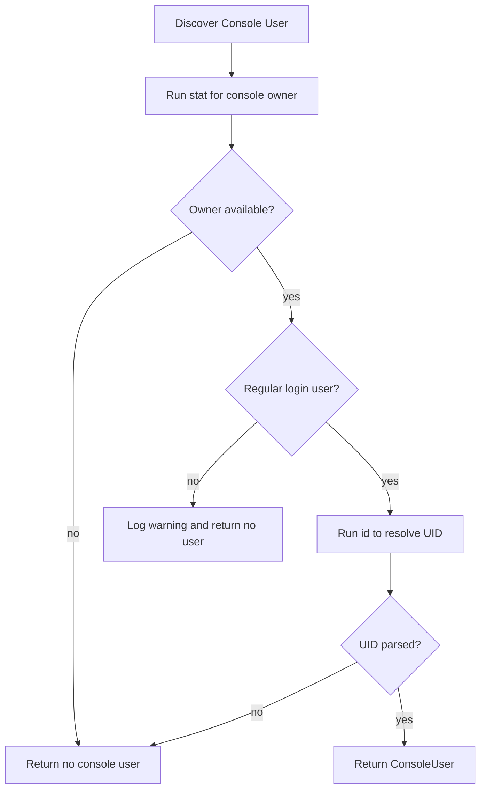
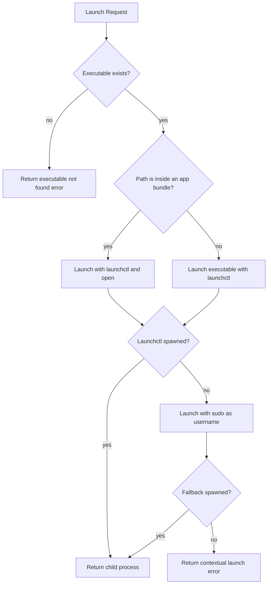
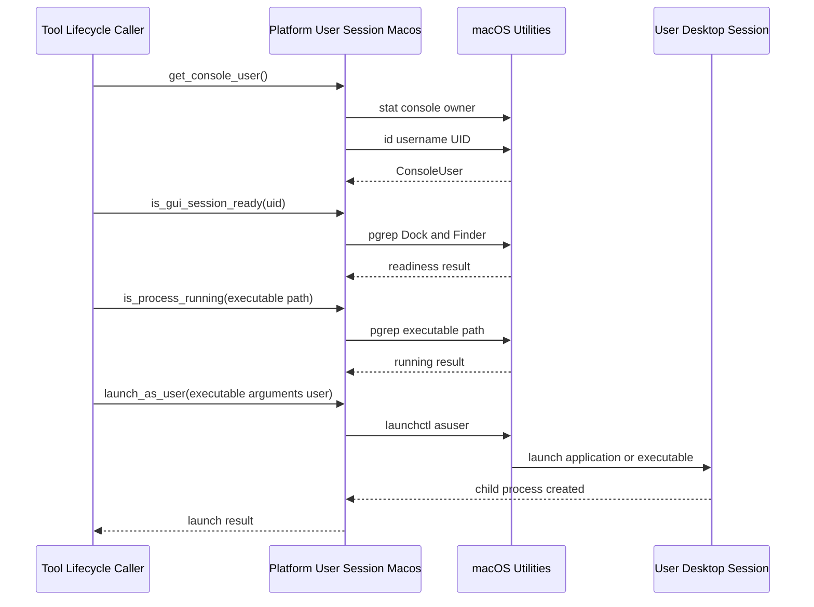

# Platform User Session Macos

Platform User Session Macos is the macOS-specific user-session boundary for the OpenFrame client agent. It identifies the person currently controlling the physical console, determines whether that person's graphical desktop is ready, detects an existing process, and starts a program inside that user's session. This is necessary when the agent runs with service-level privileges but an integrated graphical application must run in the logged-in user's Aqua session.

The implementation is supplied by the OpenFrame OSS Library's `openframe_agent_lib` Cargo artifact and is run by this repository's OpenFrame client. The authoritative implementation is [macos.rs](https://github.com/flamingo-stack/openframe-oss-lib/blob/16e7c1cbd9664e7d10ec5ebca7d53c9bd314decf/clients/openframe-client/src/platform/user_session/macos.rs).

## Scope and Responsibilities

The module is deliberately small and platform-specific. It does not authenticate users, manage the client service, install tools, or maintain session state. Instead, it provides the primitives needed by higher-level tool and application lifecycle code:

- Resolve the interactive console account from the owner of `/dev/console`.
- Reject login-window and Setup Assistant owners rather than treating them as real users.
- Resolve the account's numeric UID for macOS session targeting.
- Verify basic GUI readiness by requiring both Dock and Finder for that UID.
- Determine whether a process matching an executable path is already running.
- Launch an executable as the console user, with dedicated handling for application bundles.
- Prefer `launchctl asuser` and use `sudo -u` only if that primary launch mechanism fails.

## Position in the Client Architecture

The OpenFrame client service can run independently of a user's desktop session. Platform User Session Macos bridges that service context to the active GUI context when an installed tool must be launched for the logged-in user.

The module is part of the `platform.user_session.macos` implementation in the OpenFrame OSS Library. Its only direct operating-system dependencies are standard macOS utilities:

| Dependency | Role | How it is used |
|---|---|---|
| `/dev/console` | Identifies the active console owner | Its owner is read with `stat -f %Su /dev/console`. |
| `stat` | Reads the console owner name | Supplies the candidate account name. |
| `id` | Resolves a UID | Converts the accepted account name to the numeric UID used by `launchctl`. |
| `pgrep` | Checks process presence | Tests Dock and Finder readiness and searches for an executable-path match. |
| `launchctl` | Preferred session launcher | Runs a command within the selected user's context. |
| `open` | Application-bundle launcher | Opens an application bundle without foreground activation. |
| `sudo` | Fallback launcher | Runs a non-bundle executable as the username when `launchctl` fails. |

## Core Components

### Console User

`ConsoleUser` is the data boundary between discovery and launching. It holds:

| Field | Meaning |
|---|---|
| `username` | The accepted owner name of `/dev/console`. |
| `uid` | The numeric UID resolved for that username. |

Keeping both representations prevents repeated account lookups: the UID is used for `launchctl asuser`, while the username is used by the fallback `sudo -u` command.

### Console User Discovery

`get_console_user` reads the owner of `/dev/console` with `stat`, then validates it before looking up the UID with `id -u`.

An account is accepted only when it is non-empty, not `root`, and does not begin with an underscore. This filtering matters because macOS can report `root` while the login window owns the console and can report an underscore-prefixed system account during Setup Assistant. In either situation, the module logs a warning and returns no user instead of launching software into a non-interactive or system-owned context.

`session_user` follows the same console-based model. Its input session identifier is intentionally ignored because the implementation treats the current console owner as authoritative on a Mac with one GUI session.

### GUI Session Readiness

`is_gui_session_ready` provides a lightweight readiness gate. It runs `pgrep -u <uid> -x` for both `Dock` and `Finder`, returning `true` only when both process checks succeed. Failure to execute a check is treated as `false`.

This does not prove that every macOS user-interface facility is ready. It is a conservative signal that the principal desktop shell processes exist for the selected UID, suitable for avoiding a launch during the login transition.

### Existing-Process Detection

`is_process_running` asynchronously invokes `pgrep -f` with the supplied executable path. A successful process search is reported as running, and matching PIDs are logged. If `pgrep` cannot start, the function returns `false`.

The operation is a detection primitive, not a locking mechanism. Callers that require single-instance behavior need to re-check close to launch or use their own coordination. The module's application-bundle launch path deliberately relies on a plain `open` invocation, which can coalesce with an instance that is already starting.

### User-Context Launching

`launch_as_user` first verifies that the requested executable path exists. It then attempts the preferred `launchctl` path and logs the failure before falling back to `sudo -u`.

For a path located inside an application bundle, the module walks the path's ancestors and selects the first name ending in `.app`. It then runs the equivalent of `launchctl asuser <uid> open -g -a <bundle>`, appending `--args` and caller-provided arguments when needed. The `-g` option prevents the service-triggered launch from taking focus. The module intentionally omits `open -n`, allowing ordinary macOS application-opening behavior to reuse or coalesce with an in-progress instance.

For an executable that is not inside an application bundle, it invokes `launchctl asuser <uid> <executable>` followed by the caller's arguments. If either launchctl strategy cannot be spawned, the fallback invokes `sudo -u <username> <executable>` with the same arguments.

## End-to-End Interaction

A caller coordinating a GUI tool uses the primitives in sequence: discover the user, wait for a viable desktop session, avoid an unnecessary duplicate launch, then start the tool in the user context.

## Operational Outcomes and Failure Handling

| Condition | Behavior | Operational implication |
|---|---|---|
| No logged-in regular user | Returns `None` from console discovery and logs a warning for a rejected owner. | The caller should defer GUI work rather than launch as `root` or a setup account. |
| UID lookup fails or is not numeric | Returns `None`. | The module cannot target a user session safely. |
| Dock or Finder is absent | GUI readiness is `false`. | The caller should retry according to its own lifecycle policy. |
| Executable path does not exist | `launch_as_user` returns an error before attempting a launcher. | The caller must resolve installation or path issues. |
| `launchctl` setup or spawn fails | Logs a warning and tries `sudo -u`. | The fallback can preserve launch capability but is not equivalent to the primary session launcher. |
| `sudo` setup or spawn fails | Returns an error annotated with the username. | The caller receives failure context for logging and recovery. |
| Process lookup command fails | Reports no running process. | Callers should not interpret this as strong evidence that no instance exists. |

## Security and Maintenance Considerations

- Treat `ConsoleUser` as an operating-system-derived identity. The module uses the console owner rather than caller-provided user input to select the target account.
- Preserve the regular-user filter when changing discovery logic. Launching as `root` or an underscore-prefixed system account would violate the module's GUI-session contract.
- Keep the initial executable existence check before process creation. It produces an immediate, explicit error instead of relying on launcher-specific failure behavior.
- Preserve argument forwarding exactly in both launch paths. Application bundles receive arguments only after `--args`; direct executables and the fallback receive the argument list directly.
- Do not treat `is_gui_session_ready` or `is_process_running` as synchronization guarantees. They are best-effort observations of mutable operating-system state.
- Test changes on macOS at the login window, during Setup Assistant where applicable, after a normal desktop login, and with both application-bundle and ordinary executable paths.

## Relationship to the Wider Platform

Platform User Session Macos is a leaf platform adapter within the OpenFrame client library. Higher-level client functionality determines which integrated tool should run and when; this adapter only establishes whether an interactive macOS user context exists and how to start a selected local program in that context. The surrounding client and service lifecycle documentation should be consulted for tool installation, update orchestration, and process ownership policies.
