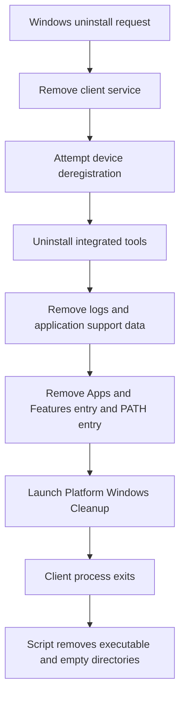
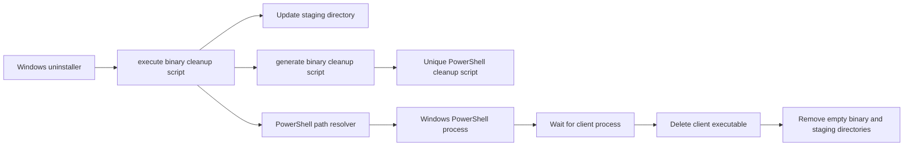
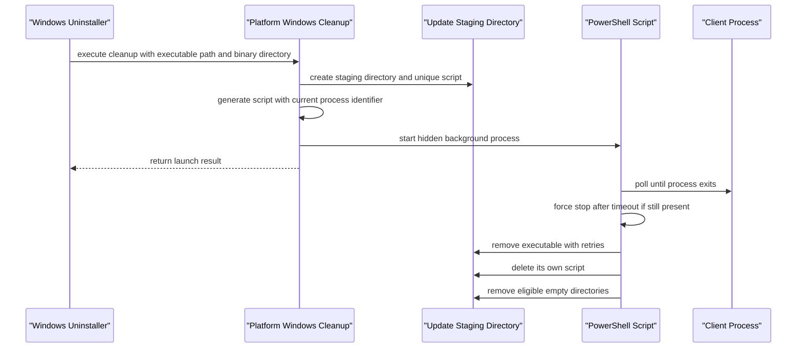
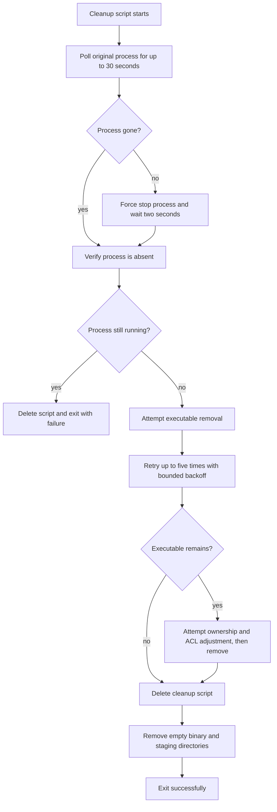

# Platform Windows Cleanup

Platform Windows Cleanup is the OpenFrame Client component that removes the client executable only after the running process has exited. It is implemented by the `windows_cleanup.rs` module in the OpenFrame OSS Library and is assembled into this repository through the `openframe_client` Cargo dependency. Its narrow responsibility is the final, self-deleting cleanup stage of Windows uninstallation; it does not stop services, deregister the device, or remove integrated tools.

**Source:** [windows_cleanup.rs in OpenFrame OSS Library](https://github.com/flamingo-stack/openframe-oss-lib/blob/16e7c1cbd9664e7d10ec5ebca7d53c9bd314decf/clients/openframe-client/src/platform/windows_cleanup.rs)

## Purpose and Scope

Windows cannot delete an executable while it is in use. The client therefore writes a uniquely named PowerShell cleanup script to its update staging directory, starts that script without a visible window, and then allows the client process to terminate. The detached script waits for the original process, removes the executable, deletes itself, and removes only directories that are empty.

The two public functions are:

| Component | Responsibility |
|---|---|
| `generate_binary_cleanup_script` | Produces the PowerShell source, embedding the process identifier, executable path, optional binary directory, and staging directory. |
| `execute_binary_cleanup_script` | Creates the staging directory and script file, then launches PowerShell in the background. |

## Placement in the Client Lifecycle

The Windows uninstaller invokes Platform Windows Cleanup only after it has attempted service removal, optional device deregistration, integrated-tool removal, directory cleanup, Apps and Features deregistration, and removal of the binary directory from the Windows `PATH`. It passes the executable's installation path and its parent directory as the binary directory.

This component is distinct from the regular update path. The update launcher also uses the update staging directory to write a PowerShell updater, while update cleanup removes stale backups and temporary update files. Platform Windows Cleanup is specifically the post-exit removal mechanism needed during uninstallation.

## Architecture and Dependencies

### Local Collaborators

| Collaborator | Relationship |
|---|---|
| Windows uninstaller | Calls `execute_binary_cleanup_script` when the installed executable still exists. It logs a warning rather than failing the broader uninstall if launching cleanup fails. |
| Directory utilities | `get_update_staging_directory` determines where the script is written. On Windows, this is the install directory's `update` subdirectory. |
| PowerShell resolver | On Windows, resolves the System32 Windows PowerShell executable, with a `powershell.exe` fallback. |
| Windows updater launcher | Uses the same staging-directory strategy for its own PowerShell scripts, avoiding locations that may block temporary scripts. |
| Update cleanup service | Separately removes aged update backups and temporary leftovers. It is complementary to, rather than a replacement for, this post-exit deletion. |

## Cleanup Execution Flow

### Script Generation

`generate_binary_cleanup_script` converts the supplied paths to PowerShell-safe single-quoted values by doubling embedded apostrophes. The generated script receives:

- the original client process identifier;
- the executable path to remove;
- the optional directory containing the executable; and
- the update staging directory, which also contains the cleanup script.

The optional binary directory is represented as an empty value when not supplied. This prevents the script from attempting directory removal without a known directory boundary.

### Launch Behavior

`execute_binary_cleanup_script` obtains the current process identifier, creates the staging directory, and writes a script with a UUID-based filename. It starts PowerShell with no profile, a hidden window, and an execution-policy bypass. Standard input, output, and error are redirected to null handles.

On Windows, the initial process launch requests both no-window and job-object breakaway creation flags. If Windows returns access denied because the current job does not permit breakaway, the component retries with the no-window flag only. This fallback preserves the cleanup attempt in restricted process environments.

## Script Process Flow

### Process and File-Removal Safeguards

1. **Bounded wait:** The script polls the original process every 500 milliseconds for up to 30 seconds. If it remains, the script makes a best-effort forced stop and waits two more seconds.
2. **Final liveness check:** If the original process is still present after the forced-stop attempt, the script deletes itself and exits with a nonzero status instead of deleting a potentially active executable.
3. **Retrying deletion:** The script attempts forced executable deletion up to five times. Delays use exponential backoff, capped at eight seconds.
4. **Ownership fallback:** When normal removal still fails and the executable exists, the script attempts `takeown` and grants full access through `icacls` before one final removal attempt. Errors remain nonfatal to the script.
5. **Self-removal before directory checks:** The script deletes itself before checking directory emptiness. This is necessary because the script resides in the staging directory and would otherwise prevent that directory from being considered empty.
6. **Empty-directory policy:** Directory removal uses `Test-Path` and enumerates entries before removal. Each empty directory receives up to three removal attempts. The script only considers removal of the parent installation directory after both the binary directory and staging directory have been removed successfully.

## Error Handling and Observability

The Rust side adds context to failures to create the staging directory, create or write the script, and spawn PowerShell. These failures are returned to the caller. The Windows uninstaller logs such an error and continues its completion path, so a cleanup-launch failure does not reintroduce the service or cancel earlier uninstallation steps.

The cleanup script deliberately sets PowerShell error handling to continue silently. This reflects its best-effort terminal role: it should remove what it can without surfacing interactive prompts or leaving a visible shell. The Rust component logs the current process identifier, script path, selected PowerShell executable, breakaway fallback, and successful launch to support diagnosis before its own process exits.

## Platform Considerations

Although the Rust function includes a non-Windows compilation branch that invokes `powershell.exe`, the generated payload and its intended lifecycle are Windows-specific. The script relies on Windows process inspection, PowerShell, `takeown`, and `icacls`. Callers should use this module only for the Windows uninstallation path.

The component assumes it can write under the update staging directory. The uninstaller's prior cleanup may remove other application data, but this staging location must remain available long enough to write and run the deferred script.

## Maintenance Guidance

- Preserve the order in which the script removes itself and evaluates directory emptiness; changing it can leave the staging directory behind.
- Treat the executable path and directory arguments as untrusted path content for script-generation purposes. Maintain the current single-quote escaping whenever interpolating new PowerShell values.
- Keep process termination and final verification separate. The verification prevents removal while the target process remains alive.
- If the cleanup scope expands, retain the empty-directory checks and avoid recursive deletion of installation parents. This module currently removes directories only when they have no remaining entries.
- Test changes on systems where the client process is locked, where the executable has restrictive permissions, and where the launcher runs inside a job object that denies breakaway.

## Source and Ownership

The implementation belongs to the OpenFrame OSS Library rather than this repository. OpenFrame OSS Tenant consumes `openframe_agent_lib` version `v0.0.5`; its OpenFrame Client runtime executes the library code. Review and modify the linked library source for behavior changes, then update the consuming dependency through the normal release process.
