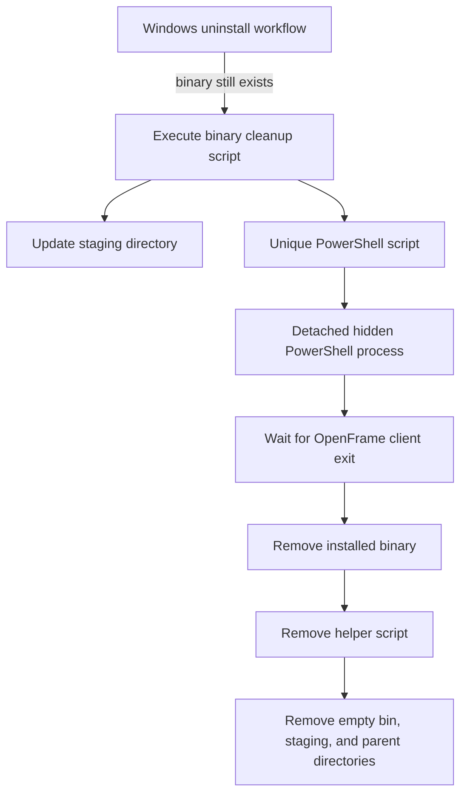
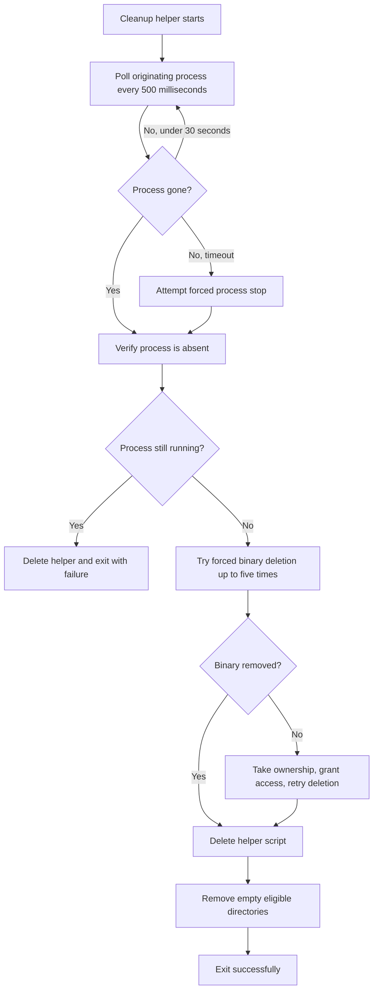

# Platform Windows Cleanup

Platform Windows Cleanup is the Windows-only deferred-removal mechanism used by the OpenFrame client during uninstallation. A running Windows executable cannot reliably delete itself, so the module writes a uniquely named PowerShell helper into the update staging directory, launches it without a visible window, and lets the helper remove the client binary only after the client process has exited.

The implementation is supplied by the `openframe_agent_lib` dependency from OpenFrame OSS Library. Its authoritative source is [`windows_cleanup.rs`](https://github.com/flamingo-stack/openframe-oss-lib/blob/7a766f00e4f58b5d89db007b878ac8d6e0c344f4/clients/openframe-client/src/platform/windows_cleanup.rs). This module does not perform remote calls or report a cleanup outcome to a server; it operates on local paths and relies on tracing logs for diagnostics.

## Responsibilities

- Generate a PowerShell cleanup program for a specific binary path and running client process ID.
- Persist the helper in the update staging directory rather than the system temporary directory.
- Start PowerShell detached, hidden, and with standard streams disconnected.
- Wait for the originating process, retry binary deletion, and use a permission-recovery fallback only when ordinary deletion fails.
- Remove the cleanup script itself and only then remove empty installation directories.

## Architecture and Position in the Client

Platform Windows Cleanup is a narrow platform utility. The Windows uninstall workflow owns the broader lifecycle: it stops and removes the service, makes best-effort deregistration attempts, removes managed tools and other files, unregisters the Apps and Features entry, removes the binary directory from the system path, and invokes this module only when the executable is still present.

The helper is deliberately external to the client process. That separation is essential because it allows the binary to be unlocked before deletion is attempted. On Windows, `get_update_staging_directory` resolves to an `update` directory beneath the installation directory. Keeping the script there avoids environments that block scripts launched from the system temporary directory. On non-Windows builds the staging-directory helper resolves to the process temporary directory, but this module's primary execution path is the Windows PowerShell flow.

## Core Components

### `generate_binary_cleanup_script`

`generate_binary_cleanup_script` creates the PowerShell source from four inputs:

| Input | Purpose |
|---|---|
| Installation path | The executable to delete after the originating process exits. |
| Current process ID | The process the helper waits for and, at the timeout boundary, attempts to stop. |
| Optional binary directory | The directory containing the executable; it is eligible for removal only if empty. |
| Staging directory | The directory containing the helper script; it is checked for emptiness after the script deletes itself. |

Before interpolation, each path is converted to a lossy string and single quotes are doubled. This preserves PowerShell single-quoted literal boundaries when a path itself contains a single quote.

The generated program defines `Remove-EmptyDir`, a bounded helper that:

1. Treats a missing or unspecified directory as already clear.
2. Enumerates all entries, including hidden entries, and refuses to remove a nonempty directory.
3. Makes up to three removal attempts, sleeping one second between failed attempts.

### `execute_binary_cleanup_script`

`execute_binary_cleanup_script` is the Rust-side launcher. It obtains the current process ID, creates the update staging directory, creates a cleanup script whose filename includes a random UUID, writes the generated script, and starts it asynchronously.

On Windows, the launcher resolves PowerShell by preferring the System32 Windows PowerShell executable and falling back to `powershell.exe`. It starts the command with no profile, hidden window mode, execution-policy bypass, null standard input, and discarded standard output and error. The initial process creation includes flags to hide the window and break away from a job object. If Windows returns access denied for the breakaway attempt, the module logs a warning and retries without the breakaway flag so cleanup can still run inside the existing job.

The launcher returns an error when it cannot create the staging directory or script, write the contents, or spawn PowerShell. Once the child process has been spawned successfully, it does not wait for the cleanup result; the cleanup occurs after the client has exited.

## Cleanup Process

### Process-exit coordination

The script polls the process ID for up to 30 seconds in 500-millisecond intervals. If the timeout is reached, it attempts a forced stop and waits an additional two seconds. It then performs a final process lookup. If the process remains present, the helper deletes itself and exits with a failure status rather than attempting to delete a potentially locked executable.

### Binary removal and retries

When the binary exists, normal removal is attempted up to five times. The delay is exponential and capped at eight seconds. If all ordinary attempts fail and the target still exists, the helper invokes `takeown` and `icacls` to take ownership and grant full access, then retries forced removal.

The ownership and access-control fallback is deliberately a last resort because it changes permissions on the target binary. It is scoped to the configured binary path and is only reached after ordinary forced deletion fails.

### Directory pruning

After binary deletion is attempted, the helper removes its own script before inspecting directories. This ordering matters: the helper resides in the staging directory, so it would otherwise prevent that directory from being empty. It then:

1. Attempts to remove an empty binary directory.
2. Attempts to remove an empty staging directory.
3. Attempts to remove the parent of the binary directory only when both prior removals succeeded and a binary directory was supplied.

Nonempty directories are retained. Failures in normal binary removal and empty-directory removal are intentionally nonfatal to the helper's final success path, whereas an active originating process triggers the explicit failure exit.

## Interactions With Adjacent Client Functions

| Client concern | Interaction with Platform Windows Cleanup |
|---|---|
| Windows uninstall | Invokes the launcher after service teardown, tool cleanup, local directory cleanup, Apps and Features unregistering, and system path removal. |
| Update staging | Provides a trusted location for the generated script. The same location is used by updater mechanics to avoid system temporary-directory script restrictions. |
| Executable updates | Binary replacement stages a sibling temporary executable and renames it into place. Cleanup is complementary: it handles final deletion after uninstallation, not an in-place update swap. |
| General update cleanup | Separately removes aged update artifacts and pre-swap copies. It does not replace the deferred process-exit deletion performed here. |

## Operational Notes

- The cleanup target and optional binary directory are derived by the caller from the installed executable path. Callers must not pass user-controlled arbitrary paths to this utility.
- The script filename uses a UUID, reducing collisions between concurrent or repeated cleanup attempts.
- Child-process output is intentionally suppressed. Investigations should use client tracing emitted when the script is created, when its path is selected, when PowerShell is selected, and when the background helper starts.
- The helper is best effort for file and directory cleanup. A failed spawn is surfaced to the caller, which logs a warning in the uninstall flow; a successfully spawned helper runs independently of the terminating client.
- Changes to waiting behavior, permission recovery, or deletion scope should be tested on Windows with service-managed client processes, job-object constraints, locked binaries, and nonempty installation directories.

## Maintenance Boundaries

Keep this module focused on deferred local cleanup. Service removal, server deregistration, tool uninstall, installation-path migration, update state, and ongoing stale-artifact sweeps belong to their respective client subsystems. In particular, do not turn the generated helper into a general-purpose PowerShell executor: its inputs should remain limited to the installed binary, its known directories, and the originating process ID.
