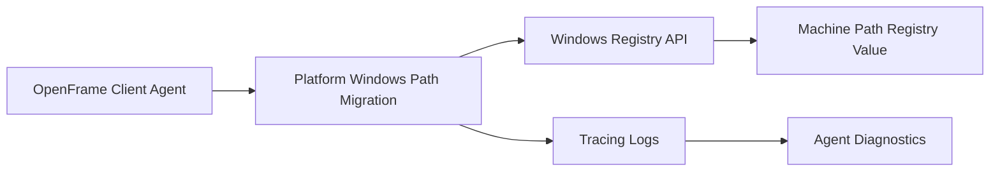
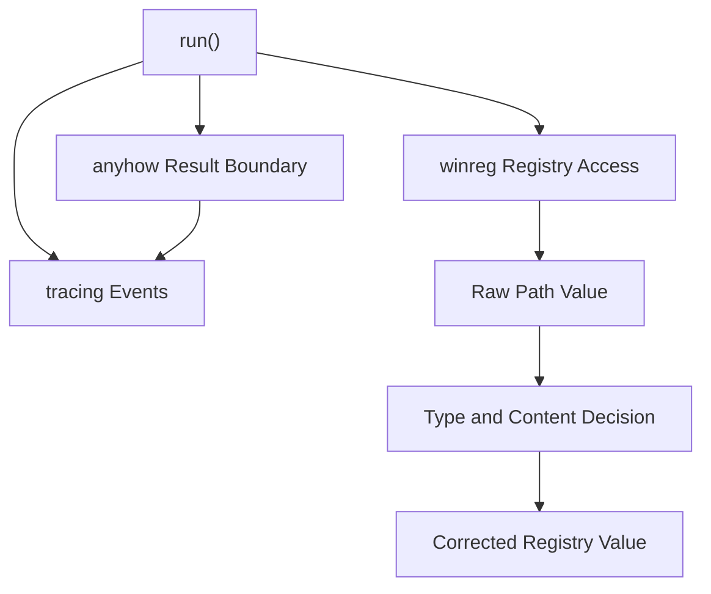
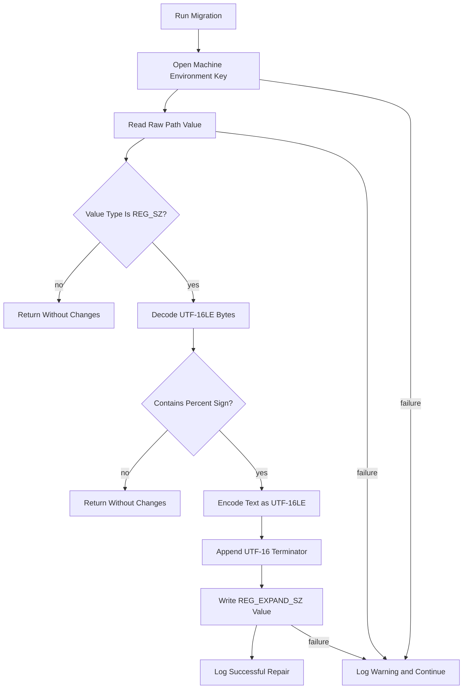
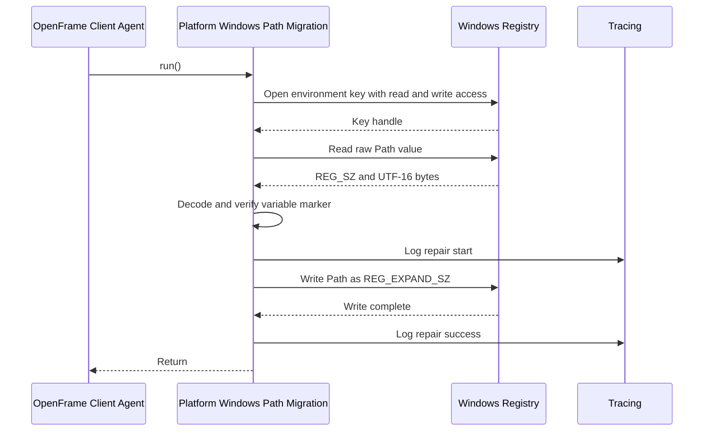

# Platform Windows Path Migration

Platform Windows Path Migration is a small, Windows-specific repair routine in the OpenFrame client agent. It corrects a historical registry-type error in the machine `Path` value: earlier agent versions could write that value as `REG_SZ` rather than `REG_EXPAND_SZ`. When a path contains environment-variable references such as `%SystemRoot%`, the string type prevents Windows from expanding them, which can leave system commands unavailable through the process path.

The module is implemented by [`run`](https://github.com/flamingo-stack/openframe-oss-lib/blob/16e7c1cbd9664e7d10ec5ebca7d53c9bd314decf/clients/openframe-client/src/platform/windows_path_migration.rs) in the `openframe_agent_lib` library, version `v0.0.5`, consumed by this repository's OpenFrame client deployment. It is intentionally idempotent: it only changes a `Path` value that is both an ordinary registry string and contains a percent sign.

## Responsibilities and Boundaries

Platform Windows Path Migration has one narrowly scoped responsibility:

- Open the machine environment registry key with read and write access.
- Read the raw `Path` registry value so its registry type and UTF-16 bytes are available.
- Preserve the existing path text while changing only its value type from `REG_SZ` to `REG_EXPAND_SZ` when migration is warranted.
- Log success or a non-fatal warning; it does not propagate migration failures to its caller.

It does not add, remove, reorder, or otherwise normalize individual path entries. It does not expand variables itself, restart Windows, or update process-level environment blocks. Windows performs variable expansion when consuming an `REG_EXPAND_SZ` value.

## Context in the Client Agent

The module belongs to the Rust OpenFrame client library supplied by OpenFrame OSS Library. It operates on local Windows state and has no network, message-bus, service-management, or API dependency. Its error-handling boundary ensures that an inaccessible registry key or failed write is reported through `tracing` without independently stopping the agent.

The migration module is one platform utility among adjacent client capabilities such as directory management, permissions, service control, binary replacement, and Windows cleanup. Its direct concern is limited to the registry value at `HKEY_LOCAL_MACHINE\\SYSTEM\\CurrentControlSet\\Control\\Session Manager\\Environment`, named `Path`.

## Dependency Model

The implementation relies on three local dependencies:

| Dependency | Role in Platform Windows Path Migration |
| --- | --- |
| `winreg` | Opens the local-machine registry key, reads the untyped value representation, and writes the corrected value. |
| `anyhow` | Carries registry and conversion failures through the internal closure. |
| `tracing` | Emits informational events for a repair and warnings when a check or repair fails. |

## Migration Decision

The routine reads the raw value rather than using a convenience string getter. This is necessary because the type is the condition being repaired. It returns without writing in either of these cases:

1. The value type is already anything other than `REG_SZ`, including the desired `REG_EXPAND_SZ`.
2. The decoded `Path` text does not contain `%`, so there is no evidence that variable expansion is required.

Only the combination of `REG_SZ` and a percent sign triggers a conversion. This limits the change to the historical failure case while making repeated calls safe.

## Data Handling and Preservation

The raw registry byte array is interpreted as little-endian UTF-16 code units and decoded lossily. A trailing null character is removed from the decoded string. For the write, the resulting text is re-encoded as UTF-16 little-endian and receives a two-byte null terminator, the expected representation for a Windows string registry value.

The operation preserves the logical text that it decoded. The intended mutation is therefore restricted to registry metadata and value encoding:

| Before | After |
| --- | --- |
| Registry type: `REG_SZ` | Registry type: `REG_EXPAND_SZ` |
| Text: existing `Path` content containing `%...%` | Text: same decoded `Path` content |
| Byte representation: existing raw string data | Byte representation: UTF-16 little-endian with a null terminator |

## Runtime Interaction

The following sequence describes the successful repair path. No request is sent to an OpenFrame server, and no external state is updated.

## Failure Semantics and Operational Notes

All work is performed inside an internal result-producing closure. A failure to open the key, read the value, or write the replacement is caught at the module boundary and produces a warning containing the error. The public `run` function returns no result, so callers cannot distinguish a no-op from a failed repair through its return value; operators must use the agent's tracing output for that distinction.

This behavior deliberately makes the migration best-effort. It reduces the risk that a legacy `Path` inconsistency prevents unrelated agent startup work. Conversely, a warning means the machine may retain the incorrect type and may need an administrator to inspect registry permissions, policy restrictions, or the current `Path` value.

## Maintenance Considerations

- Keep the operation type-aware. Replacing the raw registry read with a string-only read would hide the condition that determines whether a repair is needed.
- Do not rewrite a `Path` value solely because it is `REG_SZ`; the module requires a percent sign as evidence of an unexpanded variable reference.
- Preserve UTF-16 little-endian encoding and the terminating null when writing registry data.
- Retain non-fatal error handling unless agent startup is explicitly changed to treat this migration as mandatory.
- Test the three primary outcomes: an already-expanded value, a plain `REG_SZ` value without percent signs, and a variable-bearing `REG_SZ` value that is rewritten as `REG_EXPAND_SZ`.

## Source and Ownership

The executable logic is maintained in OpenFrame OSS Library rather than in this repository. The OpenFrame OSS Tenant repository packages and deploys the client ecosystem that consumes the library.

- Source: [`windows_path_migration.rs`](https://github.com/flamingo-stack/openframe-oss-lib/blob/16e7c1cbd9664e7d10ec5ebca7d53c9bd314decf/clients/openframe-client/src/platform/windows_path_migration.rs)
- Consumed library artifact: `openframe_agent_lib` version `v0.0.5`
- Scope: local Windows machine environment configuration
