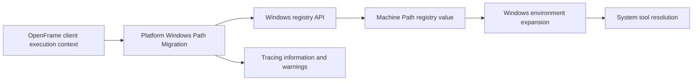
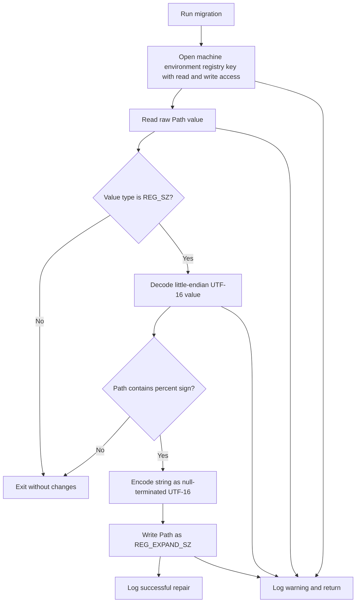
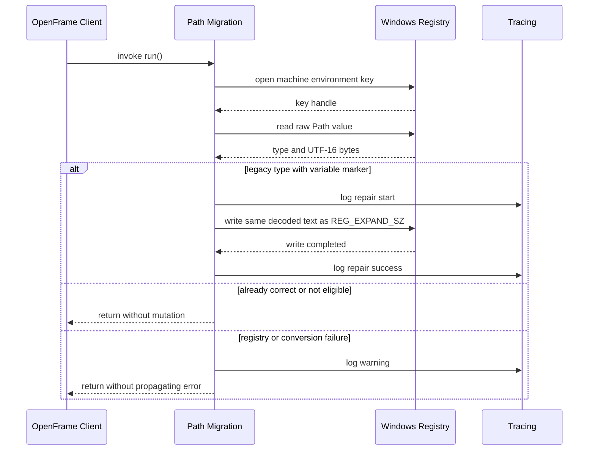

# Platform Windows Path Migration

Platform Windows Path Migration is a Windows-specific, one-time compatibility repair in the OpenFrame client agent. It restores the machine-level `Path` registry value from the literal-string registry type to the expandable-string registry type when an earlier agent version changed the type while the value still contains environment-variable references such as `%SystemRoot%`.

The implementation belongs to the OpenFrame Agent Library Cargo artifact supplied by the OpenFrame OSS Library, version `v0.0.5`, and is run by this repository's OpenFrame client distribution. Its only public component is [`run`](https://github.com/flamingo-stack/openframe-oss-lib/blob/7a766f00e4f58b5d89db007b878ac8d6e0c344f4/clients/openframe-client/src/platform/windows_path_migration.rs#L15-L68).

## Purpose and Scope

Windows expands environment references in a `REG_EXPAND_SZ` registry value, but not in a `REG_SZ` value. If `Path` contains `%SystemRoot%` or comparable references and is stored as `REG_SZ`, commands normally located through those expanded entries can become unavailable. The migration corrects the **registry value type** without intentionally editing the logical path entries.

The repair targets only this registry location:

```text
HKEY_LOCAL_MACHINE\SYSTEM\CurrentControlSet\Control\Session Manager\Environment\Path
```

It does not manage a user-level `Path`, create missing registry keys, expand variables itself, alter service configuration, or restart processes. Windows components that already inherited an old environment may require their own normal environment-refresh or restart behavior after the registry correction.

## Architecture



The migration is deliberately narrow: it performs local registry inspection and, only when the legacy condition is present, one local registry write. It has no network dependency and produces no agent protocol message.

## Component Responsibilities

| Component | Responsibility |
|---|---|
| `run()` | Encapsulates inspection, eligibility checks, conversion, and non-fatal error handling. |
| `RegKey` and raw registry value access | Opens the machine environment key with read and write rights, then preserves explicit control over the registry value type. |
| UTF-16 conversion | Decodes the Windows registry byte representation as little-endian UTF-16, removes the terminating null character, and re-encodes the string for the replacement value. |
| Tracing | Emits informational messages when a repair starts and succeeds, or a warning when inspection or repair fails. |

## Repair Decision Flow



A percent sign is used as the eligibility signal because it indicates that the value may include a Windows environment-variable reference. This is intentionally conservative: a `REG_SZ` value without a percent sign is not rewritten, and a value already stored as `REG_EXPAND_SZ` is left untouched regardless of its text.

## Data Flow and Mutation Semantics



The module reads the raw bytes rather than using a convenience string setter so it can explicitly write `REG_EXPAND_SZ`. The output is a null-terminated UTF-16 byte sequence, which is the registry representation expected for this string type. The intended preserved data is the decoded path text; the only intended mutation is the registry type.

## Operational Behavior

### Preconditions

- The process must execute on Windows and be able to access the machine environment registry key.
- A repair requires permission to open that key with both read and write rights. The module does not elevate privileges or request credentials.
- The `Path` value must be readable as a raw registry value. Missing keys, missing values, denied access, and write failures are treated as non-fatal failures.

### Outcomes

| Condition | Result |
|---|---|
| `Path` is not `REG_SZ` | No action. This includes the expected `REG_EXPAND_SZ` state. |
| `Path` is `REG_SZ` but has no percent sign | No action. |
| `Path` is `REG_SZ` and includes a percent sign | The text is decoded and written back as `REG_EXPAND_SZ`. |
| Any registry or conversion operation fails | A warning is logged; `run()` returns normally. |

### Idempotency and Failure Handling

The operation is safe to invoke repeatedly. Following a successful conversion, the next invocation sees a type other than `REG_SZ` and exits before writing. The function contains its work inside an internal fallible operation and deliberately catches every error at the boundary. This prevents an environment repair failure from terminating the caller, while preserving the error context in a tracing warning.

## Observability

A successful repair emits two informational messages: one immediately before writing and one after completion. A failed inspection or repair emits a warning with the underlying error. There is no return status, persisted migration marker, metric, or remote status message exposed by this component; logs are therefore the direct diagnostic signal.

When investigating a Windows host, confirm both the registry type and whether the `Path` string contains expandable references. The expected healthy state for a machine path containing `%...%` entries is `REG_EXPAND_SZ`.

## Integration Boundaries

Platform Windows Path Migration is part of the OpenFrame client platform layer. It complements, but does not replace, adjacent client responsibilities:

- directory and permission management selects and validates agent storage locations;
- service management installs, starts, stops, and verifies the operating-system service;
- PowerShell resolution locates Windows command tooling; and
- update and cleanup components replace agent binaries and remove temporary artifacts.

This migration does not call those components directly. The indexed organization code graph records no direct callers or tests for `run` at the indexed snapshot, so maintainers should verify the client startup integration in the consuming build before relying on a particular invocation point.

## Maintenance Guidance

- Preserve raw registry type handling. Replacing the raw write with a generic string setter can reintroduce the `REG_SZ` regression.
- Keep the conversion Windows-only and limited to the machine `Path` value named above.
- Do not turn warning-only failures into process failures without considering agent startup resilience.
- Test at least four cases: an already expandable value, a literal value with no percent sign, a legacy expandable-text value stored as `REG_SZ`, and an access-denied or unavailable registry key.
- Test that the replacement retains a terminating UTF-16 null and that a second run performs no additional write.

## Source and Ownership

The implementation is maintained in the OpenFrame OSS Library rather than directly in this repository. Consult the verified source for current behavior: [`windows_path_migration.rs`](https://github.com/flamingo-stack/openframe-oss-lib/blob/7a766f00e4f58b5d89db007b878ac8d6e0c344f4/clients/openframe-client/src/platform/windows_path_migration.rs). This repository consumes the library through the OpenFrame client artifact and distributes the resulting client as part of the tenant platform.
