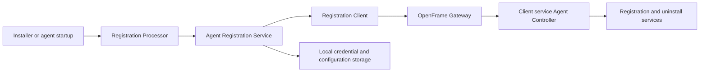
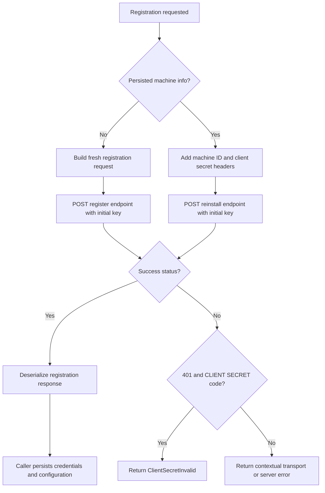
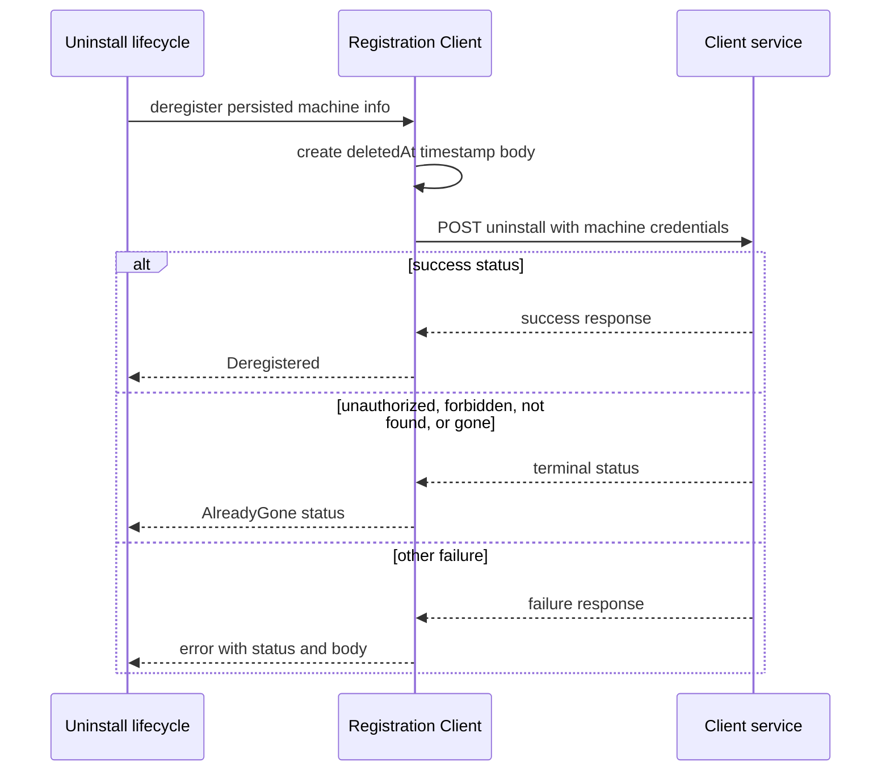
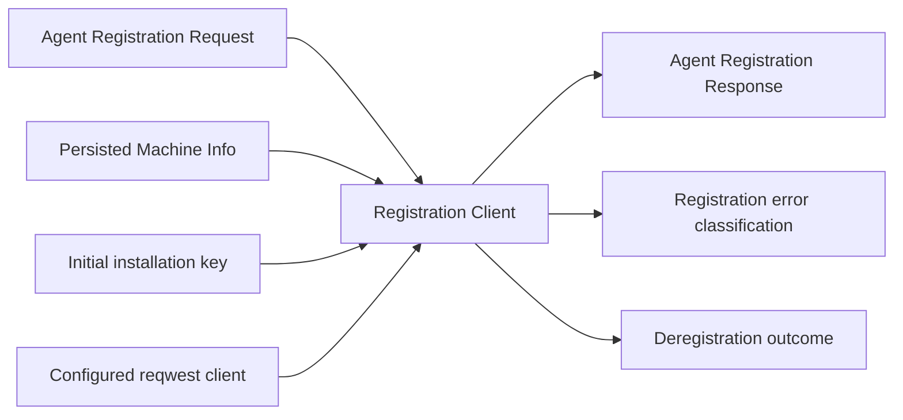

# Registration Client

Registration Client is the Rust HTTP boundary through which the OpenFrame endpoint agent establishes, restores, and removes its server-side device registration. It is implemented in the `openframe_agent_lib` library supplied by [OpenFrame OSS Library](https://github.com/flamingo-stack/openframe-oss-lib) and executed by this repository’s endpoint-client workload.

The module owns three authenticated JSON POST operations:

- **Fresh registration** creates a device record from an initial installation key and device facts.
- **Reinstallation** restores a known device by presenting its persisted machine identity and client secret along with the initial key.
- **Deregistration** reports an uninstall using the persisted machine identity and client secret.

Its implementation is [registration_client.rs](https://github.com/flamingo-stack/openframe-oss-lib/blob/7a766f00e4f58b5d89db007b878ac8d6e0c344f4/clients/openframe-client/src/clients/registration_client.rs).

## Scope and System Position

The client deliberately contains transport and response-classification logic rather than the full registration lifecycle. The endpoint agent’s registration service chooses whether the installation is fresh or a reinstall, gathers device data, persists successful credentials, and retries operational failures. Registration Client then translates that decision into an HTTP request against the client service.

The client service exposes the server-side `/api/agents` routes. In a deployed tenant, the gateway routes `/clients/**` traffic to the client service, so the endpoint-facing paths used here begin with `/clients/api/agents`.

## Public Interface

`RegistrationClient` is constructed with a base URL and a configured `reqwest` HTTP client. Construction performs no network I/O and currently only retains those dependencies.

| Operation | Request target | Required authentication | Request body | Successful result |
|---|---|---|---|---|
| `register` without persisted machine information | `/clients/api/agents/register` | `X-Initial-Key` | `AgentRegistrationRequest` | `AgentRegistrationResponse` |
| `register` with persisted machine information | `/clients/api/agents/reinstall` | `X-Initial-Key`, `X-Machine-Id`, `X-Client-Secret` | `AgentRegistrationRequest` | `AgentRegistrationResponse` |
| `deregister` | `/clients/api/agents/uninstall` | `X-Machine-Id`, `X-Client-Secret` | Timestamp object | `DeregistrationOutcome` |

All URLs are assembled by appending the route to the supplied base URL. Callers must therefore supply a base URL compatible with this path layout and avoid a trailing-path configuration that would make the composed URL invalid.

## Data Contract

### Registration Request

The `AgentRegistrationRequest` sent as JSON includes the following fields:

| Field | Meaning | Serialization behavior |
|---|---|---|
| `hostname` | Device host name | Always included |
| `agent_version` | Installed endpoint-agent version | Always included |
| `organization_id` | Organization context | Omitted when empty |
| `user_id` | Optional user context | Omitted when empty |
| `os_type` | Device operating-system type | Always included |
| `tags` | Parsed device tags | Omitted when empty |

A successful server response is deserialized as `AgentRegistrationResponse`, which contains the `machine_id`, `client_id`, and `client_secret` issued or returned by the platform. The surrounding agent registration service persists the machine ID and client secret as `PersistedMachineInfo`, then saves the registration data into agent configuration. The optional persisted `user_id` is used by lifecycle logic outside this transport client.

### Headers and Content Type

Registration always sends `X-Initial-Key` and `Content-Type: application/json`. A reinstall additionally sends `X-Machine-Id` and `X-Client-Secret`, sourced from the persisted machine record. Deregistration sends the latter two headers but does not send an initial key.

Each value is parsed into an HTTP header value before a request is issued. A value that cannot form a valid HTTP header fails locally with context identifying the invalid header; it is not sent to the server.

## Registration Flow

The same `register` operation implements both first registration and reinstallation. The presence of persisted machine information is the sole branch selector.

### Fresh Registration

When no `PersistedMachineInfo` is available, Registration Client sends the request to `/register` with the installation’s initial key. This lets the server create or associate a device based on the request facts and initial-key authorization.

### Reinstallation and Credential Rejection

When persisted machine information exists, Registration Client uses `/reinstall` and supplies both persisted credentials in request headers. This supports recovery of a device identity after a reinstall rather than blindly creating a second device.

A failed request normally becomes `RegistrationError::Other`, preserving contextual transport, validation, HTTP-status, or response-body information. The exception is an HTTP `401 Unauthorized` response whose JSON error payload has a `code` beginning with `CLIENT_SECRET_`. That narrowly defined condition is returned as `RegistrationError::ClientSecretInvalid`, enabling the caller to distinguish rejected saved credentials from a transient or general registration failure.

The registration processor treats any returned error as retryable at its level: it logs the failure and waits 60 seconds before retrying. Maintainers should preserve the special invalid-secret classification when changing the server contract because lifecycle code may use it to choose recovery behavior.

## Deregistration Flow

Deregistration is invoked during uninstall to notify the platform before local cleanup removes the credentials needed to authenticate the call. The client posts to `/clients/api/agents/uninstall` using the persisted machine ID and client secret.

The request includes a JSON object with a `deletedAt` timestamp encoded in RFC 3339 form at microsecond precision. The server-side controller does not require this payload for its application contract, but a non-empty body is intentionally sent because an upstream Google Cloud load balancer rejects body-less POST requests with HTTP `411 Length Required`.

## Deregistration Outcomes and Retry Semantics

`DeregistrationOutcome` separates a platform-confirmed removal from a terminal no-op:

| Outcome | Meaning | Statuses |
|---|---|---|
| `Deregistered` | The platform accepted the uninstall notification. | Any successful HTTP status |
| `AlreadyGone` | Retrying cannot recover the notification because the platform does not recognize the machine or does not yet expose the endpoint. | `401`, `403`, `404`, or `410` |

The `AlreadyGone` outcome is intentionally not an error. It covers invalid or expired credentials, a deleted device, and compatibility with servers that have not deployed the uninstall endpoint. All other non-success statuses remain errors and include the status and readable response body when available. The higher-level deregistration service can use this distinction to avoid futile retries while retaining retry behavior for network and nonterminal server failures.

## Component Relationships

- **Registration Client** owns endpoint selection, request construction, JSON serialization, response deserialization, and HTTP-status interpretation.
- **Agent Registration Service** owns the broader lifecycle: it obtains the initial key, reads saved credentials, gathers device facts, calls Registration Client, and persists credentials after success.
- **Registration Processor** prevents duplicate registration when configuration already contains a machine ID and provides the 60-second retry loop around lifecycle failures.
- **Machine information persistence** retains the machine ID, client secret, and optional user ID required for a later reinstall or uninstall.
- **The server-side Agent Controller** receives the three requests at `/api/agents/register`, `/api/agents/reinstall`, and `/api/agents/uninstall`, then delegates registration or uninstall behavior to server services.

## Failure Handling

| Failure point | Client behavior | Operational implication |
|---|---|---|
| Invalid initial-key, machine-ID, or client-secret header value | Returns a contextual local error before network I/O. | Validate installer-provided and persisted values. |
| Network send failure | Returns an error annotated as a registration or deregistration send failure. | The caller determines retry policy. |
| Non-success registration response | Returns the status and response body, except for the recognized invalid-secret case. | Inspect platform response and route configuration. |
| Successful registration with unreadable JSON | Returns a response-parsing error. | Treat as a server contract or proxy-response issue. |
| Deregistration `401`, `403`, `404`, or `410` | Returns `AlreadyGone`, not an error. | Continue uninstall; a retry cannot make the platform remember the device. |
| Other deregistration failure | Returns an error containing status and body. | Higher-level deregistration retry logic may retry before local credentials are removed. |

## Security and Maintenance Notes

- Initial keys and client secrets are passed only as HTTP headers; avoid logging their values when instrumenting call sites or errors.
- Persisted client secrets are the authorization proof for both identity restoration and uninstall reporting. Local persistence and cleanup ordering are therefore part of the security boundary.
- The `CLIENT_SECRET_` prefix is a compatibility contract between client and server. Changes to server error codes must retain or deliberately migrate this classification.
- The unconditional JSON body on deregistration is infrastructure compatibility behavior, not unused data to remove without validating the complete request path.
- HTTP success is evaluated with the general successful-status range rather than a single hard-coded status, allowing compatible server implementations to use appropriate success responses.

## Source and Runtime Ownership

This repository consumes the Rust `openframe_agent_lib` artifact from OpenFrame OSS Library at version `v0.0.5`. The referenced source is part of the library implementation, while OpenFrame OSS Tenant packages and runs the endpoint-client workload that uses it. The tenant deployment routes client traffic through OpenFrame Gateway to the client service, which provides the corresponding agent registration endpoints.
