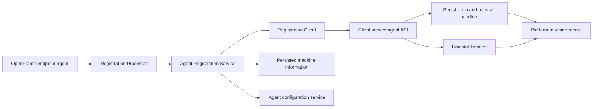
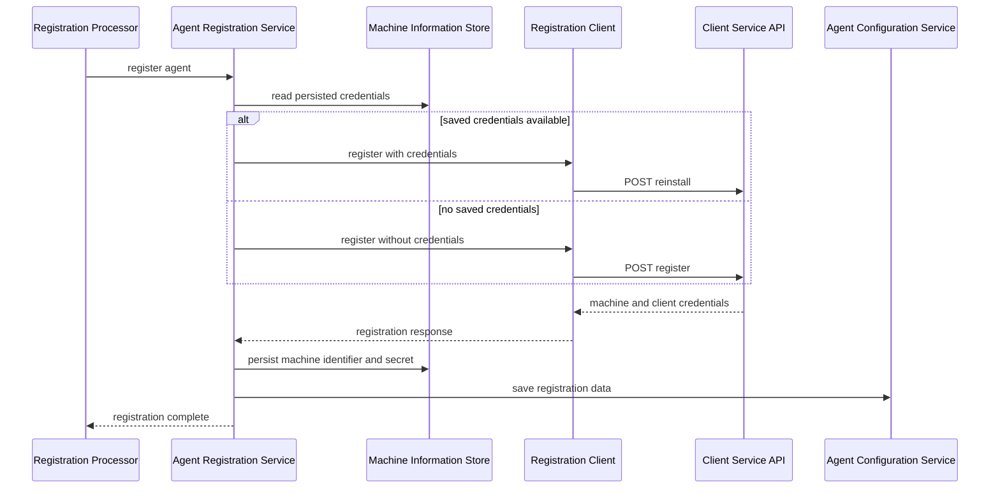
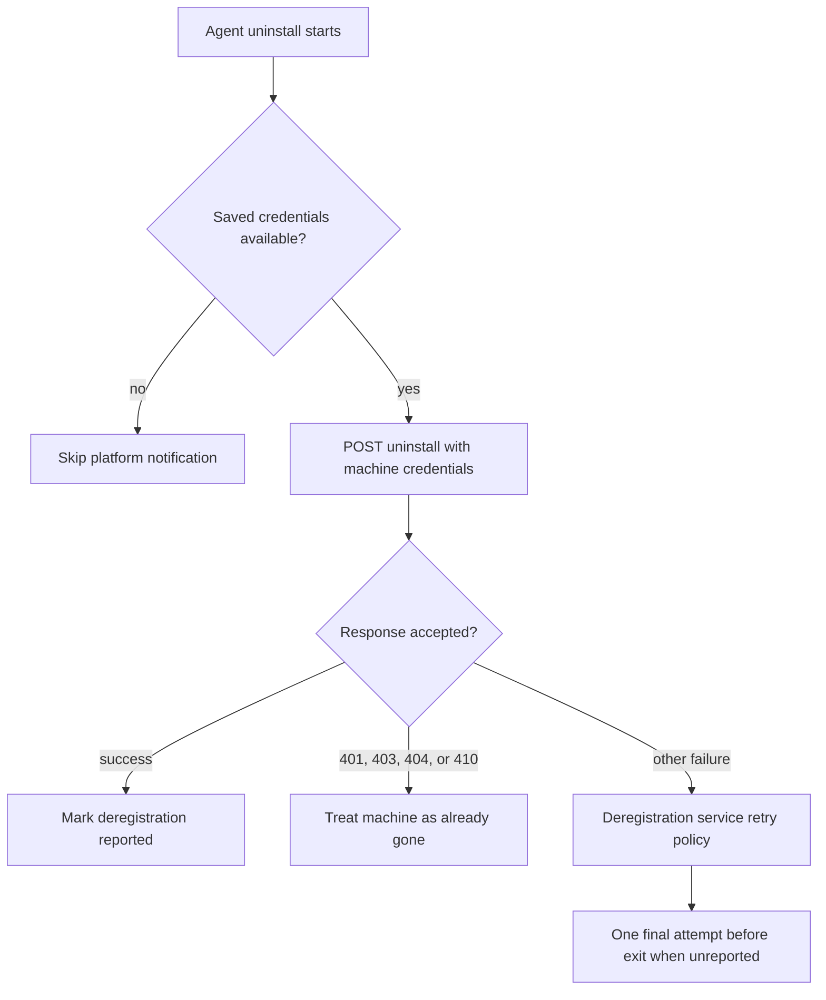

# Registration Clients

Registration Clients is the OpenFrame endpoint agent's HTTP boundary for enrolling a device, recovering an existing device identity after reinstallation, and reporting an uninstall. It is implemented by `RegistrationClient` in the Rust `openframe_agent_lib` library, version `0.0.5`, which this repository consumes to run `openframe-client`.

The client deliberately owns only request construction, response decoding, and HTTP-status classification. Registration orchestration, durable credential storage, retry scheduling, and configuration updates are handled by the surrounding agent services. The implementation is in the [Registration Client source](https://github.com/flamingo-stack/openframe-oss-lib/blob/16e7c1cbd9664e7d10ec5ebca7d53c9bd314decf/clients/openframe-client/src/clients/registration_client.rs).

## Responsibilities

- Select the fresh-registration or reinstall endpoint from the presence of persisted machine credentials.
- Send the initial installation key on every registration request.
- Attach the saved machine identifier and client secret only when proving an existing identity during reinstall or uninstall.
- Serialize the device registration payload and deserialize the returned machine identifier plus OAuth-style client credentials.
- Distinguish an invalid saved secret from other registration failures so higher-level services can recover appropriately.
- Treat selected uninstall responses as terminal success-equivalents, avoiding futile retries when the server has already forgotten the machine or does not expose uninstall support.

## Architecture and System Placement

The platform-side Client service exposes the agent routes beneath `/api/agents`; gateway configuration routes `/clients/**` to that service. The agent therefore addresses them through its configured base URL with the `/clients/api/agents/...` prefix. The service contract supplies three operations:

| Agent operation | Request endpoint | Required credentials | Successful response |
|---|---|---|---|
| Fresh registration | `POST /clients/api/agents/register` | `X-Initial-Key` | Registration response containing `machine_id`, `client_id`, and `client_secret` |
| Reinstall | `POST /clients/api/agents/reinstall` | `X-Initial-Key`, `X-Machine-Id`, and `X-Client-Secret` | Replacement or confirmed registration response |
| Deregistration | `POST /clients/api/agents/uninstall` | `X-Machine-Id` and `X-Client-Secret` | No-content success when accepted |

## Core Components

### `RegistrationClient`

`RegistrationClient` is a cloneable wrapper around a `reqwest` HTTP client and a base URL. Its constructor accepts both values and returns a result, making client construction consistent with other agent clients. It does not load configuration, create device metadata, persist credentials, or retry calls; callers supply those dependencies and policies.

### Registration request and response models

The registration request contains the hostname, agent version, operating-system type, and optionally an organization identifier, user identifier, and device tags. Empty optional strings and an empty tag collection are omitted during serialization.

A successful response returns three values:

| Field | Meaning |
|---|---|
| `machine_id` | Stable platform identity for the endpoint machine. |
| `client_id` | Client credential identifier retained by the agent configuration. |
| `client_secret` | Secret used to prove the machine identity for reinstall and deregistration, and retained with the client configuration. |

Persisted machine information is intentionally smaller: it contains the `machine_id`, `client_secret`, and an optional `user_id`. These persisted values determine whether the next registration attempt is a reinstall.

### `register`

`register` receives an initial key, optional persisted machine information, and a fully prepared request payload. When no persisted information is present it calls the register endpoint. When it is present it calls the reinstall endpoint and adds the saved machine identifier and client secret as headers.

For either branch, it adds `Content-Type: application/json`, encodes the request as JSON, and decodes a successful body as the registration response. Header parsing and transport or decoding failures are propagated with contextual errors.

A non-successful reinstall response is specially classified only when both conditions hold:

1. The status is `401 Unauthorized`.
2. The JSON error body's `code` begins with `CLIENT_SECRET_`.

That case becomes `RegistrationError::ClientSecretInvalid`. All other failures, including network errors, malformed error bodies, validation failures, and other status codes, become `RegistrationError::Other`.

### `deregister` and `DeregistrationOutcome`

`deregister` reports an uninstall using the machine identifier and client secret from persisted machine information. Although the server contract consumes credentials from headers, the agent sends a JSON body containing `deletedAt` in RFC 3339 UTC microsecond precision. This is a transport compatibility measure because a GCP load balancer rejects body-less `POST` requests with status `411`.

The result is deliberately semantic rather than a raw status:

| Outcome | Conditions | Caller implication |
|---|---|---|
| `Deregistered` | Any successful HTTP status | The platform accepted the uninstall report. |
| `AlreadyGone(status)` | `401`, `403`, `404`, or `410` | Do not retry: the identity is unavailable, has already been removed, or the endpoint is not deployed. |
| Error | Any other unsuccessful status, transport error, or invalid header | Retry policy remains a higher-level decision. |

## Registration Flow

The registration processor first checks the agent configuration for a machine identifier. A populated value ends the workflow because the process is already registered. Otherwise it repeatedly attempts registration with a 60-second delay after a failure.

The agent registration service retrieves the initial key from initial configuration and rejects an empty value before making a request. It retries reading persisted machine information according to its read-retry policy; after the configured attempts fail, it falls back to fresh registration. On a successful response it writes machine information best-effort, then saves the machine identifier, client identifier, and client secret through the configuration service. Configuration persistence errors fail the registration operation; failure to write the separate machine-information file is logged but does not prevent the successful registration result from being used.

On the server, the Client service maps the three requests to registration, reinstall, and uninstall handlers. Registration-related follow-up work can dispatch client feature flags and client-update deliveries, while enabled integrated tools are scheduled for installation asynchronously. These follow-up operations are isolated from the core registration result: failures to seed feature flags or update delivery are logged and do not fail an otherwise successful registration.

## Uninstall Reporting Flow

The deregistration service provides best-effort lifecycle handling around `RegistrationClient`. If no credentials were found, it skips platform notification. Otherwise it makes the configured attempts and tracks whether reporting completed. Before agent exit, it can make one additional attempt if the report remains unconfirmed.

## Operational and Security Considerations

- Treat the initial key, client secret, and persisted machine information as secrets. Avoid emitting them in logs, diagnostics, or telemetry.
- Preserve the distinction between a fresh registration and reinstall. Sending stale credentials changes both the target endpoint and the server-side identity semantics.
- Preserve the `CLIENT_SECRET_` classification behavior when changing server errors or agent error handling. It is the explicit signal that stored machine credentials were rejected.
- Do not remove the nonempty uninstall JSON body without verifying load-balancer behavior in every deployed environment.
- Keep `AlreadyGone` terminal. Retrying unauthorized, forbidden, missing, or gone responses cannot recreate a deleted machine identity and can delay local uninstall.
- Registration retries indefinitely at the processor level when the agent remains unregistered. Alerting should therefore distinguish persistent enrollment failure from a registered agent's normal runtime errors.

## Maintenance Checklist

When evolving this module:

1. Keep the request routes, header names, and response fields synchronized with the Client service controller contract.
2. Ensure any new registration request field has an intentional serialization rule, especially for optional values.
3. Add tests for fresh registration, reinstall, invalid-secret classification, decoding failures, and every terminal deregistration status.
4. Verify that credential persistence and configuration updates remain ordered after a successful response.
5. Test uninstall behavior behind the production ingress or load-balancer path to retain the body-required compatibility guarantee.
