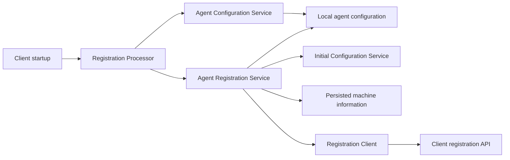
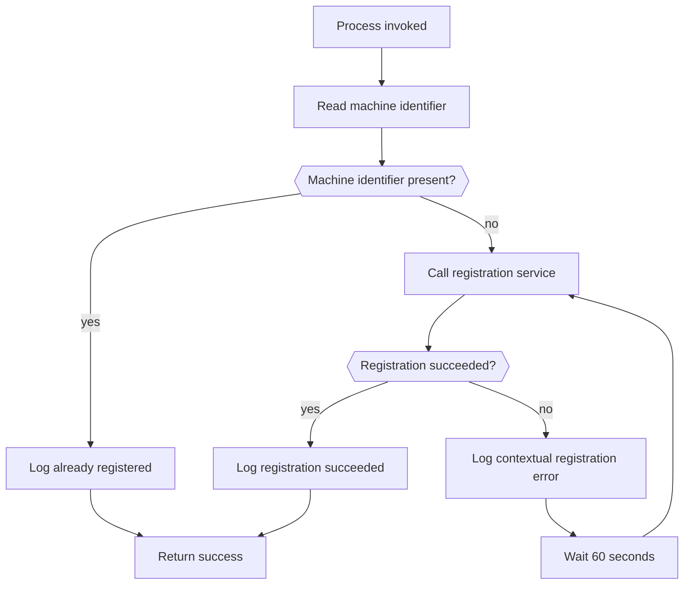
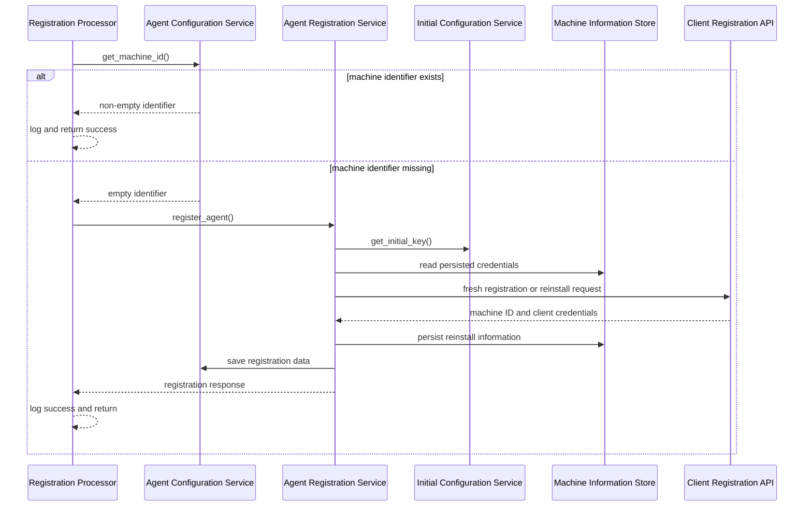

# Registration Processor

The Registration Processor is the client-side startup gate that establishes an OpenFrame client agent's durable identity. It prevents duplicate registration when a machine identifier is already stored locally, delegates a required registration or reinstall operation to the agent registration service, and retries failed registration attempts every 60 seconds until one succeeds.

The implementation is supplied by the `openframe_agent_lib` Cargo dependency from OpenFrame OSS Library and runs in this repository's OpenFrame client service. Its source is [`registration_processor.rs`](https://github.com/flamingo-stack/openframe-oss-lib/blob/16e7c1cbd9664e7d10ec5ebca7d53c9bd314decf/clients/openframe-client/src/services/registration_processor.rs).

## Responsibilities

- Read the locally configured machine identifier before issuing network requests.
- Treat a non-empty machine identifier as evidence that registration has already completed.
- Invoke the agent registration workflow when no machine identifier is configured.
- Add context to registration-service failures and log each unsuccessful attempt.
- Keep attempting registration after a fixed 60-second delay, making transient startup connectivity failures non-terminal.

The processor is deliberately small. It owns the **decision and retry loop**; request construction, registration versus reinstall selection, credential persistence, and server communication belong to its collaborators.

## Architecture

### Component roles

| Component | Role in the registration path |
| --- | --- |
| `RegistrationProcessor` | Coordinates idempotency checking and indefinite retry behavior. Constructed with an `AgentRegistrationService` and an `AgentConfigurationService`. |
| `AgentConfigurationService` | Reads the stored machine identifier. After success, it serializes configuration updates and saves the machine identifier, client identifier, and client secret. |
| `AgentRegistrationService` | Obtains the initial key, reads prior machine credentials, selects fresh registration or reinstall, builds the device-registration request, and persists successful credentials. |
| `RegistrationClient` | Sends the JSON request to the client registration API and parses an `AgentRegistrationResponse`. |
| `AgentRegistrationResponse` | Returns the assigned machine identifier plus OAuth-style client identifier and client secret used by later client authentication. |

## Processing lifecycle

`process()` is asynchronous and has two outcomes: it returns immediately for an already registered agent, or it returns after a successful registration. A failed attempt does not cause `process()` to return an error because the processor retries it forever while the task remains active.

### Idempotency boundary

The first operation is `AgentConfigurationService::get_machine_id()`. If it returns a non-empty value, the processor logs that the agent is already registered and exits successfully without calling the registration service. The local configuration is therefore the processor's sole idempotency marker.

A missing or empty value begins registration. Errors while reading that configuration are returned directly, because the processor cannot safely determine whether the agent is already registered.

### Registration delegation

For each attempt, the processor calls `AgentRegistrationService::register_agent()` through its private `attempt_registration()` helper. The helper attaches the context `Registration service returned an error`, preserving a clear boundary in error logs between orchestration failure and lower-level causes.

The delegated service performs these steps:

1. Reads the initial key from initial configuration and rejects an empty key. The service notes that this key is cleared once a device has a log key, so another registration then requires a fresh installation command.
2. Reads persisted machine information. Read failures are retried by that service; after its retry budget is exhausted, it falls back to the fresh-registration path.
3. Resolves whether this is a fresh registration or reinstall. Existing persisted credentials select reinstall; their absence selects fresh registration.
4. Builds the registration payload from hostname, agent version, operating-system type, and optional organization identifier, user identifier, and device tags.
5. Persists the returned machine identifier and client secret as reinstall information, then updates agent configuration with the machine identifier, client identifier, and client secret.

## Request and persistence flow

The registration client sends fresh registrations to the client registration endpoint and reinstalls to its dedicated reinstall endpoint. Both request forms include the initial key. Reinstall also includes the persisted machine identifier and client secret. Non-success HTTP responses are surfaced as errors; an invalid client secret is distinguished by the client as a specific registration error.

## Failure behavior and operational implications

| Condition | Behavior | Maintainer implication |
| --- | --- | --- |
| Machine identifier is already configured | No remote registration request is made. | Clear or alter registration state only through an intentional lifecycle operation. |
| Initial key is missing | The delegated registration attempt fails. | The processor logs the error and retries, but a new installation command is required to supply valid initial configuration. |
| Network, API, or response-parsing failure | The error is contextualized, logged, then retried after 60 seconds. | Investigate service reachability, API availability, TLS, and registration inputs while the client continues retrying. |
| Persisted-machine-info read failure | The registration service retries its own reads, then may treat the situation as fresh registration. | Inspect file permissions and persisted state, especially before assuming reinstall credentials will be used. |
| Successful remote registration but local persistence failure | The registration service returns an error when configuration saving fails. | The processor retries. Server-side registration may already have occurred, so diagnose local configuration write access and idempotency semantics. |

The processor does not implement a maximum retry count, exponential backoff, cancellation policy, or external health signal. Task shutdown and service lifecycle management must therefore be handled by the caller that runs this asynchronous process.

## Security and data handling

- The initial key authorizes registration and is retrieved only by the registration service; it is not logged by the processor.
- Reinstall uses persisted machine identity and client secret, which are sent as request headers by the registration client.
- The registration response contains a machine identifier, client identifier, and client secret. The processor itself logs only registration state and failure details, not response fields.
- Configuration writes are serialized by the configuration service to avoid concurrent read-modify-write operations losing registration fields.

## Maintenance guidance

When changing this module, preserve these invariants:

1. **Do not bypass the initial machine identifier check.** It prevents repeated registration on ordinary restarts.
2. **Keep registration-service concerns delegated.** The processor should not duplicate API routing, request payload composition, or persistence logic.
3. **Treat retry timing as user-visible behavior.** Changing the fixed 60-second interval affects recovery time and API load.
4. **Preserve error context.** The contextual message added by `attempt_registration()` makes asynchronous retry logs actionable.
5. **Test both branches.** Cover an existing machine identifier, a successful first registration, and at least one failed attempt followed by a successful retry using controlled time.

## System placement

Registration is an early client-agent concern. Once it has persisted machine and client credentials, downstream authentication and token-refresh services can use that identity, while command listeners, telemetry publishers, remote-access handling, and tool-management services can operate for the registered device. The processor itself does not start those subsystems; it provides the durable registration state they depend on.
