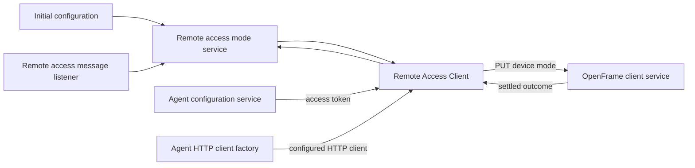
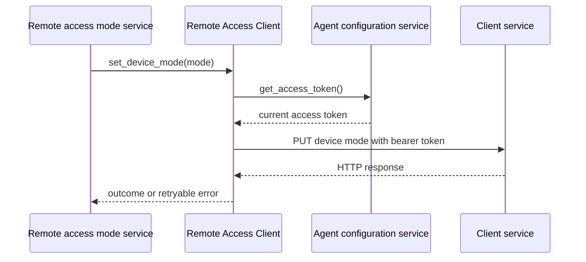
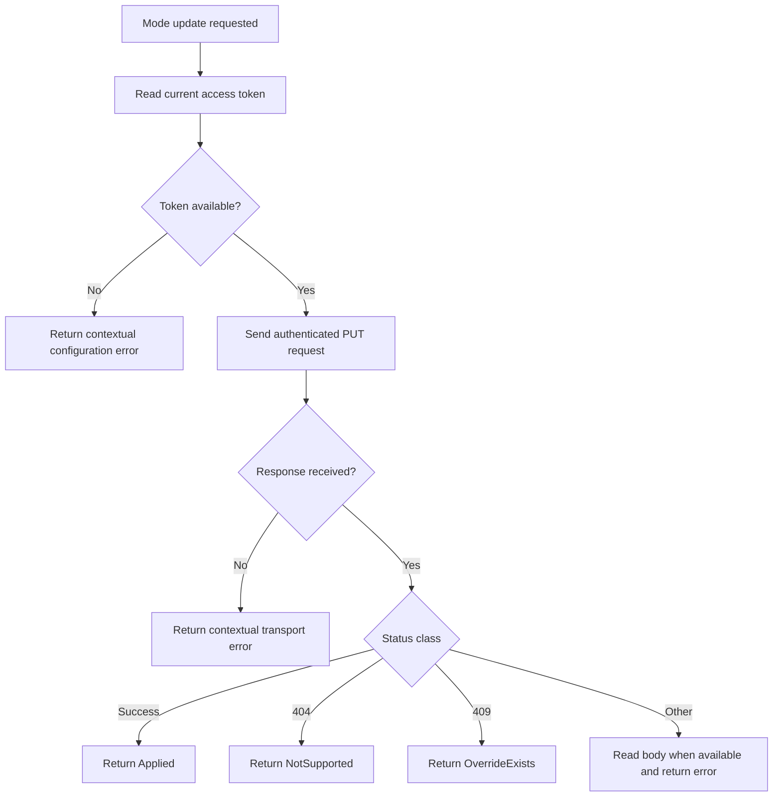
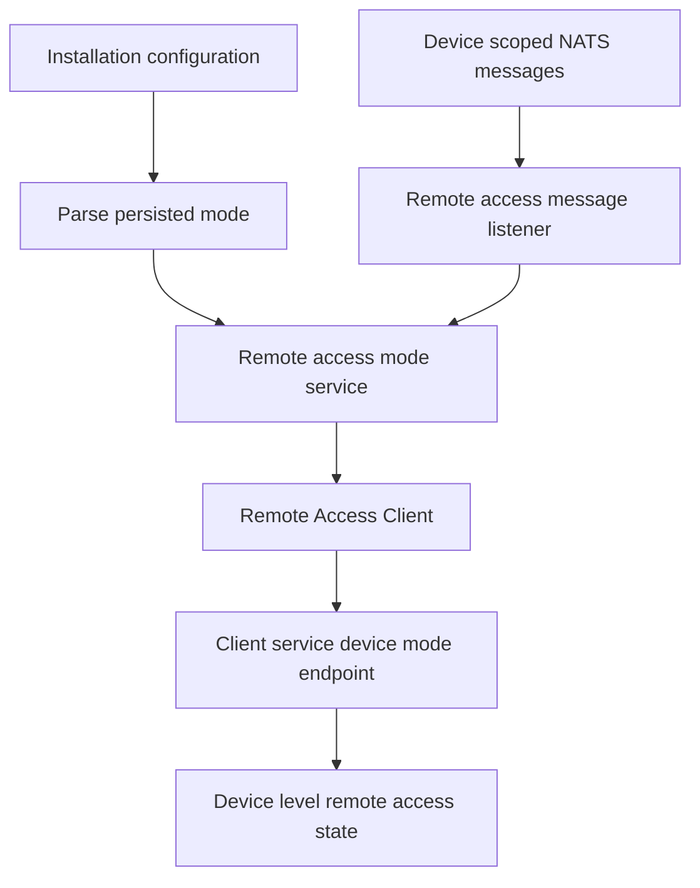

# Remote Access Client

Remote Access Client is the OpenFrame endpoint-agent adapter that persists a device-level remote-access preference in the client service. It is implemented in the `openframe_agent_lib` Rust artifact from OpenFrame OSS Library and is run by the endpoint client assembled by this repository. Its narrow responsibility is to send an authenticated mode update and distinguish a completed update from a server that does not support the capability, an existing device override, or a failure that should be retried.

The implementation is [remote_access_client.rs](https://github.com/flamingo-stack/openframe-oss-lib/blob/7a766f00e4f58b5d89db007b878ac8d6e0c344f4/clients/openframe-client/src/clients/remote_access_client.rs) in the OpenFrame OSS Library.

## Scope and Responsibilities

`RemoteAccessClient` owns the HTTP interaction for the device-mode endpoint only. It does not start remote-control software, process NATS messages, or decide a local access policy. Those activities remain in the endpoint client’s listener, tool-management, and remote-access-mode services.

Its responsibilities are:

- Construct a request to `PUT /clients/api/v1/remote-access/device-mode` relative to its configured base URL.
- Retrieve the current agent access token from `AgentConfigurationService` for every call.
- Send a bearer-authenticated JSON body containing the selected `RemoteAccessMode`.
- Convert settled HTTP responses into a small, explicit `DeviceModeOutcome`.
- Return contextual errors for token retrieval, transport failure, and retryable or otherwise unclassified HTTP responses.

The accepted remote-access mode values are `ApprovalRequired`, `NotifyOnly`, `SilentAccess`, and `DenyAccess`. The mode model supplies the wire representation used for JSON serialization and can reconstruct a mode from an install-time persisted wire name.

## Architecture

The client is constructed with three dependencies:

| Dependency | Purpose in this module |
| --- | --- |
| `reqwest::Client` | Sends the HTTPS request. The broader agent HTTP factory configures the agent client with its machine identifier header, a timeout, disabled proxy use, fresh DNS behavior, and the configured certificate-validation behavior. |
| Base URL | Is concatenated with the fixed device-mode path. It must represent the service base expected by the endpoint client. |
| `AgentConfigurationService` | Reads the persisted access token immediately before the request. The token is not retained by `RemoteAccessClient`. |

This design separates transport configuration, credential persistence, and remote-access state propagation. In particular, token refresh or configuration updates can take effect for a later mode update without recreating the client.

## Public Interface

### `RemoteAccessClient`

`RemoteAccessClient` is cloneable and stores the configured HTTP client, base URL, and agent configuration service. `new` receives those collaborators without performing network or configuration operations.

### `set_device_mode`

`set_device_mode(mode)` is asynchronous and performs the mode update. It:

1. Creates the endpoint URL from the base URL and the fixed device-mode path.
2. Reads the latest access token through `AgentConfigurationService`.
3. Sends an HTTP `PUT` request with `Authorization: Bearer` authentication and a JSON payload shaped as `{"mode": mode}`.
4. Classifies the response status and either returns a settled `DeviceModeOutcome` or an error.

### `DeviceModeOutcome`

`DeviceModeOutcome` describes terminal handling for a mode-update attempt:

| Outcome | HTTP condition | Meaning for callers |
| --- | --- | --- |
| `Applied` | Any successful status | The service accepted the device-mode update. |
| `NotSupported` | `404 Not Found` | The endpoint is unavailable in the contacted service, so the caller can treat the feature as unsupported rather than retrying the same request. |
| `OverrideExists` | `409 Conflict` | The service reports an existing device override. The request is settled; callers should not retry solely because of this result. |

All other statuses are not converted into an outcome. The client reads the response body when possible and returns an error containing the HTTP status and body, preserving the signal that the request is worth retrying. This distinction is stated in the method contract: an error represents a call that callers may retry.

## Request and Outcome Flow

## Integration in the Endpoint Client

The endpoint client has two known sources for mode application:

- **Install-time configuration:** `RemoteAccessModeService` reads a pending remote-access mode from the initial configuration. It parses the stored wire name into `RemoteAccessMode`, clears unknown values, and starts an asynchronous application task for a recognized value.
- **Runtime messaging:** `RemoteAccessMessageListener` runs a reconnecting NATS listener. Its per-device subject is `machine.{machine_id}.remote-access.>`, which scopes remote-access messages to the agent machine. The listener collaborates with the endpoint client’s tool run manager; `RemoteAccessClient` remains the HTTP adapter used to persist a device-mode override.

## Error Handling and Operational Considerations

- **Credentials:** Failure to load the token is reported with context before any request is sent. Since token acquisition occurs per invocation, diagnose configuration or authentication refresh issues at the agent configuration layer.
- **Transport:** Request failures are reported as failures to call the device-mode endpoint. They are not silently converted to an outcome.
- **Protocol compatibility:** A `404` is deliberately terminal as `NotSupported`. This lets newer clients operate against a service deployment that lacks this endpoint without repeatedly failing a background task.
- **Conflicting state:** A `409` is deliberately terminal as `OverrideExists`. The service remains the authority for whether an override has already been established.
- **Retries:** Retry orchestration belongs to the caller, not to `RemoteAccessClient`. Only errors, including statuses outside the settled set, retain retry semantics.
- **Sensitive data:** The request carries an access token in the authorization header. Callers and diagnostics should avoid logging token values. Error handling includes a response body for unclassified statuses, so service responses should not contain secrets.

## Maintenance Notes

When changing the client, preserve the boundary between a settled business outcome and a retryable error. Adding a new server status should be an explicit compatibility decision: map it to a new or existing `DeviceModeOutcome` only when no retry should be attempted. Otherwise, leave it as an error so the owning service can apply its retry policy.

Changes to the JSON mode representation must remain compatible with `RemoteAccessMode` serialization and with the initial-configuration parser. Changes to the endpoint path or authorization contract require coordinated deployment with the OpenFrame client service that receives the request.
