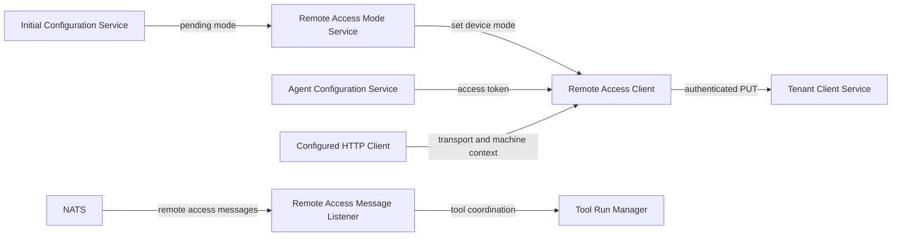
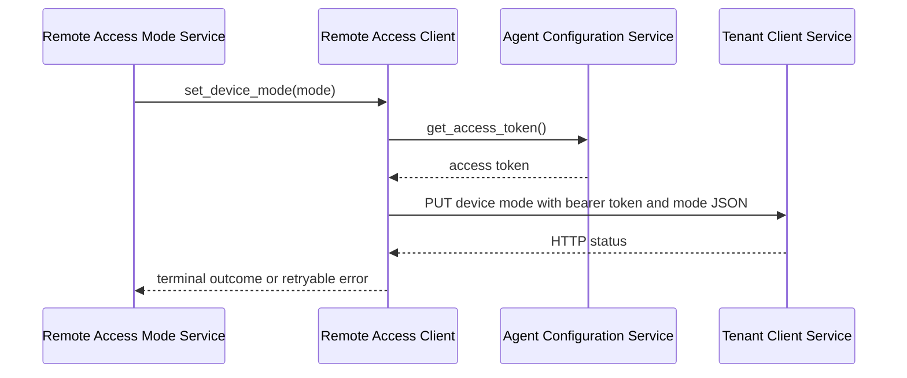
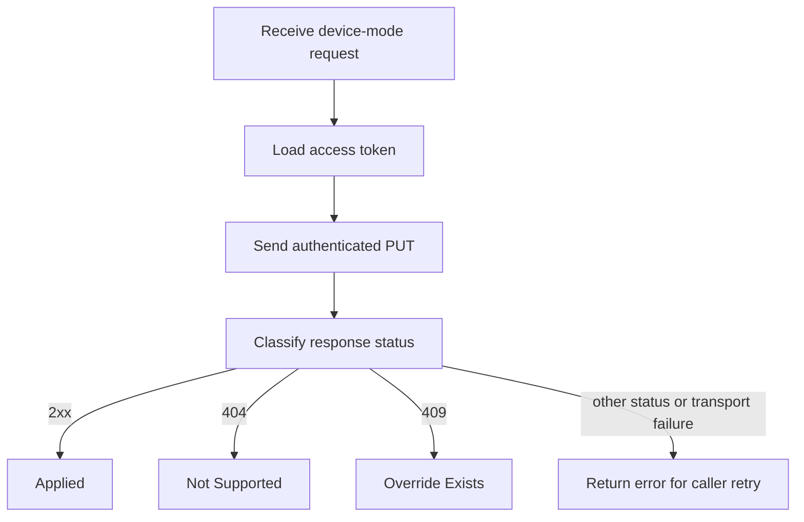
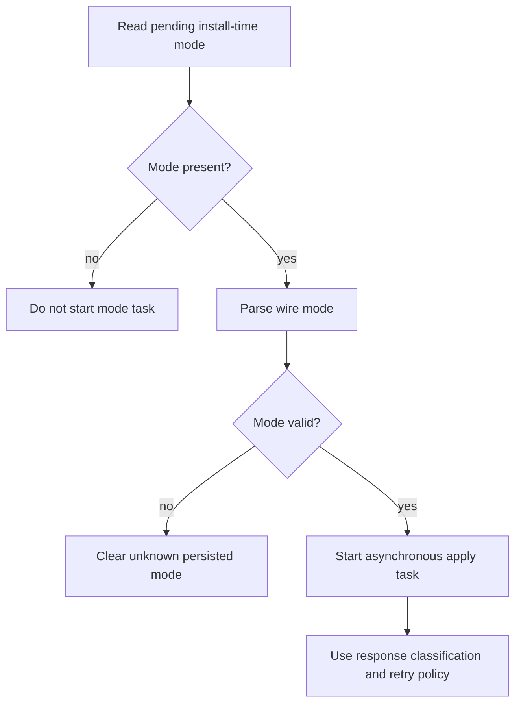

# Remote Access Clients

Remote Access Clients is the OpenFrame endpoint-agent boundary for applying a device-specific remote-access mode. It is implemented by the Rust `RemoteAccessClient` in the `openframe_agent_lib` artifact from OpenFrame OSS Library, which this repository consumes at version `v0.0.5`. The client sends an authenticated update to the tenant client service and translates the HTTP result into a small, actionable outcome set.

The implementation is deliberately narrow: it does not start or stop remote-control tooling itself. Instead, the surrounding agent services persist an install-time preference, invoke this client, and use NATS-delivered remote-access messages to coordinate tool runtime behavior.

**Implementation source:** [remote_access_client.rs](https://github.com/flamingo-stack/openframe-oss-lib/blob/16e7c1cbd9664e7d10ec5ebca7d53c9bd314decf/clients/openframe-client/src/clients/remote_access_client.rs)

## Responsibilities

- Build a request to the tenant client service endpoint `/clients/api/v1/remote-access/device-mode`.
- Retrieve the agent access token from `AgentConfigurationService` for each update.
- Send the requested `RemoteAccessMode` as a JSON object containing a `mode` field.
- Interpret terminal server responses so callers can distinguish an applied setting, an unavailable capability, and an existing server-side override.
- Surface all other transport and HTTP failures as retryable errors to the caller.

## Architecture and Placement

`RemoteAccessClient` is a library component rather than a standalone service. The local agent creates it with a configured Reqwest HTTP client, a base URL, and an agent configuration service. The remote-access mode service owns the retry lifecycle for an install-time setting, while the remote-access message listener separately receives per-device messages over NATS and coordinates the tool run manager.

### Main Components

| Component | Responsibility |
|---|---|
| `RemoteAccessClient` | Holds the HTTP client, tenant base URL, and configuration service; exposes the device-mode update operation. |
| `set_device_mode` | Obtains a bearer token, serializes a mode request, performs the HTTP `PUT`, and classifies the response. |
| `DeviceModeOutcome` | Represents a terminal result: `Applied`, `NotSupported`, or `OverrideExists`. |
| `RemoteAccessMode` | The shared mode model. Its variants are `ApprovalRequired`, `NotifyOnly`, `SilentAccess`, and `DenyAccess`. |
| `RemoteAccessModeService` | Reads an install-time mode from initial configuration and applies it asynchronously with retry timing. |
| `RemoteAccessMessageListener` | Subscribes to the machine-specific NATS wildcard subject `machine.<machine id>.remote-access.>` and reconnects after listener failures. |

## Device-Mode Update Contract

The client constructs its target by appending the fixed device-mode path to its configured base URL. It obtains the current token immediately before the call, then sends the request with an authorization header and JSON payload.

The request semantics are:

| Request element | Behavior |
|---|---|
| Method | `PUT` |
| Path | `/clients/api/v1/remote-access/device-mode` |
| Authentication | `Authorization: Bearer <access token>` |
| Body | JSON object with the selected `mode` |
| Target | The tenant client service identified by the agent's configured base URL |

The supplied HTTP client may be produced by the agent HTTP client factory. That factory configures a machine identifier header, applies a timeout, disables proxy use, and avoids idle connection pooling so each request gets a fresh DNS lookup. Those transport decisions are outside `RemoteAccessClient`; the client uses the configured instance it is given.

## Response Classification and Retry Boundary

`set_device_mode` treats only successful, not-found, and conflict statuses as settled outcomes. It does not blindly retry internally. This keeps policy decisions and backoff under the calling service, which can stop work when the agent becomes deactivated.

| Server response | Client outcome | Meaning for the caller |
|---|---|---|
| Any successful status | `Applied` | The service accepted the device-level mode. |
| `404 Not Found` | `NotSupported` | The endpoint or capability is not available. This is a settled result, not a transient failure. |
| `409 Conflict` | `OverrideExists` | A server-side override already exists. This is a settled result, not a transient failure. |
| Any other HTTP status | Error | The client includes the status and, when readable, response body in the error; the caller may retry. |
| Token lookup or network failure | Error | Configuration and transport failures are returned with context for the caller's retry policy. |

## Install-Time Mode Processing

The remote-access mode service starts only when initial configuration contains a pending remote-access mode. It parses the stored wire value into `RemoteAccessMode`; an unknown value is logged and removed rather than sent. A valid value is applied in an asynchronous task. This separates installation input from the network client and prevents an invalid persisted mode from generating repeated calls.

## Integration Boundaries

Remote Access Clients participates in the endpoint agent and tenant client service flow:

1. The installation and initial-configuration path can persist a remote-access mode for the agent.
2. `RemoteAccessModeService` reads that setting and calls `RemoteAccessClient`.
3. The client authenticates using persisted agent configuration and updates tenant-side device policy through the tenant client service.
4. Independently, `RemoteAccessMessageListener` listens for messages addressed to the machine's remote-access subject and delegates tool lifecycle coordination to `ToolRunManager`.
5. The gateway routes `/clients/**` traffic to the OpenFrame client service in the tenant deployment, while the endpoint agent's client call uses its configured tenant base URL.

This split is important: policy persistence and server acknowledgement are handled over HTTP, whereas ongoing remote-access coordination is event-driven over NATS.

## Security and Operational Considerations

- **Token retrieval is per call.** The authorization header is built from the access token retrieved from `AgentConfigurationService` at update time, rather than stored in the client instance.
- **Server outcomes are intentional.** A missing capability and an existing override are represented as values, allowing the calling service to stop retrying without parsing error strings.
- **Failures preserve diagnostic context.** Token lookup and request-send failures are annotated; unexpected HTTP responses include status and attempt to include the response body.
- **No local tool mutation occurs here.** Changes to remote-control tools belong to the listener and tool-management services, reducing the responsibility of the HTTP client to policy synchronization.
- **Retry control remains external.** Maintain retry behavior in `RemoteAccessModeService`, including any deactivation checks, rather than adding hidden retries to `RemoteAccessClient`.

## Maintenance Guidance

When changing Remote Access Clients:

- Keep the request path, HTTP method, bearer-token behavior, and JSON mode field synchronized with the tenant client service contract.
- Add a new `DeviceModeOutcome` only when the caller needs distinct terminal behavior; otherwise return an error so the established retry path remains effective.
- Preserve the distinction between settled responses and retryable errors, especially for `404` and `409`.
- Ensure any new remote-access mode remains serializable through the shared `RemoteAccessMode` wire representation and is handled by the install-time parser.
- Test status classification, failed token lookup, transport failure, and unexpected response-body handling when modifying the client.
