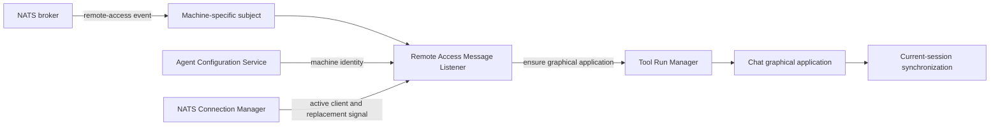
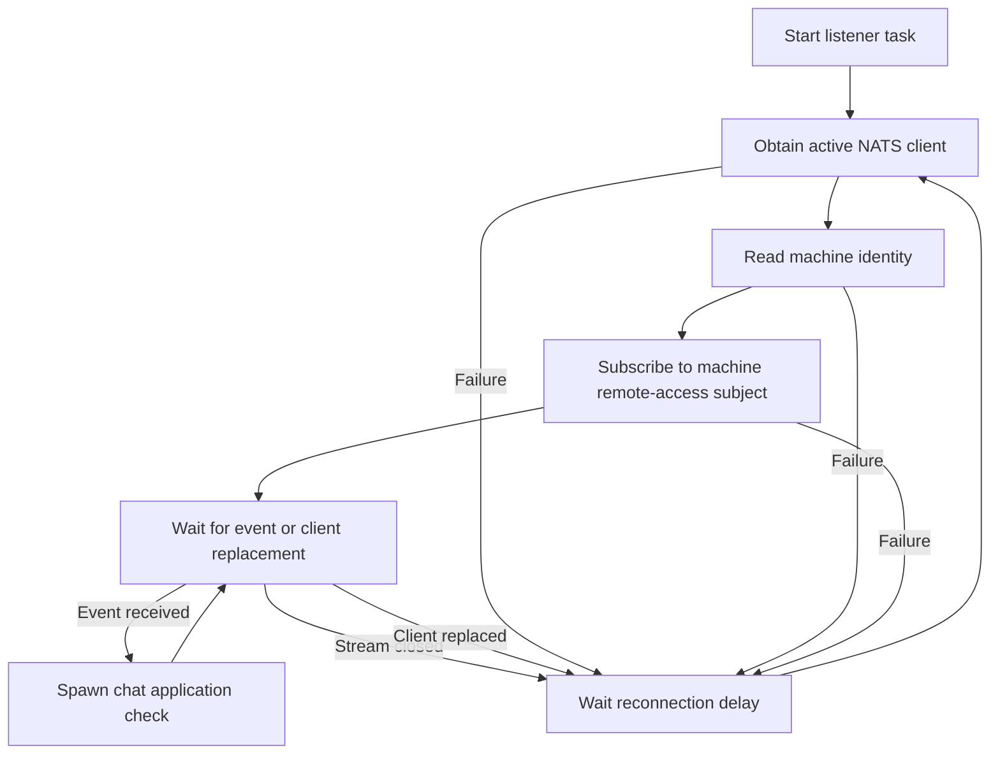
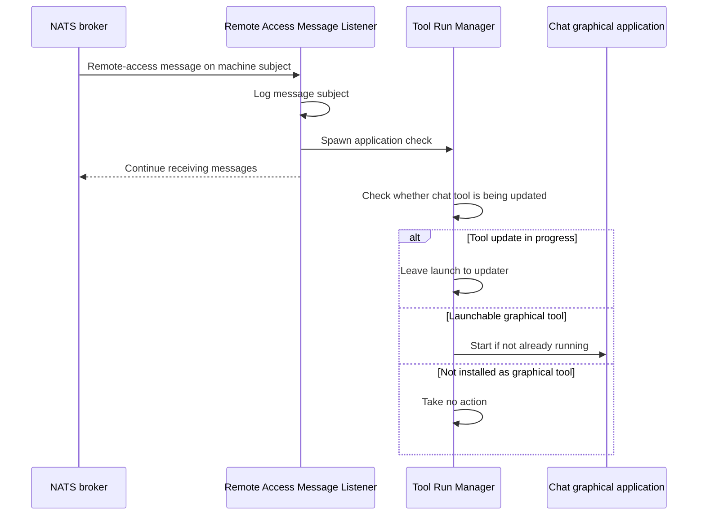

# Remote Access Message Listener

The Remote Access Message Listener is an OpenFrame Client agent component that watches the machine-specific remote-access channel in NATS. Each received message causes the client to ensure that its chat graphical application is running. This is intentionally a wake-up and recovery mechanism rather than a remote-access session processor: a chat application that had exited can start again and reconcile its state through its own current-session workflow.

The implementation is supplied by the `openframe_agent_lib` Rust artifact from OpenFrame OSS Library at version `v0.0.5`. Its source is [remote access message listener](https://github.com/flamingo-stack/openframe-oss-lib/blob/16e7c1cbd9664e7d10ec5ebca7d53c9bd314decf/clients/openframe-client/src/listener/remote_access_message_listener.rs).

## Responsibilities

- Read the persisted machine identity and derive a NATS subject scoped to that device.
- Subscribe to all remote-access events beneath that subject.
- Start or preserve the chat graphical application for every received event.
- Keep message consumption responsive by launching the application check in a separate task.
- Recreate the subscription after a stream closes, a NATS client replacement, or a listener failure.

The listener does not inspect message payloads, decide remote-access policy, create a remote session, or publish an acknowledgement. It relies on the message subject as the trigger and delegates application lifecycle behavior to the tool run manager.

## Architecture



### Core collaborators

| Collaborator | Role in the flow |
|---|---|
| Remote Access Message Listener | Owns subscription lifecycle and dispatches a non-blocking application-start request for each event. |
| Agent Configuration Service | Provides the persisted machine identity used to construct the subscription subject. |
| NATS Connection Manager | Supplies the active NATS client and a watch receiver that changes when the client is replaced. |
| Tool Run Manager | Finds the chat tool and ensures that a launchable graphical application is running. |
| Chat tool identifier | Selects the designated chat application without requiring remote-access payload parsing. |

## Subscription Scope

The listener derives its subject from the device machine identity using this pattern:

```text
machine.{machine identity}.remote-access.>
```

The terminal wildcard means the listener receives remote-access messages for the current machine below that namespace. Since the machine identity comes from the local agent configuration, the listener is scoped to one enrolled device rather than subscribing to a shared remote-access channel.

## Lifecycle and Reconnection

Calling `start` clones the listener and creates a long-lived asynchronous task. The task repeatedly starts a subscription attempt, records failures, waits for the configured reconnection delay, and tries again. The startup call itself returns the task handle, allowing the surrounding client application to supervise the listener alongside other background workers.



A connection replacement is treated as a normal resubscription boundary. The NATS connection manager exposes a watch receiver for its current client; when it changes, the listener stops its current receive loop and rebuilds the subscription against the new client. Likewise, an exhausted subscription stream returns control to the outer loop so the listener can subscribe again.

## Message Handling Flow



The listener deliberately does not await the tool manager from the subscription loop. Launching can wait for an interactive console-user context, so performing it inline could delay later messages. A detached task logs a warning if the application check fails while the subscriber continues to receive events.

## Tool Launch Semantics

The delegated application check is guarded by the Tool Run Manager:

1. If the chat tool is currently busy with an update, the manager returns successfully and lets the updater perform the relaunch.
2. Otherwise, it loads the tool record from the installed-tools registry.
3. A record that represents a launchable graphical application is passed to the normal tool-start path.
4. A missing tool or a tool that is not registered as a graphical application is informational and produces no launch attempt.

This makes repeated remote-access events safe as triggers: the listener asks the manager to ensure availability rather than directly spawning a binary.

## Failure Behavior and Operational Signals

| Condition | Listener behavior | Effect |
|---|---|---|
| NATS client unavailable at subscription setup | Logs the listener error, waits for the reconnection delay, then retries. | No subscription is active until a client becomes available. |
| NATS subscription creation fails | Adds the target subject to the error context, then retries after the delay. | The machine channel is retried without terminating the agent. |
| Subscription stream ends | Logs a warning and returns to the outer retry loop. | A replacement subscription is created. |
| NATS client is replaced | Logs an informational resubscription message and rebuilds the subscriber. | The listener follows the new connection. |
| Chat application check fails | Logs a warning from the detached task. | Message consumption continues and later events can trigger another check. |

Useful log events include listener startup, the active subject, each received remote-access message, a client replacement, a closed stream, and any failure to start the chat application. These distinguish broker connectivity problems from tool lifecycle problems.

## Integration Boundaries

The listener is part of the Rust OpenFrame Client assembled by this repository. It depends on the client-side NATS connection and configuration services, and it invokes the local tool lifecycle service. The broader tenant deployment provides NATS as a datasource service, while the client service is one of the deployed OpenFrame application images.

Remote-access policy and mode concepts exist elsewhere in the agent model, including approval-required, notification-only, silent-access, and deny-access modes. This listener does not evaluate those modes. Its only responsibility is to restore the chat application when an event arrives; session synchronization and policy enforcement are outside this component's control.

## Maintenance Guidance

- Preserve the machine-specific subject construction when changing messaging behavior. Widening the subscription could cause a device to respond to events intended for another device.
- Keep application startup detached from the receive loop. Any synchronous or awaited launch path can reduce the listener's ability to process later events promptly.
- Treat NATS client replacement as an expected lifecycle event, not a terminal failure.
- Route application availability through the Tool Run Manager so update locks, installed-tool metadata, and normal launch behavior remain authoritative.
- If message contents later become relevant, validate and handle payloads without removing the existing reconnection and non-blocking dispatch behavior.
