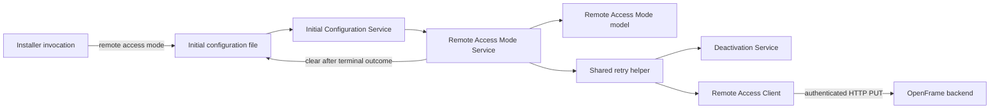
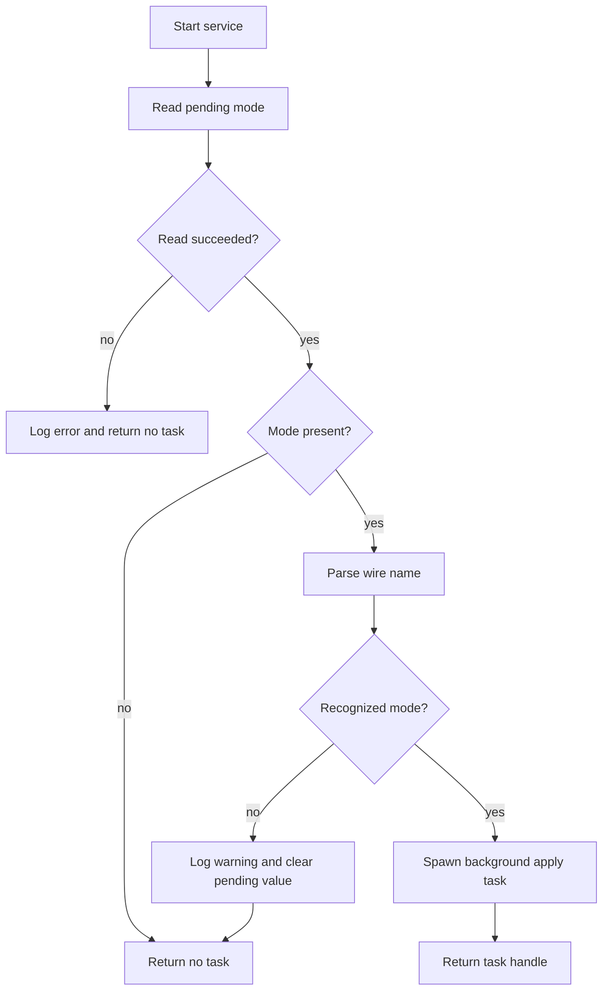
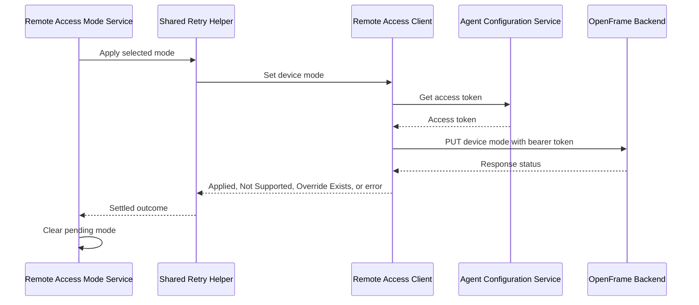
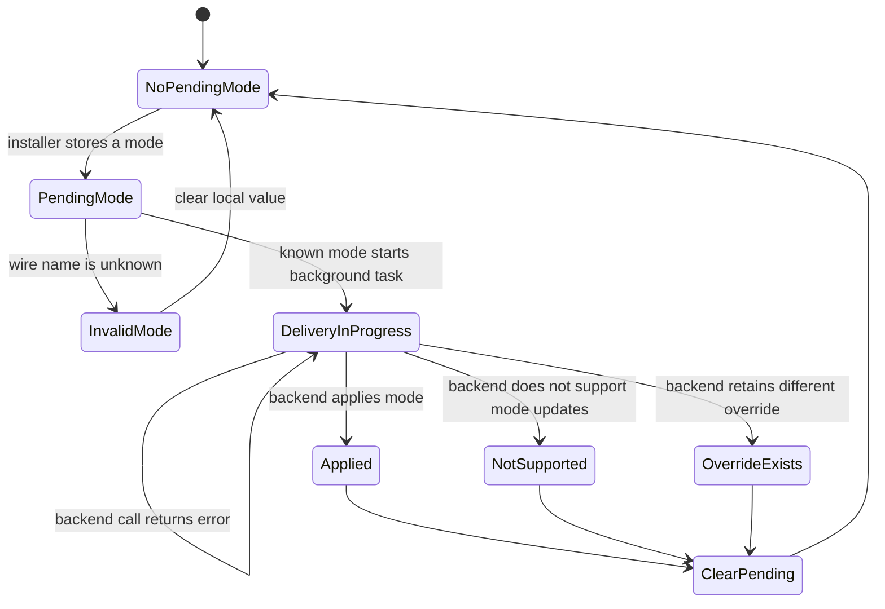

# Remote Access Mode Service

Remote Access Mode Service transfers the optional remote-access preference supplied when an OpenFrame client is installed to the backend as a **device-level override**. It is part of the Rust `openframe_agent_lib` library from OpenFrame OSS Library, which this repository consumes as `openframe_agent_lib` version `v0.0.5` for its client runtime.

This service is deliberately narrow: it does not establish, proxy, or audit a remote-control session. Instead, it performs one deferred, authenticated device-mode update, retries transient failures with bounded backoff, and removes the locally pending value once the backend has reached a terminal outcome.

**Implementation source:** [remote access mode service](https://github.com/flamingo-stack/openframe-oss-lib/blob/16e7c1cbd9664e7d10ec5ebca7d53c9bd314decf/clients/openframe-client/src/services/remote_access_mode_service.rs)

## Purpose and Scope

An installer can persist a `--remote-access-mode` value in the initial client configuration. When the agent starts, Remote Access Mode Service:

1. Reads that pending value from `InitialConfigurationService`.
2. Converts the wire value into a recognized `RemoteAccessMode`.
3. Sends the desired mode to the backend through `RemoteAccessClient`.
4. Repeats failed attempts through the shared retry helper while the agent remains active.
5. Clears the local pending value after the backend applies the request or returns a supported terminal rejection.

The supported model variants are `ApprovalRequired`, `NotifyOnly`, `SilentAccess`, and `DenyAccess`. The model serializes and parses the corresponding wire name through its `wire_name` and `from_wire_name` operations; the service does not define its own string mapping.

## Architecture

### Component Responsibilities

| Component | Responsibility |
|---|---|
| `RemoteAccessModeService` | Coordinates loading, validation, asynchronous submission, outcome handling, and cleanup. |
| `InitialConfigurationService` | Reads the persisted install-time setting and atomically updates configuration when clearing it. Its write lock prevents concurrent read-modify-write updates from losing fields. |
| `RemoteAccessMode` | Defines the four accepted modes and converts between the in-memory enum and the serialized wire representation. |
| `RemoteAccessClient` | Obtains the current access token, adds a bearer authorization header, and sends the JSON mode payload to the device-mode endpoint. |
| Shared retry helper | Invokes the backend operation until it yields a settled `DeviceModeOutcome`, using the deactivation service and configured timing. |
| `DeactivationService` | Supplies the service state used by retry coordination, including whether the client is suspended. |

## Startup and Validation Flow

`start` is called on an `Arc<RemoteAccessModeService>` and either returns no task or spawns a Tokio background task. It does not block client startup while it delivers the override.

A missing setting is an intentional no-op. A read failure is logged and also produces no task, leaving the configuration untouched so a future start can try again. An unrecognized stored value is treated differently: it is logged, then removed to prevent an invalid value from being retried indefinitely.

## Backend Update Protocol

The remote-access client constructs a request using its configured base URL and device-mode path. Before sending, it obtains the agent access token from `AgentConfigurationService`. The request is a JSON object containing the selected mode and includes an `Authorization: Bearer` header.

`RemoteAccessClient` maps recognized response statuses to these terminal outcomes:

| Outcome | Service behavior | Meaning |
|---|---|---|
| `Applied` | Logs success and clears the pending mode. | The backend accepted the requested device override. |
| `NotSupported` | Logs a warning and clears the pending mode. | The backend does not implement device-mode updates. |
| `OverrideExists` | Logs a warning and clears the pending mode. | A different override already exists and is retained. |

For an unrecognized HTTP status, the client reads the response body when possible and returns an error. That error is supplied to the retry helper rather than being treated as a terminal outcome.

## Retry, Lifecycle, and Cleanup

The service configures a retry interval with a 30-second initial delay and a 30-minute maximum delay. It delegates retry scheduling and lifecycle handling to `retry_until_settled`, passing the deactivation service, a descriptive operation name, and the call that updates the device mode. This design keeps backend communication out of the installation path while avoiding a tight retry loop.

After a settled `Applied`, `NotSupported`, or `OverrideExists` result, `apply` always calls its private cleanup routine. Cleanup clears only the `remote_access_mode` field through `InitialConfigurationService`; it logs an error if the configuration cannot be rewritten. Therefore, backend settlement and persistence cleanup are separate events: a terminal backend response can be logged even when the local removal later fails.

## State and Failure Semantics

Important operational consequences:

- The install-time value is a one-shot pending instruction, not a continuously enforced policy.
- The service preserves a value when it cannot read configuration, and invalid values are deliberately discarded.
- It does not overwrite an existing, different backend override; it records the warning and removes its pending request.
- Retryable request failures are delegated to the shared retry mechanism. Maintainers changing retry behavior should review that helper together with deactivation handling.
- The returned Tokio task handle is available to the caller, allowing the surrounding client runtime to supervise the asynchronous operation.

## Integration Boundaries

Remote Access Mode Service runs in the endpoint client supplied by OpenFrame OSS Library. The client application is one of the tenant deployment's components, while the HTTP target and access token are provided by the agent's configured backend integration. The service's direct dependencies are intentionally limited to configuration persistence, mode serialization, authenticated device-mode transport, retry coordination, and deactivation state.

Remote-access session routing, WebSocket proxying, and user-facing remote-control behavior are outside this service. Those concerns belong to the wider platform and its gateway and tool integrations. Likewise, this service does not write device records directly; it asks the backend to apply the override through its device-mode endpoint.

## Maintenance Guidance

When modifying this service:

1. Keep install-time persistence and backend delivery separate so installation remains resilient to temporary backend failures.
2. Update `RemoteAccessMode` serialization and parser behavior together when adding or renaming a mode; unknown persisted values are intentionally cleared.
3. Preserve the terminal-outcome distinction. In particular, `OverrideExists` must not be converted into an overwrite operation.
4. Treat the 30-second to 30-minute retry timing as an operational contract and verify changes against the shared retry helper and deactivation lifecycle.
5. Ensure cleanup only removes the pending remote-access field and continues to report failures to persist that cleanup.
