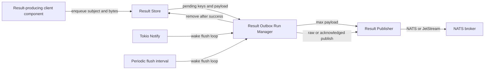
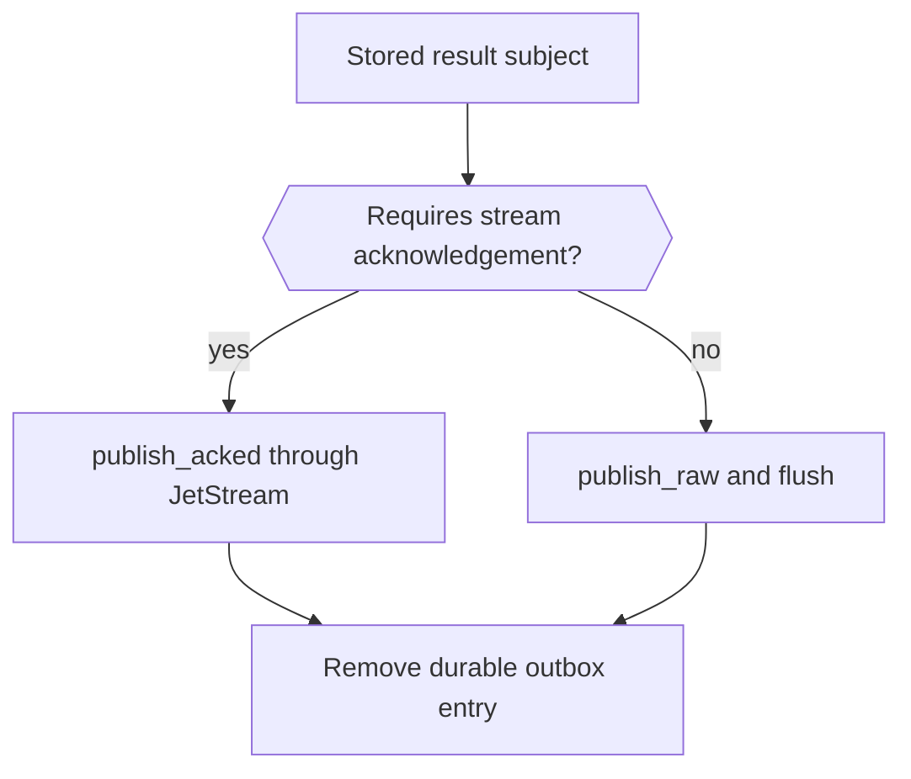
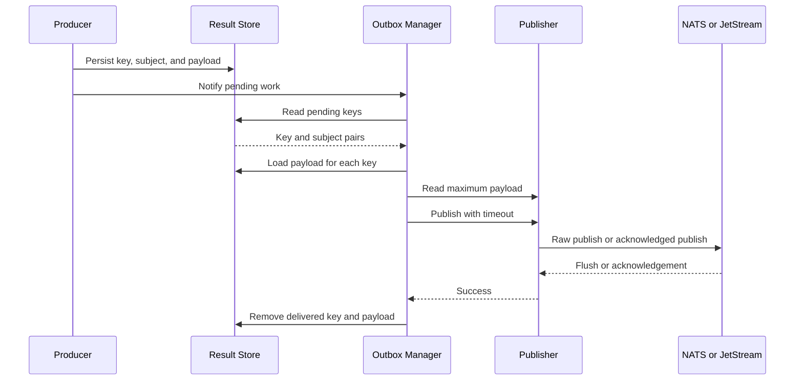
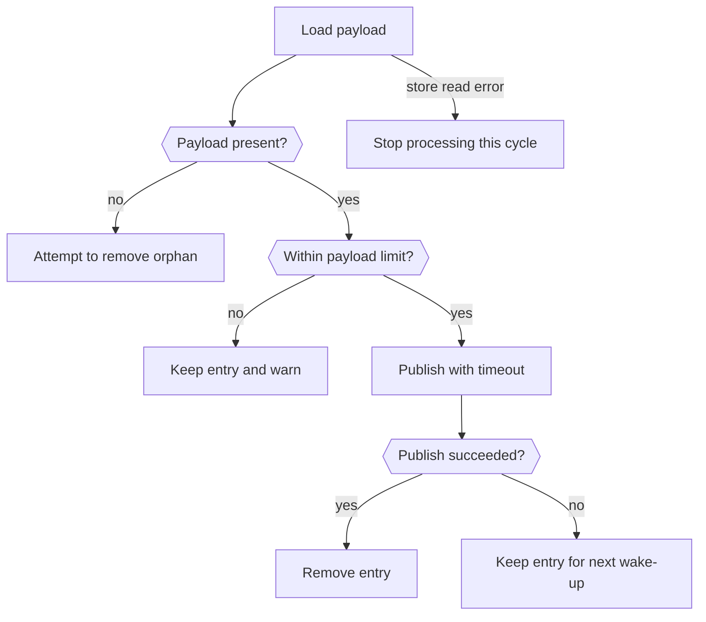
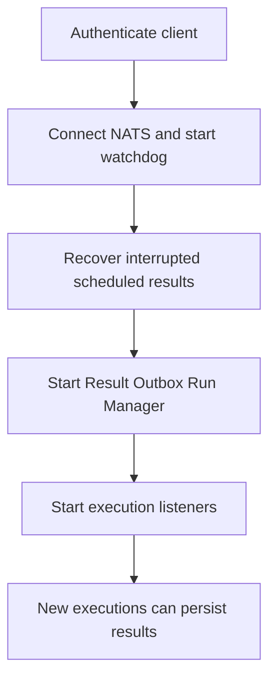

# Result Outbox Run Manager

The Result Outbox Run Manager is the OpenFrame Client background worker that delivers persisted result messages after the client regains a usable NATS connection. It drains the durable result outbox only after a publish succeeds, providing retry across transient transport failures and client restarts.

The implementation belongs to the `openframe_agent_lib` Cargo dependency supplied by [OpenFrame OSS Library](https://github.com/flamingo-stack/openframe-oss-lib/blob/16e7c1cbd9664e7d10ec5ebca7d53c9bd314decf/clients/openframe-client/src/services/result_outbox_run_manager.rs). This repository runs that library as part of the OpenFrame Client service.

## Responsibilities

`ResultOutboxRunManager
` is generic over the `ResultPublisher` transport abstraction. Its public API is deliberately small:

| Component | Responsibility |
| --- | --- |
| `ResultOutboxRunManager` | Holds shared references to the durable result store, publisher, and wake-up notification. |
| `new` | Constructs the manager from those dependencies without starting background work. |
| `start` | Checks durability and, when available, spawns the asynchronous outbox-flush loop. |

The manager does not execute scripts, create results, or decide result content. Producers persist a subject and serialized payload into the result store; this worker is responsible solely for safe deferred publication and deletion after successful delivery.

## Architecture and Dependencies

### Result Store

The durable `ResultStore` is the manager's source of truth. It exposes a list of pending `(key, subject)` pairs, retrieves the corresponding bytes by key, and removes both metadata and payload in a write transaction. Durability is conditional: `ResultStore::open_or_degrade` can fall back to an unavailable store if it cannot open the local database. In that mode, `enabled()` is false and `start()` logs that the flusher is disabled rather than spawning a task.

At client startup, interrupted scheduled-script journal records are recovered into the outbox before the manager starts. The client completes this recovery and starts the manager before it enables execution listeners, so recovered work is eligible for delivery before new execution batches are accepted.

### Publisher Contract

The `ResultPublisher` dependency defines three asynchronous operations:

- `max_payload()` returns the broker's optional maximum payload size.
- `publish_raw()` publishes and flushes an ordinary NATS message.
- `publish_acked()` publishes through JetStream and waits for the broker acknowledgement.

The concrete NATS publisher obtains its client from the NATS connection manager. A raw publish is flushed before it succeeds; an acknowledged publish additionally waits for the JetStream acknowledgement. The outbox manager therefore relies on the publisher to expose transport-level success, but independently applies a timeout to each call.

### Delivery Mode Selection

Delivery mode is determined from the stored subject, not the payload. Subjects ending in an execution acknowledgement, delivery result, or package-update-status kind require acknowledged streaming delivery. All other subjects use a raw NATS publish.

## Flush Lifecycle

Once started, the manager owns a Tokio task with two wake-up sources: the configured outbox flush interval and a shared `Notify`. A notification can prompt a flush between interval ticks; the interval ensures retry continues even when no additional notification is received.

For each flush cycle, the worker performs the following steps:

1. Read all pending keys and their subjects from the store. If this operation fails, log an error and defer the entire cycle until another wake-up.
2. Query the publisher for its payload ceiling and derive an effective limit with reserved transport headroom. When the broker limit is unavailable, the result-store fallback limit is used.
3. Load each payload in the returned key order.
4. If an entry's metadata exists but its payload is absent, attempt to remove the orphaned entry and continue with the next key.
5. If a payload exceeds the effective limit, retain it, log a warning, and continue. This prevents the oversized entry from blocking later healthy results, but it remains pending until another component corrects or removes it.
6. Select raw or acknowledged delivery from the subject and run the publish operation under the configured publish timeout.
7. On successful publication, remove the entry. A removal failure is logged as a warning, so that already-delivered data can be retried after a restart or a later cycle.
8. On a publish error or timeout, retain the entry and continue processing subsequent entries. The failed entry is retried on a future wake-up.

## Failure and Recovery Behavior

The outbox supplies **at-least-once delivery semantics** from the agent's perspective. The entry is deleted only after a successful publisher call. However, if publication succeeds and the subsequent delete fails, the same message remains durable and may be sent again. Downstream consumers must therefore tolerate duplicate messages using their normal message identity or idempotency rules.

A payload-load error is handled differently from an individual publish failure: the manager stops processing the remaining keys in that cycle. This avoids proceeding through the queue after a storage-read failure. Conversely, a publish failure, publish timeout, missing payload, or oversized payload does not prevent attempts for later entries.

## Startup Placement in the Client

The OpenFrame Client starts the Result Outbox Run Manager after authentication and NATS connection establishment. Its relevant ordering is:

This placement matters for two reasons:

- Recovery converts incomplete scheduled-script journal records into outbox results before the background flusher can send them.
- Execution listeners start only after the flusher is active, allowing previously persisted and newly generated results to use the same delivery path.

## Operational Considerations

- **Disabled durability:** A log message stating that the result store is not durable means no flusher task was started. Investigate the local result-store database initialization and any corruption-quarantine logs.
- **Repeated timeouts or publish errors:** Entries remain queued. Check NATS connectivity, authentication, JetStream availability for acknowledgement-required subjects, and publisher errors.
- **Payload-limit warnings:** The entry is intentionally retained but skipped so it cannot block the rest of the outbox. The warning includes the outbox key and byte count, which should be used to identify the result producer or payload size issue.
- **Delivered but not removed warnings:** The remote broker accepted the message, but local cleanup failed. Duplicate delivery is possible on the next cycle; investigate local database health and permissions.
- **Wake-up latency:** New work can signal `Notify` for prompt processing. If that signal is missed or unavailable, the configured interval remains the retry mechanism.

## Maintainer Guidance

When changing this module, preserve the ordering of the durability boundary: persist first, publish second, remove only after successful publication. Avoid changing acknowledged subjects to raw publication, because subjects selected by `requires_stream_ack` rely on a JetStream acknowledgement as the delivery completion signal.

The publisher timeout is intentionally scoped to an individual publish. It prevents one stalled transport operation from indefinitely blocking a flush task, while retained entries allow a later interval or notification to retry. Any change to payload handling should likewise preserve the current isolation property: a malformed or too-large entry must not block otherwise deliverable results.
