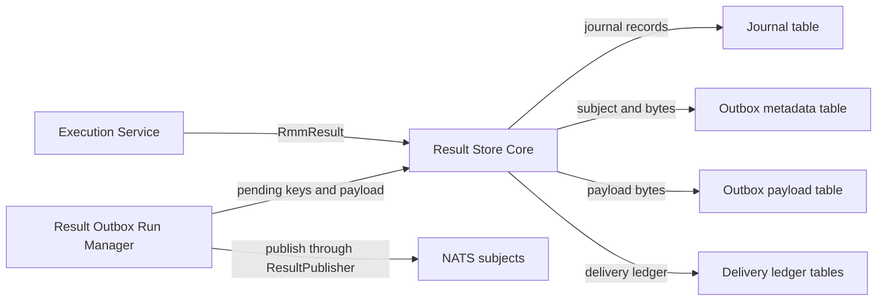
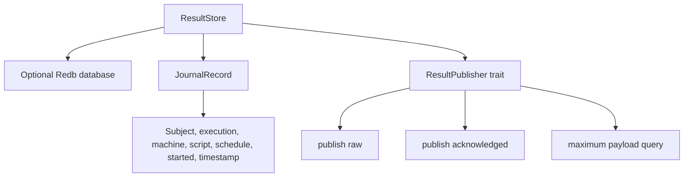
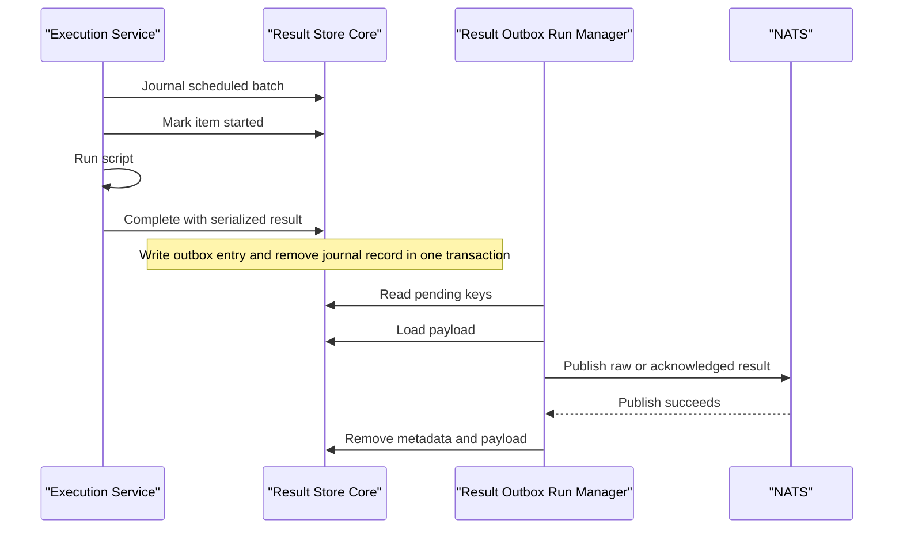
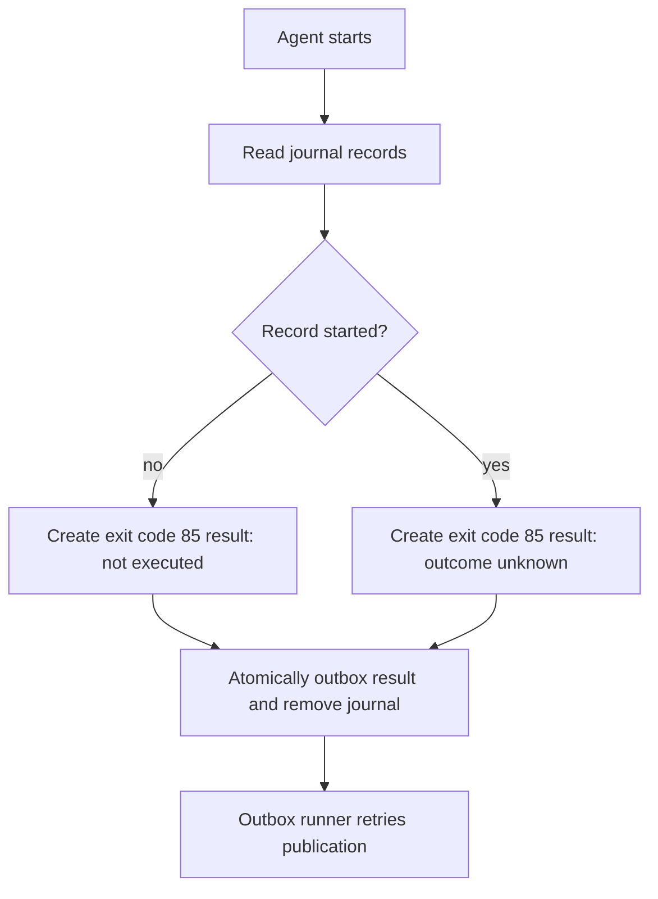
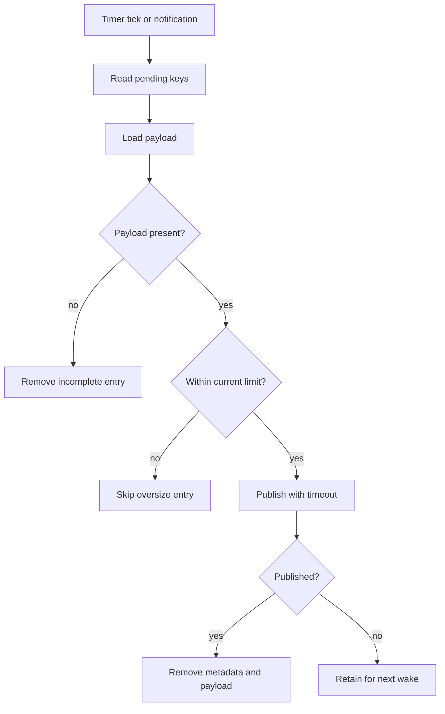

# Result Store Core

Result Store Core is the durable, local outbox for remote-management execution results produced by the OpenFrame client agent. It protects result delivery from network loss and agent restarts: results are serialized, stored locally, retried by the outbox runner, and removed only after publication succeeds. It also journals scheduled-script work before it begins so an interrupted run becomes an explicit failure result after restart rather than disappearing silently.

The implementation is supplied by the `openframe_agent_lib` Cargo dependency from OpenFrame OSS Library. Its source is [result store implementation](https://github.com/flamingo-stack/openframe-oss-lib/blob/16e7c1cbd9664e7d10ec5ebca7d53c9bd314decf/clients/openframe-client/src/services/result_store.rs); this repository runs that library as part of its OpenFrame client service.

## Responsibilities

- Persist outgoing result bytes with their destination subject in a local Redb database.
- Keep a journal of scheduled-script work until its final result has been transferred into the outbox.
- Recover journaled work after restart as a deterministic, non-success result.
- Enforce the configured outbox-entry cap by retaining newer entries and dropping the oldest entries when necessary.
- Bound serialized `RmmResult` payloads to the usable transport size, truncating standard output and then standard error if required.
- Degrade safely to non-durable operation when local storage cannot be opened even after quarantine and recreation.

Result Store Core does not execute scripts or itself communicate with NATS. Execution produces an `RmmResult`; the separate Result Outbox Run Manager reads retained entries and uses a `ResultPublisher` implementation to publish them.

## Architecture and System Position

The three tables owned by Result Store Core separate the durable payload from its metadata:

| Store | Content | Purpose |
| --- | --- | --- |
| Journal | `JournalRecord` serialized as JSON | Records each scheduled-script item before execution, including routing and whether it began. |
| Outbox metadata | Subject and creation timestamp | Lists pending deliveries and provides timestamps for oldest-first pruning. |
| Outbox payload | Serialized result bytes | Stores the exact bytes later sent to the destination subject. |

The same database is also initialized with delivery-ledger tables. Those tables belong to the sibling Result Store Ledger capability, which tracks command delivery state and applied sequences; Result Store Core does not use them while enqueueing and flushing result payloads.

## Component Model

### `ResultStore`

`ResultStore` owns an optional shared Redb database handle. Database work is performed through a blocking task so synchronous Redb transactions do not block the asynchronous runtime. When the handle is absent, durable operations return a durability error; callers can use `enabled` to identify that mode.

`open_or_degrade` establishes the operational policy:

1. Open the database and initialize all tables in one write transaction.
2. If opening fails, rename the database to a file with the `redb.corrupt` extension.
3. Retry creation at the original location.
4. If the retry also fails, retain no database handle and continue without durability.

This makes a corrupt or unusable store observable in logs while preserving agent availability.

### `JournalRecord`

A journal record captures the minimum information required to synthesize an execution result after a restart: the destination subject, execution and machine identities, optional schedule and script identities, a start marker, and creation time. The boolean `started` differentiates a batch item never reached from an item whose outcome was interrupted.

### `ResultPublisher`

`ResultPublisher` abstracts the transport used by the runner. It exposes raw and acknowledged publication methods plus an asynchronous maximum-payload lookup. The outbox runner selects acknowledged publication for subjects that require stream acknowledgement; it uses raw publication for other subjects.

## Result Lifecycle

### Journaling and completion

`journal_batch` writes a set of keyed journal records only if the execution identifier is not already represented in the journal. `entry_key` uses the execution identifier alone when no script identifier is present, otherwise it combines execution and script identifiers. This prevents a duplicate journal batch for the same execution while allowing a batch to represent multiple scripts.

Before an item starts, `journal_mark_started` updates only that existing record. On normal completion, `complete` writes the outbox metadata and payload, then removes the matching journal entry in the same transaction. The atomic transfer prevents a completed result from being left both pending execution and pending delivery.

`enqueue` writes an outbox entry without removing a journal record. It supports producers that need to persist a result independently of the scheduled-script recovery workflow.

### Restart recovery

`recover` processes every remaining journal entry when durable storage is available. It creates an `RmmResult` with exit code `85`, no standard output or standard error, and one of two explicit errors:

- **Not executed:** the agent restarted earlier in the scheduled batch.
- **Interrupted:** the agent restarted after the item was marked started, so the outcome is unknown.

Each synthesized result retains the original execution, machine, script, schedule, and subject routing information. Recovery calls `complete`, placing the synthesized result in the outbox and removing the journal entry atomically.

The adjacent delivery ledger has an analogous restart path for in-flight command deliveries: it settles in-flight records as failed while leaving an awaiting-restart state distinct. That behavior is separate from scheduled-script result recovery.

## Payload Sizing and Encoding

`payload_limit` derives usable bytes from the publisher-reported transport maximum. If the transport does not provide a maximum, it uses the configured fallback. In both cases it subtracts configured headroom before serializing results.

`encode_result` serializes the full `RmmResult` first. If it exceeds the maximum:

1. It sets an error stating that output exceeded the transport-size limit.
2. It repeatedly reduces standard output by approximately one quarter, preserving valid UTF-8 boundaries.
3. Once standard output is empty, it applies the same process to standard error.
4. It returns the first fitting representation, or the last serialized representation when neither output field can be reduced further.

The outbox runner independently compares stored bytes to its current transport limit. An oversize retained entry is skipped rather than allowed to block delivery of later healthy entries. This distinction matters when transport limits decrease after an entry was stored.

## Delivery, Retry, and Retention

The Result Outbox Run Manager starts only when `enabled` confirms that Result Store Core is durable. It wakes on a configured interval or notification, enumerates `pending_keys`, loads each payload, and applies a configured publication timeout. A successful publish triggers `remove`, which deletes both metadata and payload. Failed or timed-out publications remain in the outbox for a later retry.

After `enqueue` or `complete`, Result Store Core enforces the configured maximum entry count. `prune_oldest` reads creation timestamps from metadata, sorts entries oldest first, and removes matching metadata and payload pairs until only the requested newest count remains. It reports the number dropped through warning logs. Retention is therefore bounded, but it is not lossless under prolonged delivery failure or sustained result production.

## Operational Invariants

- **Journal-to-outbox handoff is atomic.** Completion either commits both the outbox write and journal removal or commits neither.
- **Outbox removal is paired.** Metadata and payload are removed together by the store API.
- **Journal batch insertion is idempotent by execution identifier.** A matching execution identifier, including keys prefixed by that identifier and a colon, suppresses reinsertion.
- **Recovered work is represented as failure, not success.** Restart recovery never guesses a successful execution outcome.
- **Durability is optional at runtime.** Failure to initialize local Redb storage disables the durable path and also disables the outbox flusher.
- **Outbox capacity is finite.** New results can cause oldest pending results to be discarded after a successful local write.

## Maintenance Guidance

When changing this module, preserve the relationship between journal and outbox operations. In particular, avoid splitting `complete` into independent commits, because a crash between them could create duplicate recovery failures or lose a finished result. New result fields must remain serializable because outbox payloads are stored as JSON bytes. Any adjustment to result size handling should consider both encoding-time trimming and the runner's delivery-time maximum-payload check.

Operational investigation should begin with agent logs for database-open failures, corruption quarantine, recovery counts, outbox pruning, and publish retries. A growing outbox length indicates that results are being retained faster than their subjects can be successfully published; inspect connectivity and broker payload limits before increasing the retention cap.
