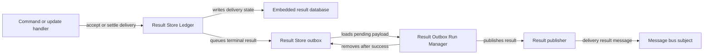
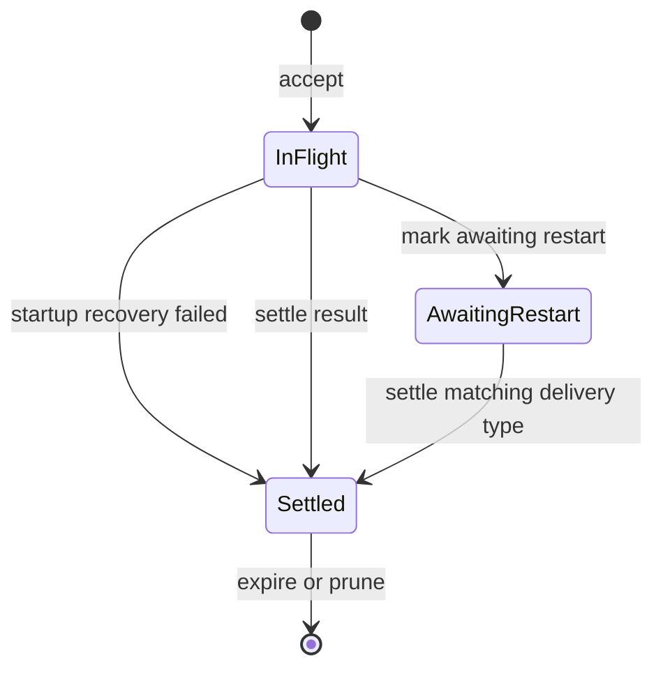
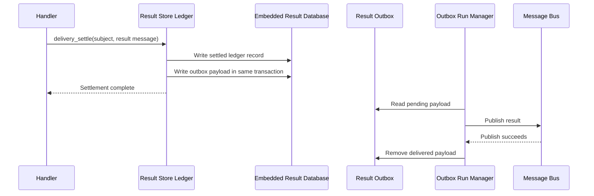
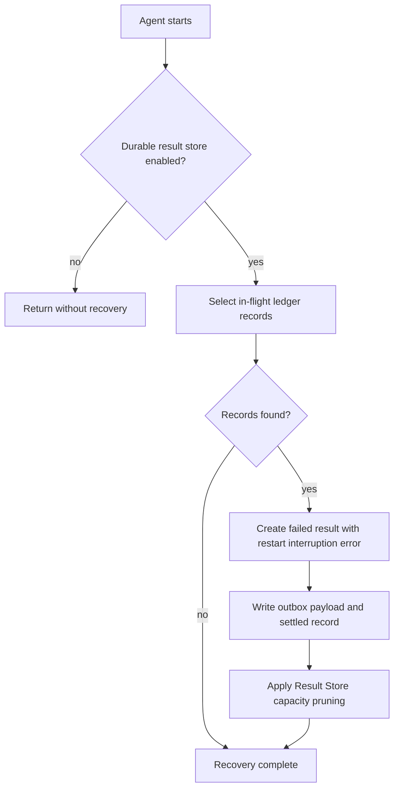
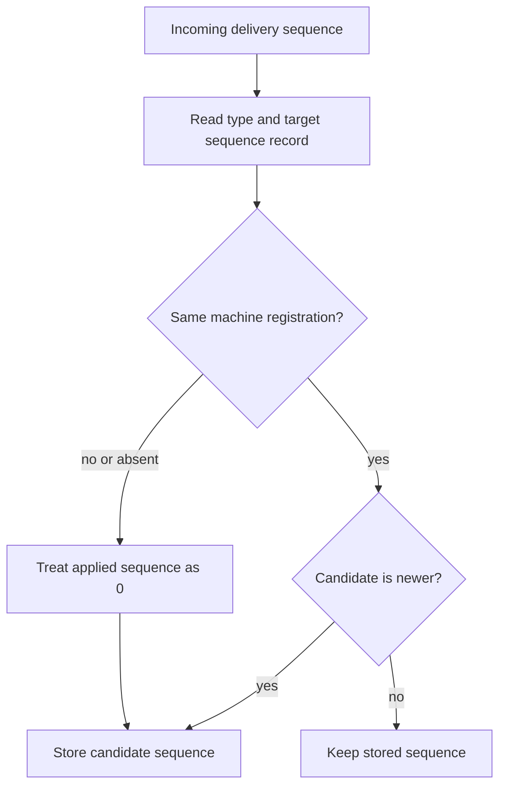

# Result Store Ledger

Result Store Ledger is the durable delivery-state and ordering ledger used by the OpenFrame client agent. It is implemented by the `openframe_agent_lib` dependency from the OpenFrame OSS Library and runs inside this repository's OpenFrame client service. The ledger records a delivery by dispatch identifier, preserves terminal delivery results for later publication, records restart-sensitive work, and tracks the highest applied sequence for a delivery target.

Its purpose is to make result reporting resilient to agent restarts and intermittent message-bus connectivity without treating an interrupted in-flight delivery as successfully completed.

**Source:** [ledger.rs in OpenFrame OSS Library](https://github.com/flamingo-stack/openframe-oss-lib/blob/16e7c1cbd9664e7d10ec5ebca7d53c9bd314decf/clients/openframe-client/src/services/result_store/ledger.rs)

## Responsibilities

- Persist one ledger row per delivery dispatch identifier.
- Represent a delivery as in flight, awaiting an agent restart, or settled with a result message.
- Convert previously in-flight work into failed results during startup recovery.
- Convert matching restart-waiting deliveries into a supplied terminal result.
- Add queued terminal results to the durable Result Store outbox in the same database transaction as their ledger update.
- Retain directly published results in the ledger without adding them to the outbox.
- Enforce monotonic application sequences per delivery type and target, scoped to a machine registration.
- Remove expired terminal records and unreadable records while preserving in-flight records for restart recovery.

## Position in the Client

Result Store Ledger is a focused part of the client-side result pipeline. Command and update handlers determine the operational outcome; the ledger records the delivery lifecycle; the Result Store retains outbound payloads; and the outbox run manager retries publication through the configured publisher.

The Result Store Ledger depends on the Result Store's database access and outbox-writing support. The outbox run manager operates independently after records are queued: it periodically or notification-triggeredly loads pending entries, publishes them, and removes an entry only after a successful publish. The ledger therefore does not itself send network messages.

## Stored Data

The ledger uses two embedded database tables:

| Table | Key | Stored information | Purpose |
|---|---|---|---|
| Delivery ledger | Delivery dispatch identifier | Subject, delivery reference, ledger state, and update time | Recover, query, and settle individual deliveries. |
| Delivery sequence | Delivery type plus target identifier | Registration machine identifier and highest applied sequence | Reject stale or repeated ordered deliveries for the same registration. |

A delivery reference carries a delivery type, target identifier, dispatch identifier, and optional sequence. Result records contain that reference, one of `acked`, `done`, or `failed`, and an optional error.

The outbox key for a delivery result is derived from its dispatch identifier. This makes the outbox entry correspond to the delivery being settled rather than to an arbitrary retry attempt.

## Delivery State Model

`LedgerState` has three persisted states:

| State | Meaning | Recovery and transition behavior |
|---|---|---|
| `in_flight` | The agent accepted the delivery and has not produced a terminal result. | Startup recovery turns it into a queued failed result with the error `interrupted by agent restart`. It is deliberately not expired by routine ledger pruning. |
| `awaiting_restart` | The delivery was in flight and is intentionally waiting for a restart-related outcome. | A matching settlement operation produces the supplied result, queues it, and transitions it to `settled`. |
| `settled` | A terminal result message was recorded. | It may be queued for durable publication or retained only as a direct-publication record. It becomes eligible for time-based pruning. |

The state machine expresses durable bookkeeping, not execution progress. In particular, accepting a delivery only writes the supplied state. The component does not execute the delivery and does not infer whether a remote operation has completed.

## Core Operations

### Accept and Inspect a Delivery

`delivery_accept` writes or replaces the ledger record for a delivery. The caller supplies the message subject, delivery reference, and initial ledger state; the ledger stamps the record with the current time. `delivery_state` reads a dispatch identifier and returns its current state when the record is readable.

Moving to restart-waiting state is intentionally guarded: `delivery_await_restart` changes only an existing `in_flight` record. Missing records and records already in another state are left unchanged.

### Settle and Record Outcomes

`delivery_settle` persists a terminal result message as `settled` and queues the serialized result into the outbox in the same write transaction. It then asks the Result Store to enforce its overall capacity policy.

`delivery_record` stores the same terminal ledger state but does **not** create an outbox entry. It is intended for a result already published directly, allowing repeats to be recognized without unnecessarily replaying that result.

`delivery_settle_awaiting_restart` finds every `awaiting_restart` record whose delivery type matches the requested type. Each selected row receives a result message with the supplied result and optional error, is transitioned to `settled`, and is queued for publication. The operation returns the delivery references it settled so its caller can correlate the restart outcome.

## Restart Recovery

At startup, `recover_deliveries` performs a targeted reconciliation when durable storage is enabled:

1. It scans the delivery ledger for `in_flight` records.
2. For each selected record, it creates a `failed` delivery result with the error `interrupted by agent restart`.
3. It transactionally queues that result and replaces the ledger state with `settled`.
4. After a non-empty recovery, it invokes Result Store capacity pruning and logs the number of recovered deliveries.

This policy makes interrupted accepted deliveries visible to the server instead of silently dropping them or assuming they succeeded. A delivery already marked `awaiting_restart` is not selected by generic startup recovery; it is settled only through the restart-specific operation.

## Sequence Tracking and Idempotency

Some deliveries include an ordering sequence. The ledger exposes `applied_sequence` and `record_applied_sequence` to make delivery application monotonic for a delivery type and target.

- The lookup key is the concatenation of delivery type and target identifier.
- A stored sequence is valid only when its machine identifier matches the current registration's machine identifier.
- If no matching registration record exists, `applied_sequence` returns `0`; callers can therefore accept any sequence under a new registration.
- `record_applied_sequence` only overwrites storage when the candidate sequence is strictly newer than the stored sequence for the same machine identifier.
- A sequence stored for a different registration does not block recording a new sequence for the current registration.

The component provides the persistence and comparison boundary only. The receiving handler is responsible for deciding how the returned applied sequence affects message acceptance.

## Retention, Compatibility, and Failure Behavior

Before settled rows are written or bulk-settled, the ledger prunes expired records. A non-in-flight record expires when the time since its last update exceeds the configured delivery-ledger time-to-live. In-flight records are explicitly retained, ensuring a later restart recovery can report their interruption.

Ledger records are JSON encoded. An unreadable entry, such as one written by a newer agent version before a rollback, is treated as absent when read and logged as a warning. During pruning, unreadable entries are removed. This favors continued agent operation and avoids blocking the entire ledger because one incompatible row cannot be decoded.

All mutation paths use a single embedded-database write transaction for related state changes. In particular, the terminal ledger update and its queued outbox payload are committed together, reducing the risk of a terminal state with no durable publication record.

## Operational Notes

- The ledger is inactive when the underlying Result Store is not durable. Recovery and restart-specific bulk settlement then return no recovered deliveries rather than attempting storage access.
- Result publication is asynchronous and can be retried by the outbox manager. A settled ledger entry means the result is durably recorded for delivery, not necessarily that the server has received it.
- If an outbox payload exceeds the publisher's permitted payload size, the outbox manager leaves it pending and logs a warning so it cannot be mistaken for successful delivery.
- Preserve the distinction between `delivery_settle` and `delivery_record` when changing callers. The former queues a result for delivery; the latter deliberately does not.
- Preserve the registration-aware sequence behavior when modifying delivery identifiers or re-registration flows, otherwise an old registration could incorrectly suppress work for a new one.

## Maintenance Checklist

When changing Result Store Ledger behavior:

1. Review every state transition for restart safety and whether it must queue an outbox result.
2. Keep terminal-state and outbox-payload writes in one transaction.
3. Do not prune `in_flight` entries through normal time-based retention.
4. Maintain forward and rollback compatibility for persisted JSON records.
5. Verify sequence updates remain monotonic for the same machine identifier and reset naturally for a changed registration.
6. Validate both recovery paths: ordinary startup recovery for `in_flight` work and type-specific settlement for `awaiting_restart` work.
