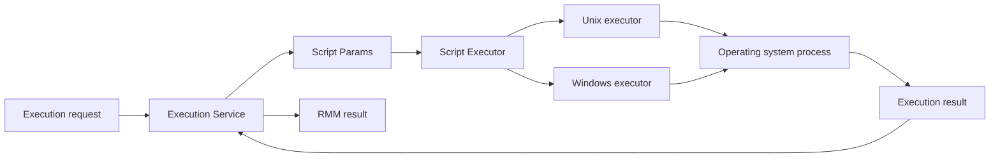
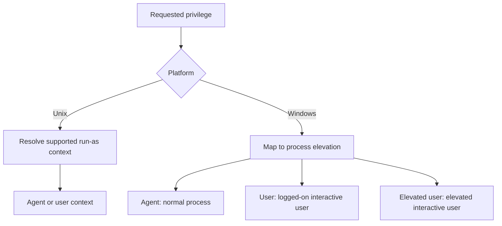
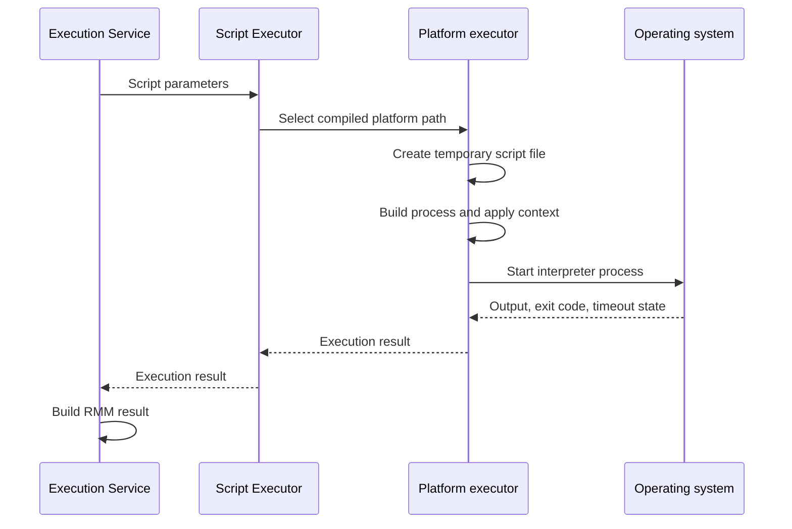
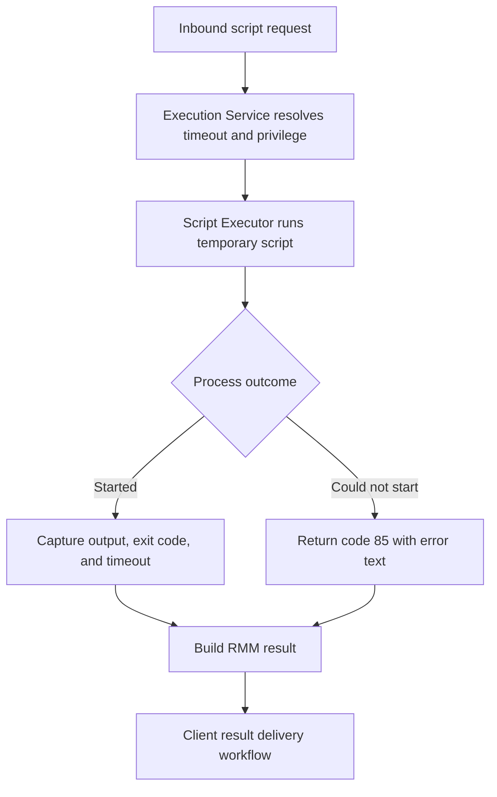

# Script Executor

The Script Executor is the operating-system boundary used by the OpenFrame client agent to run a received script and normalize its outcome. It is implemented by the `openframe_agent_lib` Cargo dependency from [OpenFrame OSS Library](https://github.com/flamingo-stack/openframe-oss-lib/blob/16e7c1cbd9664e7d10ec5ebca7d53c9bd314decf/clients/openframe-client/src/executor/mod.rs), which this repository consumes at version `v0.0.5`.

Its public contract is deliberately small: callers supply script text, a shell name, arguments, timeout, requested privilege, and environment-variable entries. The platform-specific executor runs the script and returns captured standard output, standard error, an exit code, and a timeout indicator. The owning execution service turns that result into the RMM result sent through the agent workflow.

## Responsibilities

- Provide one platform-selected `execute_script` entry point for Unix and Windows builds.
- Carry execution input through `ScriptParams` without embedding transport or scheduling concerns.
- Represent the target context with `Privilege`.
- Produce an `ExecResult` whether execution succeeds, times out, or fails before the script starts.
- Isolate shell selection, temporary-file handling, process configuration, and cleanup in operating-system implementations.

The module does not decide whether a request is authorized, persist results, or publish them. Those responsibilities are upstream and downstream of the executor.

## Module Boundary

At compile time, conditional Rust modules select the implementation:

- Unix builds expose the Unix executor and its console-user detection helper.
- Windows builds expose the Windows executor and helpers that report whether elevation is unavailable or a console user is present.
- Other target platforms are not handled by this module. The client `ExecutionService` instead returns an unsupported-platform RMM result with exit code `85`.

## Core Data Contract

The [executor module source](https://github.com/flamingo-stack/openframe-oss-lib/blob/16e7c1cbd9664e7d10ec5ebca7d53c9bd314decf/clients/openframe-client/src/executor/mod.rs) defines the following types.

| Type | Purpose | Key contents |
|---|---|---|
| `Privilege` | Selects the runtime identity/context for the process. | `Agent`, `User`, and Windows-only `ElevatedUser`. |
| `ScriptParams` | Borrowed input passed to the selected executor. | Script code, shell, arguments, timeout in seconds, privilege, and environment-variable entries. |
| `ExecResult` | Platform-neutral process outcome. | Captured standard output, captured standard error, integer return code, and `timed_out`. |

`ScriptParams` borrows its string data and argument lists. Consequently, the caller owns the request data for the duration of execution; the executor does not define a persisted script representation.

### Privilege Semantics

On Windows, the implementation maps `Agent` to a normal process. It maps `User` to the logged-on interactive user and `ElevatedUser` to an elevated interactive-user process. On Unix, the implementation first resolves the requested run-as context; an inability to do so returns a startup-style error result rather than attempting the command.

The upstream execution model separately represents script shell choices and requested user or administrator levels. `ExecutionService` resolves that request-level policy into this module's `Privilege` value before invoking the executor.

## Execution Paths

### Unix

The [Unix implementation](https://github.com/flamingo-stack/openframe-oss-lib/blob/16e7c1cbd9664e7d10ec5ebca7d53c9bd314decf/clients/openframe-client/src/executor/unix/mod.rs) performs this sequence:

1. Resolve the run-as context from the requested privilege. Failure immediately becomes an execution result.
2. Normalize script line endings.
3. Create a temporary script file associated with the resolved context and install a guard to remove it when the function scope ends.
4. Build the interpreter command with the temporary file and supplied arguments.
5. Apply the supplied environment-variable entries to that command.
6. Configure process execution before launch. Configuration errors also become execution results.
7. Run the command with the requested timeout.

### Windows

The [Windows implementation](https://github.com/flamingo-stack/openframe-oss-lib/blob/16e7c1cbd9664e7d10ec5ebca7d53c9bd314decf/clients/openframe-client/src/executor/windows/mod.rs) takes a platform-specific path:

1. Resolve the requested shell. Only `powershell` and `cmd` are accepted by this implementation; any other value returns an error result.
2. Map the privilege to no elevation, logged-on-user execution, or elevated-user execution.
3. Write the script to a temporary file using the selected interpreter extension, with a scope guard for cleanup.
4. Wait for the temporary file to become readable. A still-locked file produces an error result.
5. Execute as a normal process for agent privilege, or invoke the interactive-user runner for user-oriented privileges.

## Integration with the Client Agent

The executor is called by the OpenFrame client library's `ExecutionService`. Before calling it, that service increments its active-execution tracking, records the start time, selects a default timeout of `900` seconds when the incoming timeout is zero, and caps nonzero values to a `u32` number of seconds.

After the platform executor returns, the service creates an RMM result containing:

- The execution and machine identifiers.
- Captured standard output and standard error.
- The exit code and elapsed execution time.
- The timeout flag.
- Optional script and schedule identifiers.

Exit code `85` has a special meaning at this boundary: the service treats it as a script-start failure, logs a warning, and copies standard error into the RMM result's optional error field. This behavior also covers unsupported platforms in the service implementation.

The executor's result is therefore a local execution artifact, not the final delivery protocol. The surrounding client agent is responsible for receiving the execution request and for storing or publishing the resulting RMM message.

## Operational and Security Considerations

- **Interpreter allowlist on Windows:** the Windows path rejects unsupported shell identifiers before creating a process. Maintain alignment between request-model shell values and the platform implementation when adding shell support.
- **Privilege is behavior-changing:** a `User` or `ElevatedUser` request may require an interactive console session. Callers should expect startup failure information when the requested context cannot be established.
- **Timeouts are explicit:** a timeout produces an `ExecResult` with `timed_out` set. Consumers must use that field rather than infer a timeout solely from output or exit code.
- **Temporary script material:** both implementations write script contents to temporary files and protect cleanup with a guard. Changes to process launch must preserve cleanup across success and failure paths.
- **Environment and arguments:** Unix explicitly applies supplied environment-variable entries and passes supplied arguments when building the command. Treat both as execution input, not as trusted metadata.
- **Output handling:** standard output and standard error are returned as strings. The executor does not redact, persist, or transmit them.

## Maintenance Guide

When modifying Script Executor behavior:

1. Keep `ScriptParams` and `ExecResult` platform-neutral unless a field is inherently platform-specific.
2. Preserve the `85` startup-failure convention or update the consuming execution service in the same change.
3. Implement equivalent lifecycle guarantees across Unix and Windows: validate launch prerequisites, create a temporary script, run with timeout controls, and clean up the file.
4. Review privilege mappings separately for each platform; adding a request-level privilege does not automatically make it executable everywhere.
5. Validate shell behavior per platform. A shell accepted by the request model is not necessarily supported by each executor.

## Source Ownership

Although this repository assembles and runs the OpenFrame client agent, Script Executor source is supplied by the OpenFrame OSS Library through the `openframe_agent_lib` dependency. The authoritative implementation is the library source linked above; application-level execution orchestration resides in the same client library's execution service.
