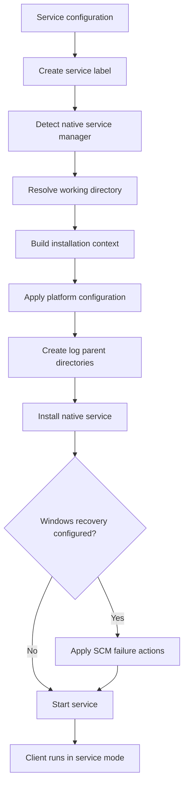
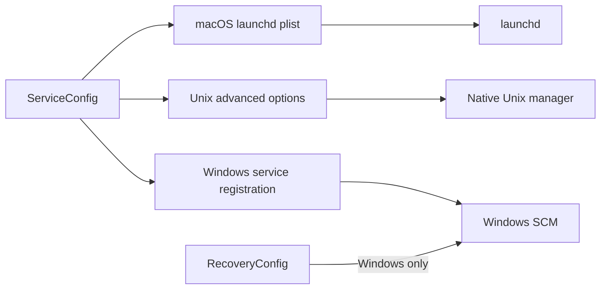
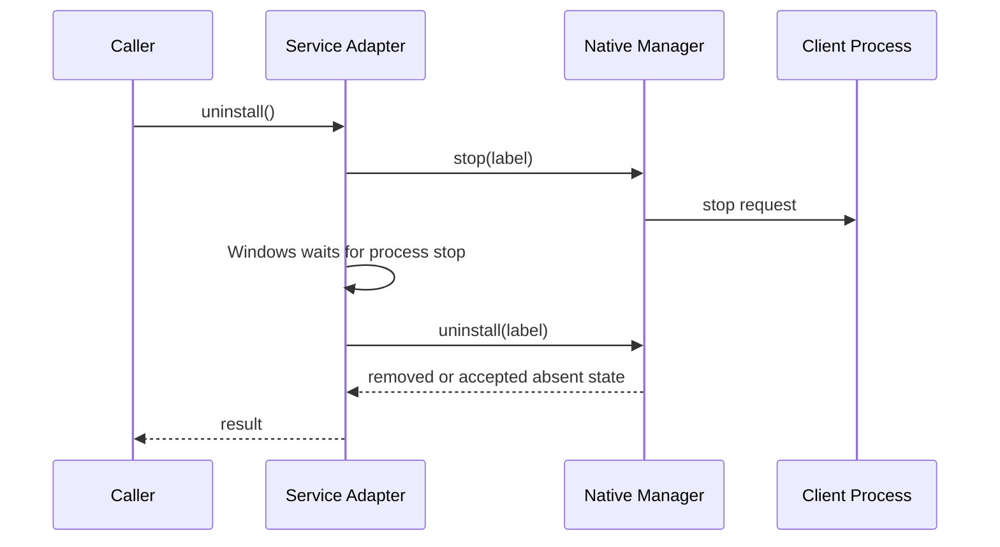

# Service Adapter

Service Adapter is the OpenFrame Client component that installs and controls the client as an operating-system service. It turns one portable configuration into a native service definition, launches the executable with the `run-as-service` argument, and provides a consistent install, start, stop, and uninstall lifecycle across macOS, Linux, and Windows.

The implementation belongs to the `openframe_agent_lib` Cargo dependency supplied by [OpenFrame OSS Library](https://github.com/flamingo-stack/openframe-oss-lib/blob/7a766f00e4f58b5d89db007b878ac8d6e0c344f4/clients/openframe-client/src/service_adapter.rs). This repository runs that library as part of its OpenFrame Client distribution; Service Adapter is not a network-facing service or an API endpoint.

## Responsibilities

- Build a stable, platform-independent service configuration.
- Derive the native label `com.openframe.<lowercase-name>` used for lifecycle operations.
- Select the native manager through the Rust `service-manager` abstraction.
- Install the configured executable with `run-as-service` and optionally autostart it.
- Render macOS launchd configuration, provide Linux service options, and configure Windows SCM recovery actions when requested.
- Create parent directories for configured standard-output and standard-error files before installation.
- Stop the service before removal and tolerate Windows states that mean it is already being removed or is absent.

## Position in the Client Runtime

The client service layer requests installation, removal, or execution. Service Adapter owns only the operating-system registration and lifecycle boundary. Once the service manager starts the program, the client process enters its service-mode runtime; its authentication, message handling, tool operations, logging, and telemetry remain responsibilities of other client components.

## Core Types

### CrossPlatformServiceManager

`CrossPlatformServiceManager` contains a public `ServiceConfig` and exposes the lifecycle API:

| Operation | Behavior |
|---|---|
| `new` | Creates a manager from the service name, display name, description, and executable path, then applies defaults. |
| `with_config` | Creates a manager from a complete caller-provided configuration. |
| `install` | Detects the native manager, constructs the installation context, applies platform-specific options, creates configured log directories, installs, optionally applies Windows recovery, then starts the service. |
| `start` | Starts the native service identified by the derived label. |
| `stop` | Stops the native service identified by the derived label. |
| `uninstall` | Attempts to stop the service, waits for termination on Windows, removes the native registration, and treats Windows error codes 1072 and 1060 as already removed states. |

The manager recreates its label for each lifecycle operation. Consequently, the configured `name` must remain stable from installation through start, stop, and removal.

### ServiceConfig

`ServiceConfig` is the portable input model. Its defaults favor a long-running client: load at startup, keep the service alive, restart after a crash, use a ten-second restart throttle, and mark the process as interactive. The service name, display name, description, and executable path are initialized by `new`; a caller supplying `with_config` is responsible for all required values.

| Configuration area | Fields | Purpose |
|---|---|---|
| Identity | `name`, `display_name`, `description`, `exec_path` | Identify the service and select its executable. The label uses only the lowercased name. |
| Startup and recovery | `run_at_load`, `keep_alive`, `restart_on_crash`, `restart_throttle_seconds` | Control autostart and restart behavior. Platform support differs as described below. |
| Process environment | `working_directory`, `environment_vars` | Set the launch directory and environment passed to the installation context. When omitted, the working directory defaults to the client application-support directory. |
| Logging | `stdout_path`, `stderr_path` | Configure destination files where the target platform supports the selected options. Their parent directories are created before installation. |
| Execution identity | `user_name`, `group_name` | Configure an explicit service account or group where supported. If no user is supplied, the adapter defaults to `root` on macOS and Linux, and `LocalSystem` on Windows. |
| Resource and shutdown controls | `file_limit`, `exit_timeout_seconds` | Carry file-descriptor and shutdown-timeout settings for applicable platform definitions. |
| macOS process class | `is_interactive` | Requests the `Interactive` process type in the generated launchd plist when true. |
| Windows recovery | `recovery` | Optionally carries Windows SCM failure-action settings. |

### RecoveryConfig

`RecoveryConfig` is used only on Windows after the service is installed. It defines restart delays for the first, second, and later failures, a reset period expressed in days, and whether SCM should also apply the actions to non-crash failures. The adapter installs three restart actions and converts the reset period to seconds before configuring SCM.

## Configuration API

The manager has fluent mutators that update `ServiceConfig` and return the same mutable manager:

| Method | Updated setting |
|---|---|
| `set_stdout_path` | Standard-output file path |
| `set_stderr_path` | Standard-error file path |
| `set_working_directory` | Service working directory |
| `set_user` | Service user name |
| `set_group` | Service group name |
| `set_restart_throttle` | Delay between restart attempts |
| `set_file_limit` | File-descriptor limit |
| `set_exit_timeout` | Allowed shutdown duration |

These setters do not validate that a supplied user, group, executable, or path exists. Installation is the point at which the selected native service manager and operating system enforce applicable requirements.

## Installation Flow

Service Adapter performs installation as an ordered process. Failure in a required step returns an `anyhow::Result` with contextual error text; the automatic start is part of a successful installation, so a start failure causes `install` to fail after registration has already been attempted.

The installation context always uses the configured executable as the program and provides `run-as-service` as its sole argument. It includes the effective working directory, copied environment-variable pairs, the effective user name, autostart flag, and a restart policy. Windows sets the generic restart policy to `Never`, because the adapter configures restart behavior separately through SCM recovery actions. Other platforms use an on-failure policy when `restart_on_crash` is enabled.

## Native Platform Behavior

### macOS

On macOS, Service Adapter serializes a launchd plist and places it in the installation context. The plist contains the label, executable and `run-as-service` program arguments, `RunAtLoad`, and a keep-alive dictionary that does not restart after a successful exit but does restart after a crash.

When configured, the plist additionally includes standard-output and standard-error paths, a soft number-of-files limit, interactive process type, restart throttle interval, exit timeout, user, group, and working directory. If no exit timeout is supplied, the plist uses ten seconds. The adapter also sets `AbandonProcessGroup` to false.

### Linux and other non-macOS Unix platforms

For non-macOS Unix platforms, the adapter creates a JSON object of advanced options only when at least one applicable option is configured. It can include file-based standard output or error paths, `LimitNOFILE`, and on-failure restart behavior with `RestartSec`. The generic installation context still conveys service label, executable, `run-as-service` argument, user, working directory, environment, autostart, and restart policy.

The adapter currently has no dedicated non-macOS Unix handling for group assignment, exit timeout, or interactive process type in this advanced-options payload. Consumers should not assume every portable field produces an identical native setting on every platform.

### Windows

Windows uses the native manager for installation and lifecycle actions. The generic restart policy is deliberately disabled because the adapter applies SCM failure actions after installation when `RecoveryConfig` is present. Those actions restart the service after each configured delay for the first, second, and subsequent failures. The optional non-crash setting enables SCM recovery for non-crash failures as well.

During uninstall, the adapter first requests a stop, then polls for up to 60 seconds until the service process is no longer reported as running. A failure to stop cleanly is logged as a warning rather than immediately preventing removal. Error code 1072, already marked for deletion, and error code 1060, service absent, are accepted as successful removal outcomes.

## Lifecycle Interactions

The uninstall path is intentionally defensive: it calls `stop`, logs rather than propagates an inability to stop, performs Windows-only termination polling, invokes the native uninstall operation, and returns the manager result. The current platform-specific removal hook does not delete log files or other application data; the native manager owns service-definition cleanup.

## Operational Considerations

- **Use a stable name.** The name determines `com.openframe.<lowercase-name>`, which is the identifier used by every lifecycle operation.
- **Treat install and start as one operation.** `install` starts the service immediately after native registration.
- **Provision paths deliberately.** The adapter creates only parent directories for configured log files. It does not validate that the executable, user, group, or destination is usable before invoking the native manager.
- **Account for privileges.** Default identities are privileged system accounts when no user name is specified. Set an explicit account only when the target platform and service manager support it and required file permissions are in place.
- **Expect platform variance.** `ServiceConfig` is a shared model, not a guarantee that every field maps to each operating system. Verify generated native service definitions on the target platform.
- **Configure Windows recovery explicitly.** Windows restart actions are absent unless `recovery` is supplied. The generic crash-restart field does not substitute for SCM failure actions on Windows.

## Source and Ownership

Service Adapter is implemented in OpenFrame OSS Library as part of `openframe_agent_lib` version `v0.0.5`, which this repository consumes. The authoritative source is [service adapter implementation](https://github.com/flamingo-stack/openframe-oss-lib/blob/7a766f00e4f58b5d89db007b878ac8d6e0c344f4/clients/openframe-client/src/service_adapter.rs). Changes to service registration semantics should be made and reviewed in that library, then validated against the OpenFrame Client packaging and target operating systems.
