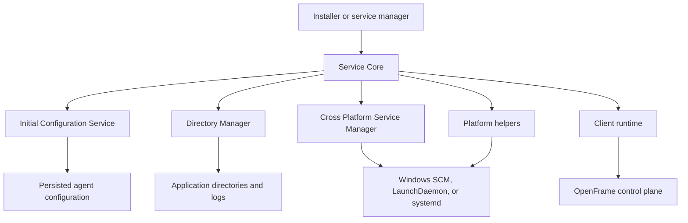
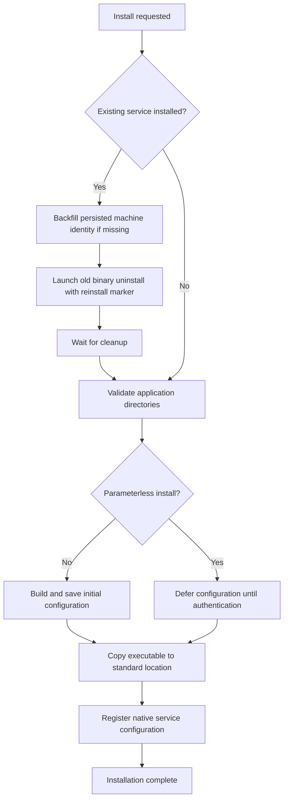
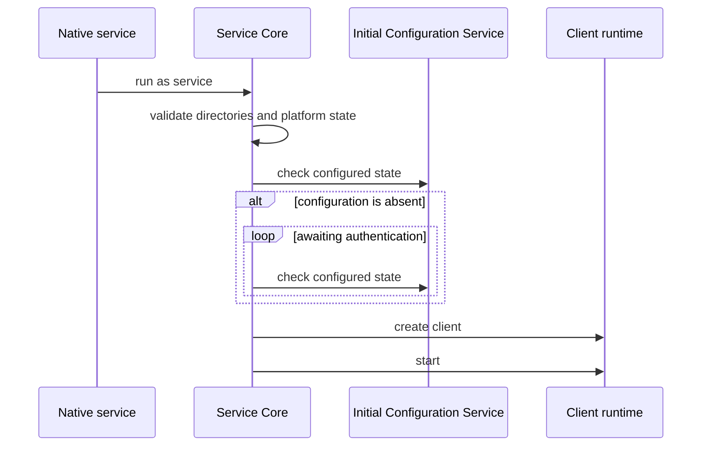
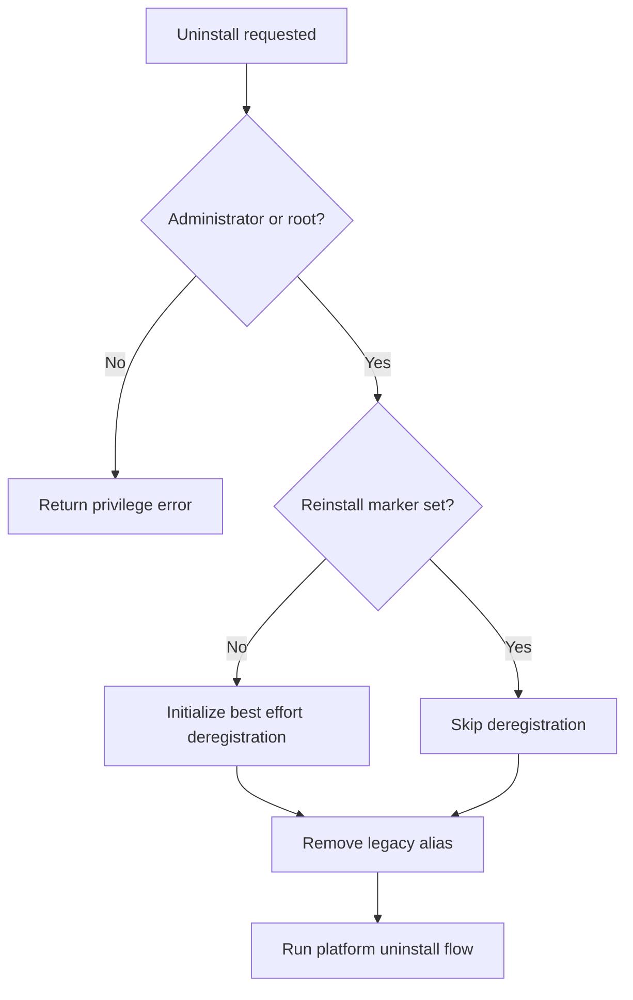

# Service Core

Service Core owns the operating-system service lifecycle for the OpenFrame Client endpoint agent. It installs the client binary and a durable service definition, prepares initial configuration, starts the client runtime, and removes the installation safely. It is implemented by the `Service` type in the OpenFrame OSS Library's [service source](https://github.com/flamingo-stack/openframe-oss-lib/blob/7a766f00e4f58b5d89db007b878ac8d6e0c344f4/clients/openframe-client/src/service.rs), which is assembled into this repository's OpenFrame Client deployment.

The module is deliberately a lifecycle coordinator rather than the remote-management runtime itself. After prerequisites are satisfied, `Service::run` constructs `Client` and awaits `Client::start`; command handling, registration, telemetry, tool management, and message transport are provided by the surrounding client modules.

## Responsibilities

| Area | Service Core responsibility |
|---|---|
| Installation | Detect a prior installation, preserve legacy registration identity where possible, remove the old client, copy the current executable to the standard location, and register the operating-system service. |
| Configuration | Persist supplied installation parameters before service registration, or support a parameterless installation that waits for later authentication. |
| Runtime | Select production or development directories, validate directory health, perform selected platform migrations, wait for configuration when necessary, then start the client runtime. |
| Service control | Provide cross-platform install and uninstall behavior and perform a controlled restart after configuration changes. |
| Platform integration | Use Windows Service Control Manager, macOS LaunchDaemon, or Linux systemd conventions through the service adapter and platform helpers. |

## Module Boundaries

Service Core is one part of the Rust OpenFrame Client. It coordinates the following neighboring concerns without reimplementing them:

- **Installation Initial Configuration Service** translates installation parameters into persisted initial configuration.
- **Directory Manager** determines application, secured, logging, and update locations and verifies they are usable.
- **Cross Platform Service Manager** creates, starts, stops, and removes native service definitions.
- **Agent Configuration, Registration, and Deregistration Services** retain registration credentials and report removal when appropriate.
- **Client Main API** owns the running agent after Service Core has completed its startup gate.
- **Platform uninstall and system service helpers** implement platform-specific cleanup and native service operations.

The service definition uses the identifier `com.openframe.client` across platforms, while the logical short service name is `client`. Its display name is OpenFrame Client Service.

## Architecture

At installation time, Service Core writes configuration and makes the executable available at the platform's standard installation path. At runtime, the native service invokes the executable, which calls Service Core again in service mode. The module then validates local state and hands control to the client runtime.

## Standard Installation Locations

| Platform | Executable location | Native service model |
|---|---|---|
| Windows | The client installation directory, under `bin/openframe-client.exe` | Windows Service Control Manager |
| macOS | `/usr/local/bin/openframe-client` | LaunchDaemon |
| Linux | `/usr/local/bin/openframe-client` | systemd unit |

On Unix-like platforms, a copied executable is assigned mode `0755`. On Windows, installation also attempts to add the executable directory to the machine PATH while preserving the existing registry value type, then broadcasts the environment-change notification.

## Installation Flow

`Service::install` accepts `InstallConfigParams` and runs asynchronously. The operation is designed for upgrades as well as fresh installations.

### Upgrade and Identity Preservation

When an existing service is found, Service Core first reads persisted registration credentials. Older clients may not have written the machine information store, so the module tries to retrieve a machine identifier and client secret from the existing agent configuration and persists them before uninstalling. This protects the identity needed by a later deregistration path.

The prior executable is run with the `OPENFRAME_REINSTALL` marker set. That marker instructs uninstall behavior not to deregister the endpoint merely because it is being replaced. A non-success exit from the old uninstall is logged, but installation continues. The workflow also waits briefly for deferred cleanup to finish.

### Binary Replacement

If the running executable is not already at the standard location, Service Core creates the parent directory and copies the executable. If the target is busy, it identifies and terminates leftover processes whose executable path exactly matches the target, retries the copy, and, as a final fallback, temporarily moves the old binary aside before attempting the replacement. A failed final copy restores the moved binary when possible and returns an error.

### Native Service Configuration

The registered service is configured to load automatically, stay alive, restart after crashes, use the application-support directory as its working directory, and write daemon output and error logs in the managed logs directory. The configured account is LocalSystem on Windows and root on macOS and Linux. The module sets a file limit of 4096 and an exit timeout of 10 seconds.

The recovery policy restarts the service after failures with delays of 10 seconds, 60 seconds, and then 300 seconds. Its failure counter resets after one day of clean operation, and recovery is enabled for non-crash failures as well.

## Runtime Startup and Authentication Gate

`Service::run` is the common runtime path. In normal operation it uses the system directory layout; with `OPENFRAME_DEV_MODE` set, it uses development directories instead. The runtime checks directory health before it creates the client, warns if it cannot write system logs, and performs Windows path repair plus Apps and Features refresh where applicable.

A parameterless installation intentionally does not crash-loop before an administrator performs authentication. The initial configuration is read before creating `Client`. If it is absent, Service Core polls at the configured awaiting-authentication interval until configuration appears. Only then does it construct the client and call `Client::start`.

## Running Under Native Service Managers

`Service::run_as_service` selects the platform integration path:

- **Windows:** starts the Service Control Manager dispatcher for `com.openframe.client`. The dispatcher entry point registers STOP and SHUTDOWN controls, reports running state, creates a Tokio runtime, and races the client task against the shutdown signal. It reports either a successful stop or a service-specific failure to the Service Control Manager.
- **macOS and Linux:** creates a Tokio runtime and executes `Service::run` directly. LaunchDaemon or systemd remains responsible for process supervision according to the service definition created by the adapter.

The module warns, but does not immediately refuse to run, when neither service-management nor system-directory write capabilities are available. This allows specialized service accounts to operate where their privileges are sufficient.

## Restarting After Authentication

Configuration is loaded when the client is constructed, so writing a new authenticated configuration does not automatically update an already-running client. `Service::nudge_restart` addresses this by stopping and then starting the installed native service.

The restart is intentionally conservative:

1. If the service is not installed, the method returns successfully without action.
2. If stopping fails, it logs at debug level and leaves the service running. The waiting startup loop can still discover newly written configuration.
3. If stopping succeeds but starting fails, the method returns an error because an explicitly stopped service will not restart itself.

## Uninstallation Flow

Uninstallation requires administrator or root privileges. Service Core removes a legacy alias before it delegates to the Windows or macOS platform-specific uninstall implementation. Linux uninstall handling is not present in the supplied Service Core implementation, so maintainers should verify the platform support path before treating Linux removal as equivalent to Windows or macOS removal.

During a normal removal, the module creates `DeregistrationService` on a best-effort basis. Initialization errors are logged and do not block local removal. During a reinstall, it skips deregistration altogether to preserve the machine's server-side identity while the binary is replaced.

## Operational Considerations

- **Use privileged installation and removal.** Installation writes system locations and registers a native service; uninstallation explicitly rejects callers without administrator or root privileges.
- **Investigate directory health failures first.** Runtime and installation stop when Directory Manager health checks fail, preventing operation against incomplete or unsafe storage paths.
- **Treat a waiting service as expected after parameterless setup.** The process remains alive until authentication supplies configuration; this is intentional rather than a failed startup.
- **Preserve service identity during upgrades.** The reinstall marker is critical because it prevents a replacement operation from deregistering the endpoint.
- **Expect platform-specific diagnostics.** Service output and error files are configured in the managed logs directory, while native manager status and restart history remain platform-specific.
- **Do not assume a live configuration reload.** Persisting authentication data should be followed by the controlled restart path when an immediate pickup is required.

## Public Surface

| Method | Purpose |
|---|---|
| `Service::new` | Creates the stateless lifecycle coordinator. |
| `Service::is_installed` | Checks for the platform-native service artifact. |
| `Service::install` | Performs upgrade-aware installation and registers the native service. |
| `Service::uninstall` | Performs privileged platform removal and optional best-effort deregistration. |
| `Service::run` | Validates local state, waits for configuration if needed, and starts the client runtime. |
| `Service::run_as_service` | Enters the Windows dispatcher or directly runs the Unix service process. |
| `Service::nudge_restart` | Stops and starts an installed service after configuration changes. |
| `Service::get_install_location` | Returns the OS-specific executable installation path. |

## Relationship to the Tenant Deployment

This repository consumes the `openframe_agent_lib` Cargo artifact from OpenFrame OSS Library at version `v0.0.5` and deploys the OpenFrame Client service as part of the tenant platform. Service Core executes on managed endpoints, not inside the tenant's Kubernetes application pods. Its client runtime communicates with the OpenFrame control plane; the tenant deployment provides the server-side client, gateway, authorization, and related services that receive and manage that endpoint activity.
