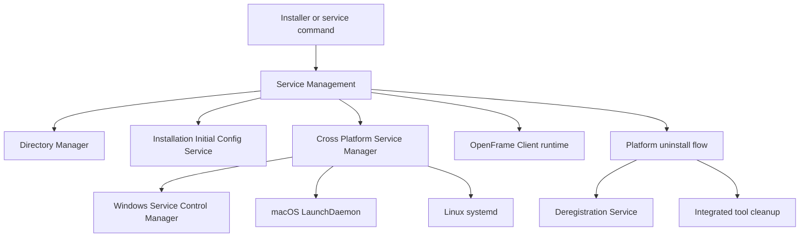
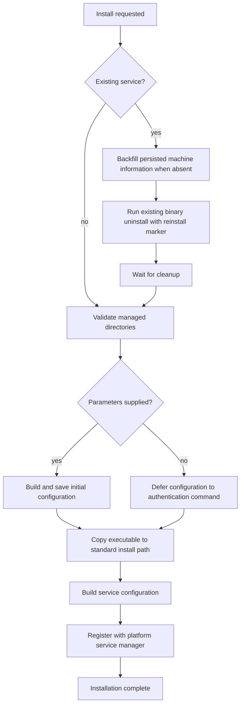
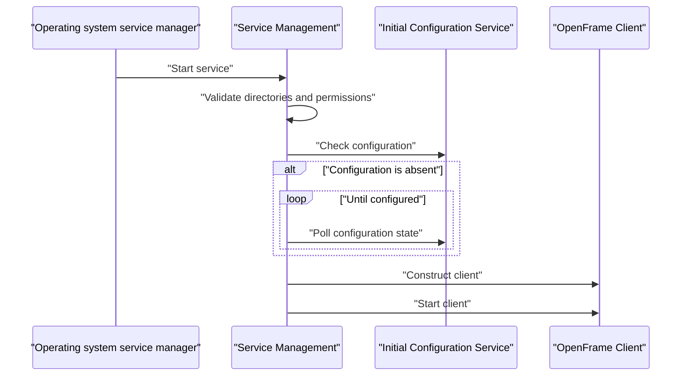
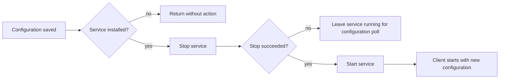

# Service Management

Service Management owns the operating-system lifecycle of the OpenFrame client agent. It installs the executable in its standard location, registers a durable background service, starts the client runtime, handles graceful stop signals, and removes the service and local state during uninstall. The implementation is supplied by the `openframe_agent_lib` crate from [OpenFrame OSS Library service source](https://github.com/flamingo-stack/openframe-oss-lib/blob/16e7c1cbd9664e7d10ec5ebca7d53c9bd314decf/clients/openframe-client/src/service.rs), which this repository consumes at version `v0.0.5`.

The module is the boundary between the agent application and platform service facilities. It provides a consistent identity, `com.openframe.client`, while adapting installation and runtime behavior for Windows Service Control Manager, macOS LaunchDaemons, and Linux systemd.

## Responsibilities

- Detect whether the OpenFrame client service is installed.
- Copy the client executable to a platform-standard location and set Unix executable permissions.
- Validate agent directories before installation and before the runtime starts.
- Write supplied initial configuration, or support a parameterless installation that waits for later authentication.
- Register the service through `CrossPlatformServiceManager` with identity, restart, logging, working-directory, and resource settings.
- Run the async `Client` only after required configuration is available.
- Implement Windows Service Control Manager status reporting and stop handling.
- Restart an installed service after configuration changes.
- Uninstall the operating-system service, deregister the agent when appropriate, remove integrated tools and local files, and clean platform registration.

## Architecture

Service Management is intentionally thin: it composes lower-level directory, permission, configuration, deregistration, platform-uninstall, and service-adapter components rather than implementing their platform details itself.

### Principal components

| Component | Role in Service Management |
|---|---|
| `Service` | Public lifecycle facade. Exposes construction, install-state detection, installation, uninstallation, runtime startup, restart nudging, the install path, and service-mode execution. |
| `CrossPlatformServiceManager` | Receives `ServiceConfig` and performs service registration, start, stop, and removal using the host platform implementation. |
| `ServiceConfig` | Captures service metadata, executable path, start and restart policy, process identity, file and exit limits, working directory, and standard output and error destinations. |
| `RecoveryConfig` | Defines Windows recovery timing: restart after 10 seconds, then 60 seconds, then 300 seconds; reset the failure counter after one clean day; include non-crash failures. |
| `DirectoryManager` | Supplies installation, application-support, and log locations, checks required directories, and is passed to configuration and uninstall services. |
| `InstallationInitialConfigService` | Builds and persists supplied installation configuration before the OS service is registered. |
| `InitialConfigurationService` | Gates client startup after a parameterless installation until the authentication command saves configuration. |
| `DeregistrationService` | Best-effort removal of the agent registration after the background service stops, with a final retry before local cleanup completes. |

## Service identity and configuration

The registered service uses the short name `client` and the full platform identifier `com.openframe.client`. Its displayed name is **OpenFrame Client Service**, and its description identifies it as the remote-management and monitoring client.

During installation, Service Management builds a `ServiceConfig` with these operational settings:

| Setting | Value or behavior |
|---|---|
| Launch behavior | Starts at load, remains alive, and restarts after a crash. |
| Working directory | The application-support directory from `DirectoryManager`. |
| Standard output | `daemon_output.log` below the managed logs directory. |
| Standard error | `daemon_error.log` below the managed logs directory. |
| Restart throttle | 10 seconds. |
| File limit | 4096. |
| Exit timeout | 10 seconds. |
| Interactivity | Enabled in the service configuration. |
| Service account | `LocalSystem` on Windows; `root` and `wheel` on macOS; `root` and `root` on Linux. |

The binary path is `/usr/local/bin/openframe-client` on macOS and Linux. On Windows, it is the managed install directory followed by `bin/openframe-client.exe`.

## Installation flow

The installation procedure is asynchronous because it may invoke an existing executable, wait for cleanup, and coordinate platform work.

### Existing installations and machine identity

If the service is already installed, the module first protects registration continuity. Older clients may lack persisted machine information, so the flow attempts to read registration credentials from agent configuration and writes a `PersistedMachineInfo` record when usable machine ID and client secret values are available. It then launches the installed executable with the `uninstall` command and sets the `OPENFRAME_REINSTALL` marker.

That marker suppresses agent deregistration during replacement. Consequently, an upgrade or reinstall retains the machine identity instead of making the server treat the replacement as a newly deregistered device. A nonzero uninstall status is logged as a warning and installation proceeds; the implementation also waits three seconds for deferred cleanup.

### Executable deployment and registration

After a directory health check, the implementation either saves initial configuration or records that configuration will be provided later. It then copies the running executable to the standard path. If that target is locked, it:

1. Locates and terminates other processes running from the target path, excluding its own process.
2. Retries the copy.
3. If still blocked, moves the old executable aside as an `.exe.old` file, retries the copy, and restores the old file if the final copy fails.

On Unix, it applies mode `0755` to the installed binary. On Windows, it additionally adds the binary directory to the system `PATH`, preserving the existing registry value type and broadcasting the environment-change notification. It registers an Apps and Features entry on a best-effort basis after service installation.

## Runtime startup and service interaction

`run_as_service` selects the host integration. Windows enters the Service Control Manager dispatcher. Unix-like systems create a Tokio runtime and execute `Service::run` directly, with the registered launch mechanism responsible for process supervision.

At runtime, Service Management chooses development-specific user directories only when `OPENFRAME_DEV_MODE` is set; otherwise it uses normal managed directories. It checks log-write capability, validates directory health, performs Windows path migration and Apps and Features refresh when applicable, and removes a legacy alias before constructing the client.

### Awaiting authentication

A parameterless install deliberately does not crash-loop. `Service::run` creates `InitialConfigurationService` and, when the agent has not yet been configured, waits at the configured polling interval. The service does not construct `Client` until configuration appears. This lets an operator install the service first and later run the authentication command with tenant parameters.

### Windows stop semantics

The Windows entry point registers a Service Control Manager handler for stop and shutdown controls. It reports a running status before creating its Tokio runtime, races the client task against a shutdown channel, and finally reports either a successful stopped state or a service-specific failure. The handler accepts interrogation requests and does not claim support for unrelated controls.

## Configuration restart flow

Configuration is read when the client is constructed. `nudge_restart` makes a newly written configuration effective immediately for an installed service.

A failed stop is intentionally non-fatal: the running instance remains available and its awaiting-auth polling can discover configuration. A failed restart after a successful stop is returned as an error because an explicitly stopped service has no automatic mechanism to restart it.

## Uninstallation and deregistration

Uninstallation requires administrative or root privileges. The service determines whether it is a reinstall by checking `OPENFRAME_REINSTALL`: ordinary removal initializes deregistration, while a reinstall skips it to preserve the machine registration.

The platform flow stops and removes the operating-system service before agent deregistration. This ordering prevents a remaining heartbeat from recreating a server-side machine record after deregistration. Both Windows and macOS flows perform best-effort deregistration, uninstall integrated tools, remove logs and application-support directories with retries, remove update artifacts, and make a final deregistration retry before cleanup completes.

| Platform | Additional cleanup shown by the implementation |
|---|---|
| Windows | Unregisters Apps and Features, removes the installation directory from the system `PATH`, and launches a cleanup script to remove the executable after the current process exits. |
| macOS | Attempts direct removal of the installed binary up to three times, then removes sibling binaries and update temporary files. |
| Linux | Installation and service detection support the systemd path. The supplied `Service::uninstall` implementation shows only Windows and macOS platform branches, so Linux removal behavior should be verified before relying on this entry point. |

## Operational constraints and failure behavior

- Directory health failure aborts installation or runtime startup rather than continuing with an invalid filesystem layout.
- Lack of log-write capability produces a warning; it does not by itself prevent startup.
- Installation uses warnings for best-effort work such as machine-information backfill, Windows PATH updates, Apps and Features registration, and an existing uninstall returning a nonzero status.
- Service removal warnings do not prevent later deregistration, integrated-tool cleanup, or local-file cleanup from being attempted.
- The client runtime begins only after configuration exists, protecting parameterless installations from repeated client construction failures.
- Windows recovery policy is configured through the platform adapter; the Windows entry point separately returns a service-specific error if the service core fails.

## Maintenance guidance

When modifying this module, preserve these lifecycle invariants:

1. Persist or recover machine registration information before replacing an older installation.
2. Write initial configuration before registering a configured service; retain the wait state for parameterless installation.
3. Stop the service before deregistration so heartbeat activity cannot recreate the remote record.
4. Keep replacement installs distinct from removal by honoring the reinstall marker.
5. Treat the installed executable as potentially locked, especially during in-place replacement on Windows.
6. Ensure service metadata, log locations, privilege identity, and recovery behavior remain aligned with the platform adapter contract.

Service Management has no child documentation generated in this run. For configuration, authentication, deregistration, directory handling, and platform-specific service mechanics, consult the corresponding OpenFrame client library source modules.