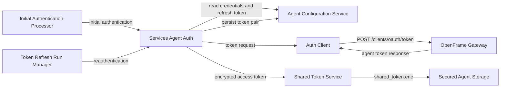
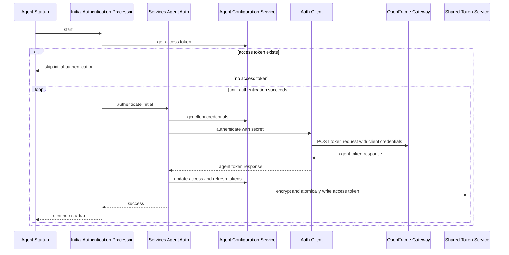
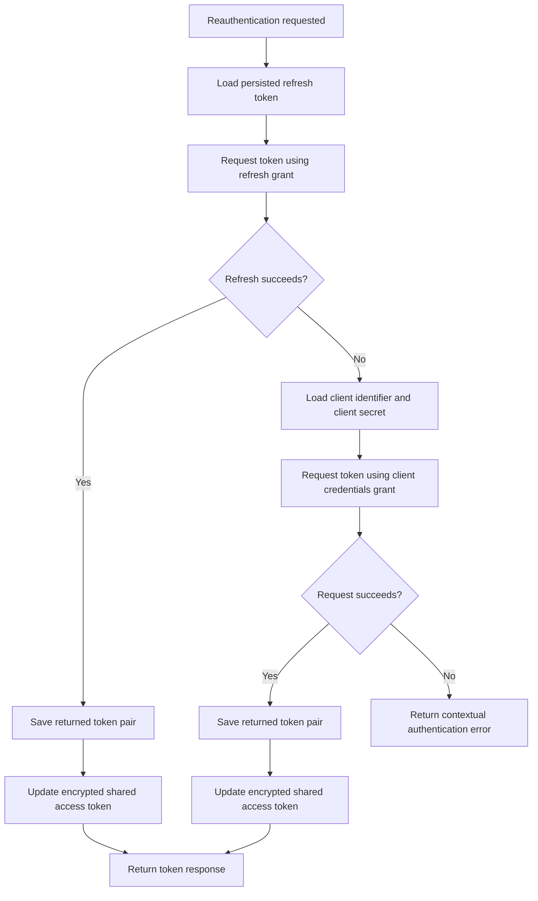
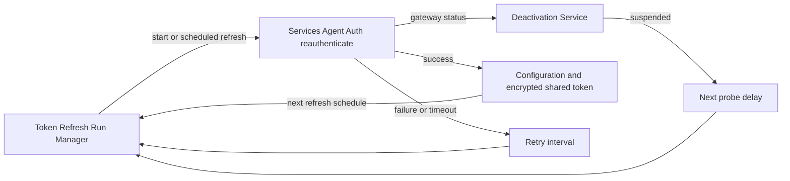

# Services Agent Auth

Services Agent Auth authenticates a running OpenFrame endpoint agent and keeps its credentials current. It is implemented by `AgentAuthService` in the OpenFrame OSS Library's Rust client, which this repository runs through the `openframe_agent_lib` dependency. The service exchanges agent credentials or a persisted refresh token at the tenant gateway, persists the resulting token pair, and writes an encrypted shared access token for local tools.

The implementation source is [agent_auth_service.rs](https://github.com/flamingo-stack/openframe-oss-lib/blob/7a766f00e4f58b5d89db007b878ac8d6e0c344f4/clients/openframe-client/src/services/agent_auth_service.rs).

## Responsibilities

- Perform the first authentication using the agent's persisted client identifier and client secret.
- Prefer refresh-token reauthentication after startup, then fall back to client credentials when a refresh request fails.
- Store the returned access and refresh tokens together in the agent configuration.
- Publish the current access token to an encrypted local shared-token file for dependent local tools.
- Surface contextual errors to callers so the startup and proactive-refresh workflows can retry or report failure.

Services Agent Auth does not register the agent, obtain its initial client credentials, or schedule refreshes. Those concerns are delegated to the registration, configuration, and refresh-runner services in the same OpenFrame client library.

## Position in the Agent

The `AgentAuthService` is constructed with three collaborators:

| Collaborator | Role in Services Agent Auth |
|---|---|
| `AuthClient` | Sends form-encoded OAuth token requests to the configured gateway base URL and reports gateway status to deactivation handling. |
| `AgentConfigurationService` | Reads the persisted client credentials and refresh token, then serializes configuration updates that replace both tokens. |
| `SharedTokenService` | Encrypts the new access token and atomically writes it to `shared_token.enc` in secured agent storage. |

## Authentication Interfaces

`AgentAuthService` exposes two asynchronous operations:

| Operation | Intended use | Credential path | Result |
|---|---|---|---|
| `authenticate_initial` | Bootstrap when no access token is stored | Client identifier and client secret | A new `AgentTokenResponse`, persisted and shared locally |
| `reauthenticate` | Scheduled or recovery refresh | Refresh token first, then client credentials after a refresh failure | A new `AgentTokenResponse`, persisted and shared locally |

The token response contains the access token and refresh token that Services Agent Auth propagates to its two storage targets. Credential values and tokens should not be logged by callers or diagnostics.

## Initial Authentication Flow

The Initial Authentication Processor reads the stored access token before invoking Services Agent Auth. If a nonempty token is present, it skips initial authentication. Otherwise, it repeatedly attempts initial authentication, waiting 60 seconds after a failure.

The underlying `AuthClient` sends the initial request to the configured gateway URL plus `/clients/oauth/token`. It uses form encoding with the `client_credentials` grant type, client identifier, and client secret. A non-success response is returned as an error; the response body is included in the client error for this grant path, so logs and error reporting must treat it as potentially sensitive.

## Reauthentication and Fallback

Reauthentication attempts the stored refresh token before using long-lived client credentials. The refresh request uses the same token endpoint with the `refresh_token` grant type and the persisted refresh token.

A rejected refresh token with HTTP 401 or 403 is explicitly logged as a reason to try client credentials. Other refresh errors receive the `Refresh token flow failed` context before returning to the reauthentication method. In both cases, the current implementation treats the refresh attempt as unsuccessful and continues to the client-credentials fallback. If that fallback also fails, the error is returned to the caller.

## Token Persistence and Local Sharing

Every successful grant reaches the same save routine, in this order:

1. `AgentConfigurationService.update_tokens` updates access and refresh tokens while holding its write lock, preventing concurrent read-modify-write operations from dropping fields.
2. `SharedTokenService.update` encrypts the access token and atomically writes `shared_token.enc` under the secured directory.
3. The original token response is returned to the calling workflow.

This ordering means the configured token pair is already updated if the encrypted shared-token write fails. The operation then returns an error, allowing the caller to retry and restore the token file. Consumers that depend on the shared token should only proceed after Services Agent Auth reports success.

## Proactive Refresh Integration

The Token Refresh Run Manager owns the recurring lifecycle. It immediately calls `reauthenticate` once at startup because it does not rely on the device clock to infer the stored token's remaining lifetime. After successful refresh, it derives the next schedule from the received token response and reports that the shared token file has been updated.

On a refresh error or timeout, the manager retries after its configured retry interval. It also cooperates with deactivation handling: while the agent is suspended because a tenant is unavailable, the manager waits for the next probe delay and uses reauthentication as the recovery probe.

## Gateway and Deactivation Behavior

The Auth Client reports every token endpoint HTTP status to `DeactivationService.on_gateway_status` before deciding whether the response is successful. This couples authentication traffic to the agent's tenant-availability state: gateway status can suspend normal activity or allow recovery according to the deactivation service policy. Services Agent Auth itself does not interpret those states; it delegates status observation to the Auth Client and retry timing to the refresh manager.

## Failure Boundaries and Operational Notes

- Missing or unreadable credentials, refresh tokens, or configuration produce errors before a gateway request can be made.
- Transport failures and malformed token responses are returned with context from the Auth Client.
- Any unsuccessful refresh attempt triggers a client-credentials fallback; a successful fallback rotates both locally persisted tokens.
- Initial authentication retries are owned by the Initial Authentication Processor. Proactive-refresh retries and request timeouts are owned by the Token Refresh Run Manager.
- Persistent failure leaves the most recently stored token data in place. The service does not clear credentials or tokens on failure.
- The encrypted shared token is written atomically, limiting consumers' exposure to partially written token data.

## Source and Runtime Ownership

Services Agent Auth is library code from the OpenFrame OSS Library, consumed in this repository through the Rust `openframe_agent_lib` artifact. The tenant repository supplies the surrounding OpenFrame deployment, including the gateway route that exposes the client service path, while the endpoint client executes this service on managed devices. The library version is pinned by this repository's dependency set; consult the build manifests for the effective release used by a deployment.
